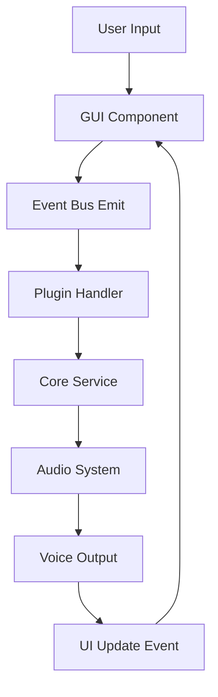
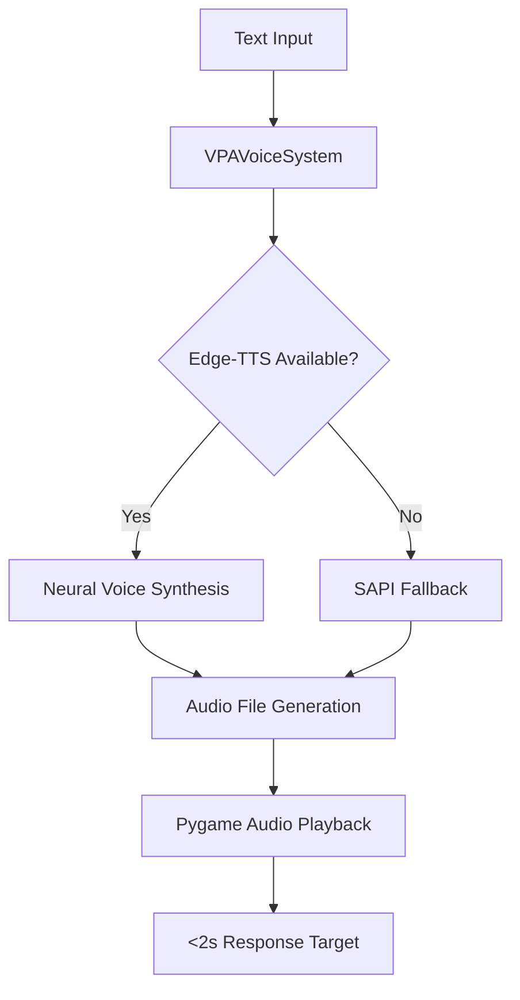

# VPA System Architecture Documentation

## Executive Summary

VPA (Virtual Personal Assistant) is an **event-driven, modular desktop application** built with Python 3.9+ that provides voice-enabled personal assistant capabilities through a plugin architecture. The system emphasizes performance, modularity, and Windows-native integration.

## Core Architectural Principles

### 1. Event-Driven Communication
- **Central Event Bus**: All components communicate through `src/vpa/core/events.py`
- **Pub/Sub Pattern**: Zero direct coupling between components
- **Async-First Design**: Non-blocking operations using `asyncio`
- **Performance Target**: <10ms event dispatch time

### 2. Plugin Architecture
- **Dynamic Discovery**: Plugins auto-discovered from `src/vpa/plugins/` and `plugins/`
- **Cached Loading**: Plugin discovery cached in `src/plugin_cache.json`
- **Isolation Boundaries**: Error containment prevents plugin failures from crashing main app
- **Dependency Management**: Priority-based loading system

### 3. Compartmentalized Design
- **Core Services**: Application lifecycle, configuration, events, plugins
- **Audio System**: 13-voice Edge-TTS catalog with fallback to Windows SAPI
- **GUI Framework**: CustomTkinter-based interface with approved restore components
- **Authentication**: User management with OAuth integration capabilities

## System Components

### Core Application (`src/vpa/core/`)

#### Application Manager (`app.py`)
```python
class App:
    """Main VPA application with performance monitoring"""
    - Lifecycle management (startup <10s target)
    - Configuration loading
    - Plugin coordination
    - Performance metrics tracking
```

#### Event Bus (`events.py`)
```python
class EventBus:
    """Pub/sub messaging system"""
    - subscribe(event_type, callback)
    - emit(event_type, data)
    - Async event handling support
    - <10ms dispatch target
```

#### Plugin Manager (`plugins.py`)
```python
class PluginManager:
    """Plugin discovery and lifecycle management"""
    - Auto-discovery with caching
    - Priority-based loading
    - Error isolation boundaries
    - Dependency resolution
```

### Audio System (`src/audio/`)

#### Voice System (`voice_system.py`)
- **13-Voice Catalog**: Edge-TTS neural voices (Andrew, Christopher, Guy, Roger, Eric, Steffan, Emma, Ava, Aria, Jenny, Libby, Michelle)
- **SAPI Fallback**: Windows Speech API for reliability
- **Performance Target**: <2s TTS response time
- **Audio Quality**: 44.1kHz/16-bit output

```python
class VPAVoiceSystem:
    """13-voice Edge-TTS system with SAPI fallback"""
    - get_available_voices() -> List[VoiceInfo]
    - synthesize_speech(text, voice_id) -> AudioResult
    - verify_voice_catalog() -> Dict[str, bool]
```

### GUI System (`src/vpa/gui/`)

#### Core Windows (APPROVED_RESTORE Components)
- **Login Window** (`login_window_APPROVED_RESTORE.py`): User authentication with first-time setup
- **Settings Window** (`settings_window_APPROVED_RESTORE.py`): Voice configuration and system settings  
- **Main Window** (`main_window_APPROVED_RESTORE.py`): Primary chat interface

#### Framework Integration
- **CustomTkinter**: Modern dark-theme GUI framework
- **Modal Dialogs**: Proper window management and focus handling
- **Event Integration**: GUI components emit events to event bus

### Configuration System

#### Configuration Files
- **`config/voice_settings.json`**: 13-voice configuration with rate/volume settings
- **`config/ui_settings.json`**: GUI preferences and window states
- **`config/default.yaml`**: Application defaults
- **`config/audio.yaml`**: Audio system configuration

## Data Flow Architecture

### 1. Application Startup Flow
```mermaid
graph TD
    A[main.py] --> B[App.startup()]
    B --> C[ConfigManager.load()]
    B --> D[EventBus.initialize()]
    B --> E[PluginManager.load_plugins()]
    B --> F[VoiceSystem.initialize()]
    F --> G[Verify 13-voice catalog]
    G --> H[GUI Launch Ready]
```

### 2. Event Processing Flow


### 3. Voice Synthesis Flow


## Performance Architecture

### Performance Targets
- **Startup Time**: <10 seconds
- **Memory Usage**: <2GB total
- **Event Dispatch**: <10ms per event
- **Voice Synthesis**: <2s TTS response
- **GUI Response**: <100ms interaction lag

### Monitoring System
```python
@PerformanceMonitor.track_execution_time("function_name")
def monitored_function():
    """All critical functions use performance monitoring"""
    pass
```

## Technology Stack

### Core Runtime
- **Python**: 3.9+ (Windows-native installation)
- **Async Framework**: `asyncio` for non-blocking operations
- **Event System**: Custom pub/sub implementation

### GUI Framework
- **CustomTkinter**: 5.2.0+ (modern dark-theme interface)
- **Tkinter**: Standard library GUI (fallback)
- **Modal Management**: CTkToplevel for dialog windows

### Audio Stack
- **Edge-TTS**: 7.0.0+ (Microsoft neural voices)
- **Pygame**: 2.6.0+ (cross-platform audio playback)
- **Windows SAPI**: Fallback TTS system
- **PyWin32**: Windows API integration

### Configuration & Data
- **PyYAML**: 6.0+ (YAML configuration files)
- **JSON**: Settings persistence
- **PSUtil**: 5.9.0+ (system performance monitoring)

### Development Tools
- **PyTest**: 7.0.0+ (testing framework with async support)
- **Coverage**: 90%+ requirement with HTML reports
- **MyPy**: Type checking (optional)
- **Black**: Code formatting (optional)

## Security Architecture

### Authentication System
- **User Management**: Local user accounts with password hashing
- **OAuth Integration**: Microsoft OAuth flow support
- **Session Management**: Secure session handling
- **Cryptography**: 41.0.0+ for secure operations

### Data Protection
- **Configuration Encryption**: Sensitive settings protection
- **Audio File Cleanup**: Temporary file management
- **Process Isolation**: Plugin error containment

## Extensibility Architecture

### Plugin Interface
```python
from vpa.core.plugins import Plugin

class CustomPlugin(Plugin):
    @property
    def name(self) -> str: return "custom_plugin"
    
    def can_handle(self, user_input: str, context: Dict) -> bool:
        return "trigger_word" in user_input.lower()
    
    async def process(self, user_input: str, context: Dict) -> Dict:
        # Plugin implementation
        return {"response": "processed"}
```

### Event System Extension
```python
# Subscribe to custom events
event_bus.subscribe("custom_event", handler_function, async_callback=True)

# Emit custom events
await event_bus.emit_async("custom_event", {"data": "value"})
```

## Deployment Architecture

### Package Structure
```
vpa/
├── src/
│   ├── main.py              # Entry point
│   ├── audio/               # Voice system
│   └── vpa/
│       ├── core/            # Core services
│       ├── gui/             # UI components
│       ├── plugins/         # Plugin modules
│       └── auth/            # Authentication
├── config/                  # Configuration files
├── tests/                   # Test suites
└── requirements.txt         # Dependencies
```

### Build System
- **PyProject.toml**: Modern Python packaging
- **Setuptools**: Build backend
- **Scripts**: `vpa` command-line entry point
- **Optional Dependencies**: GUI, LLM, development tools

## Quality Assurance Architecture

### Testing Framework
- **Unit Tests**: `tests/core/` for core components
- **Integration Tests**: `tests/test_core_architecture.py`
- **Audio Tests**: `tests/audio/` with mocking
- **Coverage Requirement**: 90%+ with HTML reports

### Performance Validation
- **Integration Test**: Validates all performance targets
- **Memory Monitoring**: PSUtil-based tracking
- **Startup Benchmarking**: <10s validation
- **Voice System Benchmarking**: <2s TTS validation

### Error Handling
- **Graceful Degradation**: System continues with reduced functionality
- **Error Isolation**: Plugin failures don't crash main app
- **Comprehensive Logging**: All errors logged with context
- **Critical Error Events**: Coordinated response to system failures

## Future Architecture Considerations

### Scalability
- **Multi-user Support**: Session-based user management
- **Distributed Plugins**: Network-based plugin loading
- **Cloud Integration**: Remote voice synthesis options

### Performance Optimization
- **Plugin Lazy Loading**: On-demand plugin initialization  
- **Audio Caching**: TTS result caching for performance
- **Event Bus Optimization**: Parallel event processing

### Integration Expansion
- **LLM Integration**: Local Ollama integration ready
- **External APIs**: Extensible API integration framework
- **Cross-platform Support**: Linux/macOS compatibility layer

---

*This architecture documentation reflects the actual codebase structure as of the current implementation. All components, flows, and specifications are based on analysis of the present source code.*
