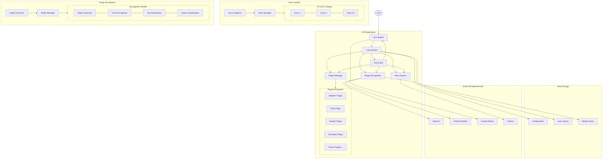
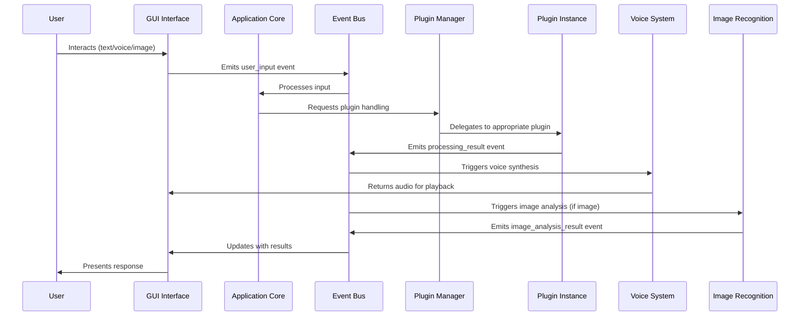
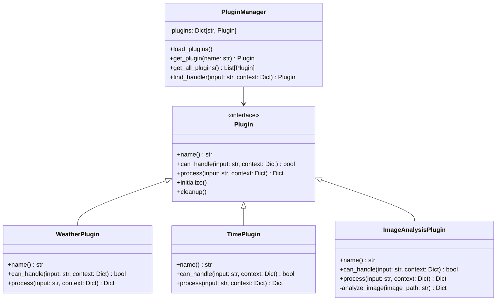
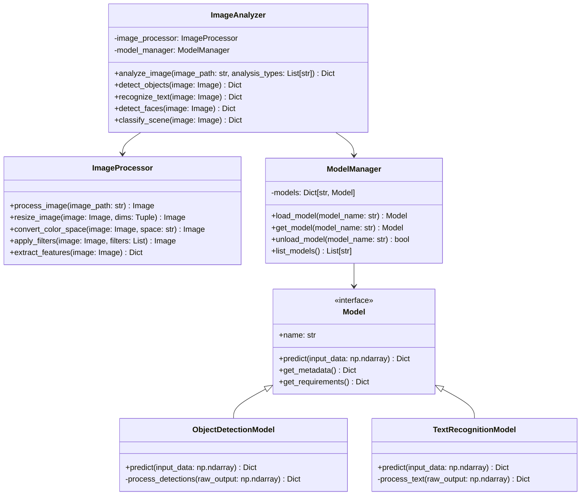
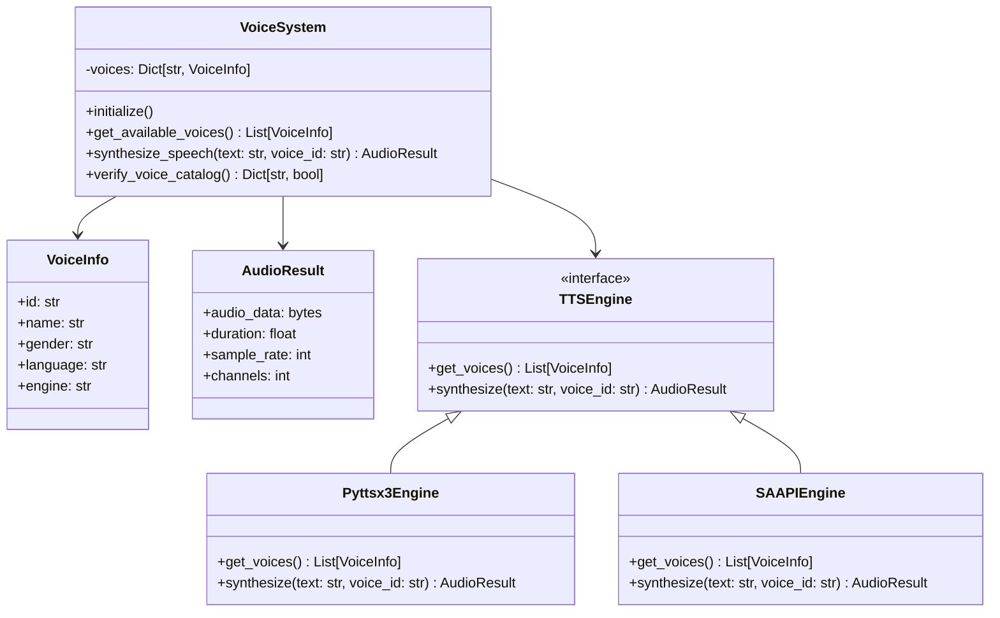
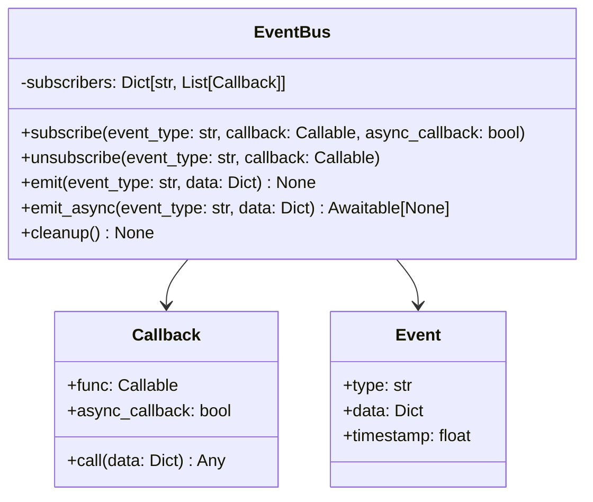
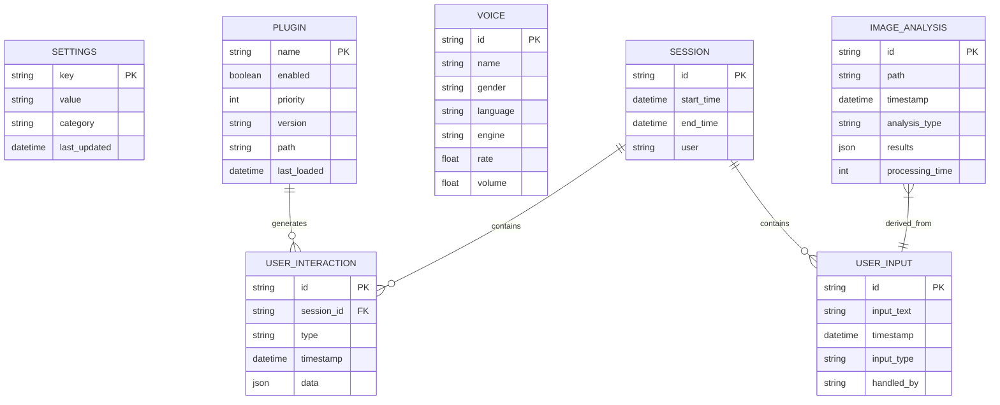

# VPA Architecture Diagrams

## System Architecture Overview

## Event Flow Architecture

## Plugin Architecture

## Image Recognition Architecture

## Voice System Architecture

## Event Bus Architecture

## Database Architecture

---

*These architectural diagrams represent the planned implementation for the VPA system with image recognition capabilities. The diagrams are generated using Mermaid syntax and can be rendered in compatible Markdown viewers.*
