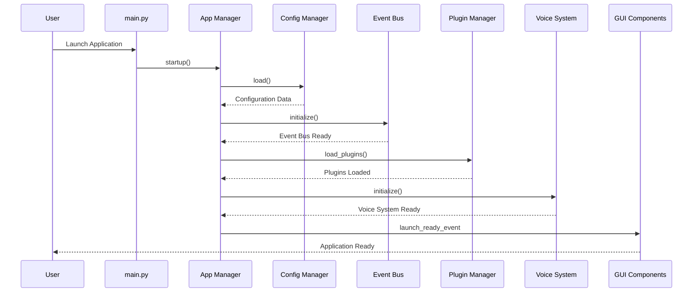
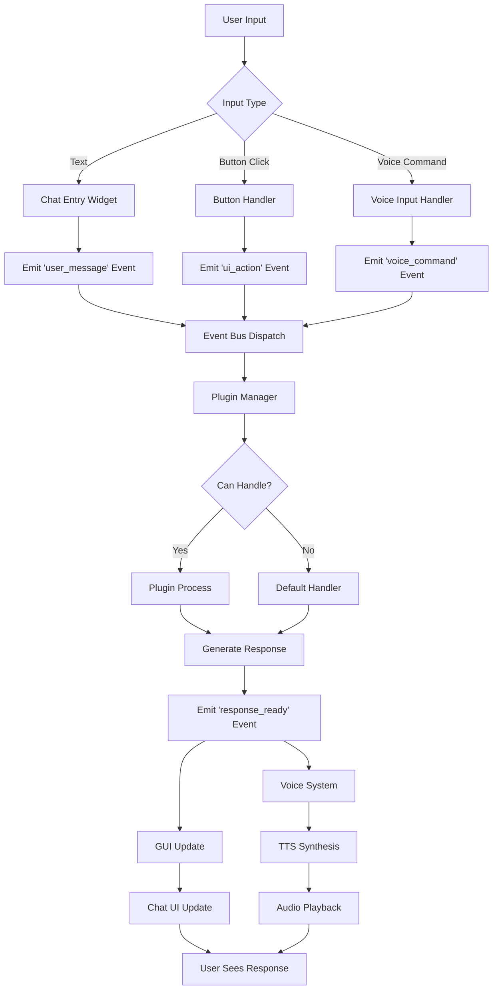
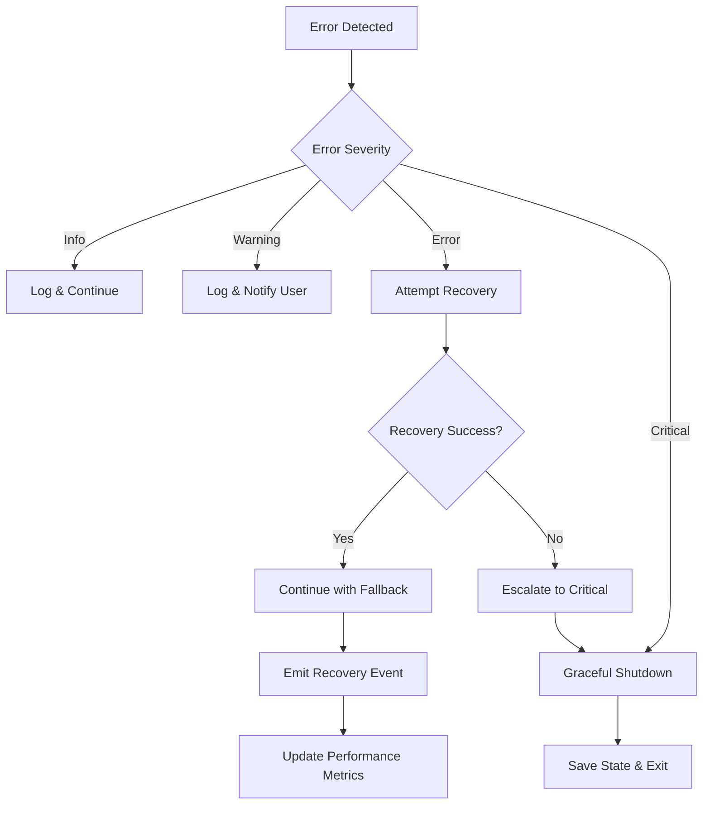

# VPA Data Flow Documentation

## Overview

VPA operates as an **event-driven system** with **asynchronous data flow** through a central event bus. All components communicate via events, ensuring zero direct coupling and enabling modular, performant operations.

## Core Data Flow Patterns

### 1. User Input Flow
```
User Action → GUI Component → Event Bus → Plugin Handler → Response Generation → Audio Output → GUI Update
```

### 2. Voice Synthesis Flow  
```
Text Input → Voice System → Edge-TTS/SAPI → Audio File → Pygame Playback → User Output
```

### 3. Configuration Flow
```
Config Files → ConfigManager → Component Initialization → Runtime Settings → Event Notifications
```

### 4. Plugin Discovery Flow
```
Directory Scan → Plugin Cache → Dynamic Loading → Registration → Event Subscription
```

## Detailed Data Flow Analysis

### Application Startup Data Flow



### User Interaction Data Flow



## Data Structures and Formats

### Event Data Format
```python
# Standard event payload structure
{
    "event_type": "user_message",
    "timestamp": "2025-08-27T17:00:00.000Z",
    "source": "chat_ui",
    "data": {
        "message": "Hello VPA",
        "user_id": "user_123",
        "session_id": "session_456"
    },
    "metadata": {
        "component_version": "1.0.0",
        "processing_time_ms": 5.2
    }
}
```

### Voice System Data Flow

#### Voice Synthesis Pipeline
```python
# Input: Text synthesis request
{
    "text": "Hello, this is your VPA assistant",
    "voice_id": "voice_01",  # Andrew (male, American)
    "settings": {
        "rate": 200,
        "volume": 0.9,
        "format": "wav"
    }
}

# Processing: Voice system internal flow
Edge-TTS Request → Neural Voice Generation → Audio File Creation → Pygame Loading → Audio Playback

# Output: Synthesis result
{
    "success": true,
    "audio_file": "/tmp/vpa_voice_temp_12345.wav",
    "duration_ms": 1800,
    "voice_used": {
        "voice_id": "voice_01",
        "name": "Andrew", 
        "provider": "Edge-TTS"
    },
    "performance": {
        "synthesis_time_ms": 1200,
        "target_met": true  # <2000ms target
    }
}
```

#### Voice Catalog Data Structure
```python
# Voice information structure
@dataclass
class VoiceInfo:
    voice_id: str        # "voice_01"
    name: str           # "Andrew"  
    gender: str         # "male"
    accent: str         # "American"
    language: str       # "en-US"
    description: str    # "Male American voice"
    quality: str        # "Neural"
    provider: str       # "Edge-TTS"
    available: bool     # True/False

# 13-voice catalog structure
{
    "voice_01": VoiceInfo("voice_01", "Andrew", "male", "American", ...),
    "voice_02": VoiceInfo("voice_02", "Christopher", "male", "American", ...),
    # ... through voice_13
}
```

### Configuration Data Flow

#### Configuration Loading Pipeline
```python
# Configuration sources (priority order)
1. config/default.yaml      # Application defaults
2. config/voice_settings.json  # Voice-specific settings  
3. config/ui_settings.json     # GUI preferences
4. config/audio.yaml           # Audio system config
5. Environment variables       # Runtime overrides
6. Command line arguments      # Launch-time overrides

# Merged configuration structure
{
    "application": {
        "name": "VPA",
        "version": "1.0.0",
        "debug": false
    },
    "voice_system": {
        "default_voice": "voice_01",
        "synthesis_timeout": 2000,
        "voices": {
            "voice_01": {"name": "Andrew", "rate": 200, "volume": 0.9},
            # ... 13 total voices
        }
    },
    "gui": {
        "theme": "dark",
        "geometry": {
            "login": "600x400+100+100",
            "settings": "800x600+200+100", 
            "main": "1000x700+300+100"
        }
    },
    "performance": {
        "startup_timeout": 10000,
        "memory_limit_mb": 2048,
        "event_dispatch_timeout": 10
    }
}
```

### Plugin System Data Flow

#### Plugin Discovery Data Pipeline
```python
# Plugin discovery input
{
    "scan_directories": [
        "src/vpa/plugins/",
        "plugins/",
        "~/.vpa/plugins/"
    ],
    "cache_file": "src/plugin_cache.json"
}

# Plugin metadata structure  
{
    "plugin_name": "weather_plugin",
    "file_path": "src/vpa/plugins/weather.py", 
    "class_name": "WeatherPlugin",
    "priority": 100,
    "dependencies": ["requests", "geopy"],
    "capabilities": ["weather_query", "location_lookup"],
    "version": "1.0.0",
    "last_modified": "2025-08-27T10:00:00Z"
}

# Plugin cache structure
{
    "cache_version": "1.0",
    "last_scan": "2025-08-27T17:00:00Z",
    "plugins": {
        "weather_plugin": { /* metadata */ },
        "calendar_plugin": { /* metadata */ },
        "email_plugin": { /* metadata */ }
    }
}
```

#### Plugin Processing Data Flow
```python
# Plugin input context
{
    "user_input": "What's the weather like?",
    "user_context": {
        "user_id": "user_123",
        "session_id": "session_456",
        "preferences": {
            "location": "New York",
            "temperature_unit": "fahrenheit"
        }
    },
    "system_context": {
        "timestamp": "2025-08-27T17:00:00Z",
        "available_services": ["weather_api", "location_service"],
        "performance_budget_ms": 1000
    }
}

# Plugin response structure
{
    "handled": true,
    "response": {
        "text": "The current temperature in New York is 72°F with clear skies.",
        "voice_enabled": true,
        "display_data": {
            "temperature": 72,
            "condition": "Clear", 
            "humidity": 45,
            "wind_speed": 8
        }
    },
    "actions": [
        {
            "type": "voice_synthesis",
            "text": "The current temperature in New York is 72°F with clear skies.",
            "voice_id": "voice_01"
        },
        {
            "type": "gui_update",
            "component": "chat_area",
            "data": { /* display data */ }
        }
    ],
    "metadata": {
        "processing_time_ms": 250,
        "data_sources": ["weather_api"],
        "confidence": 0.95
    }
}
```

### GUI Data Flow

#### Window State Management
```python
# Window creation data flow
{
    "window_type": "login_window",
    "initialization_data": {
        "first_time_setup": true,
        "parent_window": null,
        "gui_manager": "<manager_instance>"
    },
    "geometry": {
        "size": "600x400",
        "position": "+100+100",  
        "resizable": false
    },
    "theme": {
        "mode": "dark",
        "color_theme": "blue",
        "font_size": 12
    }
}

# GUI event emission
{
    "event_type": "login_attempt",
    "source": "login_window", 
    "data": {
        "username": "user123",
        "password_hash": "<hashed_password>",
        "remember_me": true,
        "timestamp": "2025-08-27T17:00:00Z"
    }
}
```

#### Chat Interface Data Flow
```python
# Chat message structure
{
    "message_id": "msg_789",
    "session_id": "session_456",
    "timestamp": "2025-08-27T17:00:00Z",
    "sender": {
        "type": "user",  # or "assistant"
        "id": "user_123",
        "name": "John Doe"
    },
    "content": {
        "text": "Hello VPA, what can you do?",
        "formatting": "plain",
        "attachments": []
    },
    "metadata": {
        "client": "vpa_gui_v1.0.0",
        "language": "en-US"
    }
}

# Chat response structure
{
    "message_id": "msg_790",
    "in_reply_to": "msg_789",
    "session_id": "session_456", 
    "timestamp": "2025-08-27T17:00:05Z",
    "sender": {
        "type": "assistant",
        "id": "vpa_system",
        "name": "VPA Assistant"
    },
    "content": {
        "text": "I'm your Virtual Personal Assistant. I can help with weather, calendar, voice synthesis, and more!",
        "formatting": "markdown",
        "voice_synthesis": {
            "enabled": true,
            "voice_id": "voice_01",
            "text": "I'm your Virtual Personal Assistant. I can help with weather, calendar, voice synthesis, and more!"
        }
    },
    "actions": [
        {
            "type": "voice_output",
            "voice_id": "voice_01"
        },
        {
            "type": "gui_update",
            "target": "chat_history"
        }
    ]
}
```

## Data Persistence Patterns

### Configuration Persistence
```python
# Voice settings persistence (JSON)
def save_voice_settings(settings: Dict[str, Any]):
    """Save voice settings to config/voice_settings.json"""
    config_path = Path("config/voice_settings.json")
    with open(config_path, 'w') as f:
        json.dump(settings, f, indent=2)
    
    # Emit configuration change event
    event_bus.emit("config_updated", {
        "component": "voice_system",
        "settings": settings
    })

# UI settings persistence
def save_ui_settings(window_states: Dict[str, str]):
    """Save window geometry and preferences"""
    ui_config = {
        "geometry": window_states,
        "theme": "dark",
        "last_updated": datetime.utcnow().isoformat()
    }
    
    config_path = Path("config/ui_settings.json")
    with open(config_path, 'w') as f:
        json.dump(ui_config, f, indent=2)
```

### Cache Management Data Flow
```python
# Plugin cache management
{
    "cache_operations": {
        "read": "Load from src/plugin_cache.json",
        "write": "Save discovery results with timestamp",
        "invalidate": "Remove cache on directory changes",
        "refresh": "Re-scan and update cache"
    },
    "cache_structure": {
        "metadata": {
            "version": "1.0",
            "last_scan": "2025-08-27T17:00:00Z",
            "scan_duration_ms": 150
        },
        "plugins": {
            "plugin_name": "plugin_metadata_object"
        }
    }
}
```

### Session Data Management
```python
# Session lifecycle data
{
    "session_id": "session_456",
    "user_id": "user_123", 
    "created": "2025-08-27T17:00:00Z",
    "last_activity": "2025-08-27T17:15:30Z",
    "state": {
        "authenticated": true,
        "preferences": {
            "voice_id": "voice_01",
            "auto_voice": true,
            "theme": "dark"
        },
        "context": {
            "conversation_history": ["msg_789", "msg_790"],
            "active_plugins": ["weather", "calendar"],
            "performance_metrics": {
                "avg_response_time": 850,
                "total_requests": 15
            }
        }
    }
}
```

## Error Handling Data Flow

### Error Event Structure
```python
{
    "event_type": "error_occurred",
    "severity": "warning",  # "info", "warning", "error", "critical"
    "source": "voice_system",
    "timestamp": "2025-08-27T17:00:00Z",
    "error": {
        "code": "VOICE_SYNTHESIS_TIMEOUT",
        "message": "Voice synthesis exceeded 2s timeout",
        "details": {
            "voice_id": "voice_01",
            "text_length": 150,
            "timeout_ms": 2000,
            "actual_time_ms": 2500
        }
    },
    "context": {
        "user_id": "user_123",
        "session_id": "session_456",
        "request_id": "req_789"
    },
    "recovery": {
        "action_taken": "fallback_to_sapi",
        "success": true,
        "fallback_time_ms": 800
    }
}
```

### Graceful Degradation Flow


## Performance Data Flow

### Performance Metrics Collection
```python
# Performance event structure
{
    "event_type": "performance_metric",
    "timestamp": "2025-08-27T17:00:00Z",
    "component": "voice_system",
    "metric": {
        "name": "synthesis_time",
        "value": 1200,
        "unit": "milliseconds",
        "target": 2000,
        "target_met": true
    },
    "context": {
        "voice_id": "voice_01",
        "text_length": 45,
        "user_session": "session_456"
    }
}

# Aggregated performance data
{
    "period": "last_hour",
    "timestamp": "2025-08-27T17:00:00Z", 
    "metrics": {
        "voice_synthesis": {
            "avg_time_ms": 1150,
            "max_time_ms": 1800,
            "min_time_ms": 600,
            "target_met_pct": 98.5,
            "total_requests": 47
        },
        "event_dispatch": {
            "avg_time_ms": 5.2,
            "max_time_ms": 8.9,
            "target_met_pct": 100.0,
            "total_events": 234
        },
        "memory_usage": {
            "current_mb": 1024,
            "peak_mb": 1156,
            "target_met": true
        }
    }
}
```

## Data Security and Privacy

### Data Encryption Flow
```python
# Sensitive data encryption
{
    "encryption_context": {
        "algorithm": "AES-256-GCM",
        "key_derivation": "PBKDF2-SHA256",
        "iterations": 100000
    },
    "data_categories": {
        "user_credentials": "encrypted_at_rest",
        "session_tokens": "encrypted_in_memory",
        "voice_files": "temporary_cleanup",
        "configuration": "selective_encryption"
    }
}
```

### Data Cleanup Pipeline
```python
# Temporary file management
{
    "cleanup_schedule": {
        "voice_files": "immediate_after_playback",
        "cache_files": "daily_cleanup",
        "log_files": "weekly_rotation",
        "session_data": "logout_cleanup"
    },
    "cleanup_events": [
        "audio_playback_complete",
        "session_expired", 
        "application_shutdown",
        "disk_space_low"
    ]
}
```

---

*This data flow documentation reflects the actual implementation patterns found in the VPA codebase, including event structures, configuration formats, and component interactions.*
