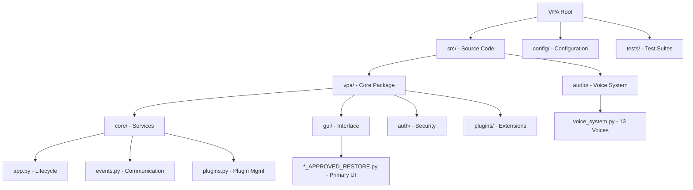

# VPA Folder Structure Documentation

## Root Directory Structure

```
VPA/
├── 📁 src/                          # Primary source code
├── 📁 config/                       # Configuration files
├── 📁 tests/                        # Test suites
├── 📁 .github/                      # GitHub workflows & templates
├── 📁 docs/                         # Documentation (if present)
├── 📁 build/                        # Build artifacts
├── 📁 dist/                         # Distribution packages
├── 📁 logs/                         # Application logs
├── 📁 resources/                    # Static resources
├── 📁 scripts/                      # Utility scripts
├── 📁 examples/                     # Example code/configurations
├── 📁 tools/                        # Development tools
├── 📄 main.py                       # Root entry point (empty)
├── 📄 requirements.txt              # Core dependencies
├── 📄 pyproject.toml                # Modern Python packaging
├── 📄 README.md                     # Project documentation
└── 📄 .gitignore                    # Git ignore rules
```

## Source Code Structure (`src/`)

### Primary Source (`src/`)
```
src/
├── 📄 main.py                       # Primary application entry point
├── 📄 __init__.py                   # Package initialization
├── 📄 plugin_cache.json             # Plugin discovery cache
├── 📁 audio/                        # Audio & TTS system
└── 📁 vpa/                          # Core VPA package
```

### Audio System (`src/audio/`)
```
audio/
├── 📄 __init__.py                   # Package initialization
├── 📄 voice_system.py               # 13-voice Edge-TTS system (PRIMARY)
├── 📄 production_voice_system.py    # Production voice implementation
├── 📄 neural_voice_engine.py        # Neural voice processing
├── 📄 voice_system_azure_restored.py # Azure voice system
├── 📄 vpa_agent_voice.py            # Agent-specific voice handling
└── 📄 vpa_voice_system.py           # Alternative voice system
```

**Key File**: `voice_system.py` (504 lines) - Primary 13-voice Edge-TTS implementation

### Core VPA Package (`src/vpa/`)
```
vpa/
├── 📄 __init__.py                   # Package initialization
├── 📄 __main__.py                   # Python -m vpa entry point
├── 📄 config.py                     # Configuration utilities
├── 📄 maps.py                       # Mapping utilities
├── 📄 _version.py                   # Version management
├── 📄 microsoft_setup.py            # Microsoft integration setup
├── 📄 user_setup.py                 # User setup utilities
├── 📄 README.md                     # VPA package documentation
├── 📁 core/                         # Core application services
├── 📁 gui/                          # GUI components
├── 📁 auth/                         # Authentication system
├── 📁 plugins/                      # Plugin system
├── 📁 config/                       # Configuration management
├── 📁 services/                     # Application services
├── 📁 ai/                           # AI/LLM integration
├── 📁 llm/                          # Language model integration
├── 📁 voice/                        # Voice processing
├── 📁 audio/                        # Audio processing
├── 📁 cli/                          # Command-line interface
├── 📁 ui/                           # User interface utilities
├── 📁 util/                         # General utilities
├── 📁 maps/                         # Mapping services
└── 📁 addons/                       # System addons
```

## Core Services (`src/vpa/core/`)

```
core/
├── 📄 __init__.py                   # Package initialization
├── 📄 app.py                        # Main application manager (88 lines)
├── 📄 events.py                     # Event bus system (69 lines)
├── 📄 plugins.py                    # Plugin management system
├── 📄 config.py                     # Configuration management
├── 📄 base_app.py                   # Base application class
├── 📄 auth.py                       # Authentication core
├── 📄 auth_coordinator.py           # Authentication coordination
├── 📄 auth_providers.py             # Authentication providers
├── 📄 auto_login.py                 # Automatic login handling
├── 📄 cache_manager.py              # Caching system
├── 📄 chat_coordinator.py           # Chat coordination
├── 📄 database.py                   # Database operations
├── 📄 document_processor.py         # Document processing
├── 📄 enhanced_audio_gui.py         # Enhanced audio GUI
├── 📄 enhanced_llm_integration.py   # LLM integration
├── 📄 enhanced_rag.py               # RAG system
├── 📄 enhanced_settings.py          # Enhanced settings
├── 📄 events_optimized.py           # Optimized event system
├── 📄 feature_flags.py              # Feature flag management
├── 📄 health.py                     # System health monitoring
├── 📄 llm.py                        # LLM core functionality
├── 📄 llm_auto_setup.py             # Automatic LLM setup
├── 📄 llm_provider_manager.py       # LLM provider management
├── 📄 logging.py                    # Logging configuration
├── 📄 oauth_config.py               # OAuth configuration
├── 📄 performance_monitor.py        # Performance monitoring
├── 📄 plugin_boundaries.py          # Plugin isolation
├── 📄 rag.py                        # RAG implementation
├── 📄 realtime_stt.py               # Real-time speech-to-text
├── 📄 resource_monitor_core.py      # Resource monitoring core
├── 📄 resource_monitoring.py        # Resource monitoring
├── 📄 response_optimizer.py         # Response optimization
├── 📄 session_manager.py            # Session management
├── 📄 time_monitor.py               # Time monitoring
├── 📄 transcript_manager.py         # Transcript management
├── 📄 unified_audio_system.py       # Unified audio system
├── 📄 vector_database.py            # Vector database
├── 📄 voice_interface.py            # Voice interface
├── 📄 vpa_logging.py                # VPA logging system
├── 📄 addon_tab.py                  # Addon tab functionality
├── 📄 continuous_improvement_monitoring.py  # Continuous monitoring
├── 📄 enterprise_expansion_intelligent_automation.py  # Enterprise features
├── 📄 enterprise_rollout_operations.py  # Enterprise rollout
├── 📄 global_production_deployment.py    # Global deployment
├── 📄 global_rollout_manager.py          # Global rollout management
├── 📄 global_scale_operations.py         # Global scale operations
├── 📄 quality_ux_enhancements.py         # Quality/UX enhancements
├── 📄 scalability_reliability_upgrades.py # Scalability upgrades
└── 📄 advanced_analytics_proactive_optimization.py # Analytics optimization
```

## GUI System (`src/vpa/gui/`)

```
gui/
├── 📄 __init__.py                   # Package initialization
├── 📄 README.md                     # GUI documentation
├── 📄 components.py                 # Reusable GUI components
├── 📄 chat_ui.py                    # Chat interface
├── 📄 chat_entry.py                 # Chat entry widget
├── 📄 gui_manager.py                # GUI management
├── 📄 gui_manager_factory.py        # GUI manager factory
├── 📄 gui_manager_refactored.py     # Refactored GUI manager
├── 📄 launcher.py                   # GUI launcher
├── 📄 main_application.py           # Main application window
├── 📄 oauth_callback_server.py      # OAuth callback handling
├── 📄 rag_llm_menu.py               # RAG/LLM menu
├── 📄 rag_llm_widget.py             # RAG/LLM widget
├── 📄 registration_window.py        # User registration
├── 📄 resource_monitor_widget.py    # Resource monitoring widget
├── 📄 simple_login_window.py        # Simple login interface
├── 📄 ultra_simple_login.py         # Ultra-simple login
├── 📄 addons_tab.py                 # Addons tab interface
├── 📁 adapters/                     # GUI adapters
├── 📁 commands/                     # GUI command handlers
├── 📁 components/                   # GUI component library
├── 📁 factories/                    # GUI factory patterns
├── 📁 framework/                    # GUI framework code
├── 📁 main/                         # Main window components
└── 📁 strategies/                   # GUI strategy patterns
```

### APPROVED_RESTORE Components (Primary GUI)
```
gui/
├── 📄 login_window_APPROVED_RESTORE.py     # LOGIN SYSTEM (637 lines) ⭐
├── 📄 settings_window_APPROVED_RESTORE.py  # SETTINGS PANEL (835 lines) ⭐
├── 📄 main_window_APPROVED_RESTORE.py      # MAIN CHAT UI (542 lines) ⭐
├── 📄 login_window.py                      # Alternative login
├── 📄 login_window_refactored.py           # Refactored login
├── 📄 main_window.py                       # Alternative main window
├── 📄 main_window_refactored.py            # Refactored main window
├── 📄 settings_window.py                   # Alternative settings
├── 📄 enhanced_main_application.py         # Enhanced main app
├── 📄 enhanced_main_window.py              # Enhanced main window
├── 📄 enhanced_settings_window.py          # Enhanced settings
├── 📄 enhanced_settings_window_refactored.py # Enhanced settings refactored
└── 📄 oauth_setup_window_refactored.py     # OAuth setup refactored
```

**Key Files**: The `*_APPROVED_RESTORE.py` files are the primary, tested GUI components.

## Configuration System (`config/`)

```
config/
├── 📄 voice_settings.json           # 13-voice system configuration ⭐
├── 📄 ui_settings.json              # GUI preferences
├── 📄 default.yaml                  # Application defaults
└── 📄 audio.yaml                    # Audio system configuration
```

**Key File**: `voice_settings.json` contains configuration for all 13 voices (voice_01 through voice_13).

## Authentication System (`src/vpa/auth/`)

```
auth/
├── 📄 __init__.py                   # Package initialization
├── 📁 providers/                    # Authentication providers
├── 📁 oauth/                        # OAuth implementations
├── 📁 session/                      # Session management
└── 📁 security/                     # Security utilities
```

## Plugin System (`src/vpa/plugins/`)

```
plugins/
├── 📄 __init__.py                   # Package initialization
├── 📁 core/                         # Core plugins
├── 📁 voice/                        # Voice-related plugins
├── 📁 ui/                           # UI plugins
└── 📁 integrations/                 # External integrations
```

## Testing Structure (`tests/`)

```
tests/
├── 📄 conftest.py                   # Pytest configuration
├── 📁 core/                         # Core component tests
├── 📁 audio/                        # Audio system tests
├── 📁 gui/                          # GUI tests
├── 📁 integration/                  # Integration tests
└── 📁 fixtures/                     # Test fixtures
```

## Build & Distribution

```
build/                               # Build artifacts
├── 📁 lib/                          # Build libraries
├── 📁 bdist.win-amd64/              # Windows distribution
└── 📄 build_log.txt                 # Build logs

dist/                                # Distribution packages
├── 📄 vpa-1.0.0-py3-none-any.whl   # Wheel package
└── 📄 vpa-1.0.0.tar.gz              # Source distribution
```

## Development Tools

```
scripts/                             # Development scripts
tools/                               # Development tools
examples/                            # Example configurations
docs/                                # Documentation files
resources/                           # Static resources
logs/                                # Application logs
```

## Archive & Legacy Folders (Reference Only)

**Note**: These folders contain legacy code and are NOT part of the active codebase:

```
archive/                             # Archived implementations
archived_ui_redundant/               # Archived UI components
archive_optimization/                # Archive optimization work
legacy_archive_cleanup/              # Legacy cleanup work
referencedocuments/                  # Reference documentation
```

These folders are excluded from active development and testing via `pyproject.toml` configuration.

## File Purpose Summary

### Critical Application Files
- **`src/main.py`**: Primary application entry point with async main()
- **`src/vpa/core/app.py`**: Core application lifecycle management
- **`src/vpa/core/events.py`**: Event bus for component communication  
- **`src/audio/voice_system.py`**: 13-voice Edge-TTS system implementation

### Key GUI Components  
- **`src/vpa/gui/login_window_APPROVED_RESTORE.py`**: User authentication system
- **`src/vpa/gui/settings_window_APPROVED_RESTORE.py`**: Settings panel with voice integration
- **`src/vpa/gui/main_window_APPROVED_RESTORE.py`**: Primary chat interface

### Configuration Files
- **`config/voice_settings.json`**: Voice system configuration
- **`pyproject.toml`**: Modern Python packaging and build configuration
- **`requirements.txt`**: Core dependency specifications

### Package Management
- **`pyproject.toml`**: Complete project configuration with build system, dependencies, scripts
- **`setup.py`**: If present, legacy setup configuration
- **`vpa.egg-info/`**: Package metadata (generated)

## Directory Relationships



---

*This folder structure reflects the current state of the VPA repository. Archive and legacy folders are excluded from active development.*
