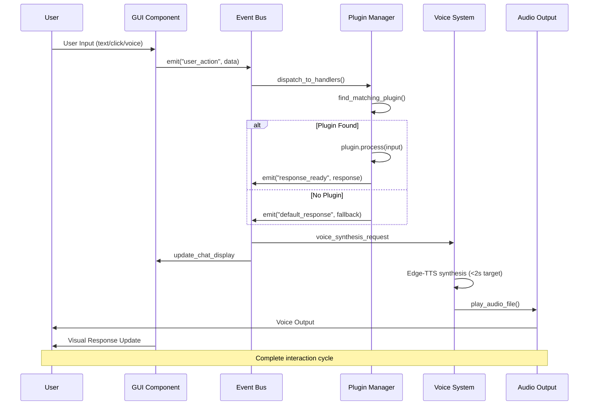
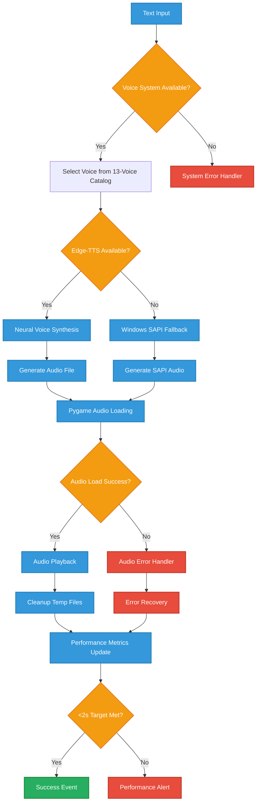
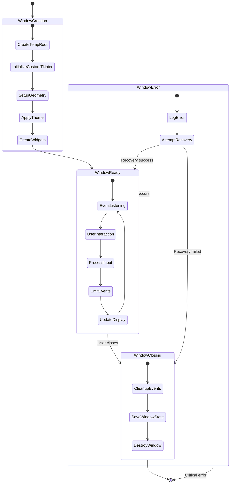
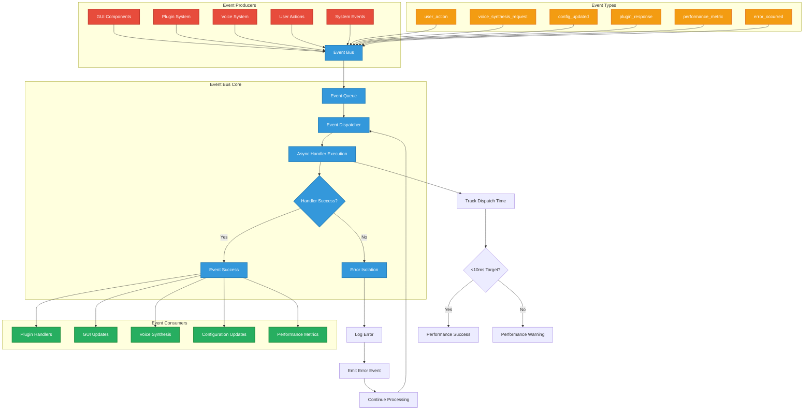
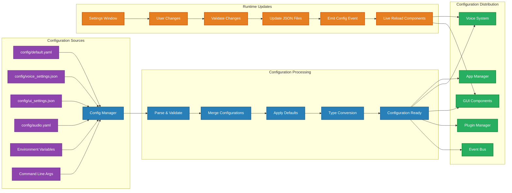
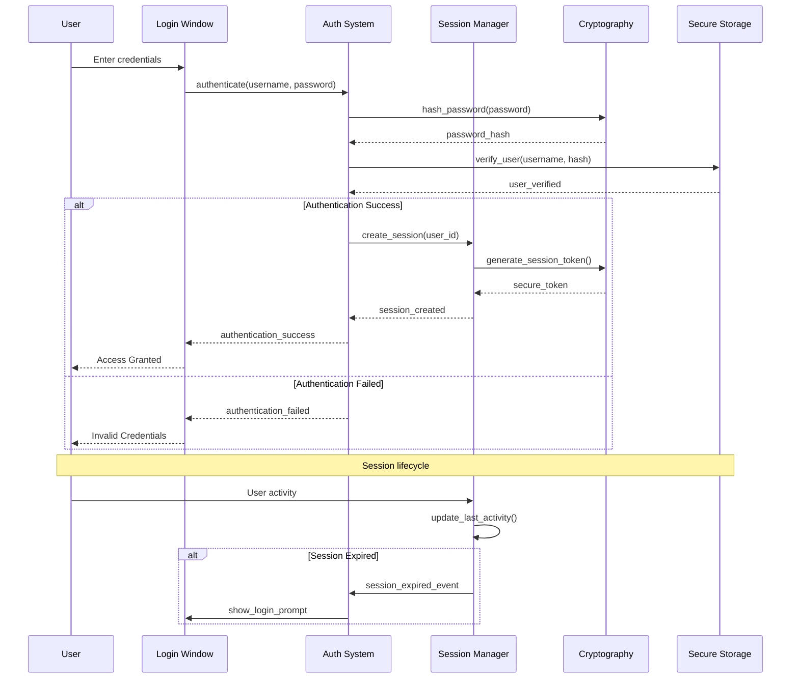
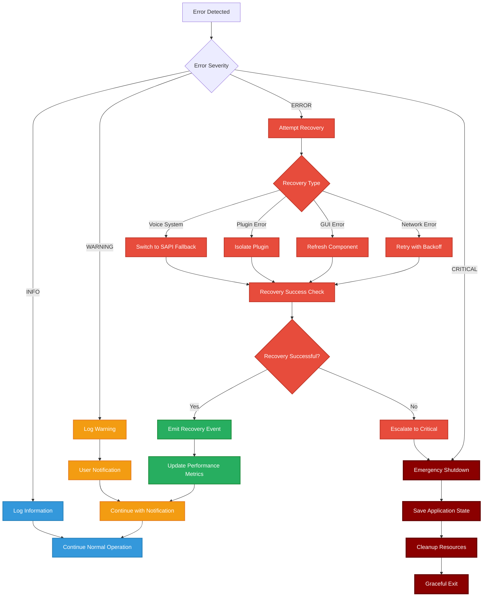

# VPA Mermaid Diagrams

## System Architecture Diagram

### Complete System Architecture
```mermaid
graph TB
    subgraph "User Interface Layer"
        A[User] --> B[Login Window]
        A --> C[Settings Window] 
        A --> D[Main Chat UI]
        B --> E[CustomTkinter Framework]
        C --> E
        D --> E
    end
    
    subgraph "Application Core"
        F[Event Bus] --> G[Application Manager]
        F --> H[Plugin Manager]
        F --> I[Configuration Manager]
        G --> J[Performance Monitor]
        H --> K[Plugin Cache]
    end
    
    subgraph "Voice System"
        L[Voice System Controller] --> M[Edge-TTS Neural Voices]
        L --> N[Windows SAPI Fallback]
        M --> O[13-Voice Catalog]
        N --> P[System Voices]
        L --> Q[Pygame Audio Playback]
    end
    
    subgraph "Data Layer"
        R[Config Files] --> S[voice_settings.json]
        R --> T[ui_settings.json]
        R --> U[default.yaml]
        R --> V[audio.yaml]
    end
    
    subgraph "Security & Auth"
        W[Authentication System] --> X[User Management]
        W --> Y[OAuth Integration]
        W --> Z[Session Manager]
    end
    
    %% Connections
    E --> F
    F --> L
    I --> R
    G --> W
    O --> AA[Andrew]
    O --> BB[Christopher]
    O --> CC[Guy]
    O --> DD[Roger]
    O --> EE[Eric]
    O --> FF[Steffan]
    O --> GG[Emma]
    O --> HH[Ava]
    O --> II[Aria]
    O --> JJ[Jenny]
    O --> KK[Libby]
    O --> LL[Michelle]
    
    %% Styling
    classDef coreSystem fill:#2D5B87,stroke:#1F4A73,stroke-width:2px,color:#fff
    classDef voiceSystem fill:#8B4513,stroke:#654321,stroke-width:2px,color:#fff
    classDef userInterface fill:#2E8B57,stroke:#1F5F3F,stroke-width:2px,color:#fff
    classDef dataLayer fill:#800080,stroke:#5A005A,stroke-width:2px,color:#fff
    
    class F,G,H,I,J,K coreSystem
    class L,M,N,O,P,Q voiceSystem  
    class A,B,C,D,E userInterface
    class R,S,T,U,V dataLayer
```

### Core Component Interaction
```mermaid
graph LR
    subgraph "Entry Point"
        A[main.py] --> B[App.startup()]
    end
    
    subgraph "Core Services"
        B --> C[ConfigManager.load()]
        B --> D[EventBus.initialize()]
        B --> E[PluginManager.load_plugins()]
        B --> F[VoiceSystem.initialize()]
    end
    
    subgraph "Service Dependencies"
        C --> G[config/*.json/*.yaml]
        D --> H[Event Subscriptions]
        E --> I[Plugin Discovery & Cache]
        F --> J[13-Voice Catalog Verification]
    end
    
    subgraph "Operational State"
        G --> K[App Ready]
        H --> K
        I --> K
        J --> K
        K --> L[GUI Launch Available]
        K --> M[Performance Monitoring Active]
    end
    
    %% Styling
    classDef entry fill:#FF6B6B,stroke:#E55555,stroke-width:3px,color:#fff
    classDef core fill:#4ECDC4,stroke:#3DB8B0,stroke-width:2px,color:#fff
    classDef deps fill:#45B7D1,stroke:#3A9BC1,stroke-width:2px,color:#fff
    classDef ready fill:#96CEB4,stroke:#7FB069,stroke-width:2px,color:#fff
    
    class A,B entry
    class C,D,E,F core
    class G,H,I,J deps
    class K,L,M ready
```

## Data Flow Diagrams

### User Interaction Flow


### Voice Synthesis Pipeline  


### Plugin System Architecture
```mermaid
graph TB
    subgraph "Plugin Discovery"
        A[Directory Scan] --> B[src/vpa/plugins/]
        A --> C[plugins/]
        A --> D[~/.vpa/plugins/]
        B --> E[Plugin Cache]
        C --> E
        D --> E
    end
    
    subgraph "Plugin Loading"
        E --> F{Cache Valid?}
        F -->|Yes| G[Load from Cache]
        F -->|No| H[Full Directory Scan]
        G --> I[Dynamic Import]
        H --> I
        I --> J[Plugin Registration]
    end
    
    subgraph "Plugin Management"
        J --> K[Priority Sorting]
        K --> L[Dependency Resolution]
        L --> M[Event Subscription]
        M --> N[Error Boundary Setup]
    end
    
    subgraph "Runtime Processing"
        O[User Input] --> P[Plugin Manager]
        P --> Q{Find Handler}
        Q -->|Match| R[Plugin.can_handle()]
        Q -->|No Match| S[Default Handler]
        R --> T[Plugin.process()]
        T --> U{Success?}
        U -->|Yes| V[Return Response]
        U -->|No| W[Error Isolation]
        W --> X[Fallback Response]
    end
    
    %% Connections between subgraphs
    N --> P
    V --> Y[Event Bus Emit]
    X --> Y
    S --> Y
    
    %% Styling
    classDef discovery fill:#8E44AD,stroke:#7D3C98,stroke-width:2px,color:#fff
    classDef loading fill:#2980B9,stroke:#1F618D,stroke-width:2px,color:#fff
    classDef management fill:#27AE60,stroke:#1E8B3A,stroke-width:2px,color:#fff
    classDef runtime fill:#E67E22,stroke:#D35400,stroke-width:2px,color:#fff
    
    class A,B,C,D,E discovery
    class F,G,H,I,J loading
    class K,L,M,N management
    class O,P,Q,R,S,T,U,V,W,X,Y runtime
```

## Performance Monitoring Flow
```mermaid
graph TD
    subgraph "Performance Metrics Collection"
        A[Function Execution] --> B[@PerformanceMonitor.track_execution_time]
        B --> C[Start Timer]
        C --> D[Execute Function]
        D --> E[End Timer] 
        E --> F[Calculate Duration]
    end
    
    subgraph "Metric Analysis"
        F --> G{Target Met?}
        G -->|Startup < 10s| H[Startup Success]
        G -->|Memory < 2GB| I[Memory Success]
        G -->|Events < 10ms| J[Event Success]
        G -->|Voice < 2s| K[Voice Success]
        G -->|Target Exceeded| L[Performance Alert]
    end
    
    subgraph "Response Actions"
        H --> M[Update Success Metrics]
        I --> M
        J --> M
        K --> M
        L --> N[Emit Performance Warning]
        M --> O[Dashboard Update]
        N --> P[Optimization Trigger]
    end
    
    subgraph "Performance Targets"
        Q[Startup: 10s] --> R[Performance Goals]
        S[Memory: 2GB] --> R
        T[Events: 10ms] --> R
        U[Voice: 2s] --> R
        R --> V[System Health Score]
    end
    
    %% Styling
    classDef metrics fill:#3498DB,stroke:#2980B9,stroke-width:2px,color:#fff
    classDef analysis fill:#E74C3C,stroke:#C0392B,stroke-width:2px,color:#fff
    classDef actions fill:#27AE60,stroke:#1E8B3A,stroke-width:2px,color:#fff
    classDef targets fill:#9B59B6,stroke:#8E44AD,stroke-width:2px,color:#fff
    
    class A,B,C,D,E,F metrics
    class G,H,I,J,K,L analysis
    class M,N,O,P actions
    class Q,S,T,U,R,V targets
```

## GUI Component Lifecycle


## Event Bus Architecture


## Configuration Management Flow


## Authentication & Security Flow


## Error Handling & Recovery Flow


---

*These Mermaid diagrams provide visual representations of the VPA system architecture, data flows, and component interactions based on the actual codebase analysis.*
