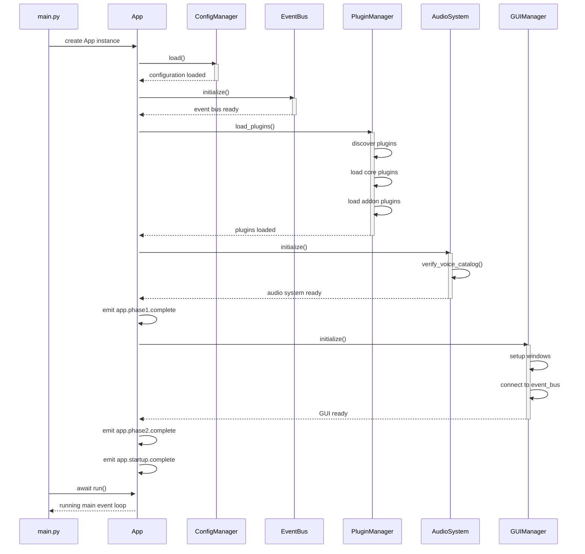
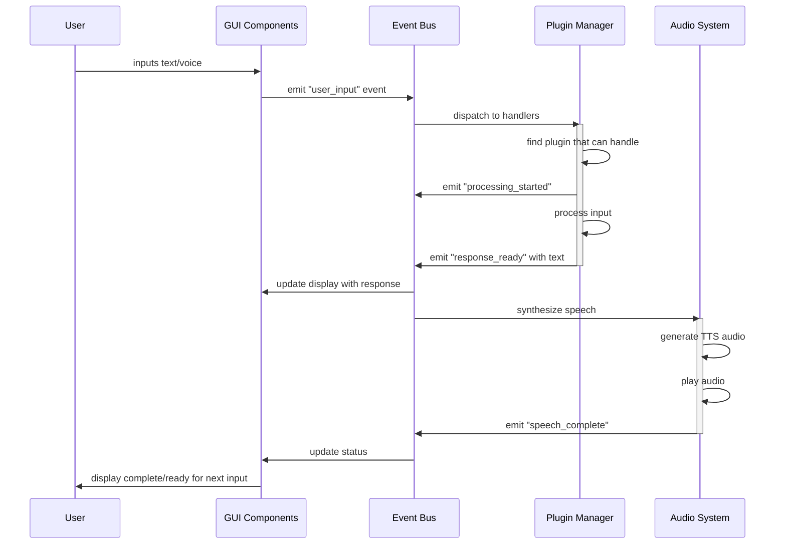
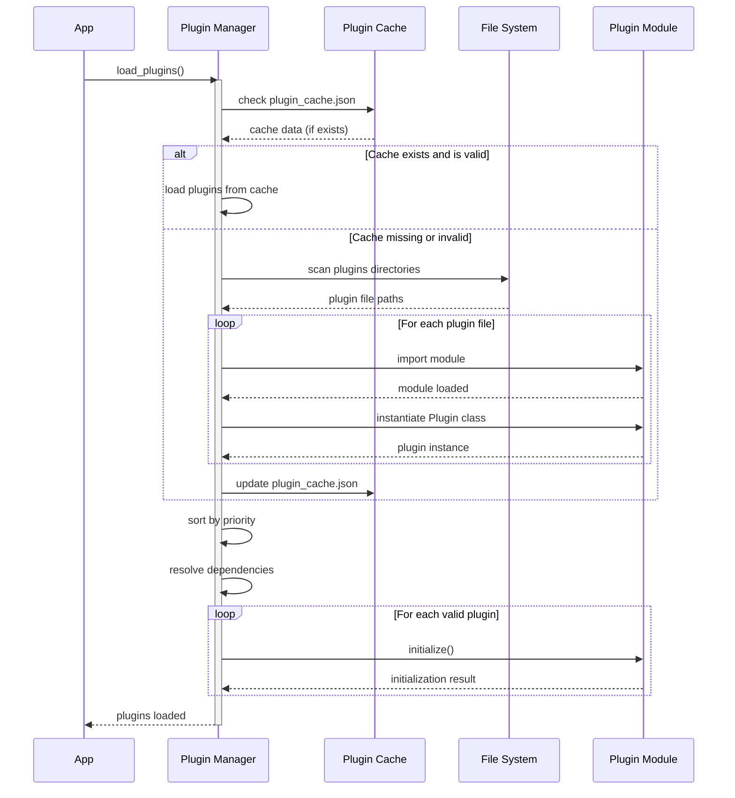
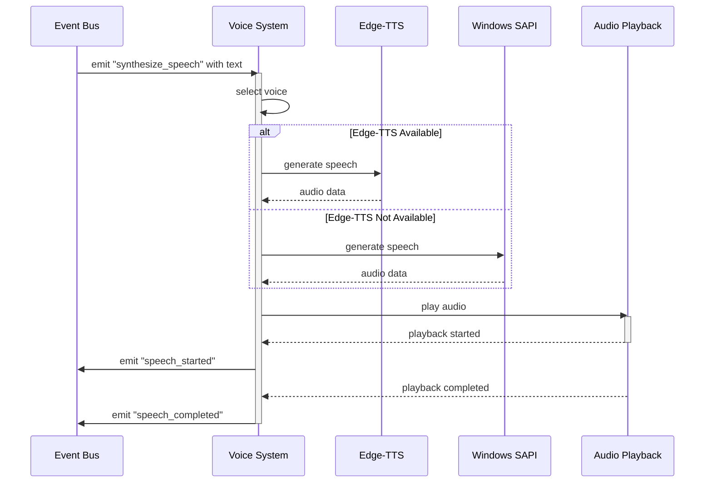
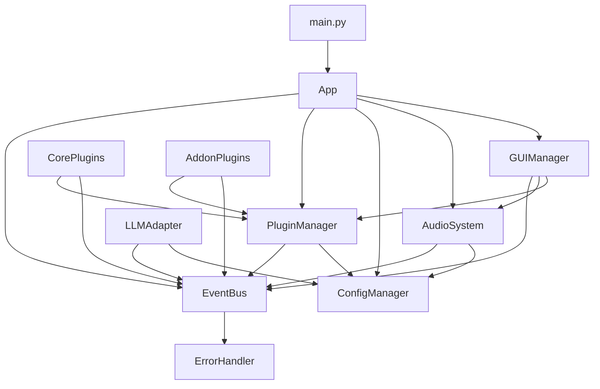
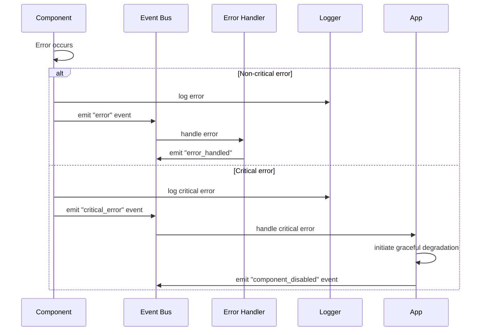
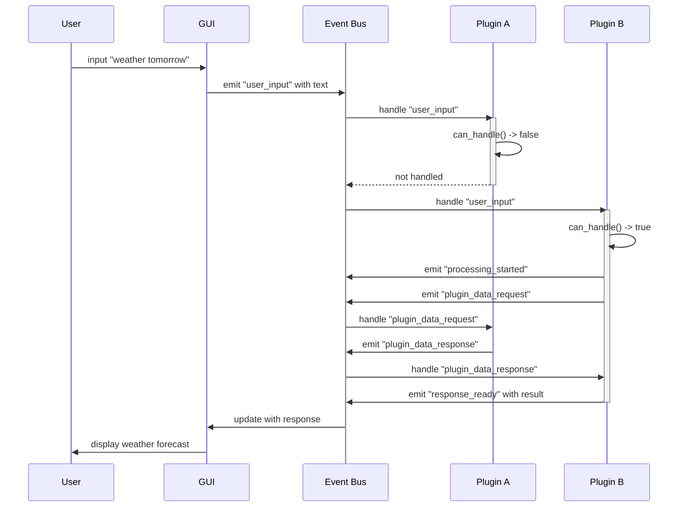
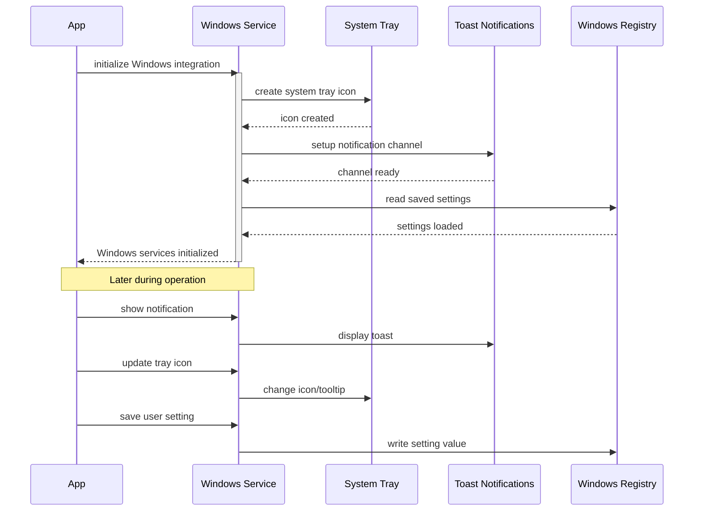
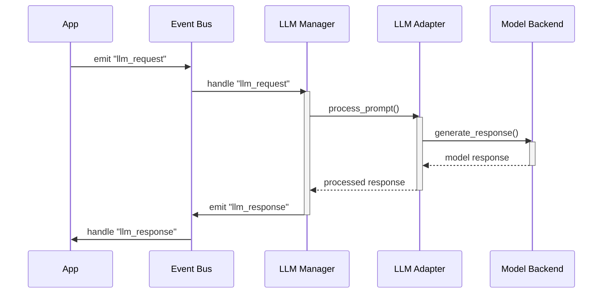

# VPA Component Integration Sequence

This document provides a detailed sequence diagram and explanation of how the VPA components integrate and communicate with each other, addressing the integration sequence gap identified in the assessment report.

## 1. System Startup Sequence

The following sequence diagram illustrates the initialization flow of the VPA application:

## 2. Event Communication Flow

This sequence diagram shows how events flow through the system when a user interacts with the application:

## 3. Plugin Registration and Discovery

This sequence illustrates how plugins are registered and discovered at runtime:

## 4. Voice System Integration

This sequence demonstrates how the voice system integrates with other components:

## 5. Component Dependency Graph

The following diagram illustrates the dependencies between major components:

## 6. Error Handling and Recovery Flow

This sequence demonstrates how errors are handled across components:

## 7. Plugin Event Communication Pattern

This diagram shows how plugins communicate with the system and each other:

## 8. Integration with Windows OS Services

This sequence shows how the VPA integrates with Windows OS services:

## 9. LLM Integration Flow

This sequence shows the integration flow with Language Models:

## 10. Integration Points Summary

| Component | Integration Points | Events Emitted | Events Subscribed |
|-----------|-------------------|----------------|-------------------|
| **App** | EventBus, PluginManager, ConfigManager | app.startup.complete, app.startup.failed, app.stopping, app.stopped | system_tray.exit |
| **EventBus** | All components | N/A (transport only) | All events |
| **PluginManager** | EventBus, Plugins | plugin.loaded, plugin.unloaded | app.startup.complete |
| **AudioSystem** | EventBus | speech_started, speech_completed | synthesize_speech |
| **GUIManager** | EventBus | user_input, gui.ready | response_ready, speech_completed |
| **Plugins** | EventBus, PluginManager | response_ready, plugin.data_* | user_input, plugin.data_* |
| **LLMManager** | EventBus, LLMAdapter | llm_response | llm_request |
| **WindowsServices** | EventBus, OS Services | notification.shown, registry.updated | system_tray.action |

---

*Document created: August 29, 2025*
