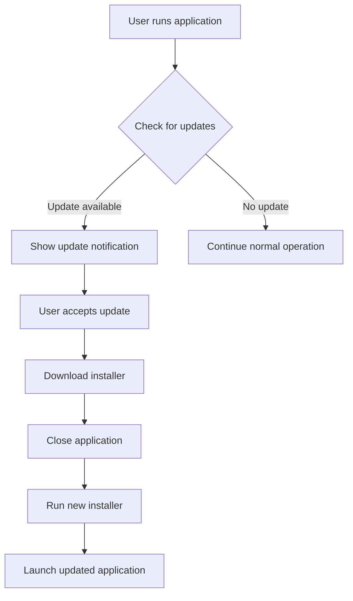
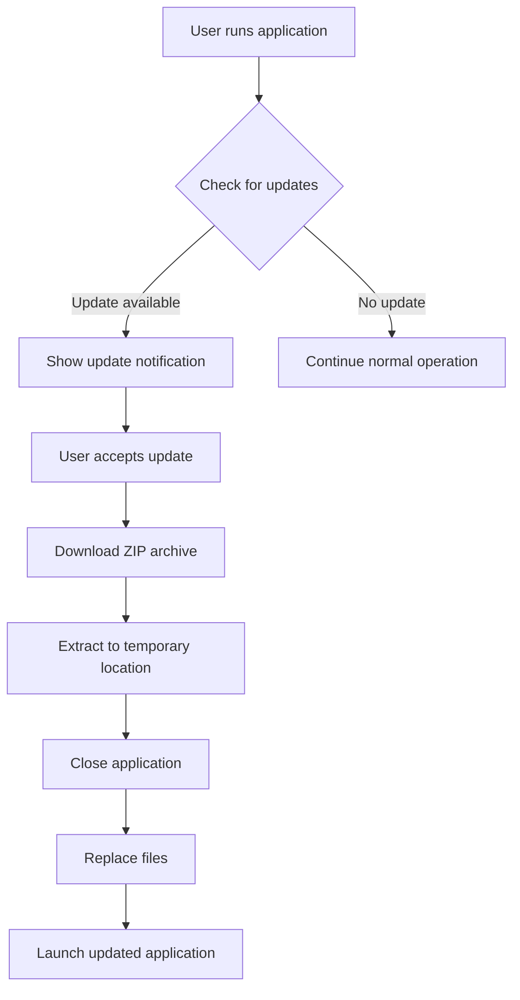

# VPA Deployment Guidelines

This document outlines the deployment guidelines for the VPA application, addressing the gap identified in the assessment report.

## 1. Deployment Overview

VPA is designed as a desktop application targeting Windows environments. This document outlines the deployment process, package creation, and distribution methods for end users.

## 2. Deployment Methods

### 2.1 Distribution Formats

VPA will be distributed in the following formats:

1. **Installable Package**: Windows installer (.exe) with guided setup
2. **Portable Package**: ZIP archive with standalone executable
3. **Python Package**: Installable via pip for developers

### 2.2 System Requirements

| Requirement | Minimum | Recommended |
|-------------|---------|-------------|
| **Operating System** | Windows 10 (64-bit) | Windows 11 (64-bit) |
| **Processor** | Dual-Core 2 GHz | Quad-Core 3 GHz |
| **RAM** | 4 GB | 8 GB |
| **Disk Space** | 500 MB | 1 GB |
| **Python** | 3.9+ (if installed from source) | 3.11+ |
| **Display** | 1366 x 768 | 1920 x 1080 |
| **Audio** | Basic audio output | High-quality speakers/headphones |
| **Internet** | Required for LLM features | Broadband connection |

## 3. Building Deployment Packages

### 3.1 Windows Installer

The Windows installer is built using PyInstaller and Inno Setup:

```bash
# Step 1: Create PyInstaller bundle
pyinstaller --noconfirm --onedir --windowed --icon=resources/icons/vpa_icon.ico ^
    --add-data="resources;resources" ^
    --add-data="config;config" ^
    --name="VPA" ^
    --hidden-import="pygame" ^
    --hidden-import="edge_tts" ^
    --hidden-import="customtkinter" ^
    src/main.py

# Step 2: Create Inno Setup installer
iscc setup.iss
```

The `setup.iss` file contains:

```iss
#define AppName "Virtual Personal Assistant"
#define AppVersion "1.0.0"
#define AppPublisher "VPA Project"
#define AppExeName "VPA.exe"

[Setup]
AppId={{38A7DEF1-2B38-4A49-A95D-9D8BFD161E8C}
AppName={#AppName}
AppVersion={#AppVersion}
AppPublisher={#AppPublisher}
DefaultDirName={autopf}\{#AppName}
DefaultGroupName={#AppName}
OutputBaseFilename=VPA_Setup_{#AppVersion}
Compression=lzma
SolidCompression=yes
PrivilegesRequired=admin
SetupIconFile=resources\icons\vpa_icon.ico

[Files]
Source: "dist\VPA\*"; DestDir: "{app}"; Flags: ignoreversion recursesubdirs createallsubdirs

[Icons]
Name: "{group}\{#AppName}"; Filename: "{app}\{#AppExeName}"
Name: "{group}\Uninstall {#AppName}"; Filename: "{uninstallexe}"
Name: "{autodesktop}\{#AppName}"; Filename: "{app}\{#AppExeName}"

[Run]
Filename: "{app}\{#AppExeName}"; Description: "Launch application"; Flags: nowait postinstall skipifsilent
```

### 3.2 Portable Package

The portable package is created with PyInstaller in a single directory:

```bash
pyinstaller --noconfirm --onedir --windowed --icon=resources/icons/vpa_icon.ico ^
    --add-data="resources;resources" ^
    --add-data="config;config" ^
    --name="VPA_Portable" ^
    --hidden-import="pygame" ^
    --hidden-import="edge_tts" ^
    --hidden-import="customtkinter" ^
    src/main.py

# Create portable ZIP archive
cd dist
powershell Compress-Archive -Path VPA_Portable -DestinationPath VPA_Portable_1.0.0.zip
```

### 3.3 Python Package

The Python package is created using PyPI standards:

```bash
# Build Python package
python -m build

# Test locally
pip install dist/vpa-1.0.0-py3-none-any.whl

# Upload to PyPI (if applicable)
python -m twine upload dist/*
```

The `pyproject.toml` file defines the package:

```toml
[build-system]
requires = ["setuptools>=42", "wheel"]
build-backend = "setuptools.build_meta"

[project]
name = "vpa"
version = "1.0.0"
description = "Virtual Personal Assistant"
readme = "README.md"
authors = [
    {name = "VPA Project", email = "info@vpaproject.example"}
]
license = {text = "MIT"}
classifiers = [
    "Development Status :: 4 - Beta",
    "Environment :: Win32 (MS Windows)",
    "Intended Audience :: End Users/Desktop",
    "License :: OSI Approved :: MIT License",
    "Programming Language :: Python :: 3",
    "Programming Language :: Python :: 3.9",
    "Programming Language :: Python :: 3.10",
    "Programming Language :: Python :: 3.11",
    "Topic :: Desktop Environment",
]
requires-python = ">=3.9"
dependencies = [
    "psutil>=5.9.0",
    "pygame>=2.6.0",
    "edge-tts>=7.0.0",
    "customtkinter>=5.2.0",
    "PyYAML>=6.0",
    "pywin32>=302; platform_system=='Windows'",
]

[project.optional-dependencies]
dev = [
    "pytest>=7.0.0",
    "pytest-asyncio>=0.21.0",
    "pytest-cov>=4.0.0",
    "black>=23.1.0",
    "mypy>=1.0.1",
]

[project.urls]
"Homepage" = "https://github.com/example/vpa"
"Bug Reports" = "https://github.com/example/vpa/issues"

[project.scripts]
vpa = "vpa.__main__:main"
```

## 4. Installation Process

### 4.1 Windows Installer Installation

1. **Download**: User downloads the Windows installer (.exe)
2. **Run Installer**: User runs the installer with admin privileges
3. **Configuration**: Installer guides through basic setup options
4. **Desktop Integration**: Creates shortcuts and file associations
5. **First Run**: Application starts with first-run setup wizard

### 4.2 Portable Installation

1. **Download**: User downloads the portable ZIP archive
2. **Extract**: User extracts the ZIP to desired location
3. **Run**: User launches the application via the executable
4. **Configuration**: Application creates settings in local directory
5. **First Run**: Application starts with first-run setup wizard

### 4.3 Python Package Installation

1. **Prerequisites**: User installs Python 3.9+ and pip
2. **Installation**: User runs `pip install vpa`
3. **Launch**: User runs `vpa` command or `python -m vpa`
4. **Configuration**: Application creates settings in user directory
5. **First Run**: Application starts with first-run setup wizard

## 5. Update Process

### 5.1 Windows Installer Updates



### 5.2 Portable Updates



### 5.3 Python Package Updates

```bash
# Update VPA package
pip install --upgrade vpa
```

## 6. Configuration Management

### 6.1 Configuration Locations

| Installation Method | Configuration Location | User Data Location |
|--------------------|------------------------|-------------------|
| **Windows Installer** | `%APPDATA%\VPA\config\` | `%APPDATA%\VPA\data\` |
| **Portable Package** | `<app_directory>\config\` | `<app_directory>\data\` |
| **Python Package** | `~\.vpa\config\` | `~\.vpa\data\` |

### 6.2 Configuration Files

The following configuration files are managed during deployment:

1. **`config/default.yaml`**: Application defaults (included in package)
2. **`config/user_settings.yaml`**: User-specific settings (created at runtime)
3. **`config/voice_settings.json`**: Voice configuration (created at runtime)
4. **`config/plugins.yaml`**: Plugin configuration (created at runtime)

### 6.3 Data Migration

When updating to a new version:

```python
def migrate_configuration():
    """Migrate configuration files to new version format."""
    try:
        config_dir = get_config_directory()
        user_settings = os.path.join(config_dir, "user_settings.yaml")
        
        if os.path.exists(user_settings):
            # Load existing settings
            with open(user_settings, 'r') as f:
                settings = yaml.safe_load(f)
                
            # Apply version-specific migrations
            if "version" in settings and settings["version"] < "1.0.0":
                # Migrate from pre-1.0.0 to 1.0.0
                settings["voice_settings"]["edge_tts_enabled"] = True
                settings["version"] = "1.0.0"
                
            # Save updated settings
            with open(user_settings, 'w') as f:
                yaml.safe_dump(settings, f)
                
    except Exception as e:
        logger.error(f"Configuration migration failed: {e}")
        # Create backup and revert to defaults
        backup_and_restore_defaults()
```

## 7. First Run Experience

### 7.1 First Run Wizard

On first run, the application guides users through:

1. **Welcome**: Introduction to the application
2. **Voice Selection**: Choose from 13-voice catalog
3. **Feature Configuration**: Enable/disable optional features
4. **User Profile**: Create user profile (optional)
5. **Completion**: Ready to use notification

### 7.2 Environment Detection

```python
def detect_environment():
    """Detect environment capabilities."""
    environment_info = {}
    
    # Check Edge-TTS availability
    try:
        import edge_tts
        environment_info["edge_tts_available"] = True
    except ImportError:
        environment_info["edge_tts_available"] = False
    
    # Check audio playback
    try:
        import pygame
        pygame.mixer.init()
        environment_info["audio_playback_available"] = True
    except:
        environment_info["audio_playback_available"] = False
    
    # Check Windows-specific features
    try:
        import win32api
        environment_info["windows_api_available"] = True
    except:
        environment_info["windows_api_available"] = False
    
    return environment_info
```

## 8. Dependency Management

### 8.1 External Dependencies

The VPA application depends on several external libraries:

| Dependency | Version | Purpose | Installation Method |
|------------|---------|---------|-------------------|
| **edge-tts** | 7.0.0+ | Neural TTS voices | Packaged with app |
| **pygame** | 2.6.0+ | Audio playback | Packaged with app |
| **customtkinter** | 5.2.0+ | GUI framework | Packaged with app |
| **PyYAML** | 6.0+ | Configuration | Packaged with app |
| **psutil** | 5.9.0+ | Performance monitoring | Packaged with app |
| **pywin32** | 302+ | Windows API | Packaged with app |

### 8.2 Optional Dependencies

The following dependencies are optional and can be installed separately:

| Dependency | Purpose | Installation |
|------------|---------|-------------|
| **ollama** | Local LLM integration | `pip install ollama` |
| **transformers** | AI text processing | `pip install transformers` |
| **pytorch** | AI model backend | `pip install torch` |

### 8.3 Runtime Dependency Check

```python
def check_dependencies():
    """Check and notify about critical dependencies."""
    missing_critical = []
    missing_optional = []
    
    # Check critical dependencies
    for dependency, module in [
        ("edge-tts", "edge_tts"),
        ("pygame", "pygame"),
        ("customtkinter", "customtkinter")
    ]:
        try:
            importlib.import_module(module)
        except ImportError:
            missing_critical.append(dependency)
    
    # Check optional dependencies
    for dependency, module in [
        ("ollama", "ollama"),
        ("transformers", "transformers")
    ]:
        try:
            importlib.import_module(module)
        except ImportError:
            missing_optional.append(dependency)
    
    return {
        "missing_critical": missing_critical,
        "missing_optional": missing_optional,
        "all_critical_available": len(missing_critical) == 0
    }
```

## 9. System Integration

### 9.1 Windows Registry

The installer registers the application in the Windows Registry:

```
HKEY_CURRENT_USER\Software\VPA\
    InstallPath = <installation directory>
    Version = <version number>
    FirstRun = <true/false>

HKEY_CURRENT_USER\Software\Microsoft\Windows\CurrentVersion\Run\
    VPA = <path to executable>  # If start with Windows is enabled
```

### 9.2 File Associations

The installer can register file associations for VPA configuration files:

```
HKEY_CLASSES_ROOT\.vpa\
    (Default) = "VPA.ConfigFile"

HKEY_CLASSES_ROOT\VPA.ConfigFile\
    (Default) = "VPA Configuration File"

HKEY_CLASSES_ROOT\VPA.ConfigFile\shell\open\command\
    (Default) = "<installation directory>\VPA.exe \"%1\""
```

### 9.3 Start Menu and Desktop Integration

The installer creates:

1. **Start Menu Shortcuts**: Program group with application and uninstaller
2. **Desktop Shortcut**: Optional desktop icon
3. **Taskbar Pin**: Optional pin to taskbar option

## 10. Deployment Checklist

| Task | Description | Status |
|------|-------------|--------|
| **Build Verification** | Verify application builds without errors | ⬜ |
| **Dependency Check** | Verify all dependencies are correctly packaged | ⬜ |
| **Installer Testing** | Test installation process on clean system | ⬜ |
| **First Run Testing** | Verify first run experience works correctly | ⬜ |
| **Update Testing** | Test update process from previous version | ⬜ |
| **Uninstall Testing** | Verify clean uninstallation | ⬜ |
| **Permissions Testing** | Verify operation with minimal permissions | ⬜ |
| **Performance Testing** | Verify startup time and memory usage | ⬜ |
| **Documentation Review** | Ensure user documentation is current | ⬜ |
| **License Check** | Verify all dependencies have compatible licenses | ⬜ |

---

*Document created: August 29, 2025*
