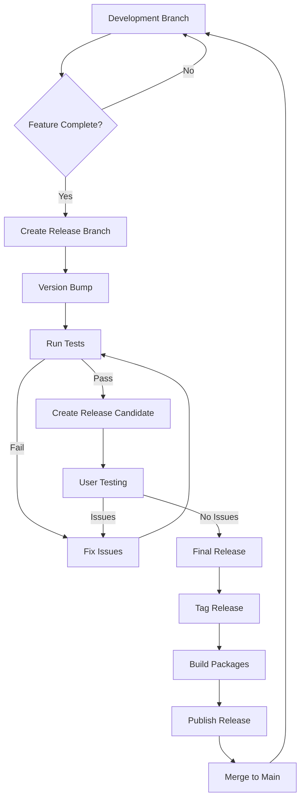
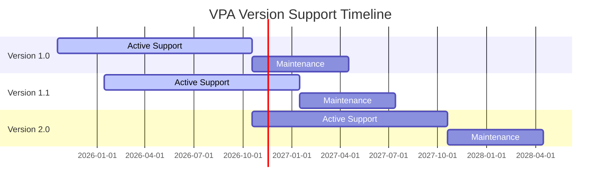

# VPA Versioning Strategy

This document outlines the versioning strategy for the VPA application, addressing the gap identified in the assessment report.

## 1. Versioning Scheme

VPA follows semantic versioning (SemVer) with a `MAJOR.MINOR.PATCH` format:

| Version Component | Purpose | Example |
|-------------------|---------|---------|
| **MAJOR** | Incompatible API changes | 1.0.0 → 2.0.0 |
| **MINOR** | New features (backward compatible) | 1.0.0 → 1.1.0 |
| **PATCH** | Bug fixes (backward compatible) | 1.0.0 → 1.0.1 |

Additional labels for pre-release and build metadata may be appended:
- Pre-release: `MAJOR.MINOR.PATCH-[alpha/beta/rc].N` (e.g., `1.0.0-beta.2`)
- Build metadata: `MAJOR.MINOR.PATCH+YYYYMMDD` (e.g., `1.0.0+20250829`)

## 2. Version Management Implementation

### 2.1 Version Definition

The version is defined in a single source of truth:

```python
# src/vpa/_version.py
"""Version information."""

__version__ = '1.0.0'
__version_info__ = tuple(int(part) for part in __version__.split('.'))
```

### 2.2 Version Access

Version information is accessible throughout the application:

```python
# src/vpa/__init__.py
from vpa._version import __version__, __version_info__

# In application code
import vpa
print(f"VPA version: {vpa.__version__}")
```

### 2.3 Version Display

The version is displayed in multiple locations:

1. **Application Title**: `Virtual Personal Assistant v1.0.0`
2. **Settings Dialog**: Detailed version information
3. **About Dialog**: Complete version with build information
4. **Log Files**: Version included in log headers

```python
def get_version_info():
    """Get detailed version information."""
    return {
        "version": __version__,
        "major": __version_info__[0],
        "minor": __version_info__[1],
        "patch": __version_info__[2],
        "build_date": BUILD_DATE,
        "build_hash": BUILD_HASH,
        "python_version": platform.python_version(),
        "platform": platform.platform()
    }
```

## 3. Release Management Process

### 3.1 Release Types

| Release Type | Purpose | Versioning | Frequency |
|--------------|---------|------------|-----------|
| **Major Release** | Significant changes, new architecture | X.0.0 | 6-12 months |
| **Feature Release** | New features, enhancements | X.Y.0 | 2-3 months |
| **Maintenance Release** | Bug fixes, minor improvements | X.Y.Z | As needed |
| **Alpha Release** | Early testing, unstable | X.Y.Z-alpha.N | Development |
| **Beta Release** | Feature complete, testing | X.Y.Z-beta.N | Pre-release |
| **Release Candidate** | Final testing before release | X.Y.Z-rc.N | Pre-release |

### 3.2 Version Bump Automation

Version numbers are managed using a version bump script:

```python
# scripts/bump_version.py
#!/usr/bin/env python
"""Version bump utility for VPA."""

import re
import sys
from pathlib import Path

def bump_version(version_file, bump_type):
    """Bump the version according to semantic versioning."""
    with open(version_file, 'r') as f:
        content = f.read()
    
    # Extract current version
    match = re.search(r"__version__\s*=\s*['\"]([^'\"]+)['\"]", content)
    if not match:
        print("Error: Could not find version string")
        sys.exit(1)
    
    current_version = match.group(1)
    major, minor, patch = map(int, current_version.split('.'))
    
    # Bump version according to bump_type
    if bump_type == 'major':
        new_version = f"{major + 1}.0.0"
    elif bump_type == 'minor':
        new_version = f"{major}.{minor + 1}.0"
    elif bump_type == 'patch':
        new_version = f"{major}.{minor}.{patch + 1}"
    else:
        print(f"Error: Unknown bump type: {bump_type}")
        sys.exit(1)
    
    # Replace version in file
    new_content = re.sub(
        r"__version__\s*=\s*['\"]([^'\"]+)['\"]",
        f"__version__ = '{new_version}'",
        content
    )
    
    with open(version_file, 'w') as f:
        f.write(new_content)
    
    print(f"Version bumped: {current_version} → {new_version}")
    return new_version

if __name__ == "__main__":
    if len(sys.argv) != 2 or sys.argv[1] not in ['major', 'minor', 'patch']:
        print("Usage: bump_version.py [major|minor|patch]")
        sys.exit(1)
    
    version_file = Path(__file__).parent.parent / "src" / "vpa" / "_version.py"
    bump_version(version_file, sys.argv[1])
```

### 3.3 Release Process



## 4. Compatibility Management

### 4.1 Configuration Compatibility

Each version tracks configuration compatibility:

```python
CONFIG_VERSION = "1.0"  # Configuration format version

def is_config_compatible(config_version):
    """Check if the configuration version is compatible."""
    if not config_version:
        return False
    
    # Compare major version for compatibility
    config_major = config_version.split('.')[0]
    current_major = CONFIG_VERSION.split('.')[0]
    
    return config_major == current_major

def migrate_config(config_data, from_version):
    """Migrate configuration from older version."""
    migrations = {
        "0.9": migrate_from_0_9,
        "0.8": migrate_from_0_8
    }
    
    # Apply necessary migrations in sequence
    current_version = from_version
    while current_version != CONFIG_VERSION:
        if current_version in migrations:
            config_data = migrations[current_version](config_data)
            # Update version after migration
            next_version = get_next_version(current_version)
            config_data["config_version"] = next_version
            current_version = next_version
        else:
            raise ValueError(f"No migration path from {current_version} to {CONFIG_VERSION}")
    
    return config_data
```

### 4.2 Plugin API Compatibility

The plugin API is versioned independently:

```python
# src/vpa/core/plugins.py
"""Plugin system for VPA."""

PLUGIN_API_VERSION = "1.0"  # Plugin API version

class PluginManager:
    def is_plugin_compatible(self, plugin_api_version):
        """Check if a plugin is compatible with the current API."""
        if not plugin_api_version:
            return False
        
        # Compare major version for compatibility
        plugin_major = plugin_api_version.split('.')[0]
        current_major = PLUGIN_API_VERSION.split('.')[0]
        
        return plugin_major == current_major
```

### 4.3 Backward Compatibility

Guidelines for maintaining backward compatibility:

1. **Configuration Files**: 
   - Maintain backward compatibility for at least one major version
   - Include automatic migration for minor version changes

2. **Plugin API**: 
   - Breaking changes only in major versions
   - Deprecate features before removal
   - Support multiple API versions when possible

3. **User Data**:
   - Never delete user data during updates
   - Migrate data formats automatically
   - Create backups before migrations

## 5. Version History Management

### 5.1 Changelog Generation

Changelogs are generated from commit history:

```python
# scripts/generate_changelog.py
"""Generate a changelog from git history."""

import subprocess
import re
from datetime import datetime

def get_last_tag():
    """Get the most recent tag."""
    try:
        return subprocess.check_output(
            ["git", "describe", "--tags", "--abbrev=0"],
            universal_newlines=True
        ).strip()
    except subprocess.CalledProcessError:
        return None

def generate_changelog(last_tag=None):
    """Generate changelog from git history."""
    if last_tag:
        git_log_cmd = ["git", "log", f"{last_tag}..HEAD", "--pretty=format:%s (%h)"]
    else:
        git_log_cmd = ["git", "log", "--pretty=format:%s (%h)"]
    
    log_output = subprocess.check_output(git_log_cmd, universal_newlines=True)
    commits = log_output.split('\n')
    
    # Categorize commits
    features = []
    fixes = []
    other = []
    
    for commit in commits:
        if re.match(r'^feat(\([^)]+\))?:', commit, re.IGNORECASE):
            features.append(commit)
        elif re.match(r'^fix(\([^)]+\))?:', commit, re.IGNORECASE):
            fixes.append(commit)
        else:
            other.append(commit)
    
    # Generate markdown
    today = datetime.now().strftime("%Y-%m-%d")
    version = get_current_version()
    
    changelog = f"## {version} ({today})\n\n"
    
    if features:
        changelog += "### Features\n\n"
        for feat in features:
            changelog += f"- {feat}\n"
        changelog += "\n"
    
    if fixes:
        changelog += "### Bug Fixes\n\n"
        for fix in fixes:
            changelog += f"- {fix}\n"
        changelog += "\n"
    
    if other:
        changelog += "### Other Changes\n\n"
        for change in other:
            changelog += f"- {change}\n"
        changelog += "\n"
    
    return changelog

def get_current_version():
    """Get current version from version file."""
    with open("src/vpa/_version.py", "r") as f:
        content = f.read()
        match = re.search(r"__version__\s*=\s*['\"]([^'\"]+)['\"]", content)
        return match.group(1) if match else "Unknown"
```

### 5.2 CHANGELOG.md Format

The CHANGELOG.md file follows the Keep a Changelog format:

```markdown
# Changelog

All notable changes to VPA will be documented in this file.

The format is based on [Keep a Changelog](https://keepachangelog.com/en/1.0.0/),
and this project adheres to [Semantic Versioning](https://semver.org/spec/v2.0.0.html).

## [1.0.0] - 2025-10-19

### Added
- Complete 13-voice catalog with Edge-TTS integration
- Event-driven architecture with async support
- Plugin system with error boundaries
- Performance monitoring system
- GUI with CustomTkinter framework

### Changed
- Completely refactored application architecture
- Improved startup performance (<10s target)
- Enhanced error handling and recovery

### Fixed
- Audio playback issues with certain sound formats
- Plugin discovery on case-sensitive file systems
- Memory leak in event handling system
```

### 5.3 Git Tagging Strategy

Releases are tagged in git:

```bash
# For standard releases
git tag -a v1.0.0 -m "Release version 1.0.0"

# For pre-releases
git tag -a v1.1.0-beta.1 -m "Beta release 1.1.0-beta.1"

# Push tags
git push origin --tags
```

## 6. Version Update Notification

### 6.1 Update Check System

The application periodically checks for updates:

```python
async def check_for_updates():
    """Check for application updates."""
    try:
        # Fetch version information from update server
        async with aiohttp.ClientSession() as session:
            async with session.get(UPDATE_CHECK_URL) as response:
                if response.status == 200:
                    data = await response.json()
                    latest_version = data.get("latest_version")
                    
                    # Compare versions
                    if latest_version and version_is_newer(latest_version, __version__):
                        return {
                            "update_available": True,
                            "latest_version": latest_version,
                            "download_url": data.get("download_url"),
                            "release_notes": data.get("release_notes"),
                            "is_critical": data.get("is_critical", False)
                        }
                        
        return {"update_available": False}
    except Exception as e:
        logger.error(f"Update check failed: {e}")
        return {"update_available": False, "error": str(e)}
```

### 6.2 Update Notification UI

Updates are presented to the user via notifications:

```python
def show_update_notification(update_info):
    """Show update notification to user."""
    if not update_info.get("update_available"):
        return
    
    version = update_info.get("latest_version")
    is_critical = update_info.get("is_critical", False)
    
    notification = UpdateNotification(
        title=f"Update Available: v{version}",
        message=(
            f"A new {'critical ' if is_critical else ''}update is available. "
            f"Would you like to update from {__version__} to {version}?"
        ),
        update_info=update_info
    )
    
    notification.show()
```

## 7. Development Version Management

### 7.1 Development Versions

Development versions use additional identifiers:

```
1.0.0-dev.20250829+abcdef
```

Where:
- `dev` indicates a development build
- `20250829` is the date in YYYYMMDD format
- `abcdef` is the abbreviated git hash

### 7.2 Build Information

Build information is included in development builds:

```python
# src/vpa/_build_info.py
"""Build information - generated at build time."""

BUILD_DATE = "20250829"
BUILD_HASH = "abcdef123456"
BUILD_TYPE = "development"  # or "release", "beta", etc.
```

This file is generated during the build process:

```python
def generate_build_info():
    """Generate build information file."""
    build_date = datetime.now().strftime("%Y%m%d")
    git_hash = subprocess.check_output(
        ["git", "rev-parse", "--short", "HEAD"],
        universal_newlines=True
    ).strip()
    
    build_type = "development"
    if os.environ.get("RELEASE_BUILD") == "1":
        build_type = "release"
    elif os.environ.get("BETA_BUILD") == "1":
        build_type = "beta"
    
    with open("src/vpa/_build_info.py", "w") as f:
        f.write('"""Build information - generated at build time."""\n\n')
        f.write(f'BUILD_DATE = "{build_date}"\n')
        f.write(f'BUILD_HASH = "{git_hash}"\n')
        f.write(f'BUILD_TYPE = "{build_type}"\n')
```

## 8. Long-term Version Support

### 8.1 LTS Policy

For major releases, the following support policy applies:

| Version | Release Date | Support End | Extended Support End |
|---------|--------------|-------------|--------------------|
| 1.0.x | October 2025 | October 2026 | April 2027 |
| 2.0.x | October 2026 | October 2027 | April 2028 |

### 8.2 Support Definitions

| Support Level | Description |
|--------------|-------------|
| **Active** | Regular feature and bug fix updates |
| **Maintenance** | Security and critical bug fixes only |
| **Extended** | Paid support for critical issues only |
| **End-of-Life** | No support provided |

### 8.3 Version Support Timeline



## 9. Versioning Decision Guidelines

### 9.1 When to Increment MAJOR Version

- Incompatible changes to plugin API
- Major UI redesign that changes user workflow
- Significant architectural changes
- Configuration format changes requiring migration

### 9.2 When to Increment MINOR Version

- New features that maintain backward compatibility
- Significant performance improvements
- New plugin types or capabilities
- Non-breaking API enhancements

### 9.3 When to Increment PATCH Version

- Bug fixes
- Security updates
- Performance optimizations
- Documentation improvements

## 10. Versioning Guidelines

1. **Single Source of Truth**: Version is defined in a single location
2. **Clear Conventions**: Follow semantic versioning strictly
3. **Documentation**: Update all version references in documentation
4. **Change Tracking**: Maintain detailed changelog
5. **Compatibility**: Clearly indicate compatibility requirements
6. **Visibility**: Make version visible to users in UI and logs

---

*Document created: August 29, 2025*
