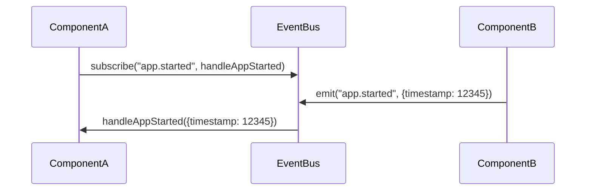
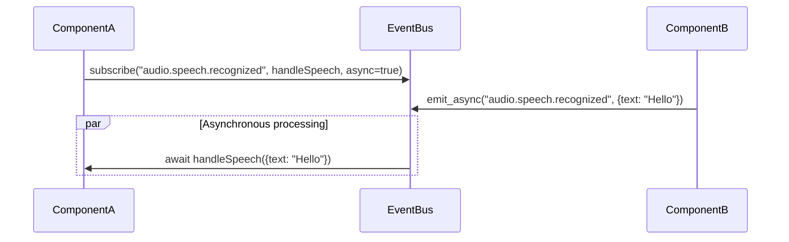

# VPA Event System Design

## Overview

The Event System is a core architectural component of the VPA application, providing a decoupled communication mechanism between components. It implements a publish-subscribe (pub/sub) pattern that allows modules to communicate without direct dependencies, promoting modularity and extensibility.

This document details the design of the Event System, including its architecture, interfaces, performance considerations, and implementation patterns.

## Design Principles

The Event System design is guided by these core principles:

1. **Zero Direct Coupling**: Components communicate without direct dependencies
2. **Asynchronous-First**: Events are primarily processed asynchronously
3. **Performance Optimized**: Event dispatch has a target of <10ms
4. **Robust Error Handling**: Event handler failures should not crash the system
5. **Flexible Subscription**: Support for different subscription patterns
6. **Observable**: Provide metrics and monitoring capabilities

## Core Components

### EventBus

The central event dispatch system that manages event emission and subscription.

```python
class EventBus:
    """
    Central event dispatch system for the VPA application.
    
    Provides methods for subscribing to events and emitting events,
    with support for both synchronous and asynchronous operations.
    """
    
    def subscribe(self, event_name: str, callback, *, 
                 async_callback: bool = False,
                 once: bool = False,
                 priority: int = 0) -> str:
        """
        Subscribe to an event.
        
        Args:
            event_name: The event to subscribe to (can use pattern matching)
            callback: Function to call when event occurs
            async_callback: Whether the callback is async
            once: Whether to unsubscribe after first call
            priority: Higher priority handlers execute first
            
        Returns:
            Subscription ID used for unsubscribing
        """
        pass
        
    def unsubscribe(self, subscription_id: str) -> bool:
        """
        Unsubscribe from an event.
        
        Args:
            subscription_id: The ID returned from subscribe()
            
        Returns:
            True if subscription was removed
        """
        pass
        
    def emit(self, event_name: str, data: dict = None) -> None:
        """
        Emit an event synchronously.
        
        Args:
            event_name: The event to emit
            data: Event data (must be JSON-serializable)
        """
        pass
        
    async def emit_async(self, event_name: str, data: dict = None) -> None:
        """
        Emit an event asynchronously.
        
        Args:
            event_name: The event to emit
            data: Event data (must be JSON-serializable)
        """
        pass
        
    def get_metrics(self) -> dict:
        """
        Get event system metrics.
        
        Returns:
            Dictionary with event system metrics
        """
        pass
        
    def cleanup(self) -> None:
        """
        Clean up resources.
        """
        pass
```

### Event

The data structure representing an event in the system.

```python
@dataclass
class Event:
    """
    Represents an event in the system.
    """
    
    name: str               # Event name
    data: dict              # Event data
    timestamp: float        # Event creation time
    source: str = None      # Component that emitted the event
    id: str = field(default_factory=lambda: str(uuid.uuid4()))  # Unique event ID
```

### EventSubscription

The data structure representing an event subscription.

```python
@dataclass
class EventSubscription:
    """
    Represents an event subscription.
    """
    
    id: str                 # Subscription ID
    event_pattern: str      # Event pattern to match
    callback: Callable      # Callback function
    async_callback: bool    # Whether callback is async
    once: bool              # Whether to unsubscribe after first call
    priority: int           # Higher priority handlers execute first
    subscribed_at: float    # Time of subscription
    call_count: int = 0     # Number of times called
    last_called_at: float = None  # Time of last call
```

## Event Naming Convention

Events follow a hierarchical naming convention to provide clarity and enable pattern-based subscriptions:

```
category.action[.detail]
```

For example:
- `audio.speech.recognized`
- `plugin.loaded`
- `gui.window.closed`
- `app.shutdown.requested`

### Standard Event Categories

1. `app` - Application-level events
2. `audio` - Audio system events
3. `gui` - GUI-related events
4. `plugin` - Plugin system events
5. `user` - User-initiated events
6. `system` - System-level events
7. `llm` - LLM-related events
8. `data` - Data-related events

## Event Flow

### Basic Event Flow

1. Component subscribes to events of interest
2. Another component emits an event
3. EventBus dispatches event to all subscribers
4. Subscribers process the event



### Asynchronous Event Flow

1. Component subscribes to events of interest with async handler
2. Another component emits an event asynchronously
3. EventBus dispatches event to all subscribers asynchronously
4. Subscribers process the event in parallel



## Subscription Patterns

### Basic Subscription

Subscribe to a specific event:

```python
event_bus.subscribe("app.started", handle_app_started)
```

### Pattern-Based Subscription

Subscribe to multiple events using patterns:

```python
# Subscribe to all audio events
event_bus.subscribe("audio.*", handle_audio_event)

# Subscribe to all speech recognition events
event_bus.subscribe("audio.speech.*", handle_speech_event)
```

### One-Time Subscription

Subscribe to an event that will be handled only once:

```python
event_bus.subscribe("app.initialized", handle_app_initialized, once=True)
```

### Priority-Based Subscription

Subscribe with priority to control execution order:

```python
# Higher priority (10) - executes first
event_bus.subscribe("user.command", handle_command_logging, priority=10)

# Lower priority (0, default) - executes after higher priority handlers
event_bus.subscribe("user.command", handle_command_execution)
```

### Asynchronous Subscription

Subscribe with an asynchronous handler:

```python
async def handle_speech_async(event_data):
    # Async processing
    pass

event_bus.subscribe("audio.speech.recognized", handle_speech_async, async_callback=True)
```

## Error Handling

The Event System implements comprehensive error handling to prevent handler failures from affecting the overall system:

1. **Handler Isolation**: Each handler runs in isolation to contain errors
2. **Error Events**: Handler errors emit `system.error.event_handler` events
3. **Logging**: All errors are logged with context
4. **Graceful Degradation**: System continues operating even if handlers fail

```python
try:
    # Execute handler
    result = handler(event)
except Exception as e:
    logger.error(f"Error in event handler: {e}")
    # Emit error event
    self.emit("system.error.event_handler", {
        "event_name": event.name,
        "handler_id": subscription.id,
        "error": str(e)
    })
```

## Performance Considerations

### Optimization Strategies

1. **Handler Prioritization**: Critical handlers run first
2. **Asynchronous Processing**: Handlers run concurrently when possible
3. **Subscription Indexing**: O(1) lookup for exact event matches
4. **Pattern Caching**: Cache pattern matching results
5. **Minimal Copying**: Avoid unnecessary data copying
6. **Monitoring**: Track dispatch times for optimization

### Performance Targets

| Metric | Target | Validation Method |
|--------|--------|------------------|
| Event Dispatch Time | <10ms | Event timing metrics |
| Event Processing | <50ms | Event timing metrics |
| Event Throughput | >1000/sec | Stress testing |

## Event Middleware

The Event System supports middleware for cross-cutting concerns:

```python
def add_middleware(self, middleware_func, *, 
                  priority: int = 0) -> str:
    """
    Add middleware to the event processing pipeline.
    
    Args:
        middleware_func: Function(event, next_middleware) that processes events
        priority: Higher priority middleware executes first
        
    Returns:
        Middleware ID
    """
    pass
```

Example middleware:

```python
# Logging middleware
def logging_middleware(event, next_middleware):
    logger.debug(f"Event: {event.name}, Data: {event.data}")
    return next_middleware(event)

# Timing middleware
def timing_middleware(event, next_middleware):
    start_time = time.time()
    result = next_middleware(event)
    duration = time.time() - start_time
    if duration > 0.01:  # 10ms
        logger.warning(f"Slow event: {event.name} took {duration:.3f}s")
    return result

event_bus.add_middleware(logging_middleware)
event_bus.add_middleware(timing_middleware)
```

## Standard System Events

### Application Lifecycle Events

| Event | Description | Data |
|-------|-------------|------|
| `app.initialized` | Application core initialized | `{timestamp: float}` |
| `app.started` | Application fully started | `{startup_time: float}` |
| `app.shutdown.requested` | Shutdown requested | `{reason: str}` |
| `app.shutdown.started` | Shutdown process started | `{reason: str}` |
| `app.shutdown.completed` | Shutdown process completed | `{shutdown_time: float}` |

### Plugin System Events

| Event | Description | Data |
|-------|-------------|------|
| `plugins.discovered` | Plugins discovered | `{count: int, plugins: List[str]}` |
| `plugin.loaded` | Plugin loaded | `{plugin_id: str, metadata: dict}` |
| `plugin.initialized` | Plugin initialized | `{plugin_id: str}` |
| `plugin.started` | Plugin started | `{plugin_id: str}` |
| `plugin.stopped` | Plugin stopped | `{plugin_id: str}` |
| `plugin.unloaded` | Plugin unloaded | `{plugin_id: str}` |
| `plugin.error` | Plugin error occurred | `{plugin_id: str, error: str, phase: str}` |

### Audio System Events

| Event | Description | Data |
|-------|-------------|------|
| `audio.speech.recognized` | Speech recognized | `{text: str, confidence: float}` |
| `audio.speech.started` | Speech recognition started | `{}` |
| `audio.speech.stopped` | Speech recognition stopped | `{}` |
| `audio.tts.started` | Text-to-speech started | `{text: str, voice: str}` |
| `audio.tts.completed` | Text-to-speech completed | `{text: str, voice: str, duration: float}` |
| `audio.playback.started` | Audio playback started | `{source: str}` |
| `audio.playback.stopped` | Audio playback stopped | `{source: str}` |
| `audio.playback.completed` | Audio playback completed | `{source: str, duration: float}` |

### GUI Events

| Event | Description | Data |
|-------|-------------|------|
| `gui.window.created` | Window created | `{window_id: str, type: str}` |
| `gui.window.closed` | Window closed | `{window_id: str}` |
| `gui.theme.changed` | Theme changed | `{theme: str}` |
| `gui.chat.message_sent` | User sent message | `{message: str}` |
| `gui.chat.message_received` | System received message | `{message: str, source: str}` |
| `gui.settings.changed` | Settings changed | `{setting: str, value: Any, previous: Any}` |

### User Interaction Events

| Event | Description | Data |
|-------|-------------|------|
| `user.command` | User issued command | `{command: str, args: dict}` |
| `user.input.voice` | Voice input received | `{input: str}` |
| `user.input.text` | Text input received | `{input: str}` |
| `user.action` | User performed action | `{action: str, context: dict}` |

### System Events

| Event | Description | Data |
|-------|-------------|------|
| `system.error` | System error occurred | `{error: str, component: str}` |
| `system.warning` | System warning occurred | `{warning: str, component: str}` |
| `system.performance.threshold_exceeded` | Performance threshold exceeded | `{metric: str, value: float, threshold: float}` |
| `system.update.available` | Update available | `{version: str, changelog: str}` |
| `system.update.started` | Update started | `{from_version: str, to_version: str}` |
| `system.update.completed` | Update completed | `{version: str}` |

## Implementation Details

### Event Bus Implementation

```python
class EventBus:
    def __init__(self):
        # Exact event subscriptions for O(1) lookup
        self._subscriptions: Dict[str, List[EventSubscription]] = defaultdict(list)
        
        # Pattern-based subscriptions
        self._pattern_subscriptions: List[EventSubscription] = []
        
        # Middleware pipeline
        self._middleware: List[Tuple[int, Callable]] = []
        
        # Metrics
        self._metrics = {
            "events_emitted": 0,
            "events_processed": 0,
            "handler_errors": 0,
            "slow_events": 0,
            "event_times": {},
        }
        
        # Lock for thread safety
        self._lock = asyncio.Lock()
        
        self.logger = logging.getLogger("vpa.core.events")
    
    def subscribe(self, event_name: str, callback, *, 
                 async_callback: bool = False,
                 once: bool = False,
                 priority: int = 0) -> str:
        """
        Subscribe to an event.
        
        Implementation details:
        1. Create subscription with unique ID
        2. Add to exact matches if no patterns
        3. Add to pattern matches if contains patterns
        4. Sort subscriptions by priority
        """
        subscription_id = str(uuid.uuid4())
        subscription = EventSubscription(
            id=subscription_id,
            event_pattern=event_name,
            callback=callback,
            async_callback=async_callback,
            once=once,
            priority=priority,
            subscribed_at=time.time()
        )
        
        # Check if pattern-based or exact match
        if '*' in event_name or '?' in event_name:
            self._pattern_subscriptions.append(subscription)
            # Sort by priority (higher first)
            self._pattern_subscriptions.sort(key=lambda s: -s.priority)
        else:
            self._subscriptions[event_name].append(subscription)
            # Sort by priority (higher first)
            self._subscriptions[event_name].sort(key=lambda s: -s.priority)
            
        return subscription_id
    
    # Other implementation details...
```

### Async Event Processing

```python
async def emit_async(self, event_name: str, data: dict = None) -> None:
    """
    Emit an event asynchronously.
    
    Implementation details:
    1. Create event object
    2. Get matching subscriptions
    3. Execute middleware pipeline
    4. Process event handlers concurrently
    5. Update metrics
    """
    # Create event
    event = Event(
        name=event_name,
        data=data or {},
        timestamp=time.time()
    )
    
    # Get matching subscriptions
    subscriptions = self._get_matching_subscriptions(event_name)
    
    # Apply middleware
    event = self._apply_middleware(event)
    
    # Process event handlers
    start_time = time.time()
    
    try:
        # Group subscriptions by async vs sync
        async_handlers = []
        sync_handlers = []
        
        for subscription in subscriptions:
            if subscription.async_callback:
                async_handlers.append(self._process_async_handler(subscription, event))
            else:
                sync_handlers.append(self._process_sync_handler(subscription, event))
        
        # Execute async handlers concurrently
        if async_handlers:
            await asyncio.gather(*async_handlers)
            
        # Execute sync handlers in an executor
        if sync_handlers:
            for handler in sync_handlers:
                await handler
                
    finally:
        # Update metrics
        duration = time.time() - start_time
        self._update_metrics(event_name, duration, len(subscriptions))
```

## Testing Strategy

The Event System should be thoroughly tested for reliability and performance:

1. **Unit Tests**: Test basic functionality and edge cases
2. **Performance Tests**: Verify event dispatch meets performance targets
3. **Concurrency Tests**: Verify correct behavior under concurrent conditions
4. **Error Handling Tests**: Verify error isolation works as expected
5. **Pattern Matching Tests**: Verify pattern subscriptions work correctly

Example test cases:

```python
def test_basic_subscription():
    """Test basic event subscription and dispatch."""
    event_bus = EventBus()
    
    received_events = []
    
    def handler(event_data):
        received_events.append(event_data)
    
    # Subscribe to event
    event_bus.subscribe("test.event", handler)
    
    # Emit event
    event_bus.emit("test.event", {"value": 42})
    
    # Verify handler was called
    assert len(received_events) == 1
    assert received_events[0]["value"] == 42
```

## Integration with Other Components

### Application Manager Integration

```python
# In app.py
from vpa.core.events import event_bus

class App:
    async def start(self):
        # Emit application events
        await event_bus.emit_async("app.initialized")
        
        # Start components
        # ...
        
        # Emit application started event
        await event_bus.emit_async("app.started", {
            "startup_time": time.time() - self.start_time
        })
```

### Plugin System Integration

```python
# In plugins.py
from vpa.core.events import event_bus

class PluginManager:
    async def load_plugin(self, plugin_id: str):
        # Load plugin
        # ...
        
        # Emit plugin loaded event
        await event_bus.emit_async("plugin.loaded", {
            "plugin_id": plugin_id,
            "metadata": plugin.metadata
        })
```

### GUI System Integration

```python
# In main_window.py
from vpa.core.events import event_bus

class MainWindow:
    def __init__(self):
        # Subscribe to events
        event_bus.subscribe("audio.speech.recognized", 
                           self.handle_speech_recognition)
        
    def handle_speech_recognition(self, event_data):
        # Update UI with recognized speech
        self.chat_interface.add_message(event_data["text"], "user")
```

## Conclusion

The Event System is a critical component of the VPA architecture, enabling decoupled communication between components. It provides a flexible, performance-optimized mechanism for event-based interactions throughout the application.

The design focuses on asynchronous processing, error isolation, and performance optimization to ensure responsive application behavior while maintaining modularity and extensibility.

## Related Documents

- [Architecture Overview](./ARCHITECTURE_OVERVIEW.md)
- [System Components](./SYSTEM_COMPONENTS.md)
- [Performance Targets](./PERFORMANCE_TARGETS.md)

---

*Document created: August 29, 2025*  
*Version: 1.0*
