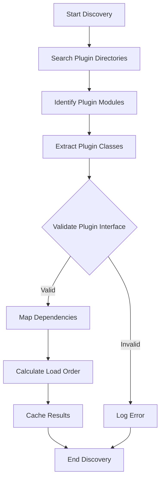
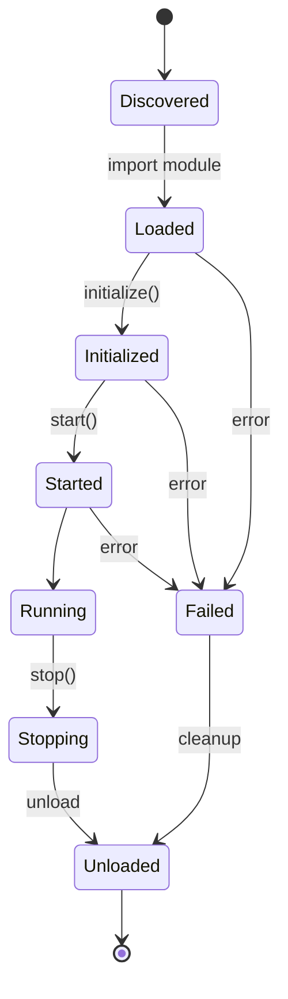
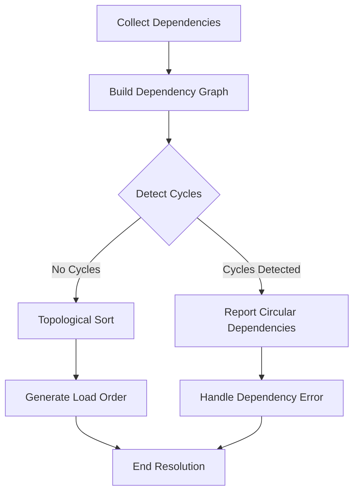

# VPA Plugin Architecture

## Overview

The Plugin Architecture is a core feature of the VPA system, enabling extensibility through modular components that can be added, removed, or updated without changing the core application. This document outlines the design, implementation, and best practices for the plugin system.

The plugin system follows these key principles:
- **Isolation**: Plugins operate in isolation to prevent crashes
- **Discovery**: Plugins are automatically discovered from designated directories
- **Dependencies**: Plugins can declare dependencies on other plugins
- **Error Boundaries**: Plugin failures are contained and don't affect other components
- **Lifecycle Management**: Clear plugin lifecycle with initialization and cleanup

## Plugin System Design

### Core Components

#### Plugin Base Class

The foundation for all plugins, defining the standard interface.

```python
class Plugin:
    """
    Base class for all VPA plugins.
    
    Provides the standard interface that all plugins must implement,
    along with default implementations of common functionality.
    """
    
    @property
    def id(self) -> str:
        """
        Get the unique identifier for this plugin.
        
        Returns:
            Plugin ID string
        """
        # Default implementation uses class name
        return self.__class__.__name__.lower()
    
    @property
    def name(self) -> str:
        """
        Get the human-readable name for this plugin.
        
        Returns:
            Plugin name string
        """
        # Default implementation uses class name with spaces
        return re.sub(r'(?<!^)(?=[A-Z])', ' ', self.__class__.__name__)
    
    @property
    def version(self) -> str:
        """
        Get the version of this plugin.
        
        Returns:
            Version string
        """
        return "1.0.0"
    
    @property
    def description(self) -> str:
        """
        Get the description of this plugin.
        
        Returns:
            Description string
        """
        return ""
    
    @property
    def author(self) -> str:
        """
        Get the author of this plugin.
        
        Returns:
            Author string
        """
        return ""
    
    @property
    def dependencies(self) -> List[str]:
        """
        Get the dependencies of this plugin.
        
        Returns:
            List of plugin IDs that this plugin depends on
        """
        return []
    
    @property
    def optional_dependencies(self) -> List[str]:
        """
        Get the optional dependencies of this plugin.
        
        Returns:
            List of plugin IDs that this plugin can use but doesn't require
        """
        return []
    
    @property
    def settings_schema(self) -> Dict[str, Any]:
        """
        Get the settings schema for this plugin.
        
        Returns:
            Dictionary describing the settings schema
        """
        return {}
        
    async def initialize(self, plugin_manager, settings: Dict[str, Any]) -> bool:
        """
        Initialize the plugin.
        
        Args:
            plugin_manager: The PluginManager instance
            settings: The plugin settings
            
        Returns:
            True if initialization was successful
        """
        return True
        
    async def start(self) -> None:
        """
        Start the plugin.
        
        This is called after initialization and after all dependencies
        have been initialized and started.
        """
        pass
        
    async def stop(self) -> None:
        """
        Stop the plugin.
        
        This is called before unloading the plugin and should clean up
        any resources the plugin is using.
        """
        pass
        
    def get_settings_ui(self) -> Optional[Any]:
        """
        Get the settings UI component for this plugin.
        
        Returns:
            UI component or None if no settings UI
        """
        return None
        
    def can_handle(self, user_input: str, context: Dict[str, Any]) -> bool:
        """
        Check if this plugin can handle the given user input.
        
        Args:
            user_input: The user input string
            context: Additional context information
            
        Returns:
            True if this plugin can handle the input
        """
        return False
        
    async def process(self, user_input: str, context: Dict[str, Any]) -> Dict[str, Any]:
        """
        Process the user input.
        
        Args:
            user_input: The user input string
            context: Additional context information
            
        Returns:
            Response dictionary
        """
        return {"response": "Not implemented"}
```

#### Plugin Manager

Responsible for discovering, loading, and managing plugins.

```python
class PluginManager:
    """
    Manages the discovery, loading, and lifecycle of plugins.
    """
    
    def __init__(self, plugin_dirs: List[str] = None):
        """
        Initialize the plugin manager.
        
        Args:
            plugin_dirs: Directories to search for plugins
        """
        self.plugin_dirs = plugin_dirs or ["src/vpa/plugins/core_plugins", "plugins"]
        self.plugins: Dict[str, Plugin] = {}
        self.plugin_modules: Dict[str, ModuleType] = {}
        self.plugin_status: Dict[str, str] = {}
        self.plugin_errors: Dict[str, str] = {}
        self.plugin_dependencies: Dict[str, List[str]] = {}
        self.plugin_load_order: List[str] = []
        self.initialized = False
        
    async def initialize(self, plugin_dirs: List[str] = None) -> None:
        """
        Initialize the plugin manager.
        
        Args:
            plugin_dirs: Optional additional directories to search for plugins
        """
        pass
    
    async def discover_plugins(self) -> List[str]:
        """
        Discover available plugins from the plugin directories.
        
        Returns:
            List of discovered plugin IDs
        """
        pass
    
    async def load_plugin(self, plugin_id: str) -> Plugin:
        """
        Load a specific plugin by ID.
        
        Args:
            plugin_id: The ID of the plugin to load
            
        Returns:
            Loaded plugin instance
            
        Raises:
            PluginLoadError: If the plugin cannot be loaded
        """
        pass
    
    async def initialize_plugin(self, plugin_id: str, settings: Dict[str, Any] = None) -> bool:
        """
        Initialize a loaded plugin.
        
        Args:
            plugin_id: The ID of the plugin to initialize
            settings: Plugin settings
            
        Returns:
            True if initialization was successful
        """
        pass
    
    async def start_plugin(self, plugin_id: str) -> bool:
        """
        Start a loaded and initialized plugin.
        
        Args:
            plugin_id: The ID of the plugin to start
            
        Returns:
            True if the plugin was started successfully
        """
        pass
    
    async def stop_plugin(self, plugin_id: str) -> bool:
        """
        Stop a running plugin.
        
        Args:
            plugin_id: The ID of the plugin to stop
            
        Returns:
            True if the plugin was stopped successfully
        """
        pass
    
    async def unload_plugin(self, plugin_id: str) -> bool:
        """
        Unload a plugin, stopping it first if necessary.
        
        Args:
            plugin_id: The ID of the plugin to unload
            
        Returns:
            True if the plugin was unloaded successfully
        """
        pass
    
    async def reload_plugin(self, plugin_id: str) -> bool:
        """
        Reload a plugin (unload and load again).
        
        Args:
            plugin_id: The ID of the plugin to reload
            
        Returns:
            True if the plugin was reloaded successfully
        """
        pass
    
    async def get_plugin_info(self, plugin_id: str) -> Dict[str, Any]:
        """
        Get information about a plugin.
        
        Args:
            plugin_id: The ID of the plugin
            
        Returns:
            Dictionary with plugin information
        """
        pass
    
    def get_plugins(self) -> Dict[str, Plugin]:
        """
        Get all loaded plugins.
        
        Returns:
            Dictionary mapping plugin IDs to plugin instances
        """
        pass
    
    def get_active_plugins(self) -> Dict[str, Plugin]:
        """
        Get all active (initialized and started) plugins.
        
        Returns:
            Dictionary mapping plugin IDs to plugin instances
        """
        pass
    
    def get_status(self) -> Dict[str, Any]:
        """
        Get the status of the plugin manager.
        
        Returns:
            Dictionary with plugin manager status
        """
        pass
    
    async def initialize_plugins(self, settings: Dict[str, Dict[str, Any]] = None) -> Dict[str, bool]:
        """
        Initialize all discovered plugins.
        
        Args:
            settings: Dictionary mapping plugin IDs to settings
            
        Returns:
            Dictionary mapping plugin IDs to initialization success
        """
        pass
    
    async def start_plugins(self) -> Dict[str, bool]:
        """
        Start all initialized plugins.
        
        Returns:
            Dictionary mapping plugin IDs to start success
        """
        pass
    
    async def stop_plugins(self) -> Dict[str, bool]:
        """
        Stop all running plugins.
        
        Returns:
            Dictionary mapping plugin IDs to stop success
        """
        pass
```

#### Plugin Errors

Custom exceptions for plugin-related errors.

```python
class PluginError(Exception):
    """Base class for plugin-related errors."""
    pass

class PluginNotFoundError(PluginError):
    """Raised when a plugin cannot be found."""
    pass

class PluginLoadError(PluginError):
    """Raised when a plugin cannot be loaded."""
    pass

class PluginInitializeError(PluginError):
    """Raised when a plugin cannot be initialized."""
    pass

class PluginStartError(PluginError):
    """Raised when a plugin cannot be started."""
    pass

class PluginDependencyError(PluginError):
    """Raised when there is a dependency issue with a plugin."""
    pass
```

### Plugin Discovery Process

1. **Search Directories**: Look for plugins in designated directories
2. **Identify Plugin Classes**: Find classes that inherit from `Plugin` base class
3. **Validate Plugin Interface**: Ensure plugins implement required methods
4. **Cache Discovery Results**: Store plugin information for faster loading
5. **Generate Dependency Graph**: Map dependencies between plugins
6. **Determine Load Order**: Sort plugins based on dependencies



### Plugin Lifecycle

Each plugin goes through a defined lifecycle:

1. **Discovery**: Plugin is found in the plugin directories
2. **Loading**: Plugin module is imported and instance created
3. **Initialization**: Plugin's `initialize()` method is called
4. **Starting**: Plugin's `start()` method is called
5. **Running**: Plugin is active and processing events/requests
6. **Stopping**: Plugin's `stop()` method is called
7. **Unloading**: Plugin instance is removed



### Plugin Dependency Resolution

1. **Declare Dependencies**: Plugins declare dependencies via the `dependencies` property
2. **Build Dependency Graph**: Create a directed graph of dependencies
3. **Detect Cycles**: Identify and report circular dependencies
4. **Topological Sort**: Determine load order using topological sorting
5. **Handle Missing Dependencies**: Gracefully handle missing dependencies



## Plugin Types

### Core Plugins

Built-in plugins that provide essential functionality:

- **Time and Date** (`time_date`): Date, time, and calendar functions
- **Calculator** (`calculator`): Basic and scientific calculator
- **Notes** (`notes`): Note-taking functionality
- **System Info** (`system_info`): System information and diagnostics
- **Weather** (`weather`): Weather forecasts and conditions
- **Help** (`help`): In-application help and documentation

### Addon Plugins

User-installed plugins that extend functionality:

- **External Service Integrations**: Connect to web services
- **Specialized Tools**: Domain-specific functionality
- **UI Extensions**: Additional UI components
- **Custom Commands**: User-defined commands and actions

## Plugin Development Guidelines

### Plugin Structure

A standard plugin should have the following structure:

```
plugin_name/
├── __init__.py           # Plugin entry point
├── plugin.py             # Main plugin class
├── handlers.py           # Event handlers
├── settings.py           # Settings definition
├── resources/            # Plugin resources
│   ├── icons/            # Icon files
│   └── data/             # Data files
└── ui/                   # UI components
    └── settings_panel.py # Settings UI
```

### Plugin Entry Point

The `__init__.py` file should export the plugin class:

```python
from .plugin import MyPlugin

__all__ = ['MyPlugin']
```

### Plugin Implementation

Example of a simple plugin implementation:

```python
from vpa.core.plugins import Plugin
from vpa.core.events import event_bus

class TimePlugin(Plugin):
    """
    Time and date plugin for VPA.
    """
    
    @property
    def id(self) -> str:
        return "time_date"
    
    @property
    def name(self) -> str:
        return "Time and Date"
    
    @property
    def description(self) -> str:
        return "Provides time and date functionality"
    
    @property
    def version(self) -> str:
        return "1.0.0"
    
    @property
    def author(self) -> str:
        return "VPA Team"
    
    @property
    def settings_schema(self) -> dict:
        return {
            "use_24h_format": {
                "type": "boolean",
                "default": False,
                "label": "Use 24-hour format",
                "description": "Display times using 24-hour format"
            },
            "timezone": {
                "type": "string",
                "default": "local",
                "label": "Timezone",
                "description": "Timezone for time display"
            }
        }
    
    async def initialize(self, plugin_manager, settings: dict) -> bool:
        """
        Initialize the plugin.
        """
        self.settings = settings
        self.plugin_manager = plugin_manager
        
        # Subscribe to events
        event_bus.subscribe("user.command", self.handle_command)
        
        return True
    
    async def start(self) -> None:
        """
        Start the plugin.
        """
        # Emit plugin ready event
        await event_bus.emit_async("plugin.ready", {
            "plugin_id": self.id,
            "plugin_name": self.name
        })
    
    async def stop(self) -> None:
        """
        Stop the plugin.
        """
        # Cleanup resources
        pass
    
    def can_handle(self, user_input: str, context: dict) -> bool:
        """
        Check if this plugin can handle the user input.
        """
        # Match time-related queries
        time_keywords = ["time", "date", "day", "month", "year", "calendar"]
        return any(keyword in user_input.lower() for keyword in time_keywords)
    
    async def process(self, user_input: str, context: dict) -> dict:
        """
        Process user input.
        """
        from datetime import datetime
        
        now = datetime.now()
        
        if "time" in user_input.lower():
            if self.settings.get("use_24h_format", False):
                time_str = now.strftime("%H:%M")
            else:
                time_str = now.strftime("%I:%M %p")
            
            return {"response": f"The current time is {time_str}."}
        
        elif "date" in user_input.lower():
            date_str = now.strftime("%A, %B %d, %Y")
            return {"response": f"Today is {date_str}."}
        
        elif "day" in user_input.lower():
            day_str = now.strftime("%A")
            return {"response": f"Today is {day_str}."}
        
        else:
            return {"response": f"Today is {now.strftime('%A, %B %d, %Y')} and the time is {now.strftime('%I:%M %p')}."}
    
    def handle_command(self, event_data: dict) -> None:
        """
        Handle user commands.
        """
        command = event_data.get("command", "").lower()
        
        # Handle specific commands
        pass
```

### Event Integration

Plugins should use the EventBus for communication:

```python
# Subscribe to events
event_bus.subscribe("audio.speech.recognized", self.handle_speech, async_callback=True)

# Emit events
await event_bus.emit_async("plugin.action", {
    "plugin_id": self.id,
    "action": "set_alarm",
    "time": "08:00"
})
```

### Settings Integration

Plugins should define and use settings:

```python
# Define settings schema
@property
def settings_schema(self) -> dict:
    return {
        "setting_name": {
            "type": "string",
            "default": "default_value",
            "label": "Setting Label",
            "description": "Setting description"
        },
        "numeric_setting": {
            "type": "number",
            "default": 42,
            "label": "Numeric Setting",
            "description": "A numeric setting"
        }
    }

# Access settings
def some_method(self):
    value = self.settings.get("setting_name", "default_value")
    # Use value
```

### UI Integration

Plugins can provide UI components:

```python
def get_settings_ui(self) -> Optional[Any]:
    """
    Get the settings UI component for this plugin.
    """
    from .ui.settings_panel import SettingsPanel
    return SettingsPanel(self.settings)
```

## Plugin Error Handling

### Error Boundaries

The plugin system implements error boundaries to prevent plugin failures from crashing the application:

```python
async def _safely_call_plugin_method(self, plugin_id: str, method_name: str, *args, **kwargs):
    """
    Safely call a plugin method with error handling.
    """
    plugin = self.plugins.get(plugin_id)
    if not plugin:
        return None
    
    method = getattr(plugin, method_name, None)
    if not method:
        return None
    
    try:
        if asyncio.iscoroutinefunction(method):
            return await method(*args, **kwargs)
        else:
            return method(*args, **kwargs)
    except Exception as e:
        self.plugin_errors[plugin_id] = str(e)
        self.plugin_status[plugin_id] = "error"
        
        # Log error
        logger.error(f"Error in plugin {plugin_id}.{method_name}: {e}")
        
        # Emit error event
        await event_bus.emit_async("plugin.error", {
            "plugin_id": plugin_id,
            "method": method_name,
            "error": str(e),
            "traceback": traceback.format_exc()
        })
        
        return None
```

### Graceful Degradation

When a plugin fails:

1. Mark the plugin as having an error
2. Log detailed error information
3. Emit a `plugin.error` event
4. Continue operating other plugins
5. Optionally attempt recovery

## Plugin Caching

To improve startup performance, the plugin system uses caching:

```python
async def _cache_plugin_discovery(self, discovered_plugins: Dict[str, Dict[str, Any]]) -> None:
    """
    Cache the results of plugin discovery.
    """
    cache_path = os.path.join(os.path.dirname(__file__), "plugin_cache.json")
    
    try:
        cache_data = {
            "timestamp": time.time(),
            "plugins": discovered_plugins,
            "directories": self.plugin_dirs
        }
        
        with open(cache_path, "w") as f:
            json.dump(cache_data, f)
    except Exception as e:
        logger.warning(f"Failed to cache plugin discovery: {e}")

async def _load_plugin_cache(self) -> Optional[Dict[str, Dict[str, Any]]]:
    """
    Load the plugin discovery cache.
    """
    cache_path = os.path.join(os.path.dirname(__file__), "plugin_cache.json")
    
    if not os.path.exists(cache_path):
        return None
    
    try:
        with open(cache_path, "r") as f:
            cache_data = json.load(f)
        
        # Check if cache is for the same directories
        if cache_data.get("directories") != self.plugin_dirs:
            return None
        
        # Check if cache is recent (less than 1 hour old)
        if time.time() - cache_data.get("timestamp", 0) > 3600:
            return None
        
        return cache_data.get("plugins")
    except Exception as e:
        logger.warning(f"Failed to load plugin cache: {e}")
        return None
```

## Plugin Marketplace

The plugin system includes a marketplace for discovering and installing additional plugins:

### Plugin Discovery

```python
async def discover_remote_plugins(self, url: str = "https://vpa-plugins.example.com/plugins.json") -> List[Dict[str, Any]]:
    """
    Discover plugins from a remote repository.
    """
    try:
        # Fetch plugin list
        async with aiohttp.ClientSession() as session:
            async with session.get(url) as response:
                if response.status != 200:
                    return []
                data = await response.json()
                
        # Parse plugin information
        plugins = []
        for plugin_data in data.get("plugins", []):
            # Validate plugin data
            if not self._validate_remote_plugin(plugin_data):
                continue
                
            plugins.append(plugin_data)
                
        return plugins
    except Exception as e:
        logger.error(f"Failed to discover remote plugins: {e}")
        return []
```

### Plugin Installation

```python
async def install_plugin(self, plugin_id: str, url: str) -> bool:
    """
    Install a plugin from a remote URL.
    """
    try:
        # Create plugin directory
        plugin_dir = os.path.join("plugins", plugin_id)
        os.makedirs(plugin_dir, exist_ok=True)
        
        # Download plugin package
        async with aiohttp.ClientSession() as session:
            async with session.get(url) as response:
                if response.status != 200:
                    return False
                    
                # Save plugin package
                package_path = os.path.join(plugin_dir, f"{plugin_id}.zip")
                with open(package_path, "wb") as f:
                    f.write(await response.read())
                    
        # Extract plugin package
        with zipfile.ZipFile(package_path, "r") as zip_ref:
            zip_ref.extractall(plugin_dir)
            
        # Remove package file
        os.unlink(package_path)
        
        # Discover plugins again to include the new one
        await self.discover_plugins()
        
        return True
    except Exception as e:
        logger.error(f"Failed to install plugin {plugin_id}: {e}")
        return False
```

## Plugin Security

### Security Measures

1. **Code Isolation**: Plugins run in isolated environments
2. **Permission System**: Plugins request and are granted specific permissions
3. **Resource Limits**: Plugins have limited access to system resources
4. **Validation**: Plugin code and resources are validated before loading
5. **Signing**: Plugins can be signed for verification

### Permission System

```python
@property
def required_permissions(self) -> List[str]:
    """
    Get the permissions required by this plugin.
    
    Returns:
        List of permission strings
    """
    return ["file.read", "network.http"]
```

## Performance Considerations

### Optimization Strategies

1. **Lazy Loading**: Plugins are loaded only when needed
2. **Caching**: Discovery results are cached for faster startup
3. **Async Processing**: Plugins operate asynchronously for non-blocking execution
4. **Resource Management**: Plugins are responsible for cleaning up their resources
5. **Monitoring**: Plugin performance is continuously monitored

### Performance Targets

| Metric | Target | Validation Method |
|--------|--------|------------------|
| Plugin Discovery | <2 seconds | Component timing |
| Plugin Loading | <500ms per plugin | Component timing |
| Plugin Initialization | <300ms per plugin | Component timing |
| Plugin Response Time | <100ms | Component timing |

## Integration with Core Components

### Event Bus Integration

```python
from vpa.core.events import event_bus

# In PluginManager
async def initialize(self, plugin_dirs: List[str] = None) -> None:
    # Initialize
    # ...
    
    # Subscribe to events
    event_bus.subscribe("app.started", self._handle_app_started)
    event_bus.subscribe("app.shutdown.requested", self._handle_app_shutdown)
```

### Application Manager Integration

```python
from vpa.core.app import app

# In PluginManager
async def initialize(self, plugin_dirs: List[str] = None) -> None:
    # Register with app
    app.register_component("plugin_manager", self)
```

### Configuration Integration

```python
from vpa.core.config import config

# In PluginManager
async def initialize_plugin(self, plugin_id: str, settings: Dict[str, Any] = None) -> bool:
    # Get plugin settings from config if not provided
    if settings is None:
        settings = config.get_plugin_settings(plugin_id)
    
    # Initialize plugin with settings
    return await self._safely_call_plugin_method(plugin_id, "initialize", self, settings)
```

## Testing Strategy

### Unit Testing

Test individual plugin components:

```python
def test_plugin_base_class():
    """Test Plugin base class."""
    class TestPlugin(Plugin):
        pass
    
    plugin = TestPlugin()
    
    # Default ID is lowercase class name
    assert plugin.id == "testplugin"
    
    # Default name is class name with spaces
    assert plugin.name == "Test Plugin"
    
    # Default version is 1.0.0
    assert plugin.version == "1.0.0"
    
    # Default dependencies is empty list
    assert plugin.dependencies == []
```

### Integration Testing

Test plugin interaction with the system:

```python
async def test_plugin_lifecycle():
    """Test plugin lifecycle."""
    plugin_manager = PluginManager()
    await plugin_manager.initialize()
    
    # Discover plugins
    plugin_ids = await plugin_manager.discover_plugins()
    assert len(plugin_ids) > 0
    
    # Load a plugin
    test_plugin_id = plugin_ids[0]
    plugin = await plugin_manager.load_plugin(test_plugin_id)
    assert plugin is not None
    
    # Initialize plugin
    success = await plugin_manager.initialize_plugin(test_plugin_id)
    assert success is True
    
    # Start plugin
    success = await plugin_manager.start_plugin(test_plugin_id)
    assert success is True
    
    # Stop plugin
    success = await plugin_manager.stop_plugin(test_plugin_id)
    assert success is True
    
    # Unload plugin
    success = await plugin_manager.unload_plugin(test_plugin_id)
    assert success is True
```

## Conclusion

The Plugin Architecture provides a powerful, extensible framework for adding functionality to the VPA system. It ensures that plugins can be developed, distributed, and used safely while maintaining application stability and performance.

By following the guidelines in this document, developers can create plugins that seamlessly integrate with the VPA system and provide valuable functionality to users.

## Related Documents

- [Architecture Overview](./ARCHITECTURE_OVERVIEW.md)
- [System Components](./SYSTEM_COMPONENTS.md)
- [Event System Design](./EVENT_SYSTEM_DESIGN.md)

---

*Document created: August 29, 2025*  
*Version: 1.0*
