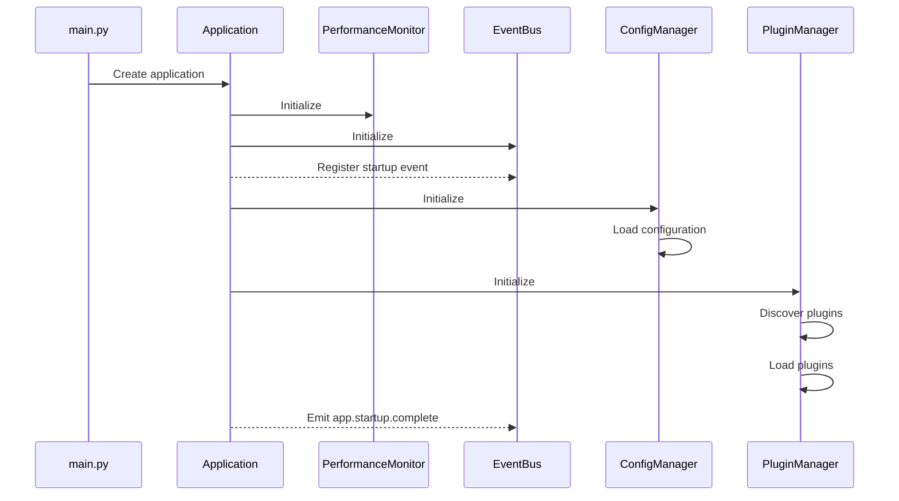
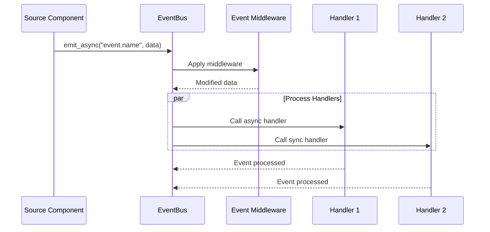
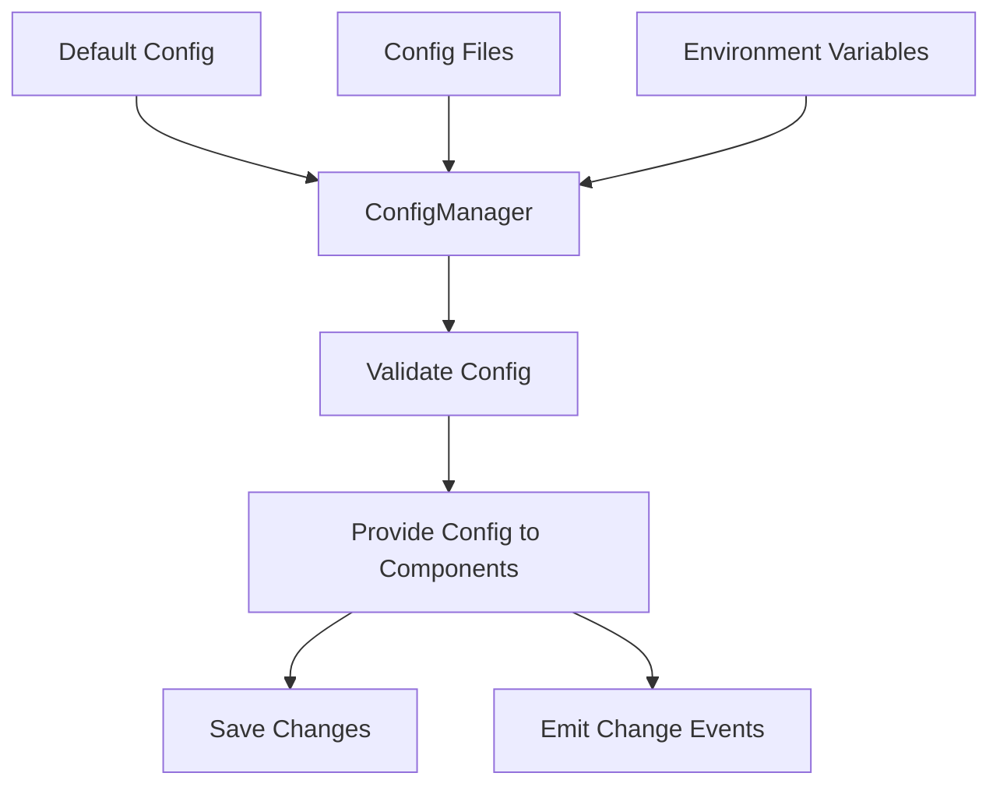

# VPA Core Components

## Overview

This document provides detailed specifications for the core components of the Virtual Personal Assistant (VPA), focusing on implementation details, interfaces, and integration patterns. These components form the foundation of the VPA system, enabling all other functionality.

Core components are characterized by:
- Critical to system functionality
- Used by multiple other components
- Required for system startup
- Performance-sensitive
- High reliability requirements

## Component Specifications

### Event Bus System (`src/vpa/core/events.py`)

#### Description
The Event Bus is the central communication mechanism for the entire VPA system, implementing a publish-subscribe pattern that enables zero direct coupling between components. All inter-component communication occurs through events, promoting a modular and extensible architecture.

#### Implementation Details

##### Class Structure
```python
class EventBus:
    """
    Central event bus system for VPA.
    Implements publish-subscribe pattern for component communication.
    """
    
    def __init__(self, performance_monitor=None):
        """
        Initialize the event bus.
        
        Args:
            performance_monitor: Optional PerformanceMonitor instance for tracking
        """
        # Dictionary mapping event names to handlers
        self._handlers = {}
        # Dictionary for async handlers
        self._async_handlers = {}
        # Middleware functions
        self._middleware = []
        # Performance tracking
        self._performance_monitor = performance_monitor
        # Lock for thread safety
        self._lock = threading.RLock()
        # Logger
        self._logger = logging.getLogger("vpa.core.events")
        
    def subscribe(self, event_name: str, handler: Callable, async_callback: bool = False) -> None:
        """
        Subscribe to an event.
        
        Args:
            event_name: Name of the event to subscribe to
            handler: Function to call when event is emitted
            async_callback: Whether the handler is a coroutine function
        """
        with self._lock:
            if async_callback:
                if event_name not in self._async_handlers:
                    self._async_handlers[event_name] = []
                self._async_handlers[event_name].append(handler)
            else:
                if event_name not in self._handlers:
                    self._handlers[event_name] = []
                self._handlers[event_name].append(handler)
                
    def unsubscribe(self, event_name: str, handler: Callable) -> bool:
        """
        Unsubscribe from an event.
        
        Args:
            event_name: Name of the event to unsubscribe from
            handler: Handler to remove
            
        Returns:
            True if successfully unsubscribed, False otherwise
        """
        with self._lock:
            # Implementation details...
            
    def emit(self, event_name: str, event_data: Optional[Dict[str, Any]] = None) -> None:
        """
        Emit an event synchronously.
        
        Args:
            event_name: Name of the event to emit
            event_data: Data to pass to handlers
        """
        if self._performance_monitor:
            with self._performance_monitor.track_execution_time(f"event.{event_name}"):
                self._process_event(event_name, event_data or {})
        else:
            self._process_event(event_name, event_data or {})
                
    async def emit_async(self, event_name: str, event_data: Optional[Dict[str, Any]] = None) -> None:
        """
        Emit an event asynchronously.
        
        Args:
            event_name: Name of the event to emit
            event_data: Data to pass to handlers
        """
        if self._performance_monitor:
            with self._performance_monitor.track_execution_time(f"event_async.{event_name}"):
                await self._process_event_async(event_name, event_data or {})
        else:
            await self._process_event_async(event_name, event_data or {})
                
    def add_middleware(self, middleware_func: Callable[[str, Dict[str, Any]], Optional[Dict[str, Any]]]) -> None:
        """
        Add middleware for event processing.
        
        Args:
            middleware_func: Function that takes event_name and event_data and returns
                             modified event_data or None to cancel the event
        """
        self._middleware.append(middleware_func)
        
    def cleanup(self) -> None:
        """
        Clean up all event handlers.
        """
        with self._lock:
            self._handlers.clear()
            self._async_handlers.clear()
            self._middleware.clear()
            
    def _process_event(self, event_name: str, event_data: Dict[str, Any]) -> None:
        """
        Process event handlers synchronously.
        
        Args:
            event_name: Name of the event
            event_data: Event data dictionary
        """
        # Apply middleware
        for middleware in self._middleware:
            try:
                result = middleware(event_name, event_data)
                if result is None:
                    # Event cancelled by middleware
                    return
                event_data = result
            except Exception as e:
                self._logger.error(f"Error in event middleware: {e}")
                
        # Get handlers (thread-safe)
        handlers = []
        with self._lock:
            handlers = self._handlers.get(event_name, [])[:]
            
        # Call handlers
        for handler in handlers:
            try:
                handler(event_data)
            except Exception as e:
                self._logger.error(f"Error in event handler for '{event_name}': {e}")
                
    async def _process_event_async(self, event_name: str, event_data: Dict[str, Any]) -> None:
        """
        Process event handlers asynchronously.
        
        Args:
            event_name: Name of the event
            event_data: Event data dictionary
        """
        # Apply middleware (same as sync version)
        for middleware in self._middleware:
            try:
                result = middleware(event_name, event_data)
                if result is None:
                    return
                event_data = result
            except Exception as e:
                self._logger.error(f"Error in event middleware: {e}")
                
        # Get handlers (thread-safe)
        sync_handlers = []
        async_handlers = []
        with self._lock:
            sync_handlers = self._handlers.get(event_name, [])[:]
            async_handlers = self._async_handlers.get(event_name, [])[:]
            
        # Call sync handlers
        for handler in sync_handlers:
            try:
                handler(event_data)
            except Exception as e:
                self._logger.error(f"Error in event handler for '{event_name}': {e}")
                
        # Call async handlers
        for handler in async_handlers:
            try:
                await handler(event_data)
            except Exception as e:
                self._logger.error(f"Error in async event handler for '{event_name}': {e}")
```

##### Event Structure
Events are represented as dictionaries with the following standard structure:
```python
{
    "timestamp": 1630000000,  # Unix timestamp
    "source": "component_name",  # Component that emitted the event
    "event_type": "category.action",  # Event classification
    # Additional event-specific data...
}
```

##### Standard Events
| Event Name | Purpose | Data Fields |
|------------|---------|------------|
| `app.startup` | Application starting | `{"stage": "starting\|middleware\|plugins\|gui\|complete"}` |
| `app.shutdown` | Application shutting down | `{"reason": "user_request\|error\|system"}` |
| `app.error` | Application error | `{"error": "error_message", "component": "component_name"}` |
| `user.input` | User provided input | `{"text": "user input", "source": "voice\|text"}` |
| `user.command` | User issued command | `{"command": "command_name", "params": {}}` |
| `voice.speaking` | Voice system speaking | `{"text": "speech text", "voice": "voice_id"}` |
| `voice.listening` | Voice system listening | `{"active": true/false}` |
| `plugin.loaded` | Plugin was loaded | `{"plugin_id": "plugin_id", "success": true/false}` |
| `plugin.action` | Plugin performed action | `{"plugin_id": "plugin_id", "action": "action_name"}` |

#### Integration Patterns

##### Subscribing to Events
```python
from vpa.core.events import event_bus

# Subscribe to synchronous events
event_bus.subscribe("user.input", handle_user_input)

# Subscribe to asynchronous events
event_bus.subscribe("plugin.action", handle_plugin_action_async, async_callback=True)

# Define handlers
def handle_user_input(event_data):
    user_text = event_data.get("text", "")
    # Process user input...

async def handle_plugin_action_async(event_data):
    plugin_id = event_data.get("plugin_id")
    action = event_data.get("action")
    # Handle plugin action asynchronously...
```

##### Emitting Events
```python
from vpa.core.events import event_bus

# Emit synchronous event
event_bus.emit("app.status", {
    "component": "my_component",
    "status": "ready",
    "details": {"version": "1.0"}
})

# Emit asynchronous event
await event_bus.emit_async("user.response", {
    "text": "Response to user",
    "voice": True,
    "display": True
})
```

##### Using Middleware
```python
from vpa.core.events import event_bus

# Add middleware for logging
def logging_middleware(event_name, event_data):
    print(f"Event: {event_name}, Data: {event_data}")
    return event_data  # Return data to continue processing

# Add middleware for filtering sensitive information
def privacy_middleware(event_name, event_data):
    if "password" in event_data:
        event_data = event_data.copy()  # Create copy to avoid modifying original
        event_data["password"] = "********"
    return event_data

# Register middleware (order matters)
event_bus.add_middleware(privacy_middleware)
event_bus.add_middleware(logging_middleware)
```

#### Performance Considerations
- Use async events for operations that might block
- Keep event payloads small and focused
- Avoid creating circular event dependencies
- Consider batching frequent events
- Use event filtering to reduce processing

### Application Manager (`src/vpa/core/app.py`)

#### Description
The Application Manager is responsible for coordinating the lifecycle of the VPA application, including startup and shutdown sequences, component registration, and system-wide state management.

#### Implementation Details

##### Class Structure
```python
class Application:
    """
    Main application manager for VPA.
    Handles application lifecycle and component coordination.
    """
    
    def __init__(self):
        """Initialize the application manager."""
        # Component registry
        self._components = {}
        # Application state
        self._state = "initialized"  # initialized, starting, running, stopping, stopped
        # Performance monitoring
        self._performance_monitor = None
        # Logger
        self._logger = logging.getLogger("vpa.core.app")
        # Startup timestamp
        self._startup_time = time.time()
        # Settings manager reference
        self._config_manager = None
        # Event bus reference
        self._event_bus = None
        # Plugin manager reference
        self._plugin_manager = None
        
    async def startup(self) -> bool:
        """
        Start the application and all components.
        
        Returns:
            True if startup was successful
        """
        try:
            # Mark as starting
            self._state = "starting"
            self._startup_time = time.time()
            
            # Initialize performance monitoring
            self._init_performance_monitoring()
            
            # Initialize event bus
            await self._init_event_bus()
            
            # Initialize config manager
            await self._init_config_manager()
            
            # Initialize core components
            await self._init_core_components()
            
            # Load plugins
            await self._init_plugins()
            
            # Initialize GUI
            await self._init_gui()
            
            # Mark as running
            startup_duration = time.time() - self._startup_time
            self._state = "running"
            
            # Emit startup complete event
            await self._event_bus.emit_async("app.startup", {
                "stage": "complete",
                "duration": startup_duration
            })
            
            # Report startup metrics
            self._logger.info(f"Application startup completed in {startup_duration:.2f}s")
            
            return True
            
        except Exception as e:
            self._logger.error(f"Application startup failed: {e}")
            self._state = "stopped"
            return False
            
    async def shutdown(self) -> bool:
        """
        Shut down the application and all components.
        
        Returns:
            True if shutdown was successful
        """
        try:
            # Mark as stopping
            self._state = "stopping"
            
            # Emit shutdown event
            if self._event_bus:
                await self._event_bus.emit_async("app.shutdown", {
                    "reason": "user_request"
                })
                
            # Shut down GUI first
            await self._shutdown_gui()
            
            # Shut down plugins
            await self._shutdown_plugins()
            
            # Shut down core components
            await self._shutdown_core_components()
            
            # Clean up event bus
            if self._event_bus:
                self._event_bus.cleanup()
                
            # Mark as stopped
            self._state = "stopped"
            return True
            
        except Exception as e:
            self._logger.error(f"Application shutdown failed: {e}")
            self._state = "error"
            return False
            
    def register_component(self, component_id: str, component: Any) -> None:
        """
        Register a component with the application.
        
        Args:
            component_id: Unique identifier for the component
            component: The component instance
        """
        self._components[component_id] = component
        
    def get_component(self, component_id: str) -> Optional[Any]:
        """
        Get a registered component.
        
        Args:
            component_id: ID of the component to retrieve
            
        Returns:
            Component instance or None if not found
        """
        return self._components.get(component_id)
        
    def get_status(self) -> Dict[str, Any]:
        """
        Get the current application status.
        
        Returns:
            Dictionary with status information
        """
        status = {
            "state": self._state,
            "uptime": time.time() - self._startup_time if self._state == "running" else 0,
            "components": list(self._components.keys()),
            "version": "1.0.0",
        }
        
        # Add performance metrics if available
        if self._performance_monitor:
            status["performance"] = self._performance_monitor.get_metrics()
            
        return status
        
    # Private initialization methods
    async def _init_performance_monitoring(self) -> None:
        """Initialize the performance monitoring system."""
        from vpa.core.performance import PerformanceMonitor
        self._performance_monitor = PerformanceMonitor()
        self.register_component("performance_monitor", self._performance_monitor)
        
    async def _init_event_bus(self) -> None:
        """Initialize the event bus system."""
        from vpa.core.events import EventBus
        self._event_bus = EventBus(performance_monitor=self._performance_monitor)
        self.register_component("event_bus", self._event_bus)
        
        # Export as global for convenience
        import vpa.core.events
        vpa.core.events.event_bus = self._event_bus
        
        # Emit startup event
        await self._event_bus.emit_async("app.startup", {
            "stage": "core",
            "timestamp": time.time()
        })
        
    async def _init_config_manager(self) -> None:
        """Initialize the configuration manager."""
        from vpa.core.config import ConfigManager
        self._config_manager = ConfigManager()
        await self._config_manager.load_config()
        self.register_component("config_manager", self._config_manager)
        
        # Export as global for convenience
        import vpa.core.config
        vpa.core.config.config = self._config_manager
        
    async def _init_core_components(self) -> None:
        """Initialize core components."""
        # Initialize other core components
        # The exact components initialized here will depend on the application
        pass
        
    async def _init_plugins(self) -> None:
        """Initialize the plugin system."""
        from vpa.core.plugins import PluginManager
        
        # Emit startup event
        await self._event_bus.emit_async("app.startup", {
            "stage": "plugins",
            "timestamp": time.time()
        })
        
        # Initialize plugin manager
        plugin_manager = PluginManager()
        await plugin_manager.initialize()
        self.register_component("plugin_manager", self._plugin_manager)
        
        # Export as global for convenience
        import vpa.core.plugins
        vpa.core.plugins.plugin_manager = plugin_manager
        
    async def _init_gui(self) -> None:
        """Initialize the GUI system."""
        # Emit startup event
        await self._event_bus.emit_async("app.startup", {
            "stage": "gui",
            "timestamp": time.time()
        })
        
        # Initialize GUI components
        # The exact components initialized here will depend on the application
        pass
        
    # Shutdown methods
    async def _shutdown_gui(self) -> None:
        """Shut down the GUI system."""
        # Implementation depends on GUI components
        pass
        
    async def _shutdown_plugins(self) -> None:
        """Shut down the plugin system."""
        if self._plugin_manager:
            await self._plugin_manager.stop_plugins()
        
    async def _shutdown_core_components(self) -> None:
        """Shut down core components."""
        # Shut down in reverse order of initialization
        pass
```

##### Application Lifecycle States
1. **Initialized**: Application object created but not started
2. **Starting**: Application startup in progress
3. **Running**: Application fully operational
4. **Stopping**: Application shutdown in progress
5. **Stopped**: Application fully shut down
6. **Error**: Application in error state

##### Startup Sequence
1. Initialize performance monitoring
2. Initialize event bus
3. Initialize configuration manager
4. Initialize core components
5. Load and initialize plugins
6. Initialize GUI components
7. Emit startup completion event

##### Shutdown Sequence
1. Emit shutdown event
2. Shut down GUI components
3. Stop and unload plugins
4. Shut down core components
5. Clean up event bus
6. Mark application as stopped

#### Integration Patterns

##### Starting the Application
```python
import asyncio
from vpa.core.app import Application

async def main():
    app = Application()
    
    # Start the application
    success = await app.startup()
    if not success:
        print("Application startup failed")
        return 1
    
    # Keep running until shutdown
    try:
        # Wait for shutdown signal
        shutdown_event = asyncio.Event()
        await shutdown_event.wait()
    except KeyboardInterrupt:
        # Handle Ctrl+C
        pass
    finally:
        # Ensure proper shutdown
        await app.shutdown()
    
    return 0

if __name__ == "__main__":
    exit_code = asyncio.run(main())
    exit(exit_code)
```

##### Registering and Accessing Components
```python
from vpa.core.app import app

# Register a component
app.register_component("my_component", my_component_instance)

# Access a component
config_manager = app.get_component("config_manager")
if config_manager:
    config = config_manager.get_config()
```

##### Handling Application Status
```python
from vpa.core.app import app
from vpa.core.events import event_bus

# Monitor application status
def on_app_status_change(event_data):
    state = event_data.get("state")
    if state == "error":
        # Handle error state
        pass
    elif state == "running":
        # Application is fully started
        pass

# Subscribe to status events
event_bus.subscribe("app.state_changed", on_app_status_change)

# Get current status
status = app.get_status()
print(f"Application state: {status['state']}")
print(f"Uptime: {status['uptime']} seconds")
```

#### Performance Considerations
- Minimize startup time by parallelizing initialization where possible
- Use lazy loading for non-critical components
- Implement graceful shutdown handling for all components
- Use timeout mechanisms to prevent hanging during startup/shutdown
- Monitor component initialization times to identify bottlenecks

### Configuration Manager (`src/vpa/core/config.py`)

#### Description
The Configuration Manager handles loading, validating, accessing, and saving application settings from multiple sources (files, environment, defaults).

#### Implementation Details

##### Class Structure
```python
class ConfigManager:
    """
    Configuration manager for VPA.
    Handles loading, accessing, and saving application settings.
    """
    
    def __init__(self):
        """Initialize the configuration manager."""
        # Configuration data
        self._config = {}
        # Configuration sources
        self._config_sources = []
        # Default configuration
        self._defaults = {}
        # Configuration schemas for validation
        self._schemas = {}
        # Modified flag
        self._modified = False
        # Config file path
        self._config_path = "config/config.json"
        # Logger
        self._logger = logging.getLogger("vpa.core.config")
        
    async def load_config(self) -> bool:
        """
        Load configuration from all sources.
        
        Returns:
            True if configuration was loaded successfully
        """
        try:
            # Load default configuration
            self._load_defaults()
            
            # Load from config file
            await self._load_from_file()
            
            # Load from environment variables
            self._load_from_env()
            
            # Validate configuration
            self._validate_config()
            
            self._modified = False
            return True
            
        except Exception as e:
            self._logger.error(f"Failed to load configuration: {e}")
            return False
            
    async def save_config(self) -> bool:
        """
        Save configuration to file.
        
        Returns:
            True if configuration was saved successfully
        """
        if not self._modified:
            return True
            
        try:
            # Create config directory if it doesn't exist
            config_dir = os.path.dirname(self._config_path)
            os.makedirs(config_dir, exist_ok=True)
            
            # Write configuration to file
            async with aiofiles.open(self._config_path, "w") as f:
                await f.write(json.dumps(self._config, indent=2))
                
            self._modified = False
            return True
            
        except Exception as e:
            self._logger.error(f"Failed to save configuration: {e}")
            return False
            
    def get_value(self, key: str, default: Any = None) -> Any:
        """
        Get a configuration value.
        
        Args:
            key: Configuration key (supports dot notation, e.g., 'section.key')
            default: Default value if key not found
            
        Returns:
            Configuration value or default if not found
        """
        # Handle dot notation
        if "." in key:
            parts = key.split(".")
            config = self._config
            for part in parts[:-1]:
                config = config.get(part, {})
                if not isinstance(config, dict):
                    return default
            return config.get(parts[-1], default)
            
        return self._config.get(key, default)
        
    def set_value(self, key: str, value: Any) -> None:
        """
        Set a configuration value.
        
        Args:
            key: Configuration key (supports dot notation)
            value: Value to set
        """
        # Handle dot notation
        if "." in key:
            parts = key.split(".")
            config = self._config
            for part in parts[:-1]:
                if part not in config or not isinstance(config[part], dict):
                    config[part] = {}
                config = config[part]
            config[parts[-1]] = value
        else:
            self._config[key] = value
            
        self._modified = True
        
    def get_section(self, section: str) -> Dict[str, Any]:
        """
        Get a configuration section.
        
        Args:
            section: Section name
            
        Returns:
            Dictionary with section configuration
        """
        return self._config.get(section, {})
        
    def set_section(self, section: str, config: Dict[str, Any]) -> None:
        """
        Set a configuration section.
        
        Args:
            section: Section name
            config: Section configuration
        """
        self._config[section] = config
        self._modified = True
        
    def register_schema(self, key: str, schema: Dict[str, Any]) -> None:
        """
        Register a configuration schema for validation.
        
        Args:
            key: Configuration key
            schema: JSON Schema for validation
        """
        self._schemas[key] = schema
        
    def register_defaults(self, defaults: Dict[str, Any]) -> None:
        """
        Register default configuration values.
        
        Args:
            defaults: Default configuration
        """
        self._defaults.update(defaults)
        
    def get_plugin_settings(self, plugin_id: str) -> Dict[str, Any]:
        """
        Get settings for a specific plugin.
        
        Args:
            plugin_id: Plugin identifier
            
        Returns:
            Dictionary with plugin settings
        """
        plugins_config = self.get_section("plugins")
        return plugins_config.get(plugin_id, {})
        
    def set_plugin_settings(self, plugin_id: str, settings: Dict[str, Any]) -> None:
        """
        Set settings for a specific plugin.
        
        Args:
            plugin_id: Plugin identifier
            settings: Plugin settings
        """
        plugins_config = self.get_section("plugins")
        plugins_config[plugin_id] = settings
        self.set_section("plugins", plugins_config)
        
    # Private methods
    def _load_defaults(self) -> None:
        """Load default configuration."""
        self._config = copy.deepcopy(self._defaults)
        
    async def _load_from_file(self) -> None:
        """Load configuration from file."""
        if not os.path.exists(self._config_path):
            return
            
        try:
            async with aiofiles.open(self._config_path, "r") as f:
                content = await f.read()
                file_config = json.loads(content)
                
            # Merge with current config
            self._merge_config(file_config)
                
        except Exception as e:
            self._logger.error(f"Failed to load configuration from file: {e}")
            
    def _load_from_env(self) -> None:
        """Load configuration from environment variables."""
        # Look for environment variables with VPA_ prefix
        prefix = "VPA_"
        for key, value in os.environ.items():
            if key.startswith(prefix):
                # Convert to config key (e.g., VPA_SECTION_KEY -> section.key)
                config_key = key[len(prefix):].lower().replace("_", ".")
                # Parse value based on type
                parsed_value = self._parse_env_value(value)
                # Set config value
                self.set_value(config_key, parsed_value)
                
    def _parse_env_value(self, value: str) -> Any:
        """
        Parse environment variable value into appropriate type.
        
        Args:
            value: String value from environment
            
        Returns:
            Parsed value (bool, int, float, or string)
        """
        # Boolean values
        if value.lower() in ("true", "yes", "1"):
            return True
        if value.lower() in ("false", "no", "0"):
            return False
            
        # Try parsing as int
        try:
            return int(value)
        except ValueError:
            pass
            
        # Try parsing as float
        try:
            return float(value)
        except ValueError:
            pass
            
        # Default to string
        return value
        
    def _merge_config(self, new_config: Dict[str, Any]) -> None:
        """
        Merge new configuration into existing config.
        
        Args:
            new_config: New configuration to merge
        """
        def merge_dict(target, source):
            for key, value in source.items():
                if key in target and isinstance(target[key], dict) and isinstance(value, dict):
                    merge_dict(target[key], value)
                else:
                    target[key] = value
                    
        merge_dict(self._config, new_config)
        
    def _validate_config(self) -> None:
        """Validate configuration against schemas."""
        # This would typically use a library like jsonschema
        # For now, just ensure required sections exist
        for key, schema in self._schemas.items():
            if "required" in schema:
                for required_key in schema["required"]:
                    full_key = f"{key}.{required_key}" if key else required_key
                    if self.get_value(full_key) is None:
                        self._logger.warning(f"Missing required configuration: {full_key}")
```

##### Configuration Structure
The configuration is organized hierarchically, with major sections for different parts of the application:

```json
{
  "app": {
    "name": "VPA",
    "version": "1.0.0",
    "startup_mode": "normal"
  },
  "audio": {
    "default_voice": "en-US-AriaNeural",
    "volume": 80,
    "rate": 1.0,
    "recognition_engine": "whisper"
  },
  "gui": {
    "theme": "dark",
    "window_size": [800, 600],
    "start_minimized": false
  },
  "plugins": {
    "enabled": ["time_date", "calculator", "notes"],
    "time_date": {
      "use_24h_format": false
    }
  },
  "llm": {
    "default_model": "local-model",
    "temperature": 0.7
  }
}
```

##### Default Configuration
The system includes sensible defaults for all settings, allowing the application to run without requiring user configuration.

#### Integration Patterns

##### Accessing Configuration
```python
from vpa.core.config import config

# Get simple values
theme = config.get_value("gui.theme", "light")
volume = config.get_value("audio.volume", 70)

# Get entire sections
audio_config = config.get_section("audio")
plugin_config = config.get_section("plugins")
```

##### Modifying Configuration
```python
from vpa.core.config import config
from vpa.core.events import event_bus

# Set individual values
config.set_value("gui.theme", "dark")
config.set_value("audio.volume", 85)

# Set entire sections
config.set_section("llm", {
    "default_model": "new-model",
    "temperature": 0.5,
    "max_tokens": 1000
})

# Save configuration
await config.save_config()

# Notify system of configuration change
event_bus.emit("config.changed", {
    "section": "gui",
    "key": "theme",
    "value": "dark"
})
```

##### Plugin Configuration
```python
from vpa.core.config import config

# Get plugin-specific settings
plugin_id = "time_date"
settings = config.get_plugin_settings(plugin_id)

# Update plugin settings
settings["use_24h_format"] = True
config.set_plugin_settings(plugin_id, settings)

# Save configuration
await config.save_config()
```

#### Performance Considerations
- Use caching for frequently accessed configuration values
- Defer saving until application exit for non-critical changes
- Use batch updates when changing multiple settings
- Validate configuration on load to catch errors early
- Use schemas to ensure type safety and required fields

### Performance Monitor (`src/vpa/core/performance.py`)

#### Description
The Performance Monitor tracks and reports on system performance metrics, ensuring the application meets its performance targets.

#### Implementation Details

##### Class Structure
```python
class PerformanceMonitor:
    """
    Performance monitoring system for VPA.
    Tracks execution times, memory usage, and other metrics.
    """
    
    def __init__(self):
        """Initialize the performance monitoring system."""
        # Metrics storage
        self._metrics = {}
        # Performance targets
        self._targets = {
            "startup_time": 10.0,  # seconds
            "event_dispatch": 0.010,  # 10ms
            "voice_synthesis": 2.0,  # seconds
            "gui_response": 0.100,  # 100ms
        }
        # Execution time data
        self._execution_times = {}
        # Memory tracking
        self._memory_baseline = None
        # Start time
        self._start_time = time.time()
        # Logger
        self._logger = logging.getLogger("vpa.core.performance")
        # Initialize memory baseline
        self._init_memory_baseline()
        
    def track_execution_time(self, name: str) -> ContextManager:
        """
        Context manager for tracking execution time.
        
        Args:
            name: Name of the operation to track
            
        Returns:
            Context manager that tracks execution time
        """
        return _ExecutionTimeTracker(self, name)
        
    def record_execution_time(self, name: str, duration: float) -> None:
        """
        Record an execution time.
        
        Args:
            name: Name of the operation
            duration: Duration in seconds
        """
        if name not in self._execution_times:
            self._execution_times[name] = []
            
        self._execution_times[name].append(duration)
        
        # Keep only the last 100 records
        if len(self._execution_times[name]) > 100:
            self._execution_times[name] = self._execution_times[name][-100:]
            
        # Update metrics
        metrics = self._get_execution_metrics(name)
        self._metrics[f"execution_time.{name}"] = metrics
        
        # Check against targets
        if name in self._targets and metrics["avg"] > self._targets[name]:
            self._logger.warning(
                f"Performance target missed for {name}: "
                f"avg={metrics['avg']:.3f}s, target={self._targets[name]:.3f}s"
            )
            
    def monitor_memory_usage(self) -> None:
        """Begin monitoring memory usage."""
        import threading
        
        def _memory_monitor():
            while True:
                try:
                    current_memory = self._get_memory_usage()
                    self._metrics["memory.current"] = current_memory
                    self._metrics["memory.increase"] = current_memory - self._memory_baseline
                    
                    # Check memory target
                    if current_memory > 2048:  # 2GB target
                        self._logger.warning(
                            f"Memory usage exceeds target: {current_memory:.1f}MB > 2048MB"
                        )
                except Exception as e:
                    self._logger.error(f"Error monitoring memory: {e}")
                    
                # Check every 5 seconds
                time.sleep(5)
                
        # Start monitoring thread
        thread = threading.Thread(target=_memory_monitor, daemon=True)
        thread.start()
        
    def get_metrics(self) -> Dict[str, Any]:
        """
        Get all performance metrics.
        
        Returns:
            Dictionary of metrics
        """
        # Add system metrics
        self._update_system_metrics()
        
        return self._metrics
        
    def check_targets(self) -> Dict[str, bool]:
        """
        Check if performance targets are being met.
        
        Returns:
            Dictionary mapping targets to success status
        """
        results = {}
        
        # Check startup time
        uptime = time.time() - self._start_time
        if uptime < 60:  # Only relevant in the first minute
            results["startup_time_achieved"] = uptime <= self._targets["startup_time"]
            
        # Check event dispatch time
        event_metrics = self._metrics.get("execution_time.event", {})
        if event_metrics:
            results["event_dispatch_achieved"] = event_metrics.get("avg", 0) <= self._targets["event_dispatch"]
            
        # Check voice synthesis time
        voice_metrics = self._metrics.get("execution_time.voice.synthesize", {})
        if voice_metrics:
            results["voice_synthesis_achieved"] = voice_metrics.get("avg", 0) <= self._targets["voice_synthesis"]
            
        # Check GUI response time
        gui_metrics = self._metrics.get("execution_time.gui.response", {})
        if gui_metrics:
            results["gui_response_achieved"] = gui_metrics.get("avg", 0) <= self._targets["gui_response"]
            
        # Check memory usage
        memory = self._metrics.get("memory.current", 0)
        results["memory_usage_achieved"] = memory <= 2048  # 2GB target
        
        return results
        
    # Private methods
    def _init_memory_baseline(self) -> None:
        """Initialize memory baseline."""
        self._memory_baseline = self._get_memory_usage()
        self._metrics["memory.baseline"] = self._memory_baseline
        
    def _get_memory_usage(self) -> float:
        """
        Get current memory usage in MB.
        
        Returns:
            Memory usage in MB
        """
        import psutil
        process = psutil.Process(os.getpid())
        memory_info = process.memory_info()
        return memory_info.rss / 1024 / 1024
        
    def _get_execution_metrics(self, name: str) -> Dict[str, float]:
        """
        Get execution time metrics for a specific operation.
        
        Args:
            name: Operation name
            
        Returns:
            Dictionary with execution metrics
        """
        times = self._execution_times.get(name, [])
        if not times:
            return {"min": 0, "max": 0, "avg": 0, "p95": 0, "count": 0}
            
        return {
            "min": min(times),
            "max": max(times),
            "avg": sum(times) / len(times),
            "p95": sorted(times)[int(len(times) * 0.95)] if len(times) >= 20 else max(times),
            "count": len(times)
        }
        
    def _update_system_metrics(self) -> None:
        """Update system-wide metrics."""
        # Uptime
        self._metrics["uptime"] = time.time() - self._start_time
        
        # Update memory usage
        current_memory = self._get_memory_usage()
        self._metrics["memory.current"] = current_memory
        self._metrics["memory.increase"] = current_memory - self._memory_baseline
        
        # CPU usage
        try:
            import psutil
            self._metrics["cpu.usage"] = psutil.cpu_percent()
        except:
            pass
            
class _ExecutionTimeTracker:
    """Context manager for tracking execution time."""
    
    def __init__(self, monitor: PerformanceMonitor, name: str):
        """
        Initialize the tracker.
        
        Args:
            monitor: PerformanceMonitor instance
            name: Name of the operation to track
        """
        self.monitor = monitor
        self.name = name
        self.start_time = None
        
    def __enter__(self):
        """Start timing."""
        self.start_time = time.time()
        return self
        
    def __exit__(self, exc_type, exc_val, exc_tb):
        """End timing and record execution time."""
        duration = time.time() - self.start_time
        self.monitor.record_execution_time(self.name, duration)
```

##### Performance Metrics
The system tracks the following key metrics:

| Metric | Description | Target |
|--------|-------------|--------|
| Startup Time | Time from launch to ready state | <10s |
| Event Dispatch | Time to process an event | <10ms |
| Voice Synthesis | Time to generate speech from text | <2s |
| GUI Response | Time for UI to respond to input | <100ms |
| Memory Usage | Total memory consumption | <2GB |

##### Execution Time Tracking
The system provides a decorator and context manager for tracking execution times:

```python
# As a context manager
with performance_monitor.track_execution_time("operation_name"):
    # Code to measure
    perform_operation()

# As a decorator (implemented separately)
@PerformanceMonitor.track_execution_time("function_name")
def some_function():
    # Code to measure
    pass
```

#### Integration Patterns

##### Tracking Execution Time
```python
from vpa.core.performance import performance_monitor

# Track a section of code
with performance_monitor.track_execution_time("event.processing"):
    # Process event
    process_event(event_data)

# Track a function using decorator (defined separately)
@PerformanceMonitor.track_execution_time("voice.synthesis")
async def synthesize_speech(text, voice_id):
    # Synthesize speech
    return await voice_system.synthesize(text, voice_id)
```

##### Monitoring Memory Usage
```python
from vpa.core.performance import performance_monitor

# Start memory monitoring
performance_monitor.monitor_memory_usage()

# Get current memory metrics
metrics = performance_monitor.get_metrics()
print(f"Current memory usage: {metrics['memory.current']:.1f} MB")
print(f"Memory increase since start: {metrics['memory.increase']:.1f} MB")
```

##### Checking Performance Targets
```python
from vpa.core.performance import performance_monitor
from vpa.core.events import event_bus

# Check if targets are being met
target_results = performance_monitor.check_targets()

# Report issues
for target, achieved in target_results.items():
    if not achieved:
        # Log and report issue
        logger.warning(f"Performance target not met: {target}")
        
        # Emit performance issue event
        event_bus.emit("performance.issue", {
            "target": target,
            "achieved": False
        })
```

#### Performance Considerations
- Minimize overhead of the monitoring system itself
- Use sampling for frequent operations to reduce impact
- Track critical paths separately for better insights
- Use memory profiling to identify memory leaks
- Report only significant deviations to avoid noise

## Component Interactions

### Initialization Flow

The core components are initialized in the following sequence:

1. **Application Manager** initializes first as the central coordinator
2. **Performance Monitor** is created to track the startup sequence
3. **Event Bus** is initialized to enable component communication
4. **Configuration Manager** loads application settings
5. Other core components are initialized in dependency order
6. Plugins and additional components are loaded based on configuration



### Event Flow

Events are the primary mechanism for component interaction:

1. Components subscribe to relevant events during initialization
2. Events are emitted when state changes or actions occur
3. The Event Bus dispatches events to all subscribed handlers
4. Handlers process events and may emit additional events
5. Error handling and retry mechanisms manage failures



### Configuration Flow

Configuration is managed centrally and accessed by components as needed:

1. Default configuration is defined for all components
2. Configuration is loaded from files and environment
3. Components access configuration through the Configuration Manager
4. Changes are saved back to persistent storage
5. Configuration changes trigger events for components to update



## Performance Targets

| Component | Operation | Target | Validation Method |
|-----------|-----------|--------|------------------|
| Event Bus | Event dispatch | <10ms | `execution_time.event` metric |
| Application | Startup sequence | <10s | `uptime` when state="running" |
| Configuration | Config loading | <200ms | `execution_time.config.load` metric |
| Configuration | Config access | <1ms | `execution_time.config.get` metric |
| Overall | Memory usage | <2GB | `memory.current` metric |

## Error Handling

### Error Strategies
- Event Bus isolates handler errors to prevent cascading failures
- Application Manager coordinates graceful degradation
- Components implement appropriate retry mechanisms
- Performance issues trigger warnings and adaptation
- Critical errors are logged and reported

### Logging
- Structured logging for all components
- Performance issues logged at WARNING level
- Component errors logged at ERROR level
- Critical system errors logged at CRITICAL level
- Debug information available at DEBUG level

## Testing Approach

### Unit Tests
- Each core component has comprehensive unit tests
- Test performance critical paths separately
- Mock dependencies for isolation
- Verify error handling paths

### Integration Tests
- Test component interactions through event flow
- Validate startup and shutdown sequences
- Test configuration loading and validation
- Measure performance in realistic scenarios

## See Also

- [Architecture Overview](../1_architecture/ARCHITECTURE_OVERVIEW.md)
- [Plugin Architecture](../1_architecture/PLUGIN_ARCHITECTURE.md)
- [Event System Design](../1_architecture/EVENT_SYSTEM_DESIGN.md)
- [System Components](../1_architecture/SYSTEM_COMPONENTS.md)
- [Implementation Checklist](../3_implementation_roadmap/IMPLEMENTATION_CHECKLIST.md)

---

*Document created: August 29, 2025*  
*Version: 1.0*
