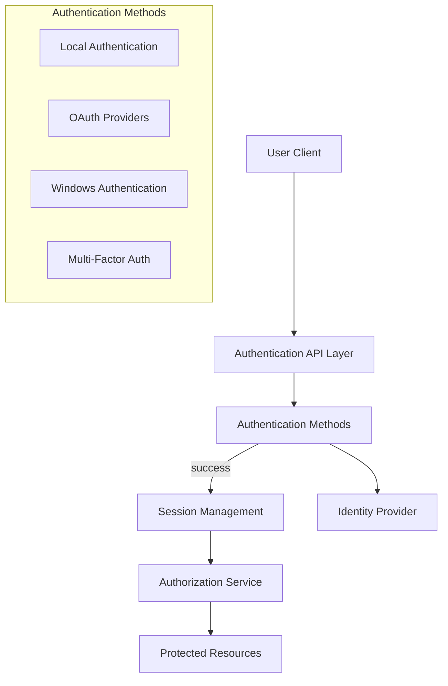
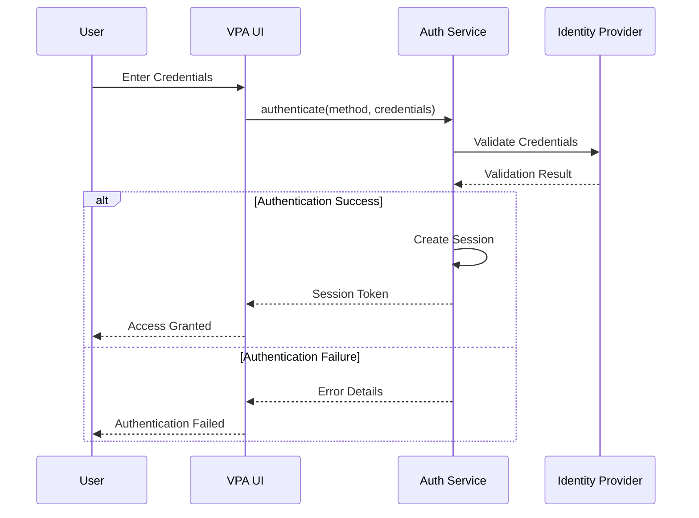
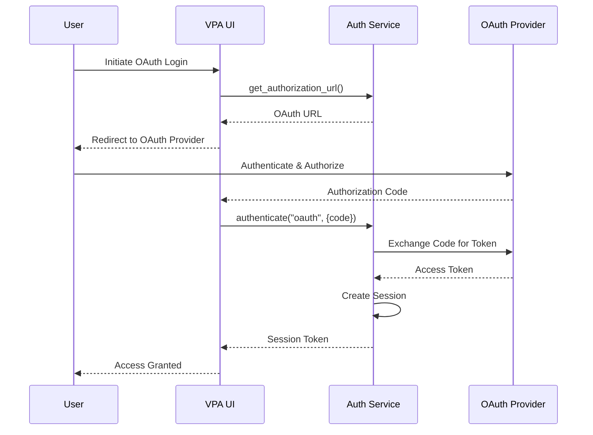
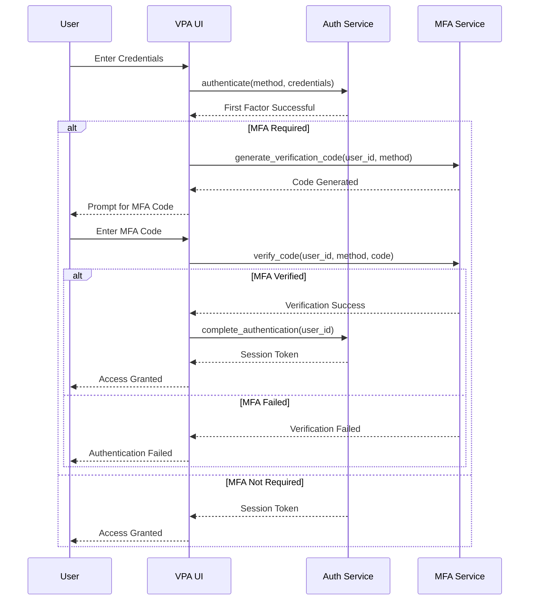
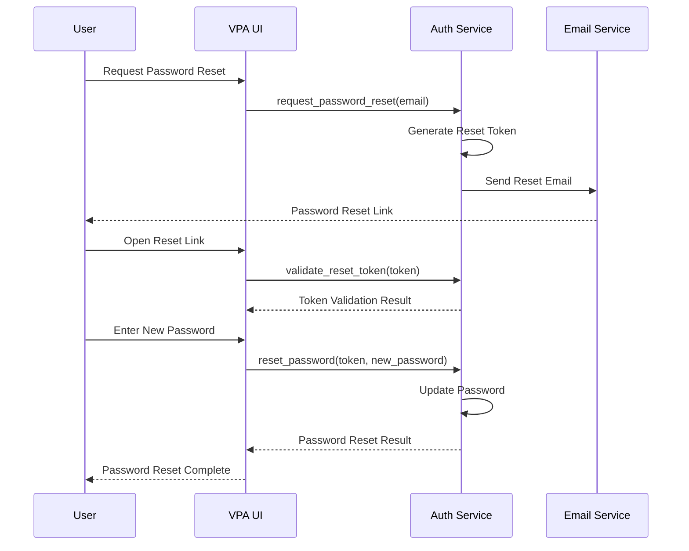

# Authentication System Design

## Overview

This document outlines the comprehensive authentication system for the Virtual Personal Assistant (VPA). It details the architecture, implementation patterns, security considerations, and integration points for user authentication and authorization throughout the VPA application.

## Table of Contents

1. [Architecture Overview](#architecture-overview)
2. [Authentication Methods](#authentication-methods)
3. [Authentication Flow](#authentication-flow)
4. [Session Management](#session-management)
5. [Authorization Framework](#authorization-framework)
6. [Multi-Factor Authentication](#multi-factor-authentication)
7. [OAuth and Third-Party Authentication](#oauth-and-third-party-authentication)
8. [Password Management](#password-management)
9. [Security Considerations](#security-considerations)
10. [Implementation Guidelines](#implementation-guidelines)

## Architecture Overview

The VPA Authentication System is designed as a layered architecture with separation of concerns between authentication, authorization, and identity management:



### Core Components

1. **Authentication Service**: Central service that orchestrates the authentication process
2. **Identity Provider**: Manages user identity information and credentials
3. **Session Manager**: Handles authenticated sessions and tokens
4. **Authorization Service**: Controls access to protected resources based on user identity
5. **Authentication Store**: Securely stores authentication-related data

### Component Relationships

```python
from typing import Dict, Any, Optional
from abc import ABC, abstractmethod
import asyncio
from datetime import datetime, timedelta


class AuthenticationService:
    """Central service managing the authentication process"""
    
    def __init__(self):
        self.identity_provider = IdentityProvider()
        self.session_manager = SessionManager()
        self.authorization_service = AuthorizationService()
        self.auth_methods = {}
        self._register_default_methods()
        
    def _register_default_methods(self):
        """Register default authentication methods"""
        self.register_auth_method("local", LocalPasswordAuthentication())
        self.register_auth_method("windows", WindowsAuthentication())
        self.register_auth_method("microsoft", MicrosoftOAuthAuthentication())
        
    def register_auth_method(self, method_id: str, auth_provider: "AuthenticationMethod"):
        """Register an authentication method"""
        self.auth_methods[method_id] = auth_provider
        auth_provider.set_services(self.identity_provider, self.session_manager)
        
    async def authenticate(
        self,
        method_id: str,
        credentials: Dict[str, Any]
    ) -> Optional[Dict[str, Any]]:
        """Authenticate a user with the specified method and credentials"""
        if method_id not in self.auth_methods:
            raise ValueError(f"Unknown authentication method: {method_id}")
            
        auth_method = self.auth_methods[method_id]
        
        # Perform the authentication
        auth_result = await auth_method.authenticate(credentials)
        
        if not auth_result.success:
            # Log failed attempt
            from vpa.core.logging import security_logger
            security_logger.warning(
                f"Authentication failed",
                extra={
                    "method": method_id,
                    "reason": auth_result.failure_reason,
                    "timestamp": datetime.utcnow().isoformat()
                }
            )
            return None
            
        # Authentication succeeded
        user_id = auth_result.user_id
        
        # Create a new session
        session = await self.session_manager.create_session(user_id, method_id)
        
        # Log successful login
        from vpa.core.logging import security_logger
        security_logger.info(
            f"User authenticated",
            extra={
                "user_id": user_id,
                "method": method_id,
                "session_id": session.session_id,
                "timestamp": datetime.utcnow().isoformat()
            }
        )
        
        # Return session information
        return {
            "user_id": user_id,
            "session_id": session.session_id,
            "token": session.token,
            "expires_at": session.expires_at.isoformat()
        }
        
    async def validate_session(self, token: str) -> Optional[Dict[str, Any]]:
        """Validate a session token"""
        session = await self.session_manager.validate_token(token)
        
        if not session:
            return None
            
        return {
            "user_id": session.user_id,
            "session_id": session.session_id,
            "expires_at": session.expires_at.isoformat()
        }
        
    async def logout(self, token: str) -> bool:
        """End a user's session"""
        return await self.session_manager.end_session(token)
```

## Authentication Methods

The VPA system supports multiple authentication methods to accommodate different usage scenarios and security requirements:

### Local Authentication

The primary authentication method using username/password stored locally:

```python
from dataclasses import dataclass
from typing import Optional
import bcrypt
import secrets


@dataclass
class AuthenticationResult:
    """Result of an authentication attempt"""
    success: bool
    user_id: Optional[str] = None
    failure_reason: Optional[str] = None


class AuthenticationMethod(ABC):
    """Base class for authentication methods"""
    
    def set_services(self, identity_provider, session_manager):
        self.identity_provider = identity_provider
        self.session_manager = session_manager
        
    @abstractmethod
    async def authenticate(self, credentials: Dict[str, Any]) -> AuthenticationResult:
        """Authenticate a user with the provided credentials"""
        pass


class LocalPasswordAuthentication(AuthenticationMethod):
    """Local authentication with username and password"""
    
    async def authenticate(self, credentials: Dict[str, Any]) -> AuthenticationResult:
        """Authenticate with username and password"""
        # Validate required credentials
        if "username" not in credentials or "password" not in credentials:
            return AuthenticationResult(
                success=False,
                failure_reason="Missing required credentials"
            )
            
        username = credentials["username"]
        password = credentials["password"]
        
        # Get the user from the identity provider
        user = await self.identity_provider.get_user_by_username(username)
        
        if not user:
            # Use constant-time comparison to prevent timing attacks
            # that could reveal if a username exists
            dummy_hash = bcrypt.hashpw(password.encode(), bcrypt.gensalt())
            bcrypt.checkpw(password.encode(), dummy_hash)
            
            return AuthenticationResult(
                success=False,
                failure_reason="Invalid username or password"
            )
            
        # Check if the password is correct
        stored_password_hash = user["password_hash"]
        
        if not bcrypt.checkpw(password.encode(), stored_password_hash.encode()):
            return AuthenticationResult(
                success=False,
                failure_reason="Invalid username or password"
            )
            
        # Check if the account is locked or disabled
        if user.get("locked", False):
            return AuthenticationResult(
                success=False,
                failure_reason="Account is locked"
            )
            
        if user.get("disabled", False):
            return AuthenticationResult(
                success=False,
                failure_reason="Account is disabled"
            )
            
        # Authentication successful
        return AuthenticationResult(
            success=True,
            user_id=user["user_id"]
        )
```

### Windows Authentication

Integration with Windows authentication for native desktop scenarios:

```python
import win32security
import win32api


class WindowsAuthentication(AuthenticationMethod):
    """Windows integrated authentication"""
    
    async def authenticate(self, credentials: Dict[str, Any]) -> AuthenticationResult:
        """Authenticate using Windows credentials"""
        # For Windows authentication, we support two modes:
        # 1. Using the current Windows user (no credentials needed)
        # 2. Explicit Windows credentials
        
        try:
            if "username" in credentials and "password" in credentials:
                # Explicit credentials provided
                domain = credentials.get("domain", ".")
                username = credentials["username"]
                password = credentials["password"]
                
                # Attempt to log on with these credentials
                try:
                    handle = win32security.LogonUser(
                        username,
                        domain,
                        password,
                        win32security.LOGON32_LOGON_NETWORK,
                        win32security.LOGON32_PROVIDER_DEFAULT
                    )
                    # If we got here, authentication succeeded
                    handle.Close()
                    
                    # Map Windows user to our internal user
                    windows_sid = self._get_user_sid(domain, username)
                    user = await self._get_user_for_windows_sid(windows_sid)
                    
                except win32security.error:
                    # Windows authentication failed
                    return AuthenticationResult(
                        success=False,
                        failure_reason="Invalid Windows credentials"
                    )
                    
            else:
                # Use current Windows user
                windows_sid = win32security.GetTokenInformation(
                    win32security.OpenProcessToken(
                        win32api.GetCurrentProcess(),
                        win32security.TOKEN_QUERY
                    ),
                    win32security.TokenUser
                )[0]
                
                # Convert SID to string
                windows_sid = win32security.ConvertSidToStringSid(windows_sid)
                
                # Map Windows user to our internal user
                user = await self._get_user_for_windows_sid(windows_sid)
            
            # If no user mapping exists
            if not user:
                # Option 1: Auto-provision a user (if enabled)
                if self._should_auto_provision():
                    user = await self._provision_user_for_windows(windows_sid)
                else:
                    return AuthenticationResult(
                        success=False,
                        failure_reason="No user associated with Windows account"
                    )
            
            # Authentication successful
            return AuthenticationResult(
                success=True,
                user_id=user["user_id"]
            )
            
        except Exception as e:
            # Log the exception
            from vpa.core.logging import security_logger
            security_logger.error(
                f"Windows authentication error: {str(e)}",
                exc_info=True
            )
            
            return AuthenticationResult(
                success=False,
                failure_reason="Windows authentication error"
            )
            
    def _get_user_sid(self, domain, username):
        """Get the SID for a Windows user"""
        sid, _, _ = win32security.LookupAccountName(domain, username)
        return win32security.ConvertSidToStringSid(sid)
        
    async def _get_user_for_windows_sid(self, windows_sid):
        """Get the internal user for a Windows SID"""
        # Implementation would look up the user in our identity store
        # This is a placeholder
        return None
        
    def _should_auto_provision(self):
        """Check if auto-provisioning is enabled"""
        # Implementation would check configuration
        # This is a placeholder
        return False
        
    async def _provision_user_for_windows(self, windows_sid):
        """Provision a new user for a Windows account"""
        # Implementation would create a new user
        # This is a placeholder
        return None
```

### OAuth Authentication

Support for OAuth 2.0 providers like Microsoft, Google, etc.:

```python
import msal
import requests
from urllib.parse import urlencode


class MicrosoftOAuthAuthentication(AuthenticationMethod):
    """Microsoft OAuth authentication"""
    
    def __init__(self):
        self._load_config()
        self._initialize_msal_app()
        
    def _load_config(self):
        """Load Microsoft OAuth configuration"""
        from vpa.core.config import get_config
        config = get_config()
        
        self.client_id = config.get("microsoft_oauth.client_id")
        self.client_secret = config.get("microsoft_oauth.client_secret")
        self.tenant_id = config.get("microsoft_oauth.tenant_id", "common")
        self.redirect_uri = config.get("microsoft_oauth.redirect_uri")
        self.scopes = config.get("microsoft_oauth.scopes", ["User.Read"])
        
    def _initialize_msal_app(self):
        """Initialize the MSAL application"""
        self.msal_app = msal.ConfidentialClientApplication(
            self.client_id,
            authority=f"https://login.microsoftonline.com/{self.tenant_id}",
            client_credential=self.client_secret
        )
        
    def get_authorization_url(self):
        """Get the authorization URL for the OAuth flow"""
        auth_url = self.msal_app.get_authorization_request_url(
            scopes=self.scopes,
            redirect_uri=self.redirect_uri,
            state=self._generate_state()
        )
        return auth_url
        
    def _generate_state(self):
        """Generate a state parameter for CSRF protection"""
        state = secrets.token_urlsafe(32)
        # Store state for validation when the callback occurs
        return state
        
    async def authenticate(self, credentials: Dict[str, Any]) -> AuthenticationResult:
        """Authenticate with Microsoft OAuth"""
        # For OAuth, we expect an authorization code
        if "code" not in credentials:
            return AuthenticationResult(
                success=False,
                failure_reason="Missing authorization code"
            )
            
        code = credentials["code"]
        
        # Validate the state if provided (CSRF protection)
        if "state" in credentials:
            state = credentials["state"]
            if not self._validate_state(state):
                return AuthenticationResult(
                    success=False,
                    failure_reason="Invalid state parameter"
                )
        
        try:
            # Exchange the code for a token
            result = self.msal_app.acquire_token_by_authorization_code(
                code=code,
                scopes=self.scopes,
                redirect_uri=self.redirect_uri
            )
            
            if "error" in result:
                return AuthenticationResult(
                    success=False,
                    failure_reason=f"OAuth error: {result.get('error_description', result['error'])}"
                )
                
            # Get the user info from Microsoft
            user_info = await self._get_user_info(result["access_token"])
            
            # Map Microsoft user to our internal user
            user = await self._get_user_for_microsoft(user_info)
            
            # If no user mapping exists
            if not user:
                # Auto-provision a user if enabled
                if self._should_auto_provision():
                    user = await self._provision_user_for_microsoft(user_info)
                else:
                    return AuthenticationResult(
                        success=False,
                        failure_reason="No user associated with Microsoft account"
                    )
            
            # Authentication successful
            return AuthenticationResult(
                success=True,
                user_id=user["user_id"]
            )
            
        except Exception as e:
            # Log the exception
            from vpa.core.logging import security_logger
            security_logger.error(
                f"Microsoft OAuth authentication error: {str(e)}",
                exc_info=True
            )
            
            return AuthenticationResult(
                success=False,
                failure_reason="OAuth authentication error"
            )
            
    async def _get_user_info(self, access_token):
        """Get user information from Microsoft Graph API"""
        headers = {"Authorization": f"Bearer {access_token}"}
        response = requests.get(
            "https://graph.microsoft.com/v1.0/me",
            headers=headers
        )
        response.raise_for_status()
        return response.json()
        
    def _validate_state(self, state):
        """Validate the state parameter"""
        # Implementation would validate against stored state
        # This is a placeholder
        return True
        
    async def _get_user_for_microsoft(self, user_info):
        """Get the internal user for a Microsoft account"""
        # Implementation would look up the user in our identity store
        # This is a placeholder
        return None
        
    def _should_auto_provision(self):
        """Check if auto-provisioning is enabled"""
        # Implementation would check configuration
        # This is a placeholder
        return False
        
    async def _provision_user_for_microsoft(self, user_info):
        """Provision a new user for a Microsoft account"""
        # Implementation would create a new user
        # This is a placeholder
        return None
```

## Authentication Flow

The VPA system implements several authentication flows to handle different scenarios:

### Interactive Login Flow



### OAuth Flow



### Implementation of Authentication Flow

```python
# Client-side implementation of authentication flow
class AuthenticationManager:
    """Client-side manager for authentication"""
    
    def __init__(self):
        self.session_token = None
        self.auth_api = AuthenticationAPI()  # Client for auth service API
        
    async def login_with_password(self, username: str, password: str) -> bool:
        """Login with username and password"""
        try:
            result = await self.auth_api.authenticate(
                method_id="local",
                credentials={
                    "username": username,
                    "password": password
                }
            )
            
            if result:
                self.session_token = result["token"]
                await self._notify_login_success(result["user_id"])
                return True
            else:
                return False
                
        except Exception:
            return False
            
    async def login_with_windows(self) -> bool:
        """Login with current Windows account"""
        try:
            result = await self.auth_api.authenticate(
                method_id="windows",
                credentials={}  # No credentials needed, uses current user
            )
            
            if result:
                self.session_token = result["token"]
                await self._notify_login_success(result["user_id"])
                return True
            else:
                return False
                
        except Exception:
            return False
            
    async def start_oauth_login(self, provider: str) -> str:
        """Start OAuth login flow"""
        # Get the authorization URL
        return await self.auth_api.get_authorization_url(provider)
        
    async def complete_oauth_login(self, provider: str, code: str, state: str = None) -> bool:
        """Complete OAuth login after receiving callback"""
        try:
            credentials = {"code": code}
            if state:
                credentials["state"] = state
                
            result = await self.auth_api.authenticate(
                method_id=provider,
                credentials=credentials
            )
            
            if result:
                self.session_token = result["token"]
                await self._notify_login_success(result["user_id"])
                return True
            else:
                return False
                
        except Exception:
            return False
            
    async def logout(self) -> bool:
        """Logout the current user"""
        if not self.session_token:
            return True
            
        try:
            result = await self.auth_api.logout(self.session_token)
            if result:
                self.session_token = None
                await self._notify_logout()
            return result
        except Exception:
            return False
            
    async def _notify_login_success(self, user_id: str):
        """Emit event for successful login"""
        from vpa.core.events import event_bus
        await event_bus.emit_async(
            "auth.login_success",
            {"user_id": user_id, "timestamp": datetime.utcnow().isoformat()}
        )
        
    async def _notify_logout(self):
        """Emit event for logout"""
        from vpa.core.events import event_bus
        await event_bus.emit_async(
            "auth.logout",
            {"timestamp": datetime.utcnow().isoformat()}
        )
```

## Session Management

The VPA system implements secure session management to maintain user authentication state:

### Session Architecture

```python
from dataclasses import dataclass
from datetime import datetime, timedelta
import secrets
import uuid


@dataclass
class Session:
    """User session information"""
    session_id: str
    user_id: str
    token: str
    auth_method: str
    created_at: datetime
    expires_at: datetime
    last_active_at: datetime
    metadata: Dict[str, Any]


class SessionManager:
    """Manages user sessions"""
    
    def __init__(self):
        self.sessions = {}  # token -> Session
        self.user_sessions = {}  # user_id -> list of session_id
        self._load_config()
        
    def _load_config(self):
        """Load session configuration"""
        from vpa.core.config import get_config
        config = get_config()
        
        # Session lifetime in minutes
        self.session_lifetime = timedelta(
            minutes=config.get("auth.session_lifetime_minutes", 60)
        )
        # Maximum sessions per user
        self.max_sessions_per_user = config.get("auth.max_sessions_per_user", 5)
        # Token length in bytes (will be base64-encoded)
        self.token_bytes = config.get("auth.token_bytes", 32)
        
    async def create_session(
        self,
        user_id: str,
        auth_method: str,
        metadata: Dict[str, Any] = None
    ) -> Session:
        """Create a new session for a user"""
        # Generate a unique session ID
        session_id = str(uuid.uuid4())
        
        # Generate a secure random token
        token = secrets.token_urlsafe(self.token_bytes)
        
        # Create the session
        now = datetime.utcnow()
        session = Session(
            session_id=session_id,
            user_id=user_id,
            token=token,
            auth_method=auth_method,
            created_at=now,
            expires_at=now + self.session_lifetime,
            last_active_at=now,
            metadata=metadata or {}
        )
        
        # Store the session
        self.sessions[token] = session
        
        # Associate with user
        if user_id not in self.user_sessions:
            self.user_sessions[user_id] = []
        self.user_sessions[user_id].append(session_id)
        
        # Enforce maximum sessions per user
        await self._enforce_session_limits(user_id)
        
        # Persist the session
        await self._persist_session(session)
        
        return session
        
    async def validate_token(self, token: str) -> Optional[Session]:
        """Validate a session token"""
        if token not in self.sessions:
            return None
            
        session = self.sessions[token]
        
        # Check if expired
        if datetime.utcnow() > session.expires_at:
            await self.end_session(token)
            return None
            
        # Update last active time
        session.last_active_at = datetime.utcnow()
        
        # Return the session
        return session
        
    async def end_session(self, token: str) -> bool:
        """End a session"""
        if token not in self.sessions:
            return False
            
        session = self.sessions[token]
        
        # Remove from user sessions
        if session.user_id in self.user_sessions:
            if session.session_id in self.user_sessions[session.user_id]:
                self.user_sessions[session.user_id].remove(session.session_id)
                
        # Remove the session
        del self.sessions[token]
        
        # Delete from persistent storage
        await self._delete_session(session.session_id)
        
        return True
        
    async def end_all_user_sessions(self, user_id: str) -> int:
        """End all sessions for a user"""
        if user_id not in self.user_sessions:
            return 0
            
        count = 0
        session_ids = self.user_sessions[user_id].copy()
        
        for session_id in session_ids:
            # Find the token for this session
            token = None
            for t, s in self.sessions.items():
                if s.session_id == session_id:
                    token = t
                    break
                    
            if token:
                await self.end_session(token)
                count += 1
                
        return count
        
    async def _enforce_session_limits(self, user_id: str):
        """Enforce the maximum number of sessions per user"""
        if user_id not in self.user_sessions:
            return
            
        # If we're under the limit, do nothing
        if len(self.user_sessions[user_id]) <= self.max_sessions_per_user:
            return
            
        # Find the oldest sessions to remove
        sessions_to_remove = len(self.user_sessions[user_id]) - self.max_sessions_per_user
        
        # Get all sessions for this user
        user_sessions = []
        for token, session in self.sessions.items():
            if session.user_id == user_id:
                user_sessions.append((token, session))
                
        # Sort by creation time
        user_sessions.sort(key=lambda x: x[1].created_at)
        
        # Remove the oldest sessions
        for i in range(sessions_to_remove):
            if i < len(user_sessions):
                await self.end_session(user_sessions[i][0])
                
    async def _persist_session(self, session: Session):
        """Save the session to persistent storage"""
        # Implementation would store in database
        pass
        
    async def _delete_session(self, session_id: str):
        """Delete the session from persistent storage"""
        # Implementation would delete from database
        pass
        
    async def _load_sessions(self):
        """Load sessions from persistent storage"""
        # Implementation would load from database
        pass
```

### Session Token Management

- Secure token generation with high entropy
- Short-lived sessions with automatic expiration
- Token rotation on privilege changes
- Session revocation capabilities

## Authorization Framework

The VPA system implements a comprehensive role-based and attribute-based authorization framework:

### Authorization Architecture

```python
from enum import Enum
from dataclasses import dataclass
from typing import Dict, Any, List, Set, Optional, Union


class Permission(Enum):
    """System permissions"""
    READ_OWN_DATA = "read_own_data"
    MODIFY_OWN_DATA = "modify_own_data"
    ACCESS_SYSTEM_SETTINGS = "access_system_settings"
    MODIFY_SYSTEM_SETTINGS = "modify_system_settings"
    INSTALL_PLUGINS = "install_plugins"
    MANAGE_USERS = "manage_users"
    # Add more permissions as needed


@dataclass
class Role:
    """User role with associated permissions"""
    role_id: str
    name: str
    description: str
    permissions: Set[Permission]
    
    
@dataclass
class AuthorizationContext:
    """Context for authorization decisions"""
    user_id: str
    roles: List[str]
    attributes: Dict[str, Any]
    session_attributes: Dict[str, Any]
    resource_attributes: Dict[str, Any] = None


class AuthorizationService:
    """Manages authorization decisions"""
    
    def __init__(self):
        self.roles = {}  # role_id -> Role
        self.user_roles = {}  # user_id -> list of role_id
        self.user_attributes = {}  # user_id -> dict of attributes
        self._initialize_roles()
        
    def _initialize_roles(self):
        """Initialize the default roles"""
        # Add the admin role
        self.add_role(Role(
            role_id="admin",
            name="Administrator",
            description="Full system access",
            permissions=set(Permission)  # All permissions
        ))
        
        # Add the standard user role
        self.add_role(Role(
            role_id="user",
            name="Standard User",
            description="Standard user access",
            permissions={
                Permission.READ_OWN_DATA,
                Permission.MODIFY_OWN_DATA,
                Permission.ACCESS_SYSTEM_SETTINGS
            }
        ))
        
        # Add the guest role
        self.add_role(Role(
            role_id="guest",
            name="Guest",
            description="Limited access for guests",
            permissions={
                Permission.READ_OWN_DATA
            }
        ))
        
    def add_role(self, role: Role):
        """Add a role to the system"""
        self.roles[role.role_id] = role
        
    async def assign_role_to_user(self, user_id: str, role_id: str):
        """Assign a role to a user"""
        if role_id not in self.roles:
            raise ValueError(f"Unknown role: {role_id}")
            
        if user_id not in self.user_roles:
            self.user_roles[user_id] = []
            
        if role_id not in self.user_roles[user_id]:
            self.user_roles[user_id].append(role_id)
            
    async def set_user_attribute(self, user_id: str, attribute: str, value: Any):
        """Set a user attribute"""
        if user_id not in self.user_attributes:
            self.user_attributes[user_id] = {}
            
        self.user_attributes[user_id][attribute] = value
        
    async def build_authorization_context(
        self,
        user_id: str,
        session: Session = None
    ) -> AuthorizationContext:
        """Build an authorization context for a user"""
        # Get the user's roles
        roles = self.user_roles.get(user_id, ["guest"])  # Default to guest
        
        # Get the user's attributes
        attributes = self.user_attributes.get(user_id, {}).copy()
        
        # Add session attributes if available
        session_attributes = {}
        if session:
            session_attributes = session.metadata.copy()
            
        return AuthorizationContext(
            user_id=user_id,
            roles=roles,
            attributes=attributes,
            session_attributes=session_attributes
        )
        
    async def check_permission(
        self,
        context: AuthorizationContext,
        permission: Permission,
        resource_id: str = None
    ) -> bool:
        """Check if a user has a permission"""
        # If user has admin role, allow everything
        if "admin" in context.roles:
            return True
            
        # Check if any of the user's roles have this permission
        has_permission = False
        for role_id in context.roles:
            if role_id in self.roles:
                role = self.roles[role_id]
                if permission in role.permissions:
                    has_permission = True
                    break
        
        if not has_permission:
            return False
            
        # Check resource-specific permissions
        if resource_id and context.resource_attributes:
            # Example: check resource ownership
            if context.resource_attributes.get("owner_id") != context.user_id:
                # Only allow non-owners with specific permissions
                if permission in [Permission.MODIFY_OWN_DATA]:
                    return False
                    
        return True


# Decorator for authorization checks
def requires_permission(permission: Permission, resource_id_param: str = None):
    """Decorator to enforce permission checks"""
    def decorator(func):
        @wraps(func)
        async def wrapper(self, *args, **kwargs):
            # Get the current user from the context
            from vpa.core.context import get_current_user_id, get_current_session
            user_id = get_current_user_id()
            session = get_current_session()
            
            # If no user, authentication is required
            if not user_id:
                from vpa.core.exceptions import AuthenticationRequiredException
                raise AuthenticationRequiredException("Authentication required")
                
            # Get the authorization service
            from vpa.core.auth import get_authorization_service
            auth_service = get_authorization_service()
            
            # Build authorization context
            context = await auth_service.build_authorization_context(user_id, session)
            
            # Add resource attributes if resource ID is provided
            resource_id = None
            if resource_id_param:
                if resource_id_param in kwargs:
                    resource_id = kwargs[resource_id_param]
                    # Get resource attributes
                    context.resource_attributes = await self._get_resource_attributes(resource_id)
                    
            # Check permission
            has_permission = await auth_service.check_permission(
                context, permission, resource_id
            )
            
            if not has_permission:
                from vpa.core.exceptions import AuthorizationException
                raise AuthorizationException(
                    f"Permission denied: {permission.value} for resource {resource_id}"
                )
                
            # If authorized, call the original function
            return await func(self, *args, **kwargs)
            
        return wrapper
    return decorator


# Usage example
class UserSettingsService:
    
    @requires_permission(Permission.ACCESS_SYSTEM_SETTINGS)
    async def get_system_settings(self):
        """Get system settings"""
        # Implementation
        pass
        
    @requires_permission(Permission.MODIFY_SYSTEM_SETTINGS)
    async def update_system_settings(self, settings):
        """Update system settings"""
        # Implementation
        pass
        
    @requires_permission(Permission.MODIFY_OWN_DATA, resource_id_param="user_id")
    async def update_user_profile(self, user_id, profile_data):
        """Update user profile"""
        # Implementation
        pass
        
    async def _get_resource_attributes(self, resource_id):
        """Get attributes for a resource"""
        # Implementation would fetch resource attributes
        # This is a placeholder
        return {"owner_id": resource_id}
```

## Multi-Factor Authentication

The VPA system supports Multi-Factor Authentication (MFA) to enhance security:

### MFA Implementation

```python
from enum import Enum, auto
import pyotp
import qrcode
from io import BytesIO


class MFAMethod(Enum):
    """Supported MFA methods"""
    TOTP = auto()  # Time-based One-Time Password
    EMAIL = auto()  # Email verification codes
    SMS = auto()  # SMS verification codes
    
    
class MFAService:
    """Service for managing multi-factor authentication"""
    
    def __init__(self):
        self._load_config()
        self.code_repository = VerificationCodeRepository()
        
    def _load_config(self):
        """Load MFA configuration"""
        from vpa.core.config import get_config
        config = get_config()
        
        self.totp_issuer = config.get("mfa.totp_issuer", "VPA")
        self.code_expiration = config.get("mfa.code_expiration_seconds", 300)  # 5 minutes
        self.code_length = config.get("mfa.code_length", 6)
        
    async def setup_totp(self, user_id: str) -> Dict[str, Any]:
        """Set up TOTP for a user"""
        # Generate a secret key
        secret = pyotp.random_base32()
        
        # Store the secret for the user
        await self._store_mfa_secret(user_id, MFAMethod.TOTP, secret)
        
        # Generate a provisioning URI for QR codes
        totp = pyotp.TOTP(secret)
        uri = totp.provisioning_uri(name=user_id, issuer_name=self.totp_issuer)
        
        # Generate a QR code
        qr = qrcode.QRCode(
            version=1,
            error_correction=qrcode.constants.ERROR_CORRECT_L,
            box_size=10,
            border=4,
        )
        qr.add_data(uri)
        qr.make(fit=True)
        
        img = qr.make_image(fill_color="black", back_color="white")
        
        # Convert to bytes
        buffer = BytesIO()
        img.save(buffer, format="PNG")
        qr_code = buffer.getvalue()
        
        return {
            "user_id": user_id,
            "method": MFAMethod.TOTP.name,
            "secret": secret,
            "qr_code": qr_code
        }
        
    async def verify_totp(self, user_id: str, code: str) -> bool:
        """Verify a TOTP code"""
        # Get the user's secret
        secret = await self._get_mfa_secret(user_id, MFAMethod.TOTP)
        
        if not secret:
            return False
            
        # Verify the code
        totp = pyotp.TOTP(secret)
        return totp.verify(code)
        
    async def generate_verification_code(self, user_id: str, method: MFAMethod) -> str:
        """Generate a verification code"""
        # Generate a random code
        code = "".join(secrets.choice("0123456789") for _ in range(self.code_length))
        
        # Store the code with expiration
        expires_at = datetime.utcnow() + timedelta(seconds=self.code_expiration)
        await self.code_repository.store_code(user_id, method, code, expires_at)
        
        # Return the code (would be sent via email/SMS in production)
        return code
        
    async def verify_code(self, user_id: str, method: MFAMethod, code: str) -> bool:
        """Verify a verification code"""
        stored_code = await self.code_repository.get_code(user_id, method)
        
        if not stored_code:
            return False
            
        # Check if code has expired
        if datetime.utcnow() > stored_code["expires_at"]:
            await self.code_repository.delete_code(user_id, method)
            return False
            
        # Check if the code matches
        if stored_code["code"] != code:
            return False
            
        # Code is valid, delete it so it can't be used again
        await self.code_repository.delete_code(user_id, method)
        
        return True
        
    async def _store_mfa_secret(self, user_id: str, method: MFAMethod, secret: str):
        """Store an MFA secret for a user"""
        # Implementation would store in database
        pass
        
    async def _get_mfa_secret(self, user_id: str, method: MFAMethod) -> Optional[str]:
        """Get an MFA secret for a user"""
        # Implementation would retrieve from database
        pass
```

### MFA Flow



## OAuth and Third-Party Authentication

The VPA system integrates with OAuth 2.0 providers for flexible authentication options:

### OAuth Providers

1. **Microsoft OAuth**:
   - Azure AD integration for corporate environments
   - Microsoft personal account support
   
2. **Google OAuth**:
   - Support for Google Workspace accounts
   - Personal Google accounts
   
3. **Custom OAuth Providers**:
   - Extensible framework for adding custom OAuth providers

### OAuth Implementation

```python
from abc import ABC, abstractmethod


class OAuthProviderBase(AuthenticationMethod, ABC):
    """Base class for OAuth providers"""
    
    @abstractmethod
    def get_authorization_url(self) -> str:
        """Get the authorization URL for this provider"""
        pass
        
    @abstractmethod
    async def exchange_code_for_token(self, code: str) -> Dict[str, Any]:
        """Exchange an authorization code for tokens"""
        pass
        
    @abstractmethod
    async def get_user_profile(self, access_token: str) -> Dict[str, Any]:
        """Get the user profile from this provider"""
        pass
        
    @abstractmethod
    async def map_provider_user_to_internal(self, profile: Dict[str, Any]) -> Optional[str]:
        """Map a provider user to an internal user ID"""
        pass
        
    @abstractmethod
    async def provision_user_from_profile(self, profile: Dict[str, Any]) -> str:
        """Provision a new user from a profile"""
        pass
        
    async def authenticate(self, credentials: Dict[str, Any]) -> AuthenticationResult:
        """Authenticate with this OAuth provider"""
        # For OAuth, we expect an authorization code
        if "code" not in credentials:
            return AuthenticationResult(
                success=False,
                failure_reason="Missing authorization code"
            )
            
        code = credentials["code"]
        
        try:
            # Exchange the code for tokens
            tokens = await self.exchange_code_for_token(code)
            
            if "error" in tokens:
                return AuthenticationResult(
                    success=False,
                    failure_reason=f"OAuth error: {tokens.get('error_description', tokens['error'])}"
                )
                
            # Get the user profile
            profile = await self.get_user_profile(tokens["access_token"])
            
            # Map to internal user
            user_id = await self.map_provider_user_to_internal(profile)
            
            # Auto-provision if enabled and no mapping exists
            if not user_id and self._should_auto_provision():
                user_id = await self.provision_user_from_profile(profile)
                
            if not user_id:
                return AuthenticationResult(
                    success=False,
                    failure_reason="No user mapped to this OAuth account"
                )
                
            # Store the tokens for future use
            await self._store_oauth_tokens(user_id, tokens)
            
            # Authentication successful
            return AuthenticationResult(
                success=True,
                user_id=user_id
            )
            
        except Exception as e:
            # Log the exception
            from vpa.core.logging import security_logger
            security_logger.error(
                f"OAuth authentication error: {str(e)}",
                exc_info=True
            )
            
            return AuthenticationResult(
                success=False,
                failure_reason="OAuth authentication error"
            )
            
    async def _store_oauth_tokens(self, user_id: str, tokens: Dict[str, Any]):
        """Store OAuth tokens for a user"""
        # Implementation would store securely
        pass
        
    def _should_auto_provision(self) -> bool:
        """Check if auto-provisioning is enabled"""
        from vpa.core.config import get_config
        config = get_config()
        return config.get(f"oauth.{self.__class__.__name__}.auto_provision", False)
```

### OAuth Configuration

```json
{
  "oauth": {
    "microsoft": {
      "client_id": "your-client-id",
      "client_secret": "your-client-secret",
      "tenant_id": "common",
      "redirect_uri": "vpa://auth/callback",
      "scopes": ["User.Read"],
      "auto_provision": true
    },
    "google": {
      "client_id": "your-client-id",
      "client_secret": "your-client-secret",
      "redirect_uri": "vpa://auth/callback",
      "scopes": ["email", "profile"],
      "auto_provision": false
    }
  }
}
```

## Password Management

The VPA system implements secure password handling and management:

### Password Storage

```python
import bcrypt
import secrets
import string
import re


class PasswordManager:
    """Manager for password operations"""
    
    def __init__(self):
        self._load_config()
        
    def _load_config(self):
        """Load password configuration"""
        from vpa.core.config import get_config
        config = get_config()
        
        # Password policy settings
        self.min_length = config.get("password.min_length", 12)
        self.require_uppercase = config.get("password.require_uppercase", True)
        self.require_lowercase = config.get("password.require_lowercase", True)
        self.require_numbers = config.get("password.require_numbers", True)
        self.require_special = config.get("password.require_special", True)
        self.max_age_days = config.get("password.max_age_days", 90)
        self.bcrypt_rounds = config.get("password.bcrypt_rounds", 12)
        
    def hash_password(self, password: str) -> str:
        """Hash a password securely"""
        # Generate a salt and hash the password
        salt = bcrypt.gensalt(rounds=self.bcrypt_rounds)
        hashed = bcrypt.hashpw(password.encode(), salt)
        return hashed.decode()
        
    def verify_password(self, password: str, hashed: str) -> bool:
        """Verify a password against a hash"""
        return bcrypt.checkpw(password.encode(), hashed.encode())
        
    def validate_password_strength(self, password: str) -> Dict[str, Any]:
        """Validate password strength against policy"""
        errors = []
        
        # Check length
        if len(password) < self.min_length:
            errors.append(f"Password must be at least {self.min_length} characters long")
            
        # Check for uppercase letters
        if self.require_uppercase and not any(c.isupper() for c in password):
            errors.append("Password must contain at least one uppercase letter")
            
        # Check for lowercase letters
        if self.require_lowercase and not any(c.islower() for c in password):
            errors.append("Password must contain at least one lowercase letter")
            
        # Check for numbers
        if self.require_numbers and not any(c.isdigit() for c in password):
            errors.append("Password must contain at least one number")
            
        # Check for special characters
        if self.require_special and not re.search(r"[!@#$%^&*(),.?\":{}|<>]", password):
            errors.append("Password must contain at least one special character")
            
        return {
            "valid": len(errors) == 0,
            "errors": errors
        }
        
    def generate_password(self) -> str:
        """Generate a strong random password"""
        # Define character sets
        uppercase = string.ascii_uppercase
        lowercase = string.ascii_lowercase
        numbers = string.digits
        special = "!@#$%^&*(),.?\":{}|<>"
        
        # Ensure at least one of each required type
        password = []
        if self.require_uppercase:
            password.append(secrets.choice(uppercase))
        if self.require_lowercase:
            password.append(secrets.choice(lowercase))
        if self.require_numbers:
            password.append(secrets.choice(numbers))
        if self.require_special:
            password.append(secrets.choice(special))
            
        # Build the character set for the rest of the password
        all_chars = ""
        if self.require_uppercase:
            all_chars += uppercase
        if self.require_lowercase:
            all_chars += lowercase
        if self.require_numbers:
            all_chars += numbers
        if self.require_special:
            all_chars += special
            
        # Generate the rest of the password
        remaining_length = max(0, self.min_length - len(password))
        password.extend(secrets.choice(all_chars) for _ in range(remaining_length))
        
        # Shuffle the password
        secrets.SystemRandom().shuffle(password)
        
        # Convert to string
        return "".join(password)
        
    async def check_password_expiration(self, user_id: str) -> bool:
        """Check if a user's password has expired"""
        # Get the user's password information
        password_info = await self._get_user_password_info(user_id)
        
        if not password_info:
            return False
            
        # Check if password age exceeds max age
        last_changed = password_info.get("last_changed")
        if not last_changed:
            return False
            
        # Convert to datetime
        last_changed_date = datetime.fromisoformat(last_changed)
        max_age = timedelta(days=self.max_age_days)
        
        return datetime.utcnow() - last_changed_date > max_age
        
    async def _get_user_password_info(self, user_id: str) -> Optional[Dict[str, Any]]:
        """Get information about a user's password"""
        # Implementation would retrieve from database
        pass
```

### Password Reset Flow



## Security Considerations

### Threat Models Addressed

1. **Credential Theft**:
   - Password hashing with bcrypt
   - Multi-factor authentication
   - Short-lived sessions
   
2. **Session Hijacking**:
   - Secure, high-entropy tokens
   - HTTPS-only cookies
   - Session binding to client characteristics
   
3. **Man-in-the-Middle**:
   - TLS for all communications
   - HSTS implementation
   
4. **Privilege Escalation**:
   - Granular permissions
   - Least privilege principle
   - Authorization checks at multiple levels

### Security Measures

```python
# Example: Protection against brute force attacks
class BruteForceProtection:
    """Protection against brute force authentication attempts"""
    
    def __init__(self):
        self.attempt_counts = {}  # identifier -> count
        self.lockout_until = {}  # identifier -> datetime
        self._load_config()
        
    def _load_config(self):
        """Load configuration"""
        from vpa.core.config import get_config
        config = get_config()
        
        self.max_attempts = config.get("security.max_login_attempts", 5)
        self.lockout_minutes = config.get("security.lockout_minutes", 15)
        self.reset_after_minutes = config.get("security.attempt_reset_minutes", 30)
        
    async def check_lockout(self, identifier: str) -> bool:
        """Check if an identifier is locked out"""
        # Clean up old data
        await self._cleanup()
        
        # Check if locked out
        if identifier in self.lockout_until:
            lockout_time = self.lockout_until[identifier]
            if datetime.utcnow() < lockout_time:
                return True
            else:
                # Lockout expired
                del self.lockout_until[identifier]
                del self.attempt_counts[identifier]
        
        return False
        
    async def record_attempt(self, identifier: str, success: bool):
        """Record an authentication attempt"""
        # If successful, reset count
        if success:
            if identifier in self.attempt_counts:
                del self.attempt_counts[identifier]
            return
            
        # Increment failed attempt count
        if identifier not in self.attempt_counts:
            self.attempt_counts[identifier] = {
                "count": 0,
                "first_attempt": datetime.utcnow()
            }
            
        self.attempt_counts[identifier]["count"] += 1
        
        # Check if max attempts exceeded
        if self.attempt_counts[identifier]["count"] >= self.max_attempts:
            # Lock out the identifier
            self.lockout_until[identifier] = datetime.utcnow() + timedelta(
                minutes=self.lockout_minutes
            )
            
            # Log the lockout
            from vpa.core.logging import security_logger
            security_logger.warning(
                f"Account locked due to failed login attempts",
                extra={
                    "identifier": identifier,
                    "attempts": self.attempt_counts[identifier]["count"],
                    "lockout_until": self.lockout_until[identifier].isoformat()
                }
            )
            
    async def _cleanup(self):
        """Clean up old attempt records"""
        now = datetime.utcnow()
        reset_threshold = timedelta(minutes=self.reset_after_minutes)
        
        # Clean up attempt counts
        to_delete = []
        for identifier, data in self.attempt_counts.items():
            if now - data["first_attempt"] > reset_threshold:
                to_delete.append(identifier)
                
        for identifier in to_delete:
            del self.attempt_counts[identifier]
            
        # Clean up expired lockouts
        to_delete = []
        for identifier, lockout_time in self.lockout_until.items():
            if now > lockout_time:
                to_delete.append(identifier)
                
        for identifier in to_delete:
            del self.lockout_until[identifier]
```

## Implementation Guidelines

When implementing the VPA Authentication System, follow these guidelines:

### General Implementation Guidelines

1. **Use the AuthenticationService**: All authentication operations should go through the central service
2. **Validate Inputs**: Validate all user inputs before processing
3. **Secure Token Handling**: Protect session tokens as sensitive data
4. **Error Messages**: Use generic error messages that don't leak information
5. **Implement Audit Logging**: Log all authentication events for security monitoring

### Code Implementation Patterns

```python
# Example: Implementing authentication in a UI component
class LoginViewModel:
    """View model for the login screen"""
    
    def __init__(self):
        self.auth_manager = AuthenticationManager()
        self.available_methods = []
        self.error_message = None
        self.is_loading = False
        self._load_auth_methods()
        
    def _load_auth_methods(self):
        """Load available authentication methods"""
        from vpa.core.config import get_config
        config = get_config()
        
        # Check enabled methods
        if config.get("auth.local_enabled", True):
            self.available_methods.append("local")
            
        if config.get("auth.windows_enabled", True):
            self.available_methods.append("windows")
            
        if config.get("auth.microsoft_oauth_enabled", False):
            self.available_methods.append("microsoft")
            
    async def login_with_password(self, username: str, password: str) -> bool:
        """Login with username and password"""
        self.is_loading = True
        self.error_message = None
        
        try:
            # Validate inputs
            if not username or not password:
                self.error_message = "Username and password are required"
                return False
                
            # Attempt login
            result = await self.auth_manager.login_with_password(username, password)
            
            if not result:
                self.error_message = "Invalid username or password"
                return False
                
            # Login successful
            return True
            
        except Exception as e:
            self.error_message = "An error occurred during login"
            
            # Log the exception
            from vpa.core.logging import app_logger
            app_logger.error("Login error", exc_info=True)
            
            return False
            
        finally:
            self.is_loading = False
            
    async def login_with_windows(self) -> bool:
        """Login with Windows authentication"""
        self.is_loading = True
        self.error_message = None
        
        try:
            # Attempt login
            result = await self.auth_manager.login_with_windows()
            
            if not result:
                self.error_message = "Windows authentication failed"
                return False
                
            # Login successful
            return True
            
        except Exception as e:
            self.error_message = "An error occurred during login"
            
            # Log the exception
            from vpa.core.logging import app_logger
            app_logger.error("Windows login error", exc_info=True)
            
            return False
            
        finally:
            self.is_loading = False
```

### Testing Guidelines

1. **Test Authentication Flows**: Verify all authentication flows work correctly
2. **Test Password Policies**: Verify password strength requirements are enforced
3. **Test Session Management**: Verify session creation, validation, and expiration
4. **Test Authorization**: Verify permission checks are applied correctly
5. **Test Security Measures**: Verify protections against common attacks

```python
import unittest
import asyncio
from unittest.mock import Mock, patch
from vpa.core.auth import AuthenticationService, LocalPasswordAuthentication


class AuthenticationTests(unittest.TestCase):
    """Tests for the authentication system"""
    
    def setUp(self):
        self.auth_service = AuthenticationService()
        self.identity_provider = Mock()
        self.session_manager = Mock()
        
        # Replace the real providers with mocks
        self.auth_service.identity_provider = self.identity_provider
        self.auth_service.session_manager = self.session_manager
        
        # Set up a test user
        self.test_user = {
            "user_id": "test_user_1",
            "username": "testuser",
            "password_hash": bcrypt.hashpw("password123".encode(), bcrypt.gensalt()).decode(),
            "locked": False,
            "disabled": False
        }
        
        # Configure the identity provider mock
        self.identity_provider.get_user_by_username.return_value = asyncio.Future()
        self.identity_provider.get_user_by_username.return_value.set_result(self.test_user)
        
        # Configure the session manager mock
        session = Mock()
        session.session_id = "test_session_1"
        session.token = "test_token_123"
        session.expires_at = datetime.utcnow() + timedelta(hours=1)
        
        self.session_manager.create_session.return_value = asyncio.Future()
        self.session_manager.create_session.return_value.set_result(session)
        
    async def test_local_authentication_success(self):
        """Test successful local authentication"""
        result = await self.auth_service.authenticate(
            method_id="local",
            credentials={
                "username": "testuser",
                "password": "password123"
            }
        )
        
        # Check that authentication succeeded
        self.assertIsNotNone(result)
        self.assertEqual(result["user_id"], "test_user_1")
        self.assertEqual(result["session_id"], "test_session_1")
        self.assertEqual(result["token"], "test_token_123")
        
        # Verify that a session was created
        self.session_manager.create_session.assert_called_once_with(
            "test_user_1", "local"
        )
        
    async def test_local_authentication_invalid_password(self):
        """Test local authentication with invalid password"""
        result = await self.auth_service.authenticate(
            method_id="local",
            credentials={
                "username": "testuser",
                "password": "wrong_password"
            }
        )
        
        # Check that authentication failed
        self.assertIsNone(result)
        
        # Verify that no session was created
        self.session_manager.create_session.assert_not_called()
```

---

*Document created: August 29, 2025*
