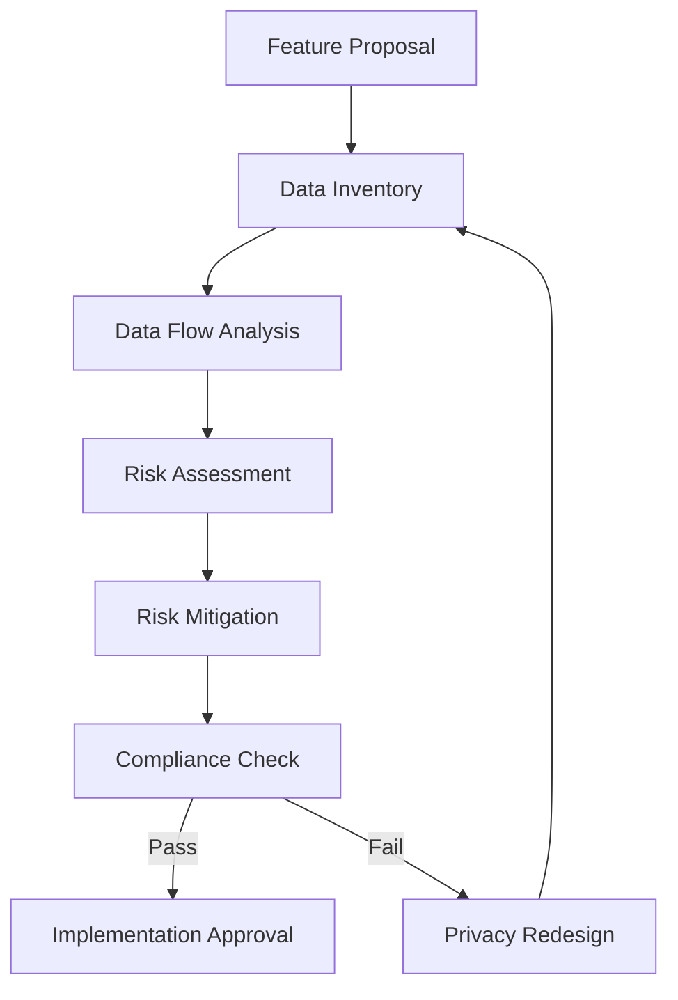

# Data Privacy Framework

## Overview

This document outlines the comprehensive data privacy framework for the Virtual Personal Assistant (VPA) system. It defines how user data is collected, processed, stored, and deleted within the system, ensuring compliance with relevant privacy regulations and best practices.

## Table of Contents

1. [Privacy Principles](#privacy-principles)
2. [User Data Classification](#user-data-classification)
3. [Data Collection and Consent](#data-collection-and-consent)
4. [Data Processing and Usage](#data-processing-and-usage)
5. [Data Storage and Retention](#data-storage-and-retention)
6. [User Rights and Controls](#user-rights-and-controls)
7. [Privacy by Design Implementation](#privacy-by-design-implementation)
8. [Privacy Impact Assessment](#privacy-impact-assessment)
9. [Integration with Security Framework](#integration-with-security-framework)
10. [Implementation Guidelines](#implementation-guidelines)

## Privacy Principles

The VPA system adheres to the following core privacy principles:

1. **Data Minimization**: Only collect data that serves a specific, legitimate purpose
2. **Purpose Limitation**: Process data only for the purposes for which it was collected
3. **Storage Limitation**: Retain data only as long as necessary for its stated purpose
4. **Transparency**: Provide clear information about data collection and processing
5. **User Control**: Enable users to access, modify, and delete their data
6. **Security**: Implement appropriate safeguards to protect user data
7. **Accountability**: Document and demonstrate compliance with privacy principles

### Implementation Pattern

```python
# Privacy principle implementation in the Privacy Manager
class PrivacyManager:
    def __init__(self):
        self.consent_repository = ConsentRepository()
        self.data_retention_service = DataRetentionService()
        self.privacy_policy_service = PrivacyPolicyService()
        self.user_rights_service = UserRightsService()
        
    async def validate_data_collection(self, data_type, purpose):
        """Validates that data collection adheres to privacy principles"""
        # Check if data type is minimized to what's necessary
        if not self._is_data_minimized(data_type, purpose):
            raise PrivacyException(f"Data collection of {data_type} exceeds minimization principle")
        
        # Check if purpose is legitimate and specific
        if not self._is_purpose_legitimate(purpose):
            raise PrivacyException(f"Purpose '{purpose}' is not legitimate")
        
        # Check if user has provided consent for this purpose
        if not await self.consent_repository.has_consent_for_purpose(purpose):
            raise PrivacyException(f"No user consent for purpose: {purpose}")
        
        return True
```

## User Data Classification

The VPA system classifies user data into the following categories to ensure appropriate handling:

| Data Category | Description | Examples | Sensitivity | Retention |
|---------------|-------------|----------|-------------|-----------|
| **Identity Data** | Information that directly identifies a user | Name, Email, Account ID | High | Until account deletion |
| **Preference Data** | User settings and preferences | UI preferences, Language settings | Medium | Until account deletion |
| **Interaction Data** | Records of user interactions | Command history, Voice samples | High | 90 days |
| **Derived Data** | Information derived from user behavior | Usage patterns, Recommendations | Medium | 60 days |
| **Technical Data** | System and device information | Device ID, IP address, OS version | Medium | 30 days |
| **Transient Data** | Temporary data for immediate processing | In-memory voice processing | High | Session only |

### Data Classification Implementation

```python
from enum import Enum, auto
from dataclasses import dataclass
from datetime import timedelta


class DataSensitivity(Enum):
    LOW = auto()
    MEDIUM = auto()
    HIGH = auto()


@dataclass
class DataCategory:
    name: str
    description: str
    sensitivity: DataSensitivity
    retention_period: timedelta
    requires_explicit_consent: bool
    encryption_required: bool
    examples: list[str]


class DataClassificationRegistry:
    """Central registry of all data categories in the system"""
    
    def __init__(self):
        self.categories = {}
        self._initialize_categories()
    
    def _initialize_categories(self):
        self.register_category(
            DataCategory(
                name="identity_data",
                description="Information that directly identifies a user",
                sensitivity=DataSensitivity.HIGH,
                retention_period=timedelta(days=365*2),  # 2 years or until deletion
                requires_explicit_consent=True,
                encryption_required=True,
                examples=["name", "email", "account_id"]
            )
        )
        
        # Additional categories would be registered here
        
    def register_category(self, category: DataCategory):
        """Register a data category in the system"""
        self.categories[category.name] = category
        
    def get_category(self, category_name: str) -> DataCategory:
        """Get a data category by name"""
        if category_name not in self.categories:
            raise ValueError(f"Unknown data category: {category_name}")
        return self.categories[category_name]
```

## Data Collection and Consent

### Consent Management

The VPA implements a granular consent management system that allows users to:

1. View all data collection purposes
2. Grant or revoke consent for specific purposes
3. Understand the implications of their consent choices
4. Access a complete history of consent changes

### Consent Implementation

```python
from datetime import datetime
from typing import Dict, List, Optional

class ConsentRecord:
    def __init__(self, purpose_id: str, granted: bool, timestamp: datetime):
        self.purpose_id = purpose_id
        self.granted = granted
        self.timestamp = timestamp
        

class ConsentPurpose:
    def __init__(
        self, 
        id: str,
        display_name: str,
        description: str,
        data_categories: List[str],
        is_required: bool = False
    ):
        self.id = id
        self.display_name = display_name
        self.description = description
        self.data_categories = data_categories
        self.is_required = is_required


class ConsentManager:
    def __init__(self):
        self._consent_store = {}  # User ID -> Dict of purpose_id -> ConsentRecord
        self._purposes = {}  # purpose_id -> ConsentPurpose
        self._initialize_purposes()
    
    def _initialize_purposes(self):
        """Initialize the standard consent purposes used in the system"""
        self.register_purpose(
            ConsentPurpose(
                id="core_functionality",
                display_name="Core Assistant Functionality",
                description="Process your commands and provide responses",
                data_categories=["interaction_data", "preference_data"],
                is_required=True
            )
        )
        
        self.register_purpose(
            ConsentPurpose(
                id="personalization",
                display_name="Personalized Experience",
                description="Customize responses based on your past interactions",
                data_categories=["interaction_data", "derived_data"],
                is_required=False
            )
        )
        
        # Additional purposes would be registered here
        
    def register_purpose(self, purpose: ConsentPurpose):
        """Register a consent purpose in the system"""
        self._purposes[purpose.id] = purpose
    
    async def update_consent(self, user_id: str, purpose_id: str, granted: bool) -> bool:
        """Update a user's consent for a specific purpose"""
        if purpose_id not in self._purposes:
            raise ValueError(f"Unknown consent purpose: {purpose_id}")
            
        # If purpose is required and trying to revoke, prevent it
        if self._purposes[purpose_id].is_required and not granted:
            raise ValueError(f"Cannot revoke consent for required purpose: {purpose_id}")
            
        # Initialize user's consent store if needed
        if user_id not in self._consent_store:
            self._consent_store[user_id] = {}
            
        # Record the consent change with timestamp
        self._consent_store[user_id][purpose_id] = ConsentRecord(
            purpose_id=purpose_id,
            granted=granted,
            timestamp=datetime.utcnow()
        )
        
        # Emit event for consent change
        await self._emit_consent_changed_event(user_id, purpose_id, granted)
        
        return True
        
    async def has_consent(self, user_id: str, purpose_id: str) -> bool:
        """Check if a user has given consent for a specific purpose"""
        if user_id not in self._consent_store:
            return False
            
        if purpose_id not in self._consent_store[user_id]:
            return False
            
        return self._consent_store[user_id][purpose_id].granted
        
    async def _emit_consent_changed_event(self, user_id: str, purpose_id: str, granted: bool):
        """Emit an event when consent is changed"""
        from vpa.core.events import event_bus
        
        await event_bus.emit_async(
            "privacy.consent_changed",
            {
                "user_id": user_id,
                "purpose_id": purpose_id,
                "granted": granted,
                "timestamp": datetime.utcnow().isoformat()
            }
        )
```

## Data Processing and Usage

### Processing Principles

1. **Lawful Basis**: All data processing must have a valid lawful basis
2. **Purpose Limitation**: Process data only for the purposes stated during collection
3. **Data Minimization**: Process only the data necessary for the stated purpose
4. **Accuracy**: Ensure data is accurate and up-to-date
5. **Storage Limitation**: Keep data only for as long as necessary

### Processing Implementation

```python
from typing import Dict, Any, List
from datetime import datetime

class DataProcessingContext:
    """Context for data processing operations"""
    def __init__(
        self,
        purpose_id: str,
        user_id: str,
        operation_name: str,
        data_categories: List[str]
    ):
        self.purpose_id = purpose_id
        self.user_id = user_id
        self.operation_name = operation_name
        self.data_categories = data_categories
        self.timestamp = datetime.utcnow()
        self.approved = False


class PrivacyAwareProcessor:
    """Base class for components that process user data"""
    
    def __init__(self, consent_manager, privacy_manager):
        self.consent_manager = consent_manager
        self.privacy_manager = privacy_manager
        
    async def validate_processing(self, context: DataProcessingContext) -> bool:
        """Validate that processing is permitted under the privacy framework"""
        # Check if user has consented to this purpose
        for category in context.data_categories:
            has_consent = await self.consent_manager.has_consent(
                context.user_id, context.purpose_id
            )
            if not has_consent:
                return False
                
        # Validate against privacy principles
        try:
            await self.privacy_manager.validate_data_collection(
                context.data_categories, context.purpose_id
            )
        except Exception:
            return False
            
        # Record the processing operation for auditing
        await self._record_processing_operation(context)
        
        context.approved = True
        return True
        
    async def _record_processing_operation(self, context: DataProcessingContext):
        """Record that data processing occurred for auditing purposes"""
        from vpa.core.logging import privacy_logger
        
        privacy_logger.info(
            f"Data processing: {context.operation_name}",
            extra={
                "user_id": context.user_id,
                "purpose_id": context.purpose_id,
                "operation": context.operation_name,
                "categories": context.data_categories,
                "timestamp": context.timestamp.isoformat()
            }
        )
```

## Data Storage and Retention

### Storage Principles

1. **Secure Storage**: All user data must be stored with appropriate security controls
2. **Encryption**: Sensitive data must be encrypted at rest and in transit
3. **Retention Limits**: Data must be automatically deleted after its retention period
4. **Storage Separation**: Different data categories should be stored separately

### Data Lifecycle Implementation

```python
from datetime import datetime, timedelta
from enum import Enum
from typing import Dict, Any, Optional, List


class StorageLocation(Enum):
    LOCAL_ENCRYPTED = "local_encrypted"
    LOCAL_UNENCRYPTED = "local_unencrypted"
    MEMORY_ONLY = "memory_only"


class DataLifecycleManager:
    """Manages the lifecycle of user data according to retention policies"""
    
    def __init__(self, encryption_service, data_classification_registry):
        self.encryption_service = encryption_service
        self.classification_registry = data_classification_registry
        self._retention_tasks = []
        
    async def store_user_data(
        self,
        user_id: str,
        data_category: str,
        data_key: str,
        data_value: Any,
        storage_location: StorageLocation = StorageLocation.LOCAL_ENCRYPTED
    ) -> bool:
        """Store user data according to privacy policies"""
        # Get the data category details
        category = self.classification_registry.get_category(data_category)
        
        # Calculate expiration time based on retention period
        expiration_time = datetime.utcnow() + category.retention_period
        
        # Encrypt if required by the category and storage location
        if category.encryption_required and storage_location == StorageLocation.LOCAL_ENCRYPTED:
            data_value = await self.encryption_service.encrypt_data(data_value)
        
        # Store the data with metadata
        storage_record = {
            "user_id": user_id,
            "category": data_category,
            "key": data_key,
            "value": data_value,
            "created_at": datetime.utcnow().isoformat(),
            "expires_at": expiration_time.isoformat()
        }
        
        # Store according to location type
        if storage_location == StorageLocation.MEMORY_ONLY:
            # Only keep in memory with no persistence
            pass
        else:
            # Store in the appropriate database/filesystem
            await self._persist_data_record(storage_record, storage_location)
        
        # Schedule deletion task when retention period expires
        self._schedule_retention_task(
            user_id, data_category, data_key, expiration_time
        )
        
        return True
        
    async def retrieve_user_data(
        self, 
        user_id: str,
        data_category: str,
        data_key: str
    ) -> Optional[Any]:
        """Retrieve user data"""
        # Retrieve the stored record
        record = await self._fetch_data_record(user_id, data_category, data_key)
        
        if not record:
            return None
            
        # Check if data has expired
        expires_at = datetime.fromisoformat(record["expires_at"])
        if datetime.utcnow() > expires_at:
            await self.delete_user_data(user_id, data_category, data_key)
            return None
            
        # Decrypt if encrypted
        category = self.classification_registry.get_category(data_category)
        value = record["value"]
        
        if category.encryption_required:
            value = await self.encryption_service.decrypt_data(value)
            
        return value
        
    async def delete_user_data(
        self,
        user_id: str,
        data_category: str,
        data_key: str
    ) -> bool:
        """Delete user data permanently"""
        await self._delete_data_record(user_id, data_category, data_key)
        
        # Log the deletion
        from vpa.core.logging import privacy_logger
        privacy_logger.info(
            f"Data deleted: {data_category}/{data_key}",
            extra={
                "user_id": user_id,
                "category": data_category,
                "key": data_key,
                "timestamp": datetime.utcnow().isoformat()
            }
        )
        
        return True
        
    async def delete_all_user_data(self, user_id: str) -> bool:
        """Delete all data for a user (for account deletion)"""
        # Implementation would delete all user data across all stores
        # and cancel all associated retention tasks
        return True
        
    async def _persist_data_record(self, record: Dict[str, Any], location: StorageLocation):
        """Implementation would store data in appropriate location"""
        pass
        
    async def _fetch_data_record(
        self, 
        user_id: str, 
        data_category: str, 
        data_key: str
    ) -> Optional[Dict[str, Any]]:
        """Implementation would fetch data record from storage"""
        pass
        
    async def _delete_data_record(self, user_id: str, data_category: str, data_key: str):
        """Implementation would securely delete data record"""
        pass
        
    def _schedule_retention_task(self, user_id: str, data_category: str, data_key: str, expiration_time: datetime):
        """Schedule a task to delete this data when its retention period expires"""
        import asyncio
        
        # Calculate seconds until expiration
        seconds_until_expiration = (expiration_time - datetime.utcnow()).total_seconds()
        
        # Schedule the deletion task
        async def deletion_task():
            await asyncio.sleep(seconds_until_expiration)
            await self.delete_user_data(user_id, data_category, data_key)
            
        task = asyncio.create_task(deletion_task())
        self._retention_tasks.append(task)
```

## User Rights and Controls

The VPA system provides users with comprehensive controls over their data, including:

1. **Right to Access**: View all data collected about them
2. **Right to Rectification**: Correct inaccurate personal data
3. **Right to Erasure**: Delete their data from the system
4. **Right to Restrict Processing**: Limit how their data is used
5. **Right to Data Portability**: Export their data in a machine-readable format
6. **Right to Object**: Object to specific data processing

### User Rights Implementation

```python
from typing import Dict, Any, List
import json
from datetime import datetime
from enum import Enum


class UserRightRequestType(Enum):
    ACCESS = "access"
    RECTIFICATION = "rectification"
    ERASURE = "erasure"
    RESTRICT_PROCESSING = "restrict_processing"
    DATA_PORTABILITY = "data_portability"
    OBJECT_TO_PROCESSING = "object_to_processing"


class UserRightsManager:
    """Handles user data rights requests"""
    
    def __init__(self, data_lifecycle_manager, consent_manager):
        self.data_lifecycle_manager = data_lifecycle_manager
        self.consent_manager = consent_manager
        
    async def process_right_request(
        self,
        user_id: str,
        request_type: UserRightRequestType,
        request_details: Dict[str, Any]
    ) -> Dict[str, Any]:
        """Process a user rights request"""
        
        # Log the request
        from vpa.core.logging import privacy_logger
        privacy_logger.info(
            f"User right request: {request_type.value}",
            extra={
                "user_id": user_id,
                "request_type": request_type.value,
                "timestamp": datetime.utcnow().isoformat()
            }
        )
        
        # Process based on request type
        if request_type == UserRightRequestType.ACCESS:
            return await self._handle_access_request(user_id)
            
        elif request_type == UserRightRequestType.RECTIFICATION:
            return await self._handle_rectification_request(user_id, request_details)
            
        elif request_type == UserRightRequestType.ERASURE:
            return await self._handle_erasure_request(user_id)
            
        elif request_type == UserRightRequestType.RESTRICT_PROCESSING:
            return await self._handle_restrict_processing_request(user_id, request_details)
            
        elif request_type == UserRightRequestType.DATA_PORTABILITY:
            return await self._handle_data_portability_request(user_id)
            
        elif request_type == UserRightRequestType.OBJECT_TO_PROCESSING:
            return await self._handle_object_request(user_id, request_details)
            
        else:
            raise ValueError(f"Unknown user right request type: {request_type}")
            
    async def _handle_access_request(self, user_id: str) -> Dict[str, Any]:
        """Handle a data access request"""
        # Implementation would gather all user data from different stores
        
        user_data = await self._collect_all_user_data(user_id)
        
        return {
            "request_type": UserRightRequestType.ACCESS.value,
            "timestamp": datetime.utcnow().isoformat(),
            "user_data": user_data
        }
        
    async def _handle_data_portability_request(self, user_id: str) -> Dict[str, Any]:
        """Handle a data portability request by providing data in a portable format"""
        user_data = await self._collect_all_user_data(user_id)
        
        # Format in standard, machine-readable format (JSON)
        portable_data = json.dumps(user_data, indent=2)
        
        return {
            "request_type": UserRightRequestType.DATA_PORTABILITY.value,
            "timestamp": datetime.utcnow().isoformat(),
            "portable_data_format": "json",
            "portable_data": portable_data
        }
        
    async def _handle_erasure_request(self, user_id: str) -> Dict[str, Any]:
        """Handle a request to erase all user data"""
        # Delete all user data
        await self.data_lifecycle_manager.delete_all_user_data(user_id)
        
        return {
            "request_type": UserRightRequestType.ERASURE.value,
            "timestamp": datetime.utcnow().isoformat(),
            "success": True,
            "message": "All user data has been permanently deleted"
        }
        
    async def _collect_all_user_data(self, user_id: str) -> Dict[str, Any]:
        """Collect all data associated with a user"""
        # Implementation would retrieve all user data from different stores
        # This is a placeholder
        return {}
```

## Privacy by Design Implementation

The VPA system implements Privacy by Design principles to ensure privacy protection throughout the system lifecycle:

1. **Proactive not Reactive**: Privacy is considered before development, not after
2. **Privacy as the Default**: Privacy-protective features are the default setting
3. **Privacy Embedded into Design**: Privacy is integral to the system architecture
4. **Full Functionality**: Privacy and functionality are both achieved without tradeoffs
5. **End-to-End Security**: Privacy is protected throughout the entire data lifecycle
6. **Visibility and Transparency**: All privacy practices are documented and accessible
7. **User-Centered**: User privacy interests are prioritized in system design

### Implementation Pattern

```python
# Privacy by Design annotation pattern
from functools import wraps
from typing import Callable, List

def privacy_check(data_categories: List[str], purpose_id: str):
    """
    Decorator to enforce privacy checks on functions that process user data
    
    Args:
        data_categories: The categories of data being processed
        purpose_id: The purpose for which data is being processed
    """
    def decorator(func: Callable):
        @wraps(func)
        async def wrapper(self, user_id: str, *args, **kwargs):
            # Get the consent manager
            from vpa.core.privacy import get_consent_manager
            consent_manager = get_consent_manager()
            
            # Create a processing context
            context = DataProcessingContext(
                purpose_id=purpose_id,
                user_id=user_id,
                operation_name=func.__name__,
                data_categories=data_categories
            )
            
            # Get the privacy processor
            from vpa.core.privacy import get_privacy_processor
            processor = get_privacy_processor()
            
            # Validate processing is allowed
            is_valid = await processor.validate_processing(context)
            if not is_valid:
                from vpa.core.exceptions import PrivacyException
                raise PrivacyException(
                    f"Privacy check failed for {func.__name__} with purpose {purpose_id}"
                )
                
            # If validation passed, call the original function
            return await func(self, user_id, *args, **kwargs)
            
        return wrapper
    return decorator


# Usage example
class UserProfileManager:
    
    @privacy_check(data_categories=["preference_data"], purpose_id="personalization")
    async def save_user_preference(self, user_id: str, preference_key: str, preference_value: Any):
        """Save a user preference"""
        # Implementation would save the preference
        pass
```

## Privacy Impact Assessment

The VPA system includes a formal Privacy Impact Assessment (PIA) process for any features that involve processing personal data.

### PIA Components

1. **Data Inventory**: Identify what personal data is collected, processed, and stored
2. **Data Flows**: Document how data moves through the system
3. **Risk Assessment**: Identify privacy risks to individuals
4. **Risk Mitigation**: Implement controls to mitigate identified risks
5. **Compliance Check**: Verify compliance with privacy regulations and principles

### PIA Workflow



## Integration with Security Framework

The Data Privacy Framework integrates with the Security Framework (defined in SECURITY_FRAMEWORK.md) to ensure comprehensive protection of user data:

1. **Authentication**: Privacy controls are tied to authenticated user identity
2. **Authorization**: Access to personal data requires appropriate authorization
3. **Encryption**: Personal data is protected using encryption standards
4. **Audit Logging**: Privacy-related actions are logged for audit purposes
5. **Incident Response**: Privacy breaches are handled through security incident response

### Integration Points

```python
from vpa.core.security import SecurityManager
from vpa.core.privacy import PrivacyManager

class PrivacySecurityIntegration:
    """Integrates privacy and security frameworks"""
    
    def __init__(self):
        self.security_manager = SecurityManager()
        self.privacy_manager = PrivacyManager()
        self._register_event_handlers()
        
    def _register_event_handlers(self):
        """Register event handlers for security-privacy integration"""
        from vpa.core.events import event_bus
        
        # When user authentication changes, update privacy context
        event_bus.subscribe(
            "security.user_authenticated",
            self._handle_user_authenticated,
            async_callback=True
        )
        
        # When a security incident occurs, check for privacy impact
        event_bus.subscribe(
            "security.incident_detected",
            self._handle_security_incident,
            async_callback=True
        )
        
        # When privacy settings change, update security controls
        event_bus.subscribe(
            "privacy.consent_changed",
            self._handle_privacy_settings_changed,
            async_callback=True
        )
        
    async def _handle_user_authenticated(self, event_data):
        """Handle user authentication event"""
        user_id = event_data["user_id"]
        
        # Update privacy context with authenticated user
        await self.privacy_manager.set_active_user(user_id)
        
    async def _handle_security_incident(self, event_data):
        """Handle security incident event"""
        incident_type = event_data["incident_type"]
        
        # If incident involves personal data, trigger privacy breach protocol
        if self._is_privacy_related_incident(incident_type, event_data):
            await self.privacy_manager.handle_privacy_breach(event_data)
            
    async def _handle_privacy_settings_changed(self, event_data):
        """Handle privacy settings change event"""
        user_id = event_data["user_id"]
        purpose_id = event_data["purpose_id"]
        granted = event_data["granted"]
        
        # Update security controls based on privacy settings
        if not granted:
            # If consent revoked, ensure security controls restrict access
            await self.security_manager.update_access_controls(
                user_id=user_id,
                data_purpose=purpose_id,
                allow_access=False
            )
            
    def _is_privacy_related_incident(self, incident_type, event_data):
        """Determine if a security incident has privacy implications"""
        privacy_related_incidents = [
            "data_breach",
            "unauthorized_access",
            "data_leak",
            "encryption_failure"
        ]
        
        return incident_type in privacy_related_incidents
```

## Implementation Guidelines

When implementing the VPA Data Privacy Framework, follow these guidelines:

### General Implementation Guidelines

1. **Use the Privacy Manager**: Always interact with user data through the Privacy Manager
2. **Check Consent**: Verify user consent before processing personal data
3. **Use Data Categories**: Always classify data according to the defined categories
4. **Log Privacy Actions**: All privacy-related actions must be logged
5. **Isolate Personal Data**: Keep personal data separate from other system data

### Code Implementation Patterns

```python
# Example: Component that needs to access user data
from vpa.core.privacy import get_privacy_manager, get_data_lifecycle_manager

class UserPreferenceService:
    """Service for managing user preferences"""
    
    def __init__(self):
        self.privacy_manager = get_privacy_manager()
        self.data_manager = get_data_lifecycle_manager()
        
    @privacy_check(data_categories=["preference_data"], purpose_id="personalization")
    async def get_user_preferences(self, user_id: str) -> Dict[str, Any]:
        """Get all preferences for a user"""
        # Access is automatically checked by the privacy_check decorator
        
        preferences = {}
        preference_keys = await self._get_preference_keys(user_id)
        
        for key in preference_keys:
            value = await self.data_manager.retrieve_user_data(
                user_id, "preference_data", key
            )
            if value is not None:
                preferences[key] = value
                
        return preferences
        
    @privacy_check(data_categories=["preference_data"], purpose_id="personalization")
    async def save_preference(self, user_id: str, key: str, value: Any) -> bool:
        """Save a user preference"""
        
        result = await self.data_manager.store_user_data(
            user_id=user_id,
            data_category="preference_data",
            data_key=key,
            data_value=value,
            storage_location=StorageLocation.LOCAL_ENCRYPTED
        )
        
        # Emit event for preference change
        from vpa.core.events import event_bus
        await event_bus.emit_async(
            "preferences.changed",
            {
                "user_id": user_id,
                "preference_key": key,
                "timestamp": datetime.utcnow().isoformat()
            }
        )
        
        return result
        
    async def _get_preference_keys(self, user_id: str) -> List[str]:
        """Get all preference keys for a user"""
        # Implementation would fetch all preference keys from storage
        return []
```

### Testing Guidelines

1. **Verify Consent Management**: Test that consent is properly checked
2. **Test Data Lifecycle**: Verify data retention and deletion
3. **Validate User Rights**: Test all user rights functionality
4. **Check Encryption**: Verify that sensitive data is encrypted
5. **Test Privacy Incident Handling**: Verify proper handling of privacy breaches

```python
import unittest
import asyncio
from vpa.core.privacy import ConsentManager, PrivacyManager, DataLifecycleManager

class PrivacyFrameworkTests(unittest.TestCase):
    """Tests for the privacy framework"""
    
    def setUp(self):
        self.consent_manager = ConsentManager()
        self.privacy_manager = PrivacyManager()
        self.data_manager = DataLifecycleManager()
        
    async def asyncSetUp(self):
        # Setup test user and consent
        await self.consent_manager.update_consent(
            "test_user", "personalization", True
        )
        
    async def test_consent_enforcement(self):
        """Test that data processing respects consent settings"""
        # Given: a context for data processing
        context = DataProcessingContext(
            purpose_id="personalization",
            user_id="test_user",
            operation_name="test_operation",
            data_categories=["preference_data"]
        )
        
        processor = PrivacyAwareProcessor(self.consent_manager, self.privacy_manager)
        
        # When: we validate processing with granted consent
        result1 = await processor.validate_processing(context)
        
        # Then: processing should be approved
        self.assertTrue(result1)
        
        # When: we revoke consent and try again
        await self.consent_manager.update_consent(
            "test_user", "personalization", False
        )
        
        # And: we validate processing again
        result2 = await processor.validate_processing(context)
        
        # Then: processing should be denied
        self.assertFalse(result2)
```

---

*Document created: August 29, 2025*
