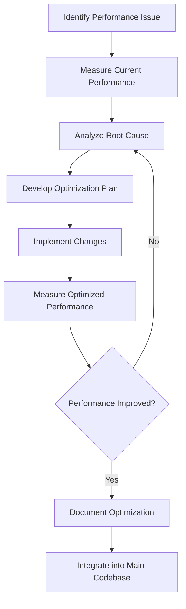

# Performance Validation Framework

## Overview

This document outlines the comprehensive performance validation framework for the Virtual Personal Assistant (VPA) project. It defines the performance requirements, testing methodologies, tools, and success criteria to ensure that the VPA system meets or exceeds performance expectations in all operational scenarios.

## Table of Contents

1. [Performance Requirements](#performance-requirements)
2. [Performance Metrics](#performance-metrics)
3. [Performance Testing Methodology](#performance-testing-methodology)
4. [Test Environments](#test-environments)
5. [Performance Testing Tools](#performance-testing-tools)
6. [Test Scenarios](#test-scenarios)
7. [Performance Benchmarks](#performance-benchmarks)
8. [Resource Utilization Targets](#resource-utilization-targets)
9. [Scalability Testing](#scalability-testing)
10. [Performance Monitoring](#performance-monitoring)
11. [Reporting and Analysis](#reporting-and-analysis)
12. [Performance Optimization Process](#performance-optimization-process)
13. [Integration with CI/CD](#integration-with-cicd)

## Performance Requirements

The VPA system must meet the following key performance requirements:

### 1. Response Time Requirements

| Interaction Type | Target Response Time | Maximum Acceptable |
|------------------|----------------------|-------------------|
| Voice command recognition | < 1.0 second | 2.0 seconds |
| Text command processing | < 0.5 seconds | 1.0 second |
| Simple queries (local data) | < 1.0 second | 2.0 seconds |
| Complex queries (requiring API calls) | < 3.0 seconds | 5.0 seconds |
| UI element rendering | < 0.1 seconds | 0.3 seconds |
| System startup time | < 3.0 seconds | 5.0 seconds |
| Plugin initialization | < 1.0 second per plugin | 2.0 seconds per plugin |

### 2. Throughput Requirements

| Operation | Minimum Throughput |
|-----------|-------------------|
| Voice processing | 20 commands per minute |
| Concurrent API requests | 10 requests per second |
| Event processing | 100 events per second |
| Database operations | 50 operations per second |

### 3. Resource Utilization Limits

| Resource | Normal Operation | Peak Load |
|----------|------------------|-----------|
| CPU utilization | < 15% | < 40% |
| Memory footprint | < 250 MB | < 500 MB |
| Disk I/O | < 10 MB/s | < 30 MB/s |
| Network bandwidth | < 1 MB/s | < 5 MB/s |

### 4. Scalability Requirements

| Aspect | Requirement |
|--------|-------------|
| Concurrent users | Support for up to 5 user profiles |
| Concurrent plugins | Support for up to 20 active plugins |
| Database size | Efficient operation with up to 10 GB of user data |

## Performance Metrics

The following metrics will be measured and tracked to evaluate the VPA's performance:

### 1. Speed Metrics

- **Command Response Time**: Time from command completion to beginning of system response
- **End-to-End Response Time**: Time from command initiation to completion of system response
- **Processing Time**: Time taken to process a command (excluding I/O)
- **Startup Time**: Time from application launch to ready state
- **Plugin Load Time**: Time required to load and initialize plugins
- **Database Query Time**: Time to execute database operations

### 2. Resource Usage Metrics

- **CPU Usage**: Percentage of CPU utilization during operations
- **Memory Consumption**: RAM usage during different operations
- **Disk I/O**: Read/write operations per second
- **Network Usage**: Bandwidth consumption for network operations
- **Power Consumption**: Battery usage on portable devices

### 3. Stability Metrics

- **Mean Time Between Failures (MTBF)**: Average time between system failures
- **Error Rate**: Percentage of operations resulting in errors
- **Memory Leaks**: Change in memory usage over extended operation
- **Resource Contention**: Frequency of resource contention issues

## Performance Testing Methodology

The VPA performance validation follows a structured methodology:

### 1. Baseline Performance Testing

Establish baseline performance metrics for all key operations:

```python
# Example baseline performance testing framework
import time
import statistics
import psutil
import matplotlib.pyplot as plt
from typing import Dict, List, Tuple, Any

class PerformanceBaseline:
    """Establish performance baselines for VPA operations"""
    
    def __init__(self):
        self.results = {}
        
    def measure_operation(self, operation_name: str, operation_func, 
                         iterations: int = 10, *args, **kwargs) -> Dict[str, Any]:
        """Measure performance of an operation"""
        response_times = []
        cpu_usage = []
        memory_before = psutil.Process().memory_info().rss / (1024 * 1024)  # MB
        
        # Warm-up run
        operation_func(*args, **kwargs)
        
        # Measured runs
        for _ in range(iterations):
            # Measure CPU usage before
            cpu_start = psutil.cpu_percent(interval=None)
            
            # Measure time
            start_time = time.time()
            result = operation_func(*args, **kwargs)
            elapsed = time.time() - start_time
            response_times.append(elapsed)
            
            # Measure CPU after
            cpu_end = psutil.cpu_percent(interval=0.1)
            cpu_usage.append(cpu_end - cpu_start)
        
        memory_after = psutil.Process().memory_info().rss / (1024 * 1024)  # MB
        
        # Calculate statistics
        metrics = {
            'mean_time': statistics.mean(response_times),
            'median_time': statistics.median(response_times),
            'p90_time': sorted(response_times)[int(iterations * 0.9)],
            'max_time': max(response_times),
            'min_time': min(response_times),
            'std_dev': statistics.stdev(response_times) if iterations > 1 else 0,
            'mean_cpu': statistics.mean(cpu_usage),
            'memory_change': memory_after - memory_before
        }
        
        # Store results
        self.results[operation_name] = metrics
        return metrics
    
    def generate_baseline_report(self, output_file: str):
        """Generate baseline performance report"""
        # Implementation of report generation with charts and tables
        # using matplotlib and other visualization tools
        pass
```

### 2. Load Testing

Simulate various load conditions to evaluate system behavior:

```python
# Example load testing script
from locust import HttpUser, task, between
import random

class VPAApiUser(HttpUser):
    """Simulates users interacting with VPA API endpoints"""
    
    wait_time = between(1, 3)  # Wait 1-3 seconds between tasks
    
    def on_start(self):
        # Log in at the start of simulation
        self.client.post("/api/auth/login", 
                        json={"username": "test_user", "password": "test_password"})
    
    @task(10)
    def query_weather(self):
        # Simulate weather queries (weight: 10)
        locations = ["Seattle", "New York", "London", "Tokyo", "Sydney"]
        location = random.choice(locations)
        self.client.get(f"/api/weather?location={location}")
    
    @task(5)
    def create_reminder(self):
        # Simulate creating reminders (weight: 5)
        self.client.post("/api/reminders", 
                        json={
                            "title": "Test reminder",
                            "time": "2025-09-01T10:00:00",
                            "description": "This is a test reminder"
                        })
    
    @task(20)
    def search_query(self):
        # Simulate search queries (weight: 20)
        queries = ["news today", "recipes", "calendar events", 
                  "nearby restaurants", "traffic report"]
        query = random.choice(queries)
        self.client.get(f"/api/search?q={query}")
    
    @task(1)
    def update_settings(self):
        # Simulate updating settings (weight: 1)
        self.client.put("/api/settings", 
                       json={"notification_enabled": True, 
                            "voice_enabled": True,
                            "theme": "dark"})
```

### 3. Stress Testing

Push the system beyond normal operational capacity to identify breaking points:

```python
# Example stress test configuration for JMeter
<?xml version="1.0" encoding="UTF-8"?>
<jmeterTestPlan version="1.2" properties="5.0">
  <hashTree>
    <TestPlan guiclass="TestPlanGui" testclass="TestPlan" testname="VPA Stress Test Plan">
      <elementProp name="TestPlan.user_defined_variables" elementType="Arguments">
        <collectionProp name="Arguments.arguments"/>
      </elementProp>
      <boolProp name="TestPlan.functional_mode">false</boolProp>
      <stringProp name="TestPlan.comments">Stress test for VPA system</stringProp>
    </TestPlan>
    <hashTree>
      <ThreadGroup guiclass="ThreadGroupGui" testclass="ThreadGroup" testname="VPA Users">
        <elementProp name="ThreadGroup.main_controller" elementType="LoopController">
          <boolProp name="LoopController.continue_forever">false</boolProp>
          <stringProp name="LoopController.loops">100</stringProp>
        </elementProp>
        <stringProp name="ThreadGroup.num_threads">500</stringProp>
        <stringProp name="ThreadGroup.ramp_time">60</stringProp>
        <boolProp name="ThreadGroup.scheduler">true</boolProp>
        <stringProp name="ThreadGroup.duration">300</stringProp>
        <stringProp name="ThreadGroup.delay">0</stringProp>
      </ThreadGroup>
      <hashTree>
        <!-- HTTP Samplers, Controllers, Listeners, etc. would be defined here -->
      </hashTree>
    </hashTree>
  </hashTree>
</jmeterTestPlan>
```

### 4. Endurance Testing

Test the system's stability during extended operation periods:

```python
# Example endurance test script
import time
import psutil
import matplotlib.pyplot as plt
from datetime import datetime, timedelta

def run_endurance_test(duration_hours=24, sample_interval_minutes=5):
    """
    Run an endurance test on the VPA system
    
    Args:
        duration_hours: How many hours to run the test
        sample_interval_minutes: How often to sample metrics
    """
    # Start VPA system
    vpa_process = start_vpa_system()
    
    # Calculate end time
    end_time = datetime.now() + timedelta(hours=duration_hours)
    
    # Initialize data collection
    timestamps = []
    cpu_usage = []
    memory_usage = []
    active_threads = []
    response_times = []
    
    # Monitoring loop
    print(f"Starting endurance test for {duration_hours} hours")
    while datetime.now() < end_time:
        # Record current time
        current_time = datetime.now()
        timestamps.append(current_time)
        
        # Record system metrics
        process = psutil.Process(vpa_process.pid)
        cpu_usage.append(process.cpu_percent(interval=1.0))
        memory_usage.append(process.memory_info().rss / (1024 * 1024))  # MB
        active_threads.append(process.num_threads())
        
        # Execute standard test operations and record response time
        response_time = execute_standard_test_operations()
        response_times.append(response_time)
        
        # Log current status
        print(f"[{current_time}] CPU: {cpu_usage[-1]}%, "
              f"Memory: {memory_usage[-1]:.2f} MB, "
              f"Response time: {response_time:.3f}s")
        
        # Sleep until next sample
        time_to_sleep = sample_interval_minutes * 60
        time.sleep(time_to_sleep)
    
    # Stop VPA system
    vpa_process.terminate()
    
    # Generate report
    generate_endurance_report(timestamps, cpu_usage, memory_usage, 
                             active_threads, response_times)
    
def generate_endurance_report(timestamps, cpu_usage, memory_usage, 
                            active_threads, response_times):
    """Generate a visual report of the endurance test results"""
    # Implementation of report generation with charts
    # showing trends over time for all metrics
```

### 5. Spike Testing

Evaluate system performance during sudden load increases:

```python
# Example spike test configuration
def run_spike_test():
    """Run a spike test on the VPA system"""
    # 1. Start with baseline load (10 users)
    start_virtual_users(10)
    time.sleep(300)  # Run for 5 minutes
    
    # 2. Suddenly increase to high load (200 users)
    print("Initiating spike...")
    start_virtual_users(190)  # Add 190 more users
    
    # 3. Measure system response during spike
    spike_metrics = measure_system_performance(duration_seconds=120)
    
    # 4. Return to baseline
    stop_virtual_users(190)
    time.sleep(300)  # Run for 5 minutes to observe recovery
    
    # 5. Record recovery metrics
    recovery_metrics = measure_system_performance(duration_seconds=60)
    
    # 6. Generate report
    generate_spike_test_report(spike_metrics, recovery_metrics)
```

### 6. Scalability Testing

Test the system's ability to scale with increasing workloads:

```python
# Example scalability test
def run_scalability_test(start_users=10, max_users=200, step=10):
    """
    Test system scalability by gradually increasing load
    
    Args:
        start_users: Starting number of concurrent users
        max_users: Maximum number of concurrent users
        step: How many users to add in each step
    """
    results = []
    
    # Start with baseline users
    current_users = start_users
    start_virtual_users(current_users)
    
    while current_users <= max_users:
        print(f"Testing with {current_users} concurrent users...")
        
        # Let the system stabilize with current load
        time.sleep(120)
        
        # Measure performance metrics
        metrics = measure_system_performance(duration_seconds=60)
        metrics['users'] = current_users
        results.append(metrics)
        
        # Check if performance is still acceptable
        if metrics['response_time_p90'] > 5.0 or metrics['error_rate'] > 0.05:
            print(f"Performance degraded significantly at {current_users} users")
            print(f"P90 response time: {metrics['response_time_p90']}s")
            print(f"Error rate: {metrics['error_rate'] * 100}%")
            break
        
        # Increase users for next iteration
        additional_users = step
        start_virtual_users(additional_users)
        current_users += additional_users
    
    # Generate scalability report
    generate_scalability_report(results)
```

## Test Environments

The VPA performance validation uses multiple environments to ensure comprehensive testing:

### 1. Development Environment

- **Purpose**: Initial performance checks during development
- **Configuration**: Developer workstations with varying specifications
- **Tools**: Built-in performance profiling tools
- **Focus**: Component-level performance testing

### 2. Performance Testing Environment

- **Purpose**: Dedicated environment for controlled performance testing
- **Configuration**: 
  - Windows 10/11 system with:
    - Intel Core i5-10400 (6 cores, 2.9-4.3 GHz) or equivalent
    - 16 GB DDR4 RAM
    - 512 GB SSD
    - Standard consumer-grade audio input/output devices
  - Clean OS installation with minimal background processes
  - Network connection throttled to simulate various conditions

### 3. Resource-Constrained Environment

- **Purpose**: Testing on minimum supported hardware
- **Configuration**: 
  - Windows 10/11 system with:
    - Intel Core i3-8100 (4 cores, 3.6 GHz) or equivalent
    - 8 GB DDR4 RAM
    - 256 GB SSD
  - Limited resource allocation (CPU, memory throttled)
  - Standard consumer-grade audio devices

### 4. High-Performance Environment

- **Purpose**: Testing upper bounds and scalability
- **Configuration**: 
  - Windows 10/11 system with:
    - Intel Core i9-11900K (8 cores, 3.5-5.3 GHz) or equivalent
    - 32 GB DDR4 RAM
    - 1 TB NVMe SSD
    - High-quality audio input/output devices

### 5. Virtual Environment Matrix

- **Purpose**: Testing across multiple Windows versions and configurations
- **Configuration**: 
  - Multiple VM instances with different Windows versions (10/11)
  - Various resource allocations
  - Different permission models and security configurations

## Performance Testing Tools

The following tools will be used for performance validation:

### 1. Profiling and Monitoring Tools

| Tool | Purpose | Metrics Gathered |
|------|---------|------------------|
| Windows Performance Recorder (WPR) | System-wide performance capture | CPU, memory, disk, network, power |
| Windows Performance Analyzer (WPA) | Analysis of WPR recordings | Detailed system resource analysis |
| Python cProfile | Python code profiling | Function call counts, timing |
| py-spy | Sampling profiler for Python | CPU usage, call stacks |
| psutil | Process monitoring | Resource usage monitoring |
| Windows Performance Monitor | Real-time monitoring | System counters |
| VTune Profiler | Low-level code optimization | Hotspot analysis, threading analysis |

### 2. Load Generation Tools

| Tool | Purpose | Use Case |
|------|---------|----------|
| Locust | API load testing | REST API endpoint testing |
| JMeter | Complex load scenarios | End-to-end testing |
| Custom load generators | Voice command simulation | Audio processing testing |
| Windows Application Driver | UI interaction | GUI performance testing |

### 3. Visualization and Analysis Tools

| Tool | Purpose |
|------|---------|
| Matplotlib | Performance data visualization |
| Grafana | Real-time performance dashboards |
| pandas | Data manipulation and analysis |
| Flame graphs | Call stack visualization |
| Custom reporting tools | Test result consolidation |

## Test Scenarios

The performance validation includes the following key test scenarios:

### 1. Core System Performance

| Scenario | Description | Success Criteria |
|----------|-------------|------------------|
| System Startup | Measure time from application launch to ready state | < 3.0 seconds |
| Command Recognition | Measure voice command recognition time | < 1.0 second |
| Context Switching | Measure time to switch between different domains | < 0.5 seconds |
| Shutdown Time | Measure clean application shutdown time | < 2.0 seconds |
| Background Processing | Measure impact of background tasks on system responsiveness | < 10% degradation |

### 2. Plugin Performance

| Scenario | Description | Success Criteria |
|----------|-------------|------------------|
| Plugin Load Time | Measure time to load each plugin | < 1.0 second per plugin |
| Plugin Execution | Measure execution time of plugin operations | Meets plugin-specific SLAs |
| Multiple Plugin Interaction | Measure system performance with multiple active plugins | < 20% degradation |
| Plugin Isolation | Measure impact of misbehaving plugin on system stability | No impact on core system |
| Plugin Memory Usage | Measure memory consumption of each plugin | < 50 MB per plugin |

### 3. User Interaction Performance

| Scenario | Description | Success Criteria |
|----------|-------------|------------------|
| Voice Recognition Latency | Measure time from speech to text conversion | < 1.0 second |
| UI Responsiveness | Measure UI element rendering and interaction time | < 0.1 second |
| Multi-modal Interaction | Measure performance during simultaneous voice and GUI interaction | < 20% degradation |
| Continuous Conversation | Measure performance during extended conversation sessions | No degradation over time |
| Interrupted Operation | Measure recovery time after interruption | < 0.5 seconds |

### 4. Data Processing Performance

| Scenario | Description | Success Criteria |
|----------|-------------|------------------|
| Database Operations | Measure CRUD operation performance | < 0.1 seconds per operation |
| Large Dataset Handling | Measure performance with large user datasets | Linear scaling with data size |
| Data Synchronization | Measure time to synchronize data with cloud services | < 5.0 seconds for 1 MB |
| Search Performance | Measure search operation speed across user data | < 1.0 second for 1000 items |
| Data Transformation | Measure performance of data format conversions | < 0.5 seconds per transformation |

### 5. Network Interaction Performance

| Scenario | Description | Success Criteria |
|----------|-------------|------------------|
| API Response Time | Measure time to complete API requests | < 2.0 seconds |
| Network Degradation Handling | Measure performance under poor network conditions | Graceful degradation |
| Connection Recovery | Measure recovery time after network interruption | < 3.0 seconds |
| Parallel API Requests | Measure performance with concurrent API calls | < 30% degradation |
| Bandwidth Utilization | Measure network bandwidth usage during operations | < 1 MB/s average |

### 6. Resource Utilization Scenarios

| Scenario | Description | Success Criteria |
|----------|-------------|------------------|
| Memory Footprint | Measure memory usage during typical operations | < 250 MB baseline |
| CPU Utilization | Measure CPU usage during typical operations | < 15% average |
| Disk I/O | Measure disk read/write operations | < 10 MB/s |
| Battery Impact | Measure battery consumption on portable devices | < 5% per hour above system baseline |
| Resource Cleanup | Verify resource release after operations | No resource leaks |

## Performance Benchmarks

The following benchmarks will be used to evaluate the VPA's performance:

### 1. Comparison Benchmarks

Compare VPA performance against:

1. **Previous Versions**: Performance compared to previous VPA releases
2. **Competitor Products**: Performance compared to similar virtual assistant products
3. **Industry Standards**: Performance compared to published industry benchmarks

### 2. Benchmark Test Suite

A standardized benchmark suite will be used for consistent performance testing:

```python
# Example benchmark test suite definition
from vpa.testing.performance import PerformanceBenchmark

def create_vpa_benchmark_suite():
    """Create the standard VPA benchmark test suite"""
    suite = PerformanceBenchmarkSuite("VPA Standard Benchmark")
    
    # 1. Voice recognition benchmarks
    suite.add_benchmark(
        PerformanceBenchmark(
            name="voice_recognition_simple",
            description="Simple voice command recognition speed",
            test_func=benchmark_voice_recognition,
            test_args={"complexity": "simple", "background_noise": "none"},
            iterations=50,
            warmup_iterations=5
        )
    )
    
    suite.add_benchmark(
        PerformanceBenchmark(
            name="voice_recognition_complex",
            description="Complex voice command recognition speed",
            test_func=benchmark_voice_recognition,
            test_args={"complexity": "complex", "background_noise": "none"},
            iterations=50,
            warmup_iterations=5
        )
    )
    
    suite.add_benchmark(
        PerformanceBenchmark(
            name="voice_recognition_with_noise",
            description="Voice command recognition with background noise",
            test_func=benchmark_voice_recognition,
            test_args={"complexity": "simple", "background_noise": "medium"},
            iterations=50,
            warmup_iterations=5
        )
    )
    
    # 2. Command processing benchmarks
    suite.add_benchmark(
        PerformanceBenchmark(
            name="command_processing_local",
            description="Processing speed for local commands",
            test_func=benchmark_command_processing,
            test_args={"command_type": "local", "context_complexity": "simple"},
            iterations=100,
            warmup_iterations=10
        )
    )
    
    suite.add_benchmark(
        PerformanceBenchmark(
            name="command_processing_api",
            description="Processing speed for commands requiring API calls",
            test_func=benchmark_command_processing,
            test_args={"command_type": "api", "context_complexity": "simple"},
            iterations=50,
            warmup_iterations=5
        )
    )
    
    # Add more benchmarks for other system aspects...
    
    return suite
```

### 3. Benchmark Reporting

Benchmark results will be presented in standardized reports:

```python
# Example benchmark reporting
def generate_benchmark_report(benchmark_results, output_file):
    """Generate a comprehensive benchmark report"""
    import pandas as pd
    import matplotlib.pyplot as plt
    import seaborn as sns
    
    # Convert results to DataFrame for analysis
    df = pd.DataFrame(benchmark_results)
    
    # Create report document
    plt.figure(figsize=(12, 8))
    
    # Plot 1: Response time comparison
    plt.subplot(2, 2, 1)
    sns.barplot(x='benchmark_name', y='mean_time', data=df)
    plt.title('Mean Response Time by Benchmark')
    plt.xticks(rotation=45, ha='right')
    plt.tight_layout()
    
    # Plot 2: CPU usage comparison
    plt.subplot(2, 2, 2)
    sns.barplot(x='benchmark_name', y='mean_cpu', data=df)
    plt.title('Mean CPU Usage by Benchmark')
    plt.xticks(rotation=45, ha='right')
    plt.tight_layout()
    
    # Plot 3: Memory usage comparison
    plt.subplot(2, 2, 3)
    sns.barplot(x='benchmark_name', y='memory_usage', data=df)
    plt.title('Memory Usage by Benchmark')
    plt.xticks(rotation=45, ha='right')
    plt.tight_layout()
    
    # Plot 4: Comparison with baseline/target
    plt.subplot(2, 2, 4)
    
    # Calculate percentage of target achieved
    df['target_percentage'] = (df['target_time'] / df['mean_time']) * 100
    df['target_percentage'] = df['target_percentage'].clip(upper=100)
    
    sns.barplot(x='benchmark_name', y='target_percentage', data=df)
    plt.axhline(y=100, color='r', linestyle='-')
    plt.title('Performance vs Target (%)')
    plt.xticks(rotation=45, ha='right')
    plt.tight_layout()
    
    # Save the report
    plt.savefig(output_file)
    print(f"Benchmark report saved to {output_file}")
    
    # Generate detailed statistics table
    stats_df = df[['benchmark_name', 'mean_time', 'p90_time', 'target_time', 
                  'target_percentage', 'mean_cpu', 'memory_usage']]
    
    return stats_df
```

## Resource Utilization Targets

Detailed resource utilization targets are defined to ensure the VPA operates efficiently:

### 1. CPU Utilization

| State | Target Utilization | Maximum Acceptable |
|-------|-------------------|-------------------|
| Idle (listening) | < 1% | < 3% |
| Processing voice | < 15% | < 30% |
| Executing commands | < 10% | < 25% |
| Background tasks | < 5% | < 15% |

### 2. Memory Usage

| Component | Target Usage | Maximum Acceptable |
|-----------|-------------|-------------------|
| Core system | < 150 MB | < 250 MB |
| Per plugin | < 30 MB | < 50 MB |
| Voice processing | < 50 MB | < 100 MB |
| UI components | < 50 MB | < 100 MB |

### 3. Disk I/O

| Operation | Target I/O | Maximum Acceptable |
|-----------|------------|-------------------|
| Startup | < 5 MB | < 15 MB |
| Operation logging | < 100 KB/min | < 1 MB/min |
| Data synchronization | < 5 MB/sync | < 15 MB/sync |
| Database operations | < 2 MB/s | < 10 MB/s |

### 4. Network Usage

| Operation | Target Usage | Maximum Acceptable |
|-----------|-------------|-------------------|
| Voice processing (if cloud-based) | < 100 KB/s | < 500 KB/s |
| API calls | < 50 KB/call | < 200 KB/call |
| Data synchronization | < 500 KB/s | < 2 MB/s |
| Background updates | < 10 KB/s | < 50 KB/s |

### 5. Power Usage (Mobile/Laptop)

| State | Target Battery Impact | Maximum Acceptable |
|-------|----------------------|-------------------|
| Idle (listening) | < 2% per hour | < 5% per hour |
| Active usage | < 5% per hour | < 10% per hour |
| Background operation | < 1% per hour | < 3% per hour |

## Scalability Testing

Scalability testing evaluates the system's ability to handle growth:

### 1. User Profile Scalability

Test the system's performance as the number of user profiles increases:

```python
# Example user profile scalability test
def test_user_profile_scalability(max_users=10):
    """Test system performance with increasing number of user profiles"""
    results = []
    
    for num_users in range(1, max_users + 1):
        print(f"Testing with {num_users} user profiles...")
        
        # Create test user profiles
        for i in range(num_users):
            create_test_user_profile(f"test_user_{i}")
        
        # Run standard benchmark suite
        benchmark_results = run_benchmark_suite()
        
        # Record results with user count
        benchmark_results['user_count'] = num_users
        results.append(benchmark_results)
        
        # Clean up profiles except for the ones needed in next iteration
        cleanup_user_profiles(keep=num_users + 1)
    
    # Analyze scalability results
    analyze_user_scalability(results)
```

### 2. Data Volume Scalability

Test the system's performance as the volume of user data increases:

```python
# Example data volume scalability test
def test_data_volume_scalability(max_data_gb=10, step_size_gb=1):
    """Test system performance with increasing data volumes"""
    results = []
    
    for data_size in range(1, max_data_gb + 1, step_size_gb):
        print(f"Testing with {data_size} GB of user data...")
        
        # Generate synthetic test data
        generate_test_data(size_gb=data_size)
        
        # Run standard benchmark suite
        benchmark_results = run_benchmark_suite()
        
        # Record results with data size
        benchmark_results['data_size_gb'] = data_size
        results.append(benchmark_results)
    
    # Analyze scalability results
    analyze_data_scalability(results)
    
    # Clean up test data
    cleanup_test_data()
```

### 3. Plugin Scalability

Test the system's performance as the number of active plugins increases:

```python
# Example plugin scalability test
def test_plugin_scalability(max_plugins=20):
    """Test system performance with increasing number of active plugins"""
    results = []
    available_plugins = get_available_test_plugins()
    
    for num_plugins in range(1, min(max_plugins + 1, len(available_plugins) + 1)):
        print(f"Testing with {num_plugins} active plugins...")
        
        # Activate test plugins
        active_plugins = available_plugins[:num_plugins]
        for plugin in active_plugins:
            activate_plugin(plugin)
        
        # Run standard benchmark suite
        benchmark_results = run_benchmark_suite()
        
        # Record results with plugin count
        benchmark_results['plugin_count'] = num_plugins
        benchmark_results['active_plugins'] = [p.name for p in active_plugins]
        results.append(benchmark_results)
        
        # Deactivate all plugins for next iteration
        for plugin in active_plugins:
            deactivate_plugin(plugin)
    
    # Analyze scalability results
    analyze_plugin_scalability(results)
```

## Performance Monitoring

Continuous performance monitoring will be implemented to track the system's performance over time:

### 1. Automated Performance Monitoring

```python
# Example performance monitoring configuration
from vpa.monitoring import PerformanceMonitor

def configure_performance_monitoring():
    """Configure the VPA performance monitoring system"""
    # Create performance monitor
    monitor = PerformanceMonitor()
    
    # Configure metrics to capture
    monitor.add_metric("cpu_usage", sampling_interval_sec=5)
    monitor.add_metric("memory_usage", sampling_interval_sec=5)
    monitor.add_metric("command_response_time", event_based=True)
    monitor.add_metric("api_response_time", event_based=True)
    monitor.add_metric("voice_recognition_accuracy", event_based=True)
    
    # Configure alerts
    monitor.add_alert(
        metric="cpu_usage",
        threshold=50.0,
        duration_sec=60,
        alert_message="High CPU usage detected"
    )
    
    monitor.add_alert(
        metric="memory_usage",
        threshold=500.0,  # MB
        duration_sec=300,
        alert_message="High memory usage detected"
    )
    
    monitor.add_alert(
        metric="command_response_time",
        threshold=3.0,  # seconds
        statistic="p90",
        window_size=20,
        alert_message="Slow command response time detected"
    )
    
    # Configure data retention
    monitor.set_retention_policy(
        metrics_history_days=30,
        aggregation_policy={
            "raw_data_hours": 24,
            "minute_aggregation_days": 7,
            "hour_aggregation_days": 30
        }
    )
    
    # Start monitoring
    monitor.start()
    
    return monitor
```

### 2. Performance Dashboards

```python
# Example dashboard generation
from vpa.monitoring.dashboard import PerformanceDashboard

def create_performance_dashboard():
    """Create a real-time performance dashboard"""
    dashboard = PerformanceDashboard(title="VPA Performance Monitor")
    
    # Add CPU usage panel
    dashboard.add_panel(
        title="CPU Usage",
        metric="cpu_usage",
        panel_type="line",
        position={"x": 0, "y": 0, "w": 12, "h": 8},
        options={
            "unit": "%",
            "min": 0,
            "max": 100,
            "thresholds": [
                {"value": 40, "color": "yellow"},
                {"value": 70, "color": "red"}
            ]
        }
    )
    
    # Add memory usage panel
    dashboard.add_panel(
        title="Memory Usage",
        metric="memory_usage",
        panel_type="line",
        position={"x": 0, "y": 8, "w": 12, "h": 8},
        options={
            "unit": "MB",
            "min": 0,
            "thresholds": [
                {"value": 300, "color": "yellow"},
                {"value": 500, "color": "red"}
            ]
        }
    )
    
    # Add response time panel
    dashboard.add_panel(
        title="Command Response Time",
        metric="command_response_time",
        panel_type="bar",
        position={"x": 12, "y": 0, "w": 12, "h": 8},
        options={
            "unit": "seconds",
            "min": 0,
            "thresholds": [
                {"value": 2, "color": "yellow"},
                {"value": 5, "color": "red"}
            ]
        }
    )
    
    # Add API response time panel
    dashboard.add_panel(
        title="API Response Time",
        metric="api_response_time",
        panel_type="bar",
        position={"x": 12, "y": 8, "w": 12, "h": 8},
        options={
            "unit": "seconds",
            "min": 0,
            "thresholds": [
                {"value": 1, "color": "yellow"},
                {"value": 3, "color": "red"}
            ]
        }
    )
    
    # Return the dashboard configuration
    return dashboard.get_config()
```

## Reporting and Analysis

Performance testing results will be analyzed and reported systematically:

### 1. Performance Test Reports

Each performance test will produce a structured report:

```markdown
# VPA Performance Test Report

## Test Summary
- **Test Type**: Load Test
- **Date**: August 25, 2025
- **Build Version**: 0.9.3
- **Test Environment**: Standard Performance Environment
- **Test Duration**: 2 hours

## Key Metrics
| Metric | Target | Actual | Status |
|--------|--------|--------|--------|
| P90 Response Time | < 2.0s | 1.8s | ✅ PASS |
| Max CPU Utilization | < 40% | 35% | ✅ PASS |
| Max Memory Usage | < 500 MB | 475 MB | ✅ PASS |
| Error Rate | < 0.1% | 0.05% | ✅ PASS |
| Voice Recognition Accuracy | > 95% | 96.5% | ✅ PASS |

## Test Details
The load test simulated 50 concurrent users performing various VPA operations including voice commands, API interactions, and plugin usage.

### Response Time Analysis
- **Mean**: 1.2s
- **Median**: 0.9s
- **P90**: 1.8s
- **P99**: 2.7s
- **Max**: 4.2s

### Resource Utilization
- **CPU (Mean)**: 22%
- **CPU (Peak)**: 35%
- **Memory (Mean)**: 320 MB
- **Memory (Peak)**: 475 MB
- **Disk I/O (Mean)**: 3.5 MB/s
- **Network (Mean)**: 0.8 MB/s

## Observations
- Response time remained stable throughout the test period
- No memory leaks detected (stable memory usage)
- Voice recognition accuracy remained consistent under load
- Plugin response time showed minor degradation (15%) under peak load

## Recommendations
- Optimize the calendar plugin which showed the highest response times
- Investigate occasional network latency spikes in weather API integration
- Add additional monitoring for voice processing thread pool

## Charts and Visualizations
[Response Time Chart]
[CPU Utilization Chart]
[Memory Usage Chart]
[Error Rate Chart]

## Appendices
- Raw test data available at: /performance/tests/load_test_20250825.csv
- Test configuration file: /performance/tests/load_test_config.json
- System logs: /performance/tests/logs/system_20250825.log
```

### 2. Performance Analysis Tools

Custom tools will be developed for analyzing performance data:

```python
# Example performance analysis tool
import pandas as pd
import numpy as np
import matplotlib.pyplot as plt
from scipy import stats

class PerformanceAnalyzer:
    """Analyzes performance test results"""
    
    def __init__(self, data_file):
        """Initialize with a performance data file"""
        self.df = pd.read_csv(data_file)
        self.metrics = self._extract_metrics()
        
    def _extract_metrics(self):
        """Extract key metrics from the data"""
        metrics = {}
        
        # Response time metrics
        rt_data = self.df['response_time']
        metrics['rt_mean'] = rt_data.mean()
        metrics['rt_median'] = rt_data.median()
        metrics['rt_p90'] = np.percentile(rt_data, 90)
        metrics['rt_p95'] = np.percentile(rt_data, 95)
        metrics['rt_p99'] = np.percentile(rt_data, 99)
        metrics['rt_max'] = rt_data.max()
        metrics['rt_std'] = rt_data.std()
        
        # Resource utilization metrics
        metrics['cpu_mean'] = self.df['cpu_usage'].mean()
        metrics['cpu_max'] = self.df['cpu_usage'].max()
        metrics['mem_mean'] = self.df['memory_usage'].mean()
        metrics['mem_max'] = self.df['memory_usage'].max()
        
        # Error metrics
        if 'errors' in self.df.columns:
            total_requests = len(self.df)
            total_errors = self.df['errors'].sum()
            metrics['error_rate'] = total_errors / total_requests
        
        return metrics
    
    def detect_anomalies(self):
        """Detect anomalies in the performance data"""
        anomalies = {}
        
        # Response time anomalies (values > 3 std devs from mean)
        rt_mean = self.df['response_time'].mean()
        rt_std = self.df['response_time'].std()
        threshold = rt_mean + 3 * rt_std
        
        rt_anomalies = self.df[self.df['response_time'] > threshold]
        if not rt_anomalies.empty:
            anomalies['response_time'] = rt_anomalies
        
        # CPU usage spikes
        cpu_threshold = self.metrics['cpu_mean'] + 3 * self.df['cpu_usage'].std()
        cpu_anomalies = self.df[self.df['cpu_usage'] > cpu_threshold]
        if not cpu_anomalies.empty:
            anomalies['cpu_usage'] = cpu_anomalies
        
        # Memory growth (detect potential leaks)
        # Calculate rolling mean to smooth the data
        rolling_mem = self.df['memory_usage'].rolling(window=10).mean()
        # Calculate growth rate (slope of best fit line)
        x = np.arange(len(rolling_mem.dropna()))
        y = rolling_mem.dropna().values
        slope, _, _, _, _ = stats.linregress(x, y)
        
        # If memory is growing by more than 1 MB per minute, flag it
        growth_threshold = 1.0  # MB per minute
        if slope * 60 > growth_threshold:  # Convert to MB/minute
            anomalies['memory_growth'] = {
                'slope': slope * 60,
                'unit': 'MB/minute'
            }
        
        return anomalies
    
    def generate_report(self, output_file):
        """Generate a performance analysis report"""
        # Implementation of report generation
        pass
    
    def compare_with_baseline(self, baseline_file):
        """Compare with baseline performance"""
        baseline_df = pd.read_csv(baseline_file)
        baseline_analyzer = PerformanceAnalyzer(baseline_file)
        baseline_metrics = baseline_analyzer.metrics
        
        comparison = {}
        for metric, value in self.metrics.items():
            if metric in baseline_metrics:
                baseline_value = baseline_metrics[metric]
                change_pct = ((value - baseline_value) / baseline_value) * 100
                comparison[metric] = {
                    'current': value,
                    'baseline': baseline_value,
                    'change_pct': change_pct,
                    'improved': (change_pct < 0 if 'rt_' in metric or 'cpu_' in metric or 'mem_' in metric else change_pct > 0)
                }
        
        return comparison
```

## Performance Optimization Process

A structured process for addressing performance issues:

### 1. Performance Optimization Workflow



### 2. Common Optimization Techniques

| Area | Technique | Description |
|------|-----------|-------------|
| Algorithms | Algorithmic complexity reduction | Replace O(n²) algorithms with O(n log n) or O(n) alternatives |
| Data Structures | Optimized data structure selection | Use appropriate data structures for operations (hash maps for lookups, etc.) |
| Memory Management | Object pooling | Reuse objects instead of creating new ones |
| Memory Management | Reduce allocations | Minimize garbage collection pressure |
| Threading | Parallelization | Distribute work across multiple cores |
| Threading | Asynchronous processing | Use non-blocking operations for I/O |
| Database | Query optimization | Optimize database queries and add indexes |
| Database | Connection pooling | Reuse database connections |
| Network | Batch API requests | Combine multiple requests into batches |
| Network | Caching | Cache responses to avoid repeated requests |
| I/O | Buffered I/O | Use buffered reads/writes |
| I/O | Asynchronous I/O | Use non-blocking I/O operations |

### 3. Code Optimization Examples

```python
# Example of optimized voice processing pipeline
class OptimizedVoiceProcessor:
    """Optimized voice processing pipeline"""
    
    def __init__(self, buffer_size=4096, pool_size=4):
        """Initialize the voice processor with optimized parameters"""
        self.buffer_size = buffer_size
        self.thread_pool = ThreadPool(processes=pool_size)
        self.audio_buffer = np.zeros(buffer_size, dtype=np.float32)
        self.frame_cache = LRUCache(maxsize=100)  # Cache for processed frames
        
    def process_audio_stream(self, audio_stream):
        """Process an audio stream with optimized pipeline"""
        # Pre-allocate result buffer to avoid reallocations
        result_buffer = []
        
        # Process chunks in parallel
        chunks = split_audio_stream(audio_stream, self.buffer_size)
        
        # Use map to process chunks in parallel
        processed_chunks = self.thread_pool.map(self._process_chunk, chunks)
        
        # Efficient concatenation
        return np.concatenate(processed_chunks)
        
    def _process_chunk(self, chunk):
        """Process a single audio chunk with optimizations"""
        # Check cache first to avoid reprocessing identical frames
        chunk_hash = self._hash_audio_chunk(chunk)
        if chunk_hash in self.frame_cache:
            return self.frame_cache[chunk_hash]
        
        # Apply pre-processing (optimized vector operations)
        normalized = self._normalize_audio(chunk)
        
        # Apply filtering (using vectorized operations)
        filtered = self._apply_filter(normalized)
        
        # Store in cache for future reuse
        self.frame_cache[chunk_hash] = filtered
        
        return filtered
        
    def _normalize_audio(self, chunk):
        """Normalize audio with optimized vector operations"""
        # Use vectorized operations instead of loops
        return chunk / (np.max(np.abs(chunk)) + 1e-10)
        
    def _apply_filter(self, chunk):
        """Apply audio filter with optimized algorithms"""
        # Use pre-compiled filter coefficients
        return signal.lfilter(self.filter_b, self.filter_a, chunk)
        
    def _hash_audio_chunk(self, chunk):
        """Create a hash of an audio chunk for caching"""
        # Downsample for faster hashing while maintaining uniqueness
        downsampled = chunk[::10]
        # Use fast hashing algorithm
        return xxhash.xxh64(downsampled.tobytes()).hexdigest()
```

## Integration with CI/CD

Performance testing will be integrated into the CI/CD pipeline:

### 1. CI Pipeline Integration

```yaml
# Example GitHub Actions workflow for performance testing
name: VPA Performance Tests

on:
  push:
    branches: [ main, develop ]
  pull_request:
    branches: [ main ]
  # Scheduled baseline tests
  schedule:
    - cron: '0 0 * * 0'  # Weekly on Sunday at midnight

jobs:
  performance_tests:
    runs-on: windows-latest
    steps:
      - name: Checkout code
        uses: actions/checkout@v3
        
      - name: Set up Python
        uses: actions/setup-python@v4
        with:
          python-version: '3.10'
          
      - name: Install dependencies
        run: |
          python -m pip install --upgrade pip
          pip install -r requirements.txt
          pip install -r requirements-dev.txt
          
      - name: Run performance tests
        run: |
          python -m vpa.testing.performance.run_tests --output results.json
          
      - name: Compare with baseline
        run: |
          python -m vpa.testing.performance.compare --baseline baseline.json --current results.json --output comparison.md
          
      - name: Check for regressions
        run: |
          python -m vpa.testing.performance.check_regressions --comparison comparison.json
          
      - name: Upload performance test results
        uses: actions/upload-artifact@v3
        with:
          name: performance-results
          path: |
            results.json
            comparison.md
            performance_report.html
            
      - name: Post comment on PR
        if: github.event_name == 'pull_request'
        uses: actions/github-script@v6
        with:
          script: |
            const fs = require('fs');
            const comparison = fs.readFileSync('comparison.md', 'utf8');
            github.rest.issues.createComment({
              issue_number: context.issue.number,
              owner: context.repo.owner,
              repo: context.repo.repo,
              body: '## Performance Test Results\n\n' + comparison
            });
```

### 2. Performance Regression Detection

```python
# Example regression detection script
def check_performance_regressions(comparison_file, threshold=10.0):
    """
    Check for performance regressions exceeding the threshold
    
    Args:
        comparison_file: Path to the JSON comparison file
        threshold: Percentage change to consider as regression
    
    Returns:
        True if no significant regressions, False otherwise
    """
    # Load comparison data
    with open(comparison_file, 'r') as f:
        comparison = json.load(f)
    
    # Track regressions
    regressions = []
    
    # Check key metrics
    for metric, data in comparison.items():
        # Skip improved metrics
        if data['improved']:
            continue
            
        # Check if regression exceeds threshold
        if abs(data['change_pct']) > threshold:
            regressions.append({
                'metric': metric,
                'baseline': data['baseline'],
                'current': data['current'],
                'change_pct': data['change_pct']
            })
    
    # Report findings
    if regressions:
        print(f"Found {len(regressions)} performance regressions:")
        for reg in regressions:
            print(f"  - {reg['metric']}: {reg['change_pct']:.2f}% worse "
                 f"({reg['baseline']:.2f} -> {reg['current']:.2f})")
        return False
    else:
        print("No significant performance regressions detected.")
        return True
```

### 3. Performance Baselines

```python
# Example baseline management
class PerformanceBaselines:
    """Manages performance baselines"""
    
    def __init__(self, baseline_dir):
        """Initialize with baseline directory"""
        self.baseline_dir = baseline_dir
        os.makedirs(baseline_dir, exist_ok=True)
        
    def save_baseline(self, name, version, results):
        """Save a new baseline"""
        baseline_file = os.path.join(self.baseline_dir, f"{name}_{version}.json")
        
        # Add metadata
        results['metadata'] = {
            'name': name,
            'version': version,
            'timestamp': datetime.now().isoformat(),
            'system_info': self._get_system_info()
        }
        
        # Save to file
        with open(baseline_file, 'w') as f:
            json.dump(results, f, indent=2)
            
        print(f"Baseline saved to {baseline_file}")
        
    def get_baseline(self, name, version=None):
        """
        Get a baseline by name and version
        If version is None, returns the latest version
        """
        if version:
            baseline_file = os.path.join(self.baseline_dir, f"{name}_{version}.json")
            if not os.path.exists(baseline_file):
                raise FileNotFoundError(f"Baseline {name} version {version} not found")
            
            with open(baseline_file, 'r') as f:
                return json.load(f)
        else:
            # Find the latest version
            pattern = os.path.join(self.baseline_dir, f"{name}_*.json")
            files = glob.glob(pattern)
            if not files:
                raise FileNotFoundError(f"No baselines found for {name}")
            
            # Sort by modification time
            latest_file = max(files, key=os.path.getmtime)
            
            with open(latest_file, 'r') as f:
                return json.load(f)
                
    def _get_system_info(self):
        """Get system information for the baseline"""
        import platform
        import psutil
        
        return {
            'platform': platform.platform(),
            'python_version': platform.python_version(),
            'cpu': platform.processor(),
            'cpu_count': psutil.cpu_count(logical=False),
            'memory': psutil.virtual_memory().total // (1024 * 1024)  # MB
        }
```

---

*Document created: August 29, 2025*  
*Author: VPA Performance Engineering Team*
