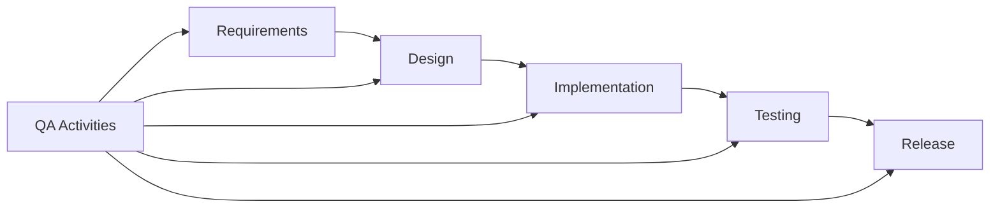
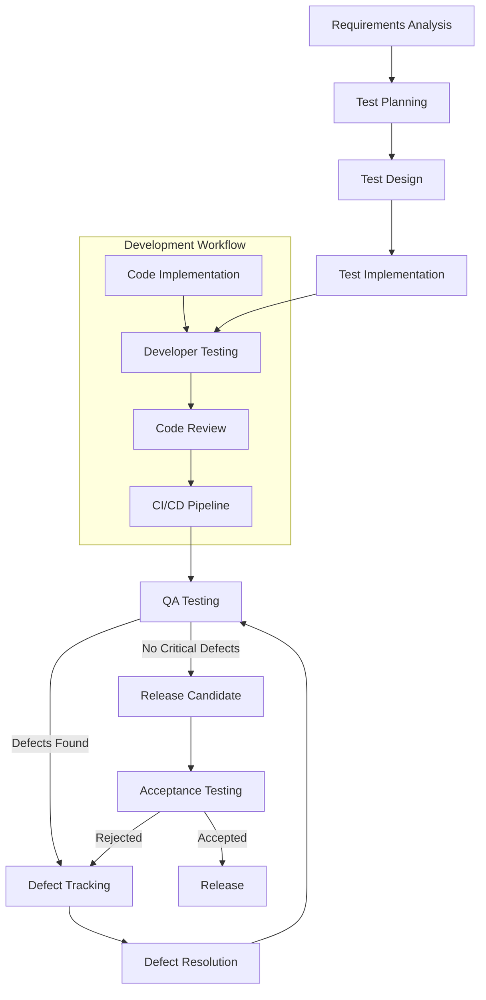
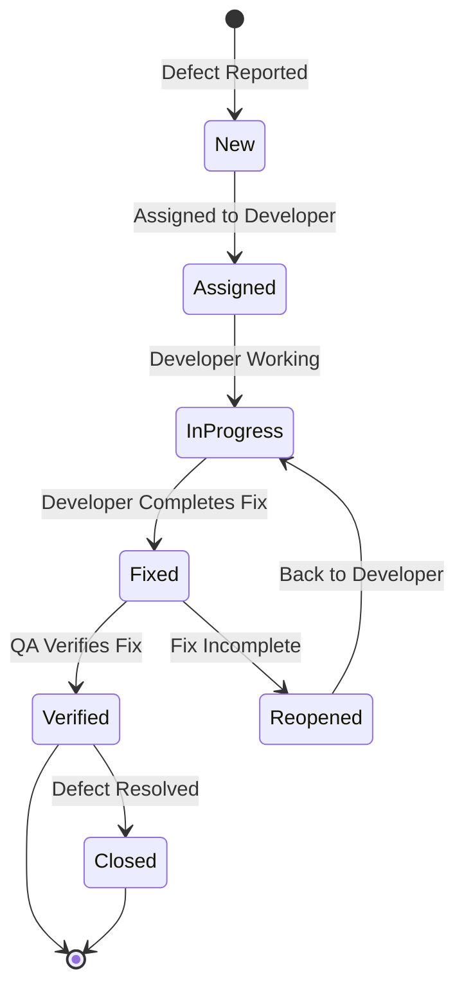
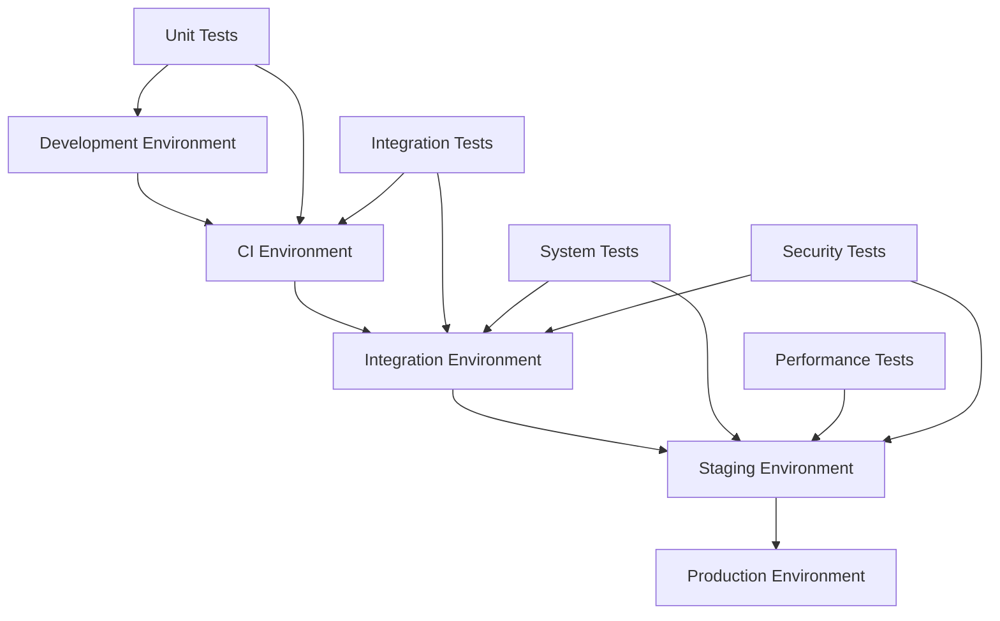

# Quality Assurance Plan

## Overview

This document outlines the comprehensive Quality Assurance (QA) plan for the Virtual Personal Assistant (VPA) project. It defines the quality standards, processes, methodologies, and tools that will be used throughout the development lifecycle to ensure the delivery of a high-quality, reliable, and user-friendly VPA system.

## Table of Contents

1. [Quality Objectives](#quality-objectives)
2. [Quality Management Strategy](#quality-management-strategy)
3. [Testing Approach](#testing-approach)
   - [Testing Levels](#testing-levels)
   - [Testing Types](#testing-types)
   - [Test Coverage Targets](#test-coverage-targets)
4. [QA Process Flow](#qa-process-flow)
5. [Defect Management](#defect-management)
6. [Quality Metrics](#quality-metrics)
7. [QA Tools and Infrastructure](#qa-tools-and-infrastructure)
8. [QA Roles and Responsibilities](#qa-roles-and-responsibilities)
9. [Quality Gates and Release Criteria](#quality-gates-and-release-criteria)
10. [Test Documentation](#test-documentation)
11. [Continuous Improvement](#continuous-improvement)

## Quality Objectives

The VPA Quality Assurance Plan is guided by the following objectives:

1. **User Satisfaction**: Ensure the VPA meets user needs and expectations with a focus on usability, reliability, and performance.

2. **Functional Reliability**: Validate that all features work as intended across various usage scenarios and environments.

3. **Performance Efficiency**: Ensure the VPA operates efficiently with minimal resource utilization and acceptable response times.

4. **Security and Privacy**: Confirm that the system properly protects user data and integrates securely with external systems.

5. **Compatibility**: Verify the VPA works correctly across all supported Windows versions and hardware configurations.

6. **Maintainability**: Support long-term code quality and ease of maintenance through appropriate quality practices.

7. **Accessibility**: Ensure the VPA is accessible to users with disabilities in compliance with accessibility standards.

## Quality Management Strategy

The VPA project employs a proactive quality management strategy based on the following principles:

### Shift-Left Approach

Quality assurance activities begin early in the development process to identify and address issues before they become more costly to fix:



### Continuous Quality Integration

Quality checks are integrated into the development workflow through automated testing and continuous integration:

```python
# Example CI pipeline configuration (GitHub Actions)
name: VPA Continuous Integration

on:
  push:
    branches: [ main, develop ]
  pull_request:
    branches: [ main, develop ]

jobs:
  quality_checks:
    runs-on: windows-latest
    steps:
    - uses: actions/checkout@v3
    - name: Set up Python
      uses: actions/setup-python@v4
      with:
        python-version: '3.10'
        
    - name: Install dependencies
      run: |
        python -m pip install --upgrade pip
        pip install -r requirements.txt
        pip install -r requirements-dev.txt
        
    - name: Lint with flake8
      run: |
        flake8 src/ tests/
        
    - name: Type check with mypy
      run: |
        mypy src/
        
    - name: Run unit tests
      run: |
        pytest tests/unit/ --cov=src
        
    - name: Run integration tests
      run: |
        pytest tests/integration/
        
    - name: Upload coverage reports
      uses: codecov/codecov-action@v3
```

### Risk-Based Approach

Testing efforts are prioritized based on risk assessment, focusing on critical components and features with the highest potential impact on users:

| Component | Risk Level | Risk Factors | Testing Emphasis |
|-----------|------------|--------------|------------------|
| Core Engine | High | Central system component, impacts all features | Extensive unit, integration, and system testing |
| Voice Recognition | High | User-facing, accuracy critical for UX | Comprehensive accuracy testing with diverse voice samples |
| Plugin System | Medium | Security concerns, stability | Security testing, isolation testing, load testing |
| Settings Management | Medium | Configuration persistence, user customization | Data integrity, backward compatibility |
| Help System | Low | Non-critical for core functionality | Basic functional testing |

## Testing Approach

The VPA testing approach combines multiple testing methodologies to ensure comprehensive quality validation.

### Testing Levels

#### 1. Unit Testing

Unit tests verify the correctness of individual components and functions:

```python
# Example unit test for the CommandParser
import unittest
from vpa.core.command_parser import CommandParser

class TestCommandParser(unittest.TestCase):
    def setUp(self):
        self.parser = CommandParser()
        
    def test_simple_command_parsing(self):
        result = self.parser.parse("set alarm for 8:00 am tomorrow")
        self.assertEqual(result.intent, "set_alarm")
        self.assertEqual(result.params["time"], "8:00 am")
        self.assertEqual(result.params["date"], "tomorrow")
        
    def test_ambiguous_command_handling(self):
        result = self.parser.parse("play")
        self.assertEqual(result.intent, "unknown")
        self.assertTrue(result.needs_clarification)
        self.assertIn("play_music", result.possible_intents)
        self.assertIn("play_video", result.possible_intents)
        
    def test_empty_input_handling(self):
        result = self.parser.parse("")
        self.assertEqual(result.intent, "no_input")
        self.assertFalse(result.needs_clarification)
```

#### 2. Integration Testing

Integration tests verify that components work together correctly:

```python
# Example integration test for Audio System and Command Execution
import pytest
from vpa.audio.recognizer import AudioRecognizer
from vpa.core.command_processor import CommandProcessor

@pytest.fixture
def audio_command_system():
    recognizer = AudioRecognizer()
    processor = CommandProcessor()
    return recognizer, processor

def test_audio_command_flow(audio_command_system):
    recognizer, processor = audio_command_system
    
    # Test with pre-recorded audio file containing "what's the weather today"
    audio_data = load_test_audio("weather_query.wav")
    text = recognizer.transcribe(audio_data)
    
    assert "weather" in text.lower()
    
    # Process the recognized text
    command = processor.process(text)
    
    assert command.intent == "get_weather"
    assert "date" in command.params
    assert command.params["date"] == "today"
```

#### 3. System Testing

System tests verify the behavior of the complete VPA system:

```python
# Example system test using pytest
import pytest
from vpa.test_helpers.system_test_harness import VPASystemTest

class TestCoreUserJourneys(VPASystemTest):
    def test_weather_query_journey(self):
        # Start VPA with mock interfaces
        self.start_vpa_with_mocks()
        
        # Simulate user speaking to VPA
        response = self.simulate_user_input("What's the weather in Seattle tomorrow?")
        
        # Verify appropriate API was called
        self.assert_api_called("weather_api", params={"location": "Seattle", "date": "tomorrow"})
        
        # Verify response to user contains weather information
        assert "temperature" in response.lower()
        assert "seattle" in response.lower()
        assert "tomorrow" in response.lower()
        
    def test_reminder_setting_journey(self):
        self.start_vpa_with_mocks()
        
        # Simulate user setting a reminder
        response = self.simulate_user_input("Remind me to call mom at 6pm")
        
        # Verify confirmation was given
        assert "reminder set" in response.lower()
        assert "6 pm" in response.lower()
        assert "call mom" in response.lower()
        
        # Verify reminder was stored correctly
        reminders = self.get_stored_reminders()
        assert len(reminders) == 1
        assert reminders[0]["task"] == "call mom"
        assert "18:00" in reminders[0]["time"]
```

#### 4. Acceptance Testing

Acceptance tests validate that the system meets user requirements:

```gherkin
# Example Acceptance Test in Gherkin/Behave
Feature: Setting Reminders
  As a VPA user
  I want to set reminders for future tasks
  So that I don't forget important activities

  Scenario: Set a time-based reminder
    Given the VPA is active and listening
    When I say "Remind me to take my medication at 9pm"
    Then the VPA should confirm that the reminder is set
    And a reminder with text "take my medication" should be scheduled for 9:00 PM today
    
  Scenario: Set a reminder for tomorrow
    Given the VPA is active and listening
    When I say "Remind me to call John tomorrow morning"
    Then the VPA should confirm that the reminder is set
    And a reminder with text "call John" should be scheduled for tomorrow morning
    
  Scenario: Reminder notification
    Given I have a reminder set for "take a break" at the current time
    When the reminder time is reached
    Then the VPA should notify me audibly about the reminder
    And the reminder should be displayed visually
    And I should be able to mark the reminder as completed or snooze it
```

### Testing Types

#### 1. Functional Testing

Verifies that each feature works according to specifications:

- Feature-by-feature validation
- Boundary value testing
- Equivalence class testing
- Error handling validation

#### 2. Performance Testing

Measures system performance under various conditions:

- Response time testing
- Resource utilization monitoring
- Stress testing
- Endurance testing
- Startup/shutdown time measurement

#### 3. Security Testing

Validates the system's security mechanisms:

- Authentication testing
- Authorization testing
- Data protection verification
- Input validation testing
- Plugin isolation verification
- API security testing

#### 4. Usability Testing

Evaluates the user experience:

- Task-based usability studies
- Voice command recognition accuracy testing
- Interface accessibility evaluation
- Cognitive walkthrough assessments
- Satisfaction surveys

#### 5. Localization Testing

Verifies the system works correctly for different languages and regions:

- Text localization validation
- Speech recognition for different accents
- Cultural appropriateness review
- Date/time/number format testing

#### 6. Accessibility Testing

Ensures the VPA is accessible to users with disabilities:

- Screen reader compatibility
- Keyboard navigation testing
- Color contrast verification
- Voice-only operation testing

### Test Coverage Targets

The project targets the following test coverage metrics:

| Coverage Type | Target | Measurement Tool |
|---------------|--------|------------------|
| Code Coverage | 85%+ | pytest-cov |
| Statement Coverage | 90%+ | pytest-cov |
| Branch Coverage | 80%+ | pytest-cov |
| Critical Path Coverage | 100% | Custom test tagging |
| UI Event Coverage | 90%+ | UI testing framework |
| Voice Command Coverage | 95%+ | Custom test harness |
| API Coverage | 100% | Swagger/OpenAPI validation |

## QA Process Flow

The QA process integrates with the development workflow as follows:



### Key QA Activities

1. **Requirements Review**: QA team participates in requirements reviews to ensure testability and clarity.

2. **Test Planning**: Development of test strategy, test plans, and resource allocation for each iteration.

3. **Test Design**: Creation of test cases, test data, and test automation scripts.

4. **Test Execution**: Manual and automated test execution with detailed reporting.

5. **Defect Management**: Tracking, prioritization, and verification of defect fixes.

6. **Test Reporting**: Regular reporting on test progress, coverage, and quality metrics.

## Defect Management

Defects are managed through a structured process:

### Defect Lifecycle



### Defect Priority Levels

| Priority | Description | Target Resolution Time |
|----------|-------------|------------------------|
| P1 - Critical | System crash, data loss, security vulnerability | 24 hours |
| P2 - High | Major feature broken, severe performance issue | 3 business days |
| P3 - Medium | Feature not working as expected, workaround available | Next release |
| P4 - Low | Minor issues, cosmetic problems | When resources allow |

### Defect Triage Process

1. **Initial Assessment**: QA classifies new defects by priority and severity
2. **Triage Meeting**: Daily review of new defects with development team
3. **Assignment**: Defects assigned to appropriate team members
4. **Resolution Tracking**: Progress tracking through resolution
5. **Verification**: QA verification of fixes

## Quality Metrics

The project tracks the following key quality metrics:

### Product Quality Metrics

| Metric | Target | Measurement Method |
|--------|--------|-------------------|
| Defect Density | <0.5 defects per 1000 LOC | (Total Defects / KLOC) |
| Test Pass Rate | >95% | (Passed Tests / Total Tests) × 100 |
| Voice Recognition Accuracy | >95% | Correct recognitions / Total attempts |
| P1/P2 Defects | <5 open at release | Count from defect tracking system |
| User Satisfaction | >4.5/5 | User testing satisfaction surveys |
| Accessibility Compliance | 100% | WCAG 2.1 AA conformance |
| Performance Targets | See Performance Standards | Automated performance tests |

### Process Quality Metrics

| Metric | Target | Measurement Method |
|--------|--------|-------------------|
| Test Coverage | >85% | Code coverage tools |
| Automation Rate | >75% of test cases | (Automated Tests / Total Tests) × 100 |
| Defect Leakage | <10% | (Prod Defects / Total Defects) × 100 |
| Defect Resolution Time | P1: 24h, P2: 3d | Average time to resolve defects by priority |
| Requirements Stability | <15% change after freeze | % of requirements changed |

### Quality Reporting

Quality metrics are reported in the following ways:

1. **Daily Quality Dashboard**: Automated dashboard showing test execution progress and recent defects
2. **Weekly Quality Report**: Detailed analysis of quality metrics and trends
3. **Release Quality Assessment**: Comprehensive quality report for each release candidate
4. **Post-Release Quality Review**: Analysis of release quality and lessons learned

## QA Tools and Infrastructure

The VPA QA effort leverages the following tools and infrastructure:

### Testing Tools

| Category | Tools |
|----------|-------|
| Test Management | TestRail |
| Defect Tracking | Jira |
| Unit Testing | pytest, unittest |
| API Testing | Postman, requests, pytest |
| UI Testing | Selenium, PyAutoGUI |
| Voice Testing | Custom test harness, recorded voice samples |
| Performance Testing | Locust, Windows Performance Recorder |
| Security Testing | OWASP ZAP, Bandit |
| Accessibility Testing | axe, Accessibility Insights |
| Load Testing | JMeter, Locust |

### Test Environment Architecture

The VPA test environments include:

1. **Developer Environments**: Local testing by developers
2. **CI Environment**: Automated testing on every commit/PR
3. **Integration Test Environment**: Controlled environment for integrated testing
4. **Staging Environment**: Production-like environment for system testing
5. **Performance Test Environment**: Isolated environment for performance testing



### Test Data Management

1. **Synthetic Test Data Generation**: Tools and scripts for creating realistic test data
2. **Voice Sample Library**: Collection of voice samples for testing voice recognition
3. **Test Data Versioning**: Version control for test data sets
4. **Sensitive Data Handling**: Processes for securing test data containing sensitive information

## QA Roles and Responsibilities

| Role | Responsibilities |
|------|------------------|
| QA Lead | Overall quality strategy, test planning, team coordination |
| Test Engineers | Test case design, test automation, test execution |
| Automation Engineers | Test automation framework development and maintenance |
| Security Tester | Security testing, vulnerability assessments |
| Performance Engineer | Performance testing and analysis |
| Accessibility Specialist | Accessibility testing and compliance verification |
| Developers | Unit testing, fixing defects, supporting QA efforts |

## Quality Gates and Release Criteria

The VPA release process includes quality gates at key milestones:

### Quality Gates

1. **Development Complete**: 
   - All features implemented according to specifications
   - Unit test coverage meets targets
   - No P1/P2 defects open
   - Code review completed for all changes

2. **Test Ready**:
   - All test cases prepared and reviewed
   - Test environment configured and ready
   - Test data prepared
   - Automation scripts updated

3. **Release Candidate**:
   - All planned test cases executed
   - No open P1/Critical defects
   - < 5 open P2/High defects (with workarounds)
   - Performance metrics meet targets
   - Security assessment completed

### Release Criteria

A release is approved when:

1. **Functional Criteria**:
   - All critical and high-priority features work as specified
   - No P1 defects and < 5 P2 defects with approved workarounds
   - All regression tests pass

2. **Performance Criteria**:
   - System meets all performance targets (see Performance Standards)
   - Resource utilization within acceptable limits
   - No memory leaks detected

3. **Security Criteria**:
   - No high or critical security vulnerabilities
   - Data protection measures verified
   - Authentication and authorization working as designed

4. **User Experience Criteria**:
   - Usability testing shows positive results
   - Voice recognition accuracy meets targets
   - Accessibility compliance verified

## Test Documentation

The project maintains the following test documentation:

### Test Plans

Test plans define the scope, approach, and resource requirements for testing activities:

```markdown
# Test Plan: Voice Recognition Module

## Scope
This test plan covers the testing of the Voice Recognition module v2.0 for the VPA system.

## Test Objectives
- Verify accuracy of voice recognition across different user profiles
- Validate noise cancellation functionality
- Ensure compatibility with various microphone types
- Test multilingual support
- Verify integration with the command processing system

## Test Schedule
- Test Design: June 5-10, 2025
- Test Implementation: June 11-18, 2025
- Test Execution: June 19-30, 2025
- Defect Resolution: July 1-7, 2025
- Test Report: July 8, 2025

## Resource Requirements
- 2 Test Engineers
- 1 Automation Engineer
- Voice sample database
- Test environments with various audio hardware
- 20 external testers for accent diversity

## Test Deliverables
- Voice Recognition Test Cases
- Automated Test Scripts
- Voice Sample Test Data
- Test Execution Reports
- Defect Reports
- Final Test Summary
```

### Test Cases

Test cases define the steps, expected results, and test data for specific test scenarios:

```markdown
# Test Case: VR-TC-101 - Voice Command Recognition Accuracy

## Objective
Verify that the voice recognition system accurately recognizes standard voice commands in a quiet environment.

## Preconditions
- VPA system is running and in listening mode
- Testing environment has ambient noise level <30dB
- Standard microphone is connected and configured

## Test Data
- Standard voice command dataset (20 commands)
- Standard adult male and female voice profiles

## Test Steps
1. Launch VPA system and activate listening mode
2. Play recorded voice command "What's the weather today?"
3. Record if the command was recognized correctly
4. Repeat steps 2-3 for each command in the test dataset
5. Repeat the entire process with different voice profiles

## Expected Results
- >95% of commands are recognized correctly
- Recognition response time is <1.5 seconds
- Transcription text matches spoken command

## Pass/Fail Criteria
- Pass: >95% recognition accuracy across all test data
- Fail: <95% recognition accuracy or any critical commands misinterpreted

## Notes
- Record details of any misrecognized commands
- Note response times for each recognition
```

### Test Execution Reports

Test execution reports document the results of test execution activities:

```markdown
# Test Execution Report: Voice Recognition Module v2.0

## Summary
- **Test Cycle**: VR-Cycle-12
- **Date**: June 28, 2025
- **Environment**: Test Environment 3
- **Build Version**: 0.9.5-rc2

## Execution Summary
- **Total Test Cases**: 145
- **Passed**: 132 (91%)
- **Failed**: 8 (5.5%)
- **Blocked**: 5 (3.5%)
- **Not Run**: 0

## Defects Found
- **Critical**: 0
- **High**: 2
- **Medium**: 4
- **Low**: 6

### Key Issues
1. VPA-1245: Voice recognition accuracy drops below 80% in moderate background noise
2. VPA-1246: Commands with dates beyond 3 months are misinterpreted

## Coverage Analysis
- Feature Coverage: 100%
- Requirements Coverage: 98%
- Code Coverage: 87%

## Recommendations
- Address the high-priority defects before release
- Add more test cases for background noise scenarios
- Improve test data for date recognition edge cases
```

## Continuous Improvement

The QA process includes continuous improvement mechanisms:

### Process Improvement Activities

1. **Sprint Retrospectives**: Regular reviews of QA process effectiveness
2. **Root Cause Analysis**: Detailed analysis of significant defects
3. **Test Automation Expansion**: Ongoing expansion of automated test coverage
4. **Knowledge Sharing**: Regular knowledge sharing sessions on testing techniques
5. **Tool Evaluation**: Periodic evaluation of QA tools and technologies

### QA Metrics Tracking

QA metrics are tracked over time to identify trends and improvement opportunities:

```python
# Example metrics tracking script
import pandas as pd
import matplotlib.pyplot as plt
from datetime import datetime
import seaborn as sns

def generate_qa_trends_report(data_file, output_file):
    """Generate QA trends report from historical metrics data"""
    # Load historical data
    df = pd.read_csv(data_file)
    df['Date'] = pd.to_datetime(df['Date'])
    
    # Create figure with multiple subplots
    fig, axes = plt.subplots(2, 2, figsize=(15, 12))
    
    # Plot test pass rate trend
    sns.lineplot(x='Date', y='TestPassRate', data=df, ax=axes[0, 0])
    axes[0, 0].set_title('Test Pass Rate Trend')
    axes[0, 0].set_ylabel('Pass Rate (%)')
    axes[0, 0].grid(True)
    
    # Plot defect density trend
    sns.lineplot(x='Date', y='DefectDensity', data=df, ax=axes[0, 1])
    axes[0, 1].set_title('Defect Density Trend')
    axes[0, 1].set_ylabel('Defects per 1000 LOC')
    axes[0, 1].grid(True)
    
    # Plot code coverage trend
    sns.lineplot(x='Date', y='CodeCoverage', data=df, ax=axes[1, 0])
    axes[1, 0].set_title('Code Coverage Trend')
    axes[1, 0].set_ylabel('Coverage (%)')
    axes[1, 0].grid(True)
    
    # Plot automation rate trend
    sns.lineplot(x='Date', y='AutomationRate', data=df, ax=axes[1, 1])
    axes[1, 1].set_title('Test Automation Rate Trend')
    axes[1, 1].set_ylabel('Automation Rate (%)')
    axes[1, 1].grid(True)
    
    # Add overall title
    plt.suptitle('VPA Quality Metrics Trends', fontsize=16)
    plt.tight_layout(rect=[0, 0.03, 1, 0.95])
    
    # Save the report
    plt.savefig(output_file)
    print(f"QA trends report saved to {output_file}")
```

---

*Document created: August 29, 2025*  
*Author: VPA Quality Assurance Team*
