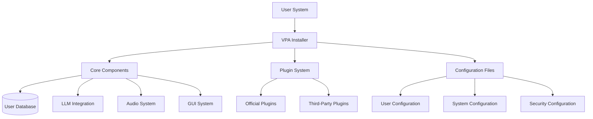
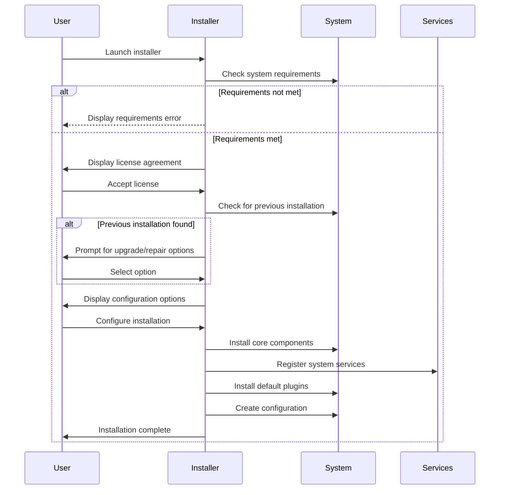
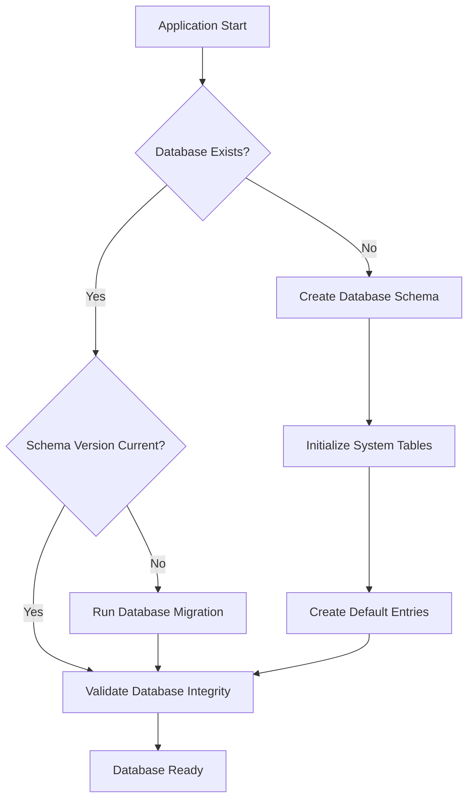

# Deployment Guidelines

## Overview

This document provides comprehensive guidelines for deploying the Virtual Personal Assistant (VPA) in various environments. It covers the deployment process, configuration management, environment setup, and best practices to ensure smooth and reliable deployment.

## Table of Contents

1. [Deployment Architecture](#deployment-architecture)
2. [Deployment Types](#deployment-types)
3. [Pre-deployment Requirements](#pre-deployment-requirements)
4. [Installation Process](#installation-process)
5. [Configuration Management](#configuration-management)
6. [Database Setup](#database-setup)
7. [Environment Configuration](#environment-configuration)
8. [Dependency Management](#dependency-management)
9. [Deployment Automation](#deployment-automation)
10. [Deployment Validation](#deployment-validation)
11. [Rollback Procedures](#rollback-procedures)
12. [Deployment Monitoring](#deployment-monitoring)
13. [Post-Deployment Tasks](#post-deployment-tasks)
14. [Security Considerations](#security-considerations)
15. [Troubleshooting Common Issues](#troubleshooting-common-issues)

## Deployment Architecture

The VPA deployment architecture consists of the following components:

### Component Structure



### Deployment Topology

VPA uses a client-side deployment model with optional cloud service integrations:

1. **Client Application**: The core VPA system installed on the user's Windows device
2. **Local Data Storage**: User data stored locally in an encrypted database
3. **Cloud Services**: Optional integrations with cloud-based services for enhanced functionality
4. **Plugin Ecosystem**: Extensible plugin system with local and remote plugins

## Deployment Types

VPA supports several deployment types to accommodate different user scenarios:

### 1. Standard User Deployment

- **Target**: Individual end-users
- **Installation**: Self-service installer
- **Customization**: Basic configuration during installation
- **Updates**: Automatic updates through built-in update mechanism

### 2. Enterprise Deployment

- **Target**: Corporate environments
- **Installation**: Managed deployment via enterprise tools (SCCM, Intune, etc.)
- **Customization**: Pre-configured based on enterprise policies
- **Updates**: Controlled by IT administrators

### 3. Developer Deployment

- **Target**: Developers building extensions or customizations
- **Installation**: Development environment setup
- **Customization**: Extended debugging and development options
- **Updates**: Manual control over version updates

### 4. Offline Deployment

- **Target**: Environments with limited connectivity
- **Installation**: Offline installer package
- **Customization**: Limited to pre-packaged options
- **Updates**: Manual update process via downloaded packages

## Pre-deployment Requirements

Before deploying VPA, ensure the following requirements are met:

### System Requirements

| Component | Minimum | Recommended |
|-----------|---------|-------------|
| Operating System | Windows 10 (1909+) | Windows 11 |
| Processor | Dual-core 2.0 GHz | Quad-core 2.5 GHz or better |
| Memory | 4 GB RAM | 8 GB RAM or more |
| Storage | 2 GB available | 5 GB available |
| Display | 1280 x 720 | 1920 x 1080 or higher |
| Audio | Microphone and speakers | High-quality microphone and speakers |
| Internet | Broadband connection | High-speed broadband connection |

### Software Prerequisites

1. **.NET Runtime**: .NET 6.0 or later
2. **Python Runtime**: Python 3.10 or later (embedded in the installer)
3. **Microsoft Visual C++ Redistributable**: Latest version
4. **Windows Media Feature Pack**: For Windows N editions

### Administrative Rights

- Standard installation: Temporary administrator rights required
- Enterprise deployment: System administrator or equivalent permissions

### Network Configuration

- Outbound connections to `api.vpa-assistant.com` (ports 443, 8883)
- Optional: Connections to third-party services (based on plugins installed)
- Proxy configuration supported via system settings or explicit configuration

## Installation Process

The VPA deployment follows a structured installation process:

### Standard Installation Flow



### Installation Options

The VPA installer provides several installation options:

1. **Quick Install**: Default settings with minimal user interaction
2. **Custom Install**: User selection of components and configuration options
3. **Silent Install**: Command-line installation with no user interface
4. **Repair**: Fix corrupted installation without data loss
5. **Upgrade**: Upgrade existing installation while preserving user data

### Silent Installation

For automated deployment, use the following command-line parameters:

```powershell
VPA_Setup.exe /silent /components=all /configfile="path\to\config.json" /log="path\to\install.log"
```

Available parameters:

| Parameter | Description | Example |
|-----------|-------------|---------|
| /silent | Run installer without UI | /silent |
| /verysilent | Run installer without UI or progress window | /verysilent |
| /components | Comma-separated list of components to install | /components=core,audio,gui,plugins |
| /configfile | Path to JSON configuration file | /configfile="C:\config.json" |
| /log | Path for installation log | /log="C:\install.log" |
| /dir | Installation directory | /dir="C:\Program Files\VPA" |
| /nostart | Don't start application after installation | /nostart |
| /noreboot | Don't reboot after installation | /noreboot |

### Enterprise Deployment Script

```powershell
# PowerShell deployment script for enterprise environments
# Save as Deploy-VPA.ps1

param (
    [string]$ConfigFile = "enterprise_config.json",
    [string]$LogPath = "$env:ProgramData\VPA\Logs\deployment.log",
    [switch]$ForceInstall = $false
)

# Create log directory if it doesn't exist
$logDir = Split-Path -Parent $LogPath
if (-not (Test-Path $logDir)) {
    New-Item -ItemType Directory -Path $logDir -Force | Out-Null
}

function Write-Log {
    param ([string]$Message)
    
    $timestamp = Get-Date -Format "yyyy-MM-dd HH:mm:ss"
    "$timestamp - $Message" | Out-File -FilePath $LogPath -Append
    Write-Host $Message
}

# Check if VPA is already installed
$installedVersion = Get-ItemProperty -Path "HKLM:\Software\VPA" -Name "Version" -ErrorAction SilentlyContinue
if ($installedVersion -and -not $ForceInstall) {
    Write-Log "VPA version $($installedVersion.Version) is already installed."
    Write-Log "Use -ForceInstall to reinstall or upgrade."
    exit 0
}

# Get installer path
$installerPath = Join-Path $PSScriptRoot "VPA_Enterprise_Setup.exe"
if (-not (Test-Path $installerPath)) {
    Write-Log "Error: Installer not found at $installerPath"
    exit 1
}

# Get config file path
$configFilePath = Join-Path $PSScriptRoot $ConfigFile
if (-not (Test-Path $configFilePath)) {
    Write-Log "Error: Configuration file not found at $configFilePath"
    exit 1
}

# Run installation
Write-Log "Starting VPA installation with config from $configFilePath"
$arguments = @(
    "/verysilent",
    "/components=all",
    "/configfile=`"$configFilePath`"",
    "/log=`"$LogPath`"",
    "/noreboot"
)

try {
    $process = Start-Process -FilePath $installerPath -ArgumentList $arguments -Wait -PassThru
    if ($process.ExitCode -eq 0) {
        Write-Log "VPA installation completed successfully."
    } else {
        Write-Log "VPA installation failed with exit code $($process.ExitCode)"
        exit $process.ExitCode
    }
} catch {
    Write-Log "Error during installation: $_"
    exit 1
}
```

## Configuration Management

VPA uses a multi-layered configuration approach:

### Configuration Hierarchy

1. **Default Configuration**: Built-in defaults for all settings
2. **System Configuration**: Machine-wide settings in `%ProgramData%\VPA\config`
3. **User Configuration**: User-specific settings in `%AppData%\VPA\config`
4. **Plugin Configuration**: Plugin-specific settings in respective folders
5. **Runtime Configuration**: Temporary settings that don't persist between sessions

### Configuration File Structure

VPA uses JSON configuration files with the following structure:

```json
{
  "system": {
    "version": "1.0.0",
    "installPath": "C:\\Program Files\\VPA",
    "dataPath": "%AppData%\\VPA\\Data",
    "logLevel": "info",
    "autoUpdate": true,
    "updateChannel": "stable",
    "telemetry": {
      "enabled": true,
      "anonymousUsageStats": true,
      "errorReporting": true
    }
  },
  "security": {
    "encryptionEnabled": true,
    "localStorageEncryption": "AES-256",
    "authenticationRequired": false,
    "sessionTimeout": 30,
    "pluginSandboxing": "strict"
  },
  "audio": {
    "inputDevice": "default",
    "outputDevice": "default",
    "sampleRate": 48000,
    "bitDepth": 16,
    "noiseReduction": true,
    "voiceActivation": true,
    "activationThreshold": 0.2
  },
  "gui": {
    "theme": "system",
    "fontSize": "medium",
    "animations": true,
    "startMinimized": false,
    "alwaysOnTop": false
  },
  "plugins": {
    "autoLoad": true,
    "allowedDirectories": [
      "%ProgramFiles%\\VPA\\Plugins",
      "%AppData%\\VPA\\Plugins"
    ],
    "disabled": []
  },
  "llm": {
    "provider": "default",
    "apiKey": "",
    "localProcessing": true,
    "offlineSupport": true,
    "contextLength": 2048
  },
  "network": {
    "proxyEnabled": false,
    "proxyServer": "",
    "proxyPort": 0,
    "proxyUsername": "",
    "proxyPassword": "",
    "offlineMode": false
  }
}
```

### Environment-Based Configuration

Configuration can be adjusted based on deployment environment using environment variables or command-line parameters:

```powershell
# Set environment variable for deployment environment
$env:VPA_ENVIRONMENT = "production"

# Launch VPA with specific configuration overrides
Start-Process -FilePath "VPA.exe" -ArgumentList "--config-override=network.offlineMode=true"
```

### Enterprise Configuration Example

For enterprise deployments, create a pre-configured settings file:

```json
{
  "system": {
    "installPath": "C:\\Program Files\\VPA",
    "dataPath": "%ProgramData%\\VPA\\EnterpriseData",
    "logLevel": "warning",
    "autoUpdate": false,
    "telemetry": {
      "enabled": true,
      "anonymousUsageStats": true,
      "errorReporting": true
    }
  },
  "security": {
    "encryptionEnabled": true,
    "authenticationRequired": true,
    "pluginSandboxing": "strict"
  },
  "plugins": {
    "autoLoad": false,
    "allowedDirectories": [
      "%ProgramFiles%\\VPA\\ApprovedPlugins"
    ],
    "disabled": ["social_media_connector", "game_integration"]
  },
  "llm": {
    "provider": "enterprise",
    "apiEndpoint": "https://llm.company.com/api/v1",
    "localProcessing": false
  },
  "enterprise": {
    "domainAuthentication": true,
    "policyServer": "https://policies.company.com/vpa",
    "managementServer": "https://mgmt.company.com/vpa",
    "departmentId": "IT-SUPPORT"
  }
}
```

## Database Setup

The VPA uses a local database for storing user data and application state:

### Database Configuration

1. **Default Database**: SQLite database in the user data directory
2. **Enterprise Database**: Option for centralized database (PostgreSQL, SQL Server)
3. **Encryption**: Automatic database encryption using platform-secure storage

### Database Initialization

The database is automatically initialized during first launch with the following steps:



### Database Migration

For upgrades, database migrations are handled automatically:

```python
# Example database migration code
from vpa.db import migration_manager

def perform_database_migration():
    """Perform database migration during deployment"""
    try:
        # Initialize migration manager
        migrator = migration_manager.MigrationManager()
        
        # Check current version and target version
        current_version = migrator.get_current_version()
        target_version = migrator.get_latest_version()
        
        if current_version < target_version:
            # Backup database before migration
            migrator.backup_database()
            
            # Run migrations sequentially
            for version in range(current_version + 1, target_version + 1):
                migrator.apply_migration(version)
                
            # Verify migration success
            migrator.verify_migration()
            
            print(f"Database successfully migrated from v{current_version} to v{target_version}")
        else:
            print("Database is already at the latest version")
            
    except Exception as e:
        print(f"Migration failed: {str(e)}")
        # Restore from backup if available
        if migrator.has_backup():
            migrator.restore_from_backup()
            print("Database restored from backup")
        return False
        
    return True
```

### Enterprise Database Setup

For enterprise environments with a centralized database:

1. **Setup PostgreSQL**:
   ```sql
   -- Create database and user
   CREATE DATABASE vpa_enterprise;
   CREATE USER vpa_app WITH ENCRYPTED PASSWORD 'strong_password_here';
   GRANT ALL PRIVILEGES ON DATABASE vpa_enterprise TO vpa_app;
   
   -- Connect to the database
   \c vpa_enterprise
   
   -- Create schema
   CREATE SCHEMA vpa;
   GRANT ALL ON SCHEMA vpa TO vpa_app;
   
   -- Set search path
   SET search_path TO vpa, public;
   ```

2. **Configure Connection**:
   ```json
   {
     "database": {
       "type": "postgresql",
       "host": "db.company.com",
       "port": 5432,
       "name": "vpa_enterprise",
       "schema": "vpa",
       "user": "vpa_app",
       "password": "encrypted:AES256:base64encodedpassword",
       "ssl": true,
       "connectionPool": 5
     }
   }
   ```

## Environment Configuration

VPA requires specific environment configurations for optimal operation:

### Windows Integration

1. **Autostart Configuration**:
   ```powershell
   # Add to startup (per user)
   $startupFolder = [Environment]::GetFolderPath('Startup')
   $shortcutPath = Join-Path $startupFolder "VPA.lnk"
   
   $WshShell = New-Object -ComObject WScript.Shell
   $Shortcut = $WshShell.CreateShortcut($shortcutPath)
   $Shortcut.TargetPath = "C:\Program Files\VPA\VPA.exe"
   $Shortcut.Arguments = "--startup"
   $Shortcut.WorkingDirectory = "C:\Program Files\VPA"
   $Shortcut.Save()
   ```

2. **Windows Firewall Rules**:
   ```powershell
   # Add firewall rules
   New-NetFirewallRule -DisplayName "VPA Application" `
                       -Direction Inbound `
                       -Program "C:\Program Files\VPA\VPA.exe" `
                       -Action Allow
   ```

3. **Register Protocol Handler**:
   ```powershell
   # Register vpa:// protocol
   New-Item -Path "HKCU:\Software\Classes\vpa" -Force
   Set-ItemProperty -Path "HKCU:\Software\Classes\vpa" -Name "(Default)" -Value "URL:VPA Protocol"
   Set-ItemProperty -Path "HKCU:\Software\Classes\vpa" -Name "URL Protocol" -Value ""
   
   New-Item -Path "HKCU:\Software\Classes\vpa\shell\open\command" -Force
   Set-ItemProperty -Path "HKCU:\Software\Classes\vpa\shell\open\command" -Name "(Default)" -Value "`"C:\Program Files\VPA\VPA.exe`" `"%1`""
   ```

### Environment Variables

Set the following environment variables for VPA operation:

```powershell
# System-wide environment variables
[Environment]::SetEnvironmentVariable("VPA_HOME", "C:\Program Files\VPA", "Machine")
[Environment]::SetEnvironmentVariable("VPA_DATA", "%ProgramData%\VPA", "Machine")
[Environment]::SetEnvironmentVariable("VPA_CONFIG_DIR", "%ProgramData%\VPA\config", "Machine")
[Environment]::SetEnvironmentVariable("VPA_LOG_LEVEL", "info", "Machine")
```

### File Permissions

Set appropriate permissions for VPA directories:

```powershell
# Set permissions on data directory
$dataPath = [Environment]::ExpandEnvironmentVariables("%ProgramData%\VPA")
$acl = Get-Acl $dataPath
$rule = New-Object System.Security.AccessControl.FileSystemAccessRule(
    "Users", 
    "ReadAndExecute, Write", 
    "ContainerInherit, ObjectInherit", 
    "None", 
    "Allow"
)
$acl.AddAccessRule($rule)
Set-Acl $dataPath $acl
```

## Dependency Management

VPA uses an integrated dependency management system:

### Dependency Bundling

The VPA installer includes all required dependencies by default:

1. **Runtime Dependencies**: Packaged within the application bundle
2. **System Dependencies**: Installed or verified during installation
3. **Plugin Dependencies**: Packaged with individual plugins or dynamically installed

### Dependency Verification

During startup, VPA verifies critical dependencies:

```python
# Example dependency verification
import importlib.util
import os
import subprocess
import sys

def verify_dependencies():
    """Verify all required dependencies are available"""
    missing_deps = []
    
    # Check Python packages
    required_packages = [
        "numpy>=1.21.0",
        "pytorch>=1.9.0",
        "sqlalchemy>=1.4.0",
        "fastapi>=0.70.0",
        "pydantic>=1.8.0"
    ]
    
    for pkg_req in required_packages:
        pkg_name = pkg_req.split('>=')[0]
        pkg_version = pkg_req.split('>=')[1] if '>=' in pkg_req else None
        
        try:
            spec = importlib.util.find_spec(pkg_name)
            if spec is None:
                missing_deps.append(pkg_req)
            elif pkg_version:
                # Check version
                module = importlib.import_module(pkg_name)
                if not hasattr(module, '__version__'):
                    print(f"Warning: Cannot verify version for {pkg_name}")
                    continue
                    
                if module.__version__ < pkg_version:
                    missing_deps.append(pkg_req)
        except ImportError:
            missing_deps.append(pkg_req)
    
    # Check system dependencies
    if sys.platform == 'win32':
        # Check for Visual C++ Redistributable
        try:
            # PowerShell command to check for Visual C++ Redistributable
            cmd = "powershell -Command \"Get-ItemProperty "
            cmd += "'HKLM:\\SOFTWARE\\Microsoft\\VisualStudio\\14.0\\VC\\Runtimes\\x64' "
            cmd += "-ErrorAction SilentlyContinue | Select-Object -ExpandProperty Version\""
            
            result = subprocess.run(cmd, capture_output=True, text=True)
            if result.returncode != 0 or not result.stdout.strip():
                missing_deps.append("Microsoft Visual C++ Redistributable 2015-2022")
        except Exception:
            missing_deps.append("Microsoft Visual C++ Redistributable 2015-2022")
    
    return missing_deps
```

### Dependency Installation

For missing optional dependencies:

```python
# Example dependency installer
import subprocess
import sys
import os

def install_dependency(package):
    """Install a dependency package"""
    print(f"Installing {package}...")
    
    # Use embedded pip to install within VPA's environment
    pip_path = os.path.join(os.path.dirname(sys.executable), "Scripts", "pip.exe")
    
    try:
        subprocess.run(
            [pip_path, "install", package, "--no-warn-script-location"],
            check=True
        )
        return True
    except subprocess.CalledProcessError:
        print(f"Failed to install {package}")
        return False

def install_missing_dependencies(dependencies):
    """Install all missing dependencies"""
    success = True
    for dep in dependencies:
        if not install_dependency(dep):
            success = False
    
    return success
```

## Deployment Automation

VPA supports several deployment automation approaches:

### Automated Deployment with PowerShell

```powershell
# Deploy-VPA-Enterprise.ps1

param (
    [Parameter(Mandatory=$true)]
    [string]$DeploymentConfigPath,
    
    [string]$TargetDir = "C:\Program Files\VPA",
    
    [string]$LogPath = "C:\Logs\VPA_Deployment.log",
    
    [switch]$Force
)

function Write-Log {
    param ([string]$Message)
    
    $timestamp = Get-Date -Format "yyyy-MM-dd HH:mm:ss"
    "$timestamp - $Message" | Out-File -FilePath $LogPath -Append
    Write-Host $Message
}

# Load deployment configuration
$config = Get-Content -Path $DeploymentConfigPath -Raw | ConvertFrom-Json

# Validate configuration
if (-not $config.packagePath -or -not (Test-Path $config.packagePath)) {
    Write-Log "Error: Invalid package path in configuration"
    exit 1
}

# Stop VPA service if running
$serviceRunning = Get-Service -Name "VPAService" -ErrorAction SilentlyContinue
if ($serviceRunning) {
    Write-Log "Stopping VPA service..."
    Stop-Service -Name "VPAService" -Force
}

# Check for existing installation
if (Test-Path $TargetDir) {
    if ($Force) {
        Write-Log "Removing existing installation..."
        # Backup configuration
        if (Test-Path "$TargetDir\config") {
            Copy-Item -Path "$TargetDir\config" -Destination "$env:TEMP\VPA_Config_Backup" -Recurse -Force
        }
        
        # Remove installation directory
        Remove-Item -Path $TargetDir -Recurse -Force
    } else {
        Write-Log "Installation directory exists. Use -Force to overwrite."
        exit 1
    }
}

# Create target directory
New-Item -Path $TargetDir -ItemType Directory -Force | Out-Null

# Extract package
Write-Log "Extracting package to $TargetDir..."
Expand-Archive -Path $config.packagePath -DestinationPath $TargetDir

# Restore configuration if backup exists
if (Test-Path "$env:TEMP\VPA_Config_Backup") {
    Write-Log "Restoring configuration..."
    Copy-Item -Path "$env:TEMP\VPA_Config_Backup" -Destination "$TargetDir\config" -Recurse -Force
    Remove-Item -Path "$env:TEMP\VPA_Config_Backup" -Recurse -Force
}

# Apply configuration overrides
if ($config.configOverrides) {
    Write-Log "Applying configuration overrides..."
    $configPath = Join-Path $TargetDir "config\system.json"
    $sysConfig = Get-Content -Path $configPath -Raw | ConvertFrom-Json
    
    foreach ($prop in $config.configOverrides.PSObject.Properties) {
        $propPath = $prop.Name -split "\."
        $current = $sysConfig
        
        # Navigate to the nested property
        for ($i = 0; $i -lt $propPath.Count - 1; $i++) {
            $current = $current.($propPath[$i])
        }
        
        # Set the value
        $current.($propPath[-1]) = $prop.Value
    }
    
    # Save updated configuration
    $sysConfig | ConvertTo-Json -Depth 10 | Out-File -FilePath $configPath -Encoding utf8
}

# Register services
Write-Log "Registering services..."
Start-Process -FilePath "$TargetDir\VPA.exe" -ArgumentList "--register-service" -Wait

# Start services
Write-Log "Starting services..."
Start-Service -Name "VPAService"

Write-Log "VPA deployment completed successfully"
```

### Continuous Deployment Pipeline (Azure DevOps)

```yaml
# azure-pipelines.yml - CD Pipeline for VPA
trigger:
  branches:
    include:
    - main
    - releases/*

variables:
  solution: 'VPA.sln'
  buildPlatform: 'x64'
  buildConfiguration: 'Release'
  installerProject: 'src/VPA.Installer/VPA.Installer.wixproj'
  artifactName: 'VPAInstaller'

stages:
- stage: Build
  jobs:
  - job: BuildAndPackage
    pool:
      vmImage: 'windows-latest'
    steps:
    - task: NuGetToolInstaller@1
      displayName: 'Install NuGet'

    - task: NuGetCommand@2
      displayName: 'Restore NuGet packages'
      inputs:
        restoreSolution: '$(solution)'

    - task: VSBuild@1
      displayName: 'Build solution'
      inputs:
        solution: '$(solution)'
        platform: '$(buildPlatform)'
        configuration: '$(buildConfiguration)'

    - task: VSBuild@1
      displayName: 'Build installer'
      inputs:
        solution: '$(installerProject)'
        platform: '$(buildPlatform)'
        configuration: '$(buildConfiguration)'

    - task: CopyFiles@2
      displayName: 'Copy installer to artifact staging'
      inputs:
        SourceFolder: '$(Build.SourcesDirectory)/src/VPA.Installer/bin/$(buildConfiguration)'
        Contents: '**/*.msi'
        TargetFolder: '$(Build.ArtifactStagingDirectory)'
        
    - task: PublishBuildArtifacts@1
      displayName: 'Publish installer artifact'
      inputs:
        PathtoPublish: '$(Build.ArtifactStagingDirectory)'
        ArtifactName: '$(artifactName)'

- stage: DeployDev
  dependsOn: Build
  jobs:
  - deployment: DeployToDev
    environment: 'Development'
    strategy:
      runOnce:
        deploy:
          steps:
          - download: current
            artifact: '$(artifactName)'
            
          - task: PowerShell@2
            displayName: 'Deploy VPA'
            inputs:
              filePath: 'deployment/Deploy-VPA.ps1'
              arguments: '-ConfigFile deployment/config/dev-config.json -Force'

- stage: DeployTest
  dependsOn: DeployDev
  jobs:
  - deployment: DeployToTest
    environment: 'Test'
    strategy:
      runOnce:
        deploy:
          steps:
          - download: current
            artifact: '$(artifactName)'
            
          - task: PowerShell@2
            displayName: 'Deploy VPA'
            inputs:
              filePath: 'deployment/Deploy-VPA.ps1'
              arguments: '-ConfigFile deployment/config/test-config.json -Force'
              
- stage: DeployProd
  dependsOn: DeployTest
  jobs:
  - deployment: DeployToProd
    environment: 'Production'
    strategy:
      runOnce:
        deploy:
          steps:
          - download: current
            artifact: '$(artifactName)'
            
          - task: PowerShell@2
            displayName: 'Deploy VPA'
            inputs:
              filePath: 'deployment/Deploy-VPA.ps1'
              arguments: '-ConfigFile deployment/config/prod-config.json'
```

## Deployment Validation

Ensure successful deployment with automated validation:

### Validation Checklist

1. **Installation Verification**:
   - All files correctly installed
   - Registry entries created
   - Services properly registered
   - Permissions correctly set

2. **Functionality Verification**:
   - Application starts successfully
   - Services run properly
   - Basic functionality works
   - No startup errors

3. **Integration Verification**:
   - Database connectivity
   - API connections
   - Plugin system initialized
   - Windows integration working

### Automated Validation Script

```powershell
# Validate-VPA-Deployment.ps1

param (
    [string]$InstallPath = "C:\Program Files\VPA",
    [string]$LogPath = "C:\Logs\VPA_Validation.log"
)

function Write-Log {
    param ([string]$Message, [string]$Level = "INFO")
    
    $timestamp = Get-Date -Format "yyyy-MM-dd HH:mm:ss"
    "$timestamp - [$Level] $Message" | Out-File -FilePath $LogPath -Append
    
    switch ($Level) {
        "ERROR" { Write-Host $Message -ForegroundColor Red }
        "WARNING" { Write-Host $Message -ForegroundColor Yellow }
        default { Write-Host $Message }
    }
}

function Test-Installation {
    # Check installation directory
    if (-not (Test-Path $InstallPath)) {
        Write-Log "Installation directory does not exist" "ERROR"
        return $false
    }
    
    # Check critical files
    $requiredFiles = @(
        "VPA.exe",
        "VPAService.exe",
        "config\default.json"
    )
    
    foreach ($file in $requiredFiles) {
        $filePath = Join-Path $InstallPath $file
        if (-not (Test-Path $filePath)) {
            Write-Log "Required file missing: $file" "ERROR"
            return $false
        }
    }
    
    # Check registry
    $regPath = "HKLM:\SOFTWARE\VPA"
    if (-not (Test-Path $regPath)) {
        Write-Log "Registry key missing" "ERROR"
        return $false
    }
    
    # Check services
    $service = Get-Service -Name "VPAService" -ErrorAction SilentlyContinue
    if (-not $service) {
        Write-Log "VPA service not installed" "ERROR"
        return $false
    }
    
    return $true
}

function Test-Functionality {
    # Check service status
    $service = Get-Service -Name "VPAService"
    if ($service.Status -ne "Running") {
        Write-Log "VPA service not running" "ERROR"
        return $false
    }
    
    # Test API endpoint
    try {
        $apiUrl = "http://localhost:8765/api/status"
        $response = Invoke-WebRequest -Uri $apiUrl -UseBasicParsing
        $content = ConvertFrom-Json $response.Content
        
        if ($content.status -ne "ok") {
            Write-Log "API status check failed: $($content.status)" "ERROR"
            return $false
        }
    }
    catch {
        Write-Log "API check failed: $_" "ERROR"
        return $false
    }
    
    # Check log file for errors
    $logFiles = Get-ChildItem -Path "$InstallPath\logs" -Filter "*.log" | Sort-Object LastWriteTime -Descending
    if ($logFiles.Count -gt 0) {
        $recentLog = $logFiles[0].FullName
        $errorCount = Select-String -Path $recentLog -Pattern "ERROR" | Measure-Object | Select-Object -ExpandProperty Count
        
        if ($errorCount -gt 0) {
            Write-Log "Found $errorCount errors in log file" "WARNING"
            # Not failing validation for log errors, just warning
        }
    }
    
    return $true
}

function Test-Integration {
    # Check database
    try {
        $dbPath = Join-Path $InstallPath "data\vpa.db"
        if (Test-Path $dbPath) {
            Write-Log "Database file exists" "INFO"
        } else {
            Write-Log "Database file missing" "WARNING"
            # Not failing validation, might be using remote database
        }
    }
    catch {
        Write-Log "Database check failed: $_" "WARNING"
    }
    
    # Test process running
    $process = Get-Process -Name "VPA" -ErrorAction SilentlyContinue
    if (-not $process) {
        Write-Log "VPA process not running" "WARNING"
        # Not failing validation, service might run separately
    }
    
    return $true
}

# Main validation
Write-Log "Starting VPA deployment validation" "INFO"

$installCheck = Test-Installation
if (-not $installCheck) {
    Write-Log "Installation validation failed" "ERROR"
    exit 1
}
Write-Log "Installation validation successful" "INFO"

$funcCheck = Test-Functionality
if (-not $funcCheck) {
    Write-Log "Functionality validation failed" "ERROR"
    exit 1
}
Write-Log "Functionality validation successful" "INFO"

$integCheck = Test-Integration
if (-not $integCheck) {
    Write-Log "Integration validation failed" "ERROR"
    exit 1
}
Write-Log "Integration validation successful" "INFO"

Write-Log "Validation completed successfully" "INFO"
```

## Rollback Procedures

In case of deployment failures, follow these rollback procedures:

### Automated Rollback

The installer includes automatic rollback capability:

1. **Transaction-Based Installation**: The installer uses Windows Installer transactions to ensure atomicity
2. **Pre-Installation Backup**: Critical configuration is backed up before modifications
3. **Restoration Point**: System restore points are created before installation

### Manual Rollback Steps

If automated rollback fails, follow these manual steps:

```powershell
# Manual-Rollback.ps1

param (
    [Parameter(Mandatory=$true)]
    [string]$BackupPath,
    
    [string]$InstallPath = "C:\Program Files\VPA"
)

# Stop services
Write-Host "Stopping VPA services..."
Stop-Service -Name "VPAService" -Force -ErrorAction SilentlyContinue

# Unregister services
Write-Host "Unregistering services..."
Start-Process -FilePath "$InstallPath\VPA.exe" -ArgumentList "--unregister-service" -Wait -ErrorAction SilentlyContinue

# Restore from backup
if (Test-Path $BackupPath) {
    Write-Host "Restoring from backup..."
    # Remove current installation
    Remove-Item -Path $InstallPath -Recurse -Force
    
    # Restore backup
    Copy-Item -Path "$BackupPath\*" -Destination $InstallPath -Recurse -Force
    
    # Restore registry if available
    if (Test-Path "$BackupPath\registry_backup.reg") {
        Write-Host "Restoring registry..."
        Start-Process -FilePath "regedit.exe" -ArgumentList "/s", "$BackupPath\registry_backup.reg" -Wait
    }
    
    # Re-register services
    Write-Host "Re-registering services..."
    Start-Process -FilePath "$InstallPath\VPA.exe" -ArgumentList "--register-service" -Wait
    
    # Start services
    Write-Host "Starting services..."
    Start-Service -Name "VPAService" -ErrorAction SilentlyContinue
    
    Write-Host "Rollback completed successfully"
} else {
    Write-Host "Error: Backup path not found" -ForegroundColor Red
    exit 1
}
```

### Database Rollback

For database rollback:

```python
# Example database rollback
from vpa.db import database_manager

def rollback_database():
    """Roll back database to previous state"""
    db_manager = database_manager.DatabaseManager()
    
    # Check for backup
    if not db_manager.has_backup():
        print("Error: No database backup found")
        return False
    
    # Get backup info
    backup_info = db_manager.get_backup_info()
    print(f"Found backup from: {backup_info['timestamp']}, Version: {backup_info['version']}")
    
    # Confirm rollback
    print("Rolling back database...")
    
    try:
        # Stop all database activity
        db_manager.stop_connections()
        
        # Restore from backup
        restore_success = db_manager.restore_from_backup()
        
        if restore_success:
            print("Database rollback successful")
            return True
        else:
            print("Database rollback failed")
            return False
    except Exception as e:
        print(f"Error during database rollback: {str(e)}")
        return False
```

## Deployment Monitoring

Monitor deployment success with telemetry and logging:

### Deployment Logging

```python
# Example deployment logger
import logging
import os
from datetime import datetime
import platform

class DeploymentLogger:
    """Logger for deployment operations"""
    
    def __init__(self, log_dir):
        """Initialize the deployment logger"""
        self.log_dir = log_dir
        os.makedirs(log_dir, exist_ok=True)
        
        # Set up logging
        timestamp = datetime.now().strftime("%Y%m%d_%H%M%S")
        log_file = os.path.join(log_dir, f"deploy_{timestamp}.log")
        
        # Configure logger
        self.logger = logging.getLogger("deployment")
        self.logger.setLevel(logging.INFO)
        
        # File handler
        file_handler = logging.FileHandler(log_file)
        file_handler.setLevel(logging.INFO)
        
        # Console handler
        console_handler = logging.StreamHandler()
        console_handler.setLevel(logging.INFO)
        
        # Formatter
        formatter = logging.Formatter('%(asctime)s - %(name)s - %(levelname)s - %(message)s')
        file_handler.setFormatter(formatter)
        console_handler.setFormatter(formatter)
        
        # Add handlers
        self.logger.addHandler(file_handler)
        self.logger.addHandler(console_handler)
        
        # Log system information
        self._log_system_info()
    
    def _log_system_info(self):
        """Log system information for deployment context"""
        self.logger.info("=== DEPLOYMENT STARTED ===")
        self.logger.info(f"System: {platform.system()} {platform.version()}")
        self.logger.info(f"Architecture: {platform.machine()}")
        self.logger.info(f"Python: {platform.python_version()}")
        self.logger.info(f"Processor: {platform.processor()}")
        
        # Memory information
        try:
            import psutil
            vm = psutil.virtual_memory()
            self.logger.info(f"Memory: Total={vm.total / (1024**3):.1f} GB, Available={vm.available / (1024**3):.1f} GB")
        except ImportError:
            self.logger.info("Memory: psutil not available")
            
        # Disk information
        try:
            import shutil
            disk = shutil.disk_usage("/")
            self.logger.info(f"Disk: Total={disk.total / (1024**3):.1f} GB, Free={disk.free / (1024**3):.1f} GB")
        except:
            self.logger.info("Disk: Information not available")
            
    def log_step(self, step_name, status="STARTED"):
        """Log a deployment step"""
        self.logger.info(f"STEP [{status}]: {step_name}")
        
    def log_success(self, message):
        """Log a success message"""
        self.logger.info(f"SUCCESS: {message}")
        
    def log_warning(self, message):
        """Log a warning message"""
        self.logger.warning(f"WARNING: {message}")
        
    def log_error(self, message, exception=None):
        """Log an error message with optional exception"""
        if exception:
            self.logger.error(f"ERROR: {message}", exc_info=exception)
        else:
            self.logger.error(f"ERROR: {message}")
            
    def log_completion(self, success=True):
        """Log deployment completion"""
        if success:
            self.logger.info("=== DEPLOYMENT COMPLETED SUCCESSFULLY ===")
        else:
            self.logger.error("=== DEPLOYMENT FAILED ===")
```

### Telemetry for Deployment Monitoring

Setup telemetry to monitor deployment success rates:

```python
# Example telemetry for deployment monitoring
from vpa.telemetry import telemetry_client

def send_deployment_telemetry(success, metrics=None):
    """Send deployment telemetry data"""
    # Initialize telemetry client
    client = telemetry_client.TelemetryClient()
    
    # Basic deployment data
    deployment_data = {
        "success": success,
        "timestamp": datetime.now().isoformat(),
        "version": "1.0.0",
        "os_version": platform.platform(),
        "deployment_type": "standard",
        "deployment_duration_seconds": metrics.get("duration", 0) if metrics else 0
    }
    
    # Add detailed metrics if available
    if metrics:
        deployment_data.update({
            "component_success_rate": metrics.get("component_success_rate", 100),
            "database_migration_time": metrics.get("database_migration_time", 0),
            "error_count": metrics.get("error_count", 0)
        })
    
    # Send telemetry
    client.track_event("deployment_complete", deployment_data)
    client.flush()
```

## Post-Deployment Tasks

After successful deployment, perform these tasks:

### System Optimization

1. **Registry Cleanup**:
   ```powershell
   # Remove temporary registry entries
   Remove-Item -Path "HKLM:\SOFTWARE\VPA\Temp" -Recurse -Force -ErrorAction SilentlyContinue
   ```

2. **Temporary File Cleanup**:
   ```powershell
   # Clean up temporary files
   Remove-Item -Path "$env:TEMP\VPA_Install_*" -Recurse -Force -ErrorAction SilentlyContinue
   ```

3. **First Run Optimization**:
   ```powershell
   # Run optimization routine
   Start-Process -FilePath "C:\Program Files\VPA\VPA.exe" -ArgumentList "--optimize" -Wait
   ```

### Integration Verification

1. **Verify Windows Integration**:
   ```powershell
   # Test protocol handler
   $testUrl = "vpa://test"
   Start-Process -FilePath $testUrl
   
   # Wait for process to start
   Start-Sleep -Seconds 2
   $process = Get-Process -Name "VPA" -ErrorAction SilentlyContinue
   if ($process) {
       Write-Host "Protocol handler verification successful"
   } else {
       Write-Host "Protocol handler verification failed" -ForegroundColor Red
   }
   ```

2. **Verify Audio System**:
   ```powershell
   # Test audio system initialization
   Start-Process -FilePath "C:\Program Files\VPA\VPA.exe" -ArgumentList "--test-audio" -Wait
   ```

### User Notification

Send notifications to users about the successful deployment:

```powershell
# Display notification to users
$notificationScript = @"
[Windows.UI.Notifications.ToastNotificationManager, Windows.UI.Notifications, ContentType = WindowsRuntime] | Out-Null
[Windows.Data.Xml.Dom.XmlDocument, Windows.Data.Xml.Dom.XmlDocument, ContentType = WindowsRuntime] | Out-Null

`$app = '{1AC14E77-02E7-4E5D-B744-2EB1AE5198B7}\\WindowsPowerShell\\v1.0\\powershell.exe'

`$template = @'
<toast>
    <visual>
        <binding template="ToastGeneric">
            <text>VPA Deployment Complete</text>
            <text>The Virtual Personal Assistant has been successfully updated to version 1.0.0</text>
        </binding>
    </visual>
    <actions>
        <action activationType="protocol" content="Launch" arguments="vpa://welcome" />
    </actions>
</toast>
'@

`$xml = New-Object Windows.Data.Xml.Dom.XmlDocument
`$xml.LoadXml(`$template)
`$toast = [Windows.UI.Notifications.ToastNotification]::new(`$xml)
[Windows.UI.Notifications.ToastNotificationManager]::CreateToastNotifier(`$app).Show(`$toast)
"@

# Save and execute the notification script
$notificationScriptPath = "$env:TEMP\VPA_Notification.ps1"
$notificationScript | Out-File -FilePath $notificationScriptPath -Encoding utf8
Start-Process -FilePath "powershell.exe" -ArgumentList "-ExecutionPolicy Bypass -File `"$notificationScriptPath`"" -WindowStyle Hidden
```

## Security Considerations

Address these security considerations during deployment:

### Secure Installation

1. **File Integrity Verification**:
   ```powershell
   # Verify file integrity with SHA-256 hashes
   function Verify-FileIntegrity {
       param (
           [string]$FilePath,
           [string]$ExpectedHash
       )
       
       $fileHash = Get-FileHash -Path $FilePath -Algorithm SHA256
       return $fileHash.Hash -eq $ExpectedHash
   }
   
   $criticalFiles = @{
       "C:\Program Files\VPA\VPA.exe" = "1a2b3c4d5e6f7g8h9i0j1k2l3m4n5o6p7q8r9s0t1u2v3w4x5y6z7a8b9c0d"
       "C:\Program Files\VPA\VPAService.exe" = "0d9c8b7a6z5y4x3w2v1u0t9s8r7q6p5o4n3m2l1k0j9i8h7g6f5e4d3c2b1a"
   }
   
   foreach ($file in $criticalFiles.Keys) {
       if (-not (Verify-FileIntegrity -FilePath $file -ExpectedHash $criticalFiles[$file])) {
           Write-Error "File integrity verification failed for $file"
           exit 1
       }
   }
   ```

2. **Secure Credential Handling**:
   ```powershell
   # Securely handle credentials during installation
   function Set-SecureCredential {
       param (
           [string]$CredentialName,
           [string]$Username,
           [SecureString]$Password
       )
       
       # Use Windows Credential Manager
       $credential = New-Object Microsoft.PowerShell.Commands.PSCredential($Username, $Password)
       
       # Store credential in Windows Credential Manager
       cmdkey /add:VPAService /user:$Username /pass:$([Runtime.InteropServices.Marshal]::PtrToStringAuto([Runtime.InteropServices.Marshal]::SecureStringToBSTR($Password)))
   }
   ```

### Permissions and Privileges

1. **Principle of Least Privilege**:
   ```powershell
   # Apply least privilege principle to VPA service
   $serviceName = "VPAService"
   $account = "NT SERVICE\VPAService"
   
   # Grant minimum required permissions
   $acl = Get-Acl "C:\ProgramData\VPA"
   $rule = New-Object System.Security.AccessControl.FileSystemAccessRule(
       $account,
       "ReadAndExecute, Write",
       "ContainerInherit, ObjectInherit",
       "None",
       "Allow"
   )
   $acl.AddAccessRule($rule)
   Set-Acl "C:\ProgramData\VPA" $acl
   
   # Remove unnecessary privileges
   $svcUser = Get-LocalUser -Name "VPAService" -ErrorAction SilentlyContinue
   if ($svcUser) {
       Remove-LocalGroupMember -Group "Administrators" -Member $svcUser -ErrorAction SilentlyContinue
   }
   ```

2. **Service Hardening**:
   ```powershell
   # Harden VPA service
   sc.exe config VPAService obj= "NT SERVICE\VPAService" password= ""
   sc.exe config VPAService type= own
   sc.exe config VPAService start= auto
   sc.exe sdset VPAService "D:(A;;CCLCSWRPWPDTLOCRRC;;;SY)(A;;CCDCLCSWRPWPDTLOCRSDRCWDWO;;;BA)(A;;CCLCSWLOCRRC;;;IU)(A;;CCLCSWLOCRRC;;;SU)"
   ```

## Troubleshooting Common Issues

Address these common deployment issues:

### Installation Failures

1. **Permission Issues**:
   ```powershell
   # Fix permission issues
   function Fix-PermissionIssues {
       param ([string]$Path)
       
       # Take ownership
       takeown /F $Path /R /D Y
       
       # Grant administrator full control
       $acl = Get-Acl $Path
       $rule = New-Object System.Security.AccessControl.FileSystemAccessRule(
           "Administrators",
           "FullControl",
           "ContainerInherit, ObjectInherit",
           "None",
           "Allow"
       )
       $acl.AddAccessRule($rule)
       Set-Acl $Path $acl
   }
   ```

2. **Service Registration Failures**:
   ```powershell
   # Fix service registration issues
   function Fix-ServiceRegistration {
       # Unregister existing service
       sc.exe delete VPAService
       
       # Clean up registry
       Remove-Item -Path "HKLM:\SYSTEM\CurrentControlSet\Services\VPAService" -Force -ErrorAction SilentlyContinue
       
       # Re-register service
       Start-Process -FilePath "C:\Program Files\VPA\VPA.exe" -ArgumentList "--register-service" -Wait
   }
   ```

### Configuration Issues

1. **Corrupted Configuration**:
   ```powershell
   # Reset corrupted configuration
   function Reset-Configuration {
       # Backup existing configuration
       $timestamp = Get-Date -Format "yyyyMMdd_HHmmss"
       $backupDir = "$env:TEMP\VPA_Config_Backup_$timestamp"
       New-Item -Path $backupDir -ItemType Directory -Force | Out-Null
       
       # Copy existing configuration
       Copy-Item -Path "C:\ProgramData\VPA\config\*" -Destination $backupDir -Recurse
       
       # Reset to defaults
       Remove-Item -Path "C:\ProgramData\VPA\config\*" -Recurse -Force
       Copy-Item -Path "C:\Program Files\VPA\defaults\config\*" -Destination "C:\ProgramData\VPA\config" -Recurse
       
       return $backupDir
   }
   ```

2. **Environment Variables**:
   ```powershell
   # Fix environment variables
   function Fix-EnvironmentVariables {
       # Reset environment variables
       [Environment]::SetEnvironmentVariable("VPA_HOME", "C:\Program Files\VPA", "Machine")
       [Environment]::SetEnvironmentVariable("VPA_DATA", "C:\ProgramData\VPA", "Machine")
       
       # Force refresh
       $env:VPA_HOME = "C:\Program Files\VPA"
       $env:VPA_DATA = "C:\ProgramData\VPA"
   }
   ```

### Database Issues

1. **Database Connection Failures**:
   ```powershell
   # Fix database connection issues
   function Fix-DatabaseConnection {
       param ([string]$ConfigPath)
       
       # Load current config
       $config = Get-Content -Path $ConfigPath -Raw | ConvertFrom-Json
       
       # Reset database connection settings
       $config.database.connectionRetryCount = 5
       $config.database.connectionTimeout = 30
       $config.database.type = "sqlite"
       $config.database.path = "C:\ProgramData\VPA\data\vpa.db"
       
       # Save updated config
       $config | ConvertTo-Json -Depth 10 | Out-File -FilePath $ConfigPath -Encoding utf8
       
       # Recreate database if needed
       if (-not (Test-Path "C:\ProgramData\VPA\data\vpa.db")) {
           Start-Process -FilePath "C:\Program Files\VPA\VPA.exe" -ArgumentList "--init-db" -Wait
       }
   }
   ```

---

*Document created: August 29, 2025*  
*Author: VPA Deployment Team*
