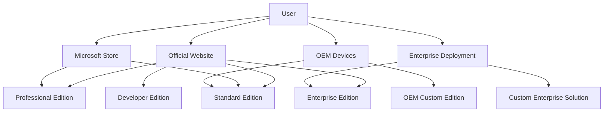
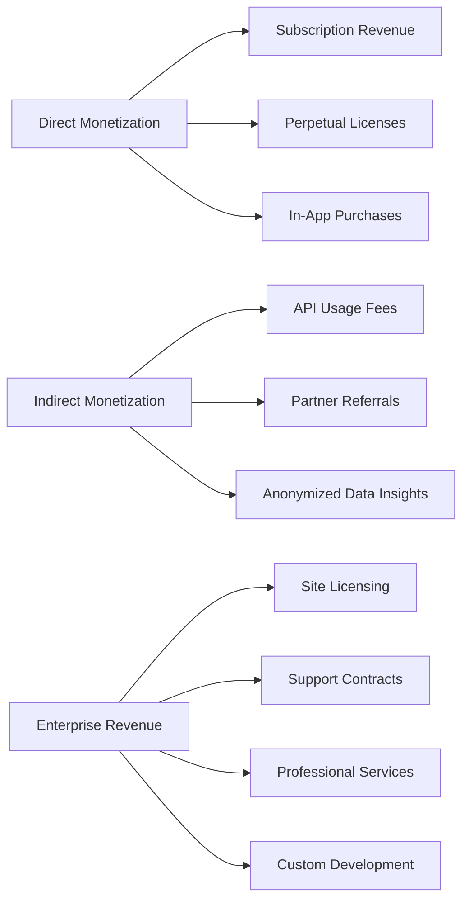
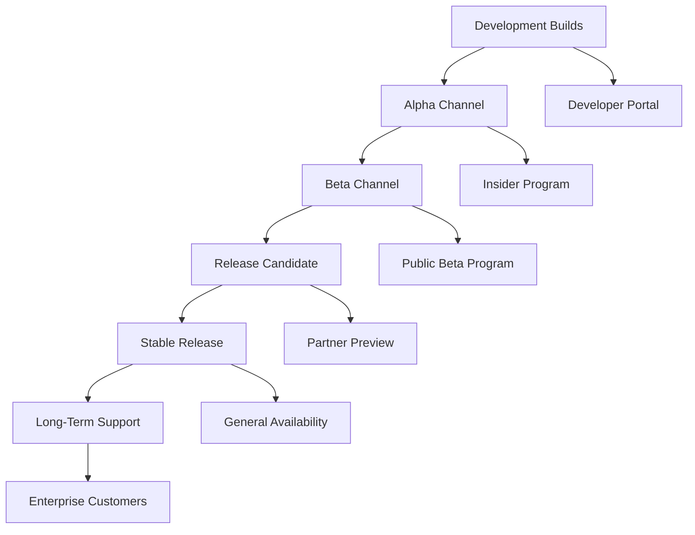
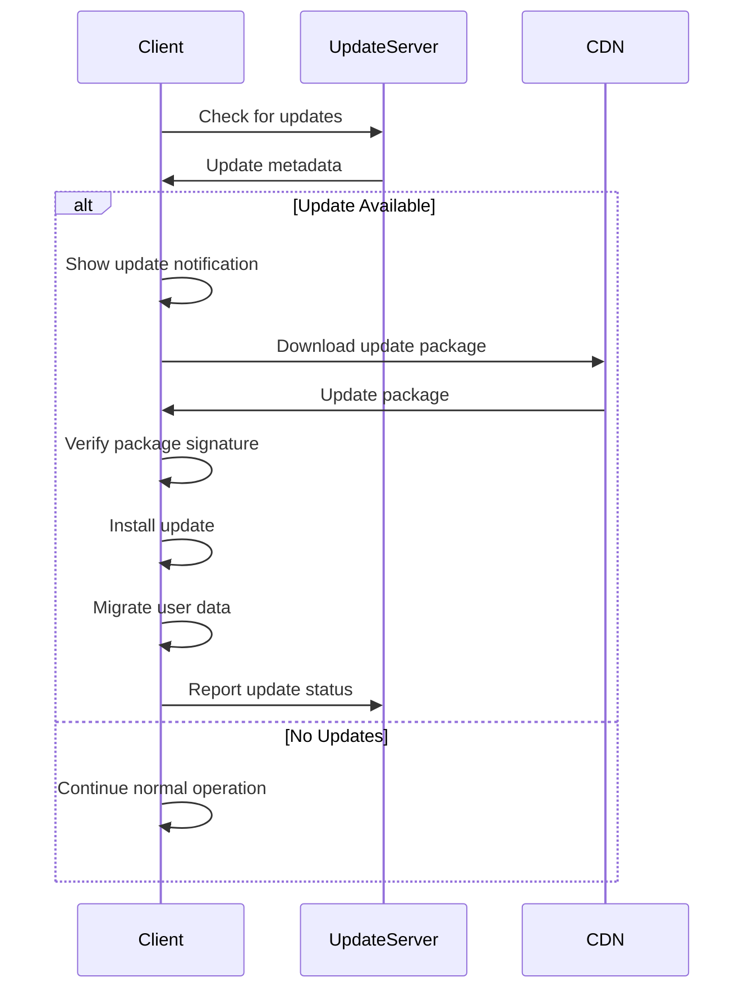
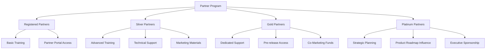
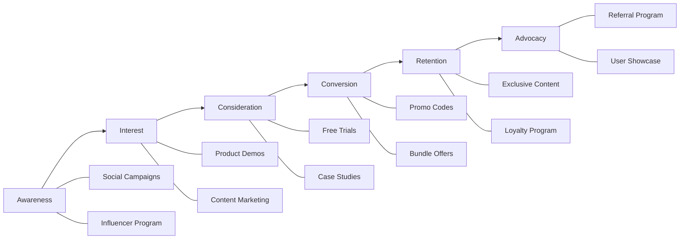
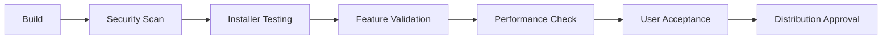
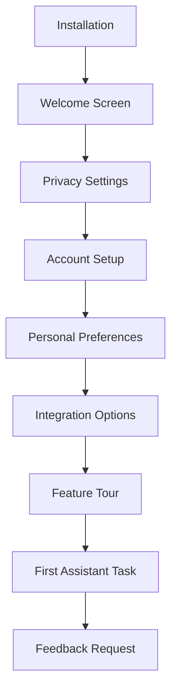
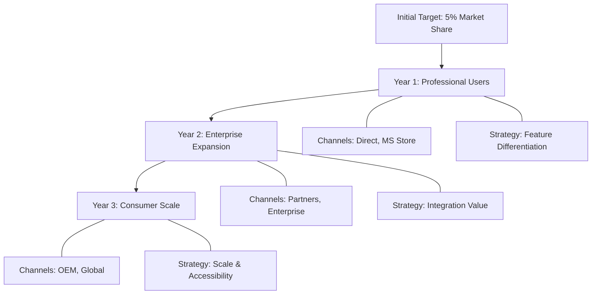

# Distribution Strategy

## Overview

This document outlines the comprehensive strategy for distributing the Virtual Personal Assistant (VPA) to end users across various channels and markets. The distribution strategy focuses on maximizing user adoption, ensuring quality experiences, and maintaining the integrity of the VPA platform.

## Table of Contents

1. [Target Audience](#target-audience)
2. [Distribution Channels](#distribution-channels)
3. [Distribution Models](#distribution-models)
4. [Licensing and Monetization](#licensing-and-monetization)
5. [Version Management](#version-management)
6. [Update Distribution](#update-distribution)
7. [Platform Support](#platform-support)
8. [Regional Availability](#regional-availability)
9. [Partner Distribution](#partner-distribution)
10. [Marketing Integration](#marketing-integration)
11. [Analytics and Tracking](#analytics-and-tracking)
12. [Quality Assurance](#quality-assurance)
13. [User Onboarding](#user-onboarding)
14. [Distribution Timeline](#distribution-timeline)
15. [Competitive Analysis](#competitive-analysis)
16. [Compliance and Legal Considerations](#compliance-and-legal-considerations)

## Target Audience

The VPA distribution strategy addresses the following primary audience segments:

### Individual Users

- **Home Users**: Personal productivity, entertainment, home automation
- **Professionals**: Productivity enhancement, scheduling, task management
- **Students**: Research assistance, study tools, organization
- **Elderly/Accessibility Users**: Simplified digital interaction, assistance features

### Business Users

- **Small Business**: Cost-effective productivity enhancement, basic automation
- **Enterprise**: Corporate workflow integration, security-focused deployment
- **Remote Workers**: Collaboration tools, workflow management

### Developer Community

- **Plugin Developers**: Creating VPA extensions and integrations
- **Integration Partners**: Embedding VPA functionality into other applications
- **Research Partners**: Advanced AI and voice recognition applications

### Audience Requirements Analysis

| Audience Segment | Technical Proficiency | Security Requirements | Integration Needs | Update Frequency | Support Level |
|-----------------|------------------------|----------------------|-------------------|-----------------|--------------|
| Home Users | Low-Medium | Basic | Smart Home, Entertainment | Automatic | Standard |
| Professionals | Medium | Medium | Productivity Apps, Calendar | Regular | Premium |
| Enterprise | High | Very High | Business Systems, Custom Apps | Controlled | Enterprise |
| Developers | Very High | Variable | APIs, SDKs, Documentation | Frequent | Developer |

## Distribution Channels

VPA will be distributed through the following channels:

### Direct Distribution

- **Official Website**: Primary download portal with all editions and documentation
- **Developer Portal**: Access to SDKs, APIs, and developer resources
- **Enterprise Sales**: Direct sales channel for enterprise licensing and custom deployments

### Partner Channels

- **Microsoft Store**: Distribution through the official Windows app marketplace
- **OEM Partnerships**: Pre-installation on partner hardware devices
- **Enterprise Resellers**: Distribution through authorized enterprise software resellers
- **Educational Institutions**: Special distribution programs for schools and universities

### Marketplace Integration



### Channel Management Strategy

1. **Channel Conflict Prevention**:
   - Clear pricing policies across all channels
   - Differentiated features for various distribution paths
   - Channel-specific promotion strategies

2. **Partner Requirements**:
   - Technical qualification process for partners
   - Sales and technical training requirements
   - Support capabilities validation

3. **Channel Performance Metrics**:
   - Monthly acquisition metrics by channel
   - User satisfaction scores by distribution source
   - Cost of acquisition by channel

## Distribution Models

VPA will be offered under multiple distribution models:

### Free Edition

- **Features**: Core VPA functionality, basic integrations
- **Limitations**: Limited API calls, standard voice models only
- **Target**: Individual users, students, trial users
- **Goal**: Maximize user base, platform adoption

### Premium Subscription

- **Features**: Advanced functionality, priority processing, extended integrations
- **Pricing**: Monthly or annual subscription
- **Target**: Professionals, power users
- **Goal**: Recurring revenue, engaged user base

### Enterprise Licensing

- **Features**: Full functionality, advanced security, custom deployment
- **Pricing**: Per-seat licensing or site licensing
- **Target**: Businesses, organizations
- **Goal**: Enterprise adoption, higher-value deployments

### OEM Bundling

- **Features**: Customized for device integration
- **Pricing**: Negotiated with OEM partners
- **Target**: Hardware manufacturers
- **Goal**: Expand reach through device integration

### Distribution Model Comparison

| Feature | Free Edition | Premium Subscription | Enterprise License | OEM Bundle |
|---------|-------------|----------------------|-------------------|------------|
| Core Assistant | ✓ | ✓ | ✓ | ✓ |
| Voice Recognition | Basic | Advanced | Advanced | Customizable |
| API Limits | Restricted | High | Very High | Negotiable |
| Offline Features | Limited | Full | Full | Customizable |
| Custom Branding | ✗ | ✗ | ✓ | ✓ |
| Integration Options | Basic | Extended | Full | Customizable |
| Support | Community | Priority | Dedicated | Partner Support |
| Custom Deployment | ✗ | ✗ | ✓ | ✓ |
| Price | Free | $7.99/month | Custom | Negotiated |

## Licensing and Monetization

### Licensing Structure

The VPA licensing structure provides flexibility across different market segments:

1. **Personal License**:
   - Single-user license for individual users
   - Free tier with basic functionality
   - Premium tier with subscription-based pricing

2. **Business License**:
   - Per-user licensing for small to medium businesses
   - Tiered pricing based on user count
   - Additional fees for premium support and features

3. **Enterprise License**:
   - Site licensing option for large organizations
   - Volume discounts based on deployment size
   - Customization and integration services

4. **OEM License**:
   - Custom licensing for hardware manufacturers
   - Revenue sharing models available
   - Branding and customization options

### Revenue Models



### Pricing Strategy

| Edition | Monthly Price | Annual Price | Volume Discounts |
|---------|--------------|-------------|-----------------|
| Free | $0 | $0 | N/A |
| Premium Individual | $7.99 | $79.99 (17% savings) | N/A |
| Business (per user) | $12.99 | $129.99 (17% savings) | 10%+ for 50+ users |
| Enterprise | Custom | Custom | Negotiated |
| OEM | N/A | N/A | Negotiated |

### License Management System

VPA will use a cloud-based license management system with the following features:

- **License Activation**: Online and offline activation options
- **License Verification**: Regular verification with grace periods
- **Usage Tracking**: Anonymous usage statistics for licensed features
- **Self-Service Portal**: License management dashboard for customers

## Version Management

### Version Naming Convention

VPA will follow semantic versioning with the following structure:

- **Major Version** (X.0.0): Significant new features, major UI changes
- **Minor Version** (0.X.0): New functionality, minor UI enhancements
- **Patch Version** (0.0.X): Bug fixes and security updates

### Edition Designations

- **VPA Standard**: Base edition for personal use
- **VPA Professional**: Enhanced edition for professional users
- **VPA Enterprise**: Full-featured edition for business deployment
- **VPA Developer**: Special edition with development tools

### Release Channels



### Release Timeline

| Release Type | Frequency | Support Period | Target Audience |
|-------------|-----------|---------------|----------------|
| Development | Continuous | None | Internal Only |
| Alpha | Bi-weekly | Current version only | Developer partners |
| Beta | Monthly | Current version only | Insider program |
| Release Candidate | Before major release | 1 month | Partners & testers |
| Stable | Quarterly | 1 year | All users |
| Long-Term Support | Yearly | 3 years | Enterprise customers |

## Update Distribution

### Update Mechanisms

VPA will use a robust update distribution system with these features:

1. **In-Application Updates**:
   - Automatic background checking
   - Configurable download and installation
   - Rollback capability for failed updates

2. **Enterprise Update Management**:
   - WSUS integration for enterprise environments
   - Group Policy control options
   - Staged rollout capability

3. **Offline Updates**:
   - Downloadable update packages
   - Side-loading capability for airgapped environments
   - Cumulative update options

### Update Process Flow



### Update Policies

| Policy | Free Edition | Premium | Enterprise |
|--------|-------------|---------|------------|
| Update Frequency | Automatic | User-controlled | IT-controlled |
| Forced Updates | Security only | Critical only | None |
| Update Notifications | All updates | All updates | Configurable |
| Deferrals | Limited | Extended | Full control |
| Bandwidth Limits | Not configurable | Configurable | Fully configurable |
| Update Windows | Anytime | Configurable | Fully configurable |

### Update Package Structure

```
update-package-1.2.0/
├── manifest.json       # Update metadata and integrity information
├── delta/              # Delta update files (smaller download)
│   ├── core-delta.bin  # Core application changes
│   ├── resource-delta.bin  # Resource file changes
├── full/               # Full update files
│   ├── VPA.exe         # Main executable
│   ├── resources/      # Resource files
├── scripts/            # Update scripts
│   ├── pre-update.ps1  # Pre-update actions
│   ├── post-update.ps1 # Post-update actions
├── rollback/           # Rollback information
│   ├── restore-points.json  # Data for rollback
```

## Platform Support

### Primary Platform

- **Windows 10/11**: Main supported platform with full functionality

### Secondary Platforms

- **Web Interface**: Browser-based limited functionality
- **Mobile Companion**: Android and iOS companion applications

### Platform Feature Matrix

| Feature | Windows | Web | Android | iOS |
|---------|---------|-----|---------|-----|
| Core Assistant | Full | Limited | Companion | Companion |
| Voice Recognition | Full | Limited | Full | Full |
| System Integration | Deep | None | Limited | Limited |
| Offline Support | Full | None | Limited | Limited |
| Plugin Support | Full | Limited | Limited | Limited |
| Data Synchronization | N/A | Full | Full | Full |

### System Requirements

**Windows Desktop Application**:
- Windows 10 (1909+) or Windows 11
- 4GB RAM (8GB recommended)
- 2GB available storage (5GB recommended)
- Microphone (for voice features)
- Internet connection (for online features)

**Web Application**:
- Modern browsers (Chrome, Edge, Firefox, Safari)
- WebRTC support
- Microphone access (for voice features)

**Mobile Companion**:
- Android 9.0+
- iOS 14.0+
- 100MB free storage
- Microphone access

## Regional Availability

### Launch Regions

Initial VPA distribution will target the following regions:

- **Phase 1** (Month 1): United States, Canada, United Kingdom
- **Phase 2** (Month 3): EU countries, Australia, New Zealand
- **Phase 3** (Month 6): Asia Pacific, Latin America, Middle East
- **Phase 4** (Month 12): Global availability

### Localization Strategy

| Region | Languages | Localized UI | Voice Models | Support |
|--------|-----------|--------------|--------------|---------|
| North America | English, Spanish, French (CA) | ✓ | ✓ | Full |
| Europe | English, German, French, Spanish, Italian | ✓ | ✓ | Full |
| UK | English | ✓ | ✓ | Full |
| Asia Pacific | English, Japanese, Korean | ✓ | Partial | Business Hours |
| Latin America | Spanish, Portuguese | ✓ | Partial | Business Hours |
| Middle East | English, Arabic | Partial | Limited | Limited |
| Other Regions | English | ✗ | ✗ | Email only |

### Regional Compliance

Each region will have specific compliance requirements addressed:

- **North America**: CCPA (California), PIPEDA (Canada)
- **Europe**: GDPR, ePrivacy Directive
- **Asia Pacific**: PDPA (Singapore), APPI (Japan)
- **Global**: ISO 27001, SOC 2

## Partner Distribution

### Partner Types

VPA will establish distribution partnerships in these categories:

1. **OEM Partners**: Hardware manufacturers integrating VPA
2. **ISV Partners**: Software vendors integrating VPA capabilities
3. **Channel Partners**: Value-added resellers and distributors
4. **Technology Partners**: Complementary technology providers

### Partner Program Structure



### Partner Requirements and Benefits

| Partner Level | Revenue Requirement | Certification Requirements | Marketing Commitment | Benefits |
|--------------|-------------------|--------------------------|---------------------|---------|
| Registered | None | None | None | Basic access, documentation |
| Silver | $50K annual | 2 certified staff | Co-branding | Support, NFR licenses |
| Gold | $250K annual | 5 certified staff | Joint marketing | Dedicated support, roadmap access |
| Platinum | $1M+ annual | 10 certified staff | Success stories | Strategic relationship, influence |

### Partner Integration Options

1. **API Integration**: REST API access for basic integration
2. **SDK Integration**: Deep integration with partner applications
3. **White Label**: Customized VPA solutions with partner branding
4. **Custom Development**: Tailored solutions for key partners

## Marketing Integration

The distribution strategy will be coordinated with marketing efforts:

### Launch Marketing

1. **Pre-Launch Activities**:
   - Private beta program (3 months before launch)
   - Partner preview access (2 months before launch)
   - Media briefings (1 month before launch)
   - Teaser campaign (2 weeks before launch)

2. **Launch Activities**:
   - Press release and media kit
   - Influencer program activation
   - Launch event (virtual and in-person)
   - Social media campaign
   - Partner announcement coordination

3. **Post-Launch Activities**:
   - User testimonial collection
   - Success story development
   - Review management
   - Feature highlight campaign

### Ongoing Marketing Support



### Marketing Asset Distribution

Marketing assets will be distributed through:

- **Partner Portal**: For channel and technology partners
- **Press Kit**: For media and influencers
- **Developer Resources**: For developer community
- **Sales Enablement**: For internal teams and resellers

## Analytics and Tracking

### Distribution Analytics

VPA will implement comprehensive distribution analytics:

1. **Acquisition Metrics**:
   - Downloads by channel
   - Installs by region
   - Conversion rates (download-to-install)
   - Acquisition cost by channel

2. **Activation Metrics**:
   - First-run completion rate
   - Feature discovery rate
   - Initial engagement metrics
   - Time-to-value measurements

3. **Engagement Metrics**:
   - Daily and monthly active users
   - Session frequency and duration
   - Feature usage patterns
   - User retention rates

### Telemetry Implementation

```python
# Example telemetry implementation for distribution tracking
from vpa.telemetry import analytics

class DistributionAnalytics:
    """Analytics for tracking VPA distribution"""
    
    def __init__(self):
        """Initialize distribution analytics"""
        self.client = analytics.AnalyticsClient()
        
    def track_installation(self, install_data):
        """Track new VPA installation"""
        event_data = {
            "event": "new_installation",
            "timestamp": datetime.now().isoformat(),
            "distribution_channel": install_data.get("channel", "unknown"),
            "source_campaign": install_data.get("campaign", "organic"),
            "installer_version": install_data.get("installer_version"),
            "os_version": platform.platform(),
            "language": install_data.get("language", "en-US"),
            "edition": install_data.get("edition", "standard"),
            "installation_id": str(uuid.uuid4())
        }
        
        # Add referral information if available
        if install_data.get("referral_code"):
            event_data["referral_code"] = install_data["referral_code"]
            
        # Add partner information if applicable
        if install_data.get("partner_id"):
            event_data["partner_id"] = install_data["partner_id"]
            event_data["partner_type"] = install_data.get("partner_type")
            
        # Send installation event
        self.client.track_event(event_data)
    
    def track_activation(self, user_id, activation_data):
        """Track user activation"""
        event_data = {
            "event": "user_activation",
            "user_id": user_id,
            "timestamp": datetime.now().isoformat(),
            "time_to_activate": activation_data.get("time_since_install"),
            "completed_onboarding": activation_data.get("completed_onboarding", False),
            "initial_features_used": activation_data.get("features_used", []),
            "account_type": activation_data.get("account_type", "standard")
        }
        
        self.client.track_event(event_data)
    
    def track_license_activation(self, license_data):
        """Track license activation"""
        event_data = {
            "event": "license_activation",
            "license_id": license_data["license_id"],
            "license_type": license_data["license_type"],
            "user_id": license_data["user_id"],
            "timestamp": datetime.now().isoformat(),
            "seats_activated": license_data.get("seats_activated", 1),
            "seats_total": license_data.get("seats_total", 1),
            "activation_method": license_data.get("activation_method", "online")
        }
        
        self.client.track_event(event_data)
```

### Dashboard and Reporting

Distribution performance will be tracked through:

1. **Real-time Dashboard**: Live distribution metrics
2. **Weekly Distribution Report**: Channel and regional performance
3. **Monthly Executive Summary**: Overall distribution performance
4. **Partner Performance Reports**: Channel-specific analytics

## Quality Assurance

### Distribution QA Process

A robust QA process will ensure quality across distribution channels:

1. **Pre-Distribution Testing**:
   - Installer validation on all supported platforms
   - Clean and upgrade installation paths
   - Permissions and security verification
   - Integration testing with partner systems

2. **Staged Rollout**:
   - Canary release to limited users (1%)
   - Monitoring for critical issues
   - Gradual expansion to wider audience
   - Full rollout after validation

3. **Post-Distribution Monitoring**:
   - Installation success rates
   - Error telemetry analysis
   - User feedback collection
   - Performance benchmarking

### Testing Matrix

| Test Type | Description | Pre-Release | Each Release | Major Release |
|-----------|-------------|-------------|--------------|---------------|
| Installer Validation | Test all installation paths | ✓ | ✓ | ✓ |
| Upgrade Testing | Test upgrading from previous versions | ✓ | ✓ | ✓ |
| Permissions Testing | Verify correct permission handling | ✓ | ✓ | ✓ |
| Multi-language Testing | Test localized installers | ✗ | ✗ | ✓ |
| Offline Installation | Test offline installation scenarios | ✗ | ✓ | ✓ |
| Uninstall Testing | Verify clean uninstallation | ✓ | ✓ | ✓ |
| Security Scanning | Scan packages for vulnerabilities | ✓ | ✓ | ✓ |

### Quality Gates

Each distribution must pass these quality gates:



## User Onboarding

### First-Run Experience

The VPA distribution will include a streamlined onboarding process:

1. **Welcome Flow**:
   - Platform introduction
   - Key feature highlights
   - Personalization options
   - Privacy settings configuration

2. **Feature Discovery**:
   - Guided tour of key features
   - Interactive tutorials
   - Contextual help elements
   - Progressive feature introduction

3. **Integration Setup**:
   - Account connections
   - System integration options
   - Notification preferences
   - Data synchronization options

### Onboarding Metrics

Onboarding success will be measured through:

- **Completion Rate**: Percentage of users completing onboarding
- **Time-to-Value**: Time until users engage with core features
- **Feature Discovery**: Number of features discovered in first week
- **Help Access**: Frequency of help resource access

### Sample Onboarding Flow



## Distribution Timeline

The VPA distribution will follow this timeline:

### Phase 1: Initial Release (September 2025)

- **Month 1**: Limited release to key markets
  - Standard and Professional editions
  - Windows platform only
  - English language support
  - Direct and Microsoft Store distribution

- **Month 2-3**: Market expansion
  - Additional language support
  - Partner onboarding
  - Initial OEM discussions

### Phase 2: Enterprise and Partner Expansion (December 2025)

- **Month 4-6**: Enterprise edition launch
  - Full enterprise features
  - Volume licensing program
  - Partner certification program
  - Initial OEM deployments

### Phase 3: Platform Expansion (March 2026)

- **Month 7-9**: Secondary platform launch
  - Web interface availability
  - Mobile companion apps
  - Expanded language support
  - Advanced API access

### Phase 4: Global Scale (June 2026)

- **Month 10-12**: Global availability
  - Worldwide distribution
  - Localization for major markets
  - Full partner ecosystem
  - Advanced integration options

## Competitive Analysis

### Market Positioning

VPA's distribution strategy positions it against competitors:

| Competitor | Target Audience | Distribution Channel | Pricing Model | Differentiator |
|------------|----------------|---------------------|--------------|----------------|
| Competitor A | Consumer | App stores, direct | Freemium | Consumer focus, ease of use |
| Competitor B | Enterprise | Direct sales | Enterprise licensing | Security, integration |
| Competitor C | Developers | Developer platforms | Usage-based | Extensibility, API-first |
| VPA | All segments | Multi-channel | Tiered + custom | Flexibility, privacy focus |

### Competitive Advantage in Distribution

VPA will differentiate its distribution through:

1. **Privacy-First Approach**: Emphasizing local processing and data control
2. **Flexible Deployment**: Supporting various deployment models
3. **Integration Capabilities**: Extensive API and plugin ecosystem
4. **Enterprise Readiness**: Security and compliance focus
5. **User Experience**: Streamlined onboarding and intuitive interface

### Market Share Strategy



## Compliance and Legal Considerations

### Legal Requirements

The VPA distribution must comply with:

1. **Licensing Compliance**:
   - Open source license compliance
   - Third-party component licensing
   - Proper attribution in distributions

2. **Privacy Regulations**:
   - GDPR (EU)
   - CCPA (California)
   - PIPEDA (Canada)
   - LGPD (Brazil)
   - Other regional requirements

3. **Export Compliance**:
   - Export Administration Regulations (EAR)
   - Restricted country limitations
   - Encryption export controls

4. **Accessibility Compliance**:
   - ADA requirements
   - Section 508 compliance
   - WCAG 2.1 guidelines

### Documentation Requirements

Each distribution package will include:

- **End User License Agreement (EULA)**
- **Privacy Policy**
- **Third-Party Notices**
- **Support Information**
- **Security Documentation** (for enterprise)

### Compliance Checklist

| Requirement | Implementation | Validation Method | Responsible Party |
|------------|----------------|-------------------|------------------|
| License Compliance | License scanning | Automated + manual review | Legal team |
| Open Source Attribution | Attribution document | Document review | Legal + Engineering |
| Privacy Disclosures | Privacy policy | Regional legal review | Legal + Privacy team |
| Data Processing Agreements | Template DPA | Legal review | Legal team |
| Export Compliance | Distribution restrictions | Geo-fencing, checks | Legal + Operations |
| Accessibility | WCAG guidelines | Accessibility testing | UX + Engineering |
| Security Documentation | Security white paper | Security review | Security team |

---

*Document created: August 29, 2025*  
*Author: VPA Distribution Team*
