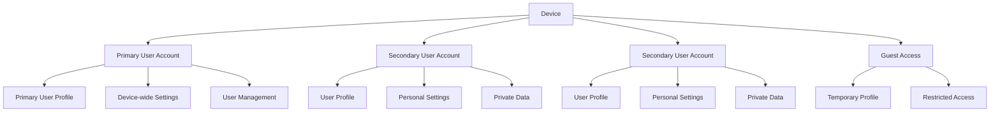
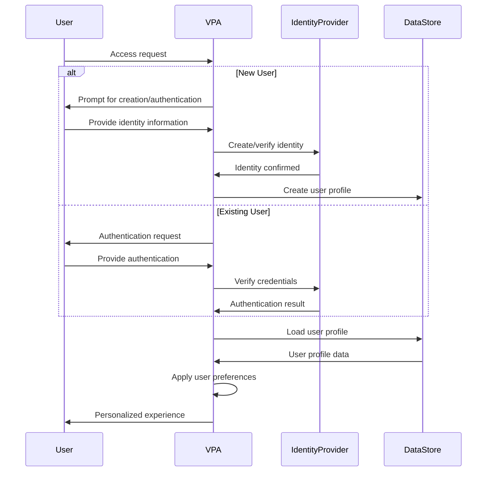
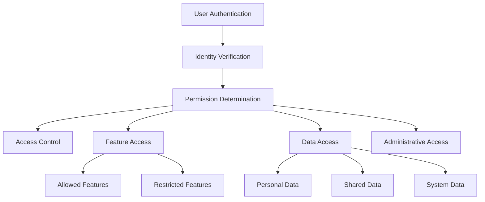
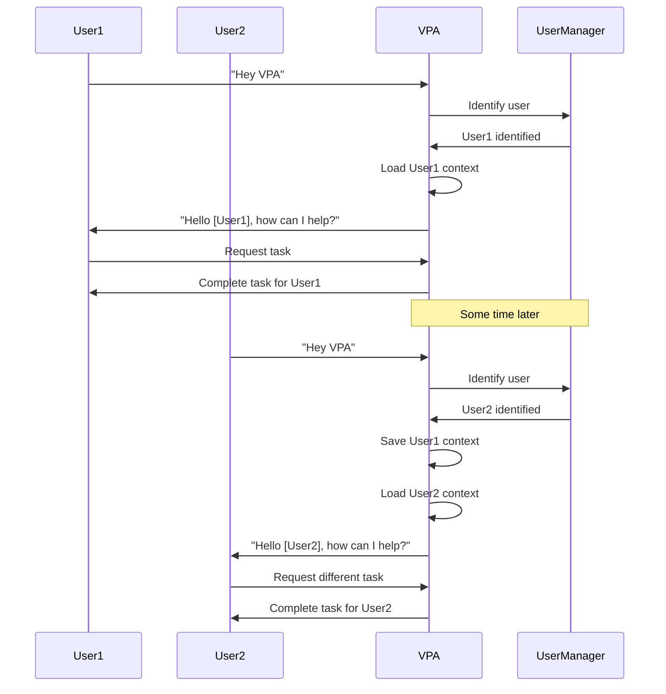
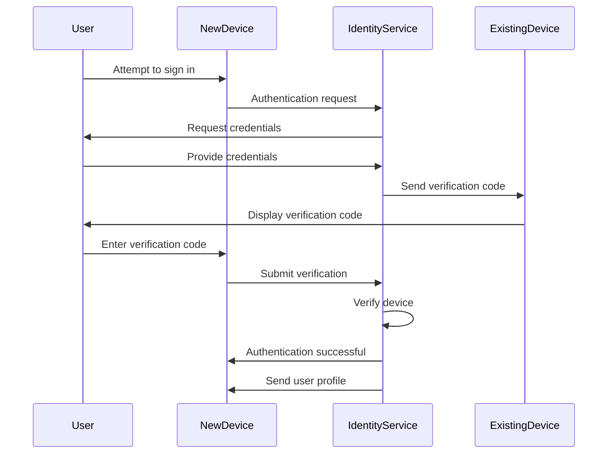
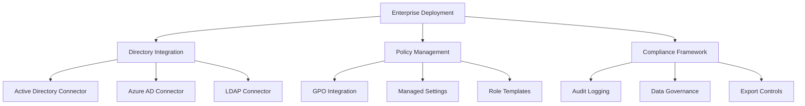
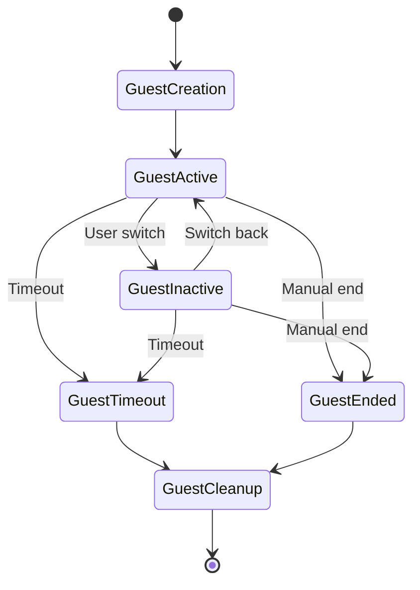
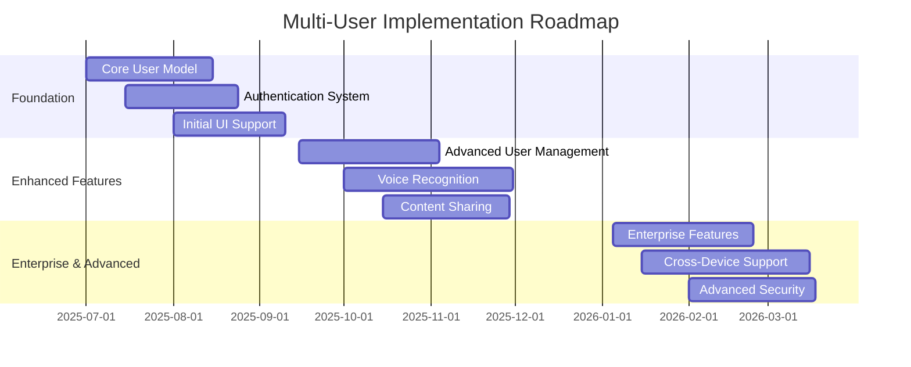

# Multi-User Strategy

## Overview

This document outlines the comprehensive strategy for implementing and managing multiple user support in the Virtual Personal Assistant (VPA). The multi-user strategy addresses how VPA will handle multiple users on the same device or across multiple devices, ensuring personalized experiences while maintaining privacy and security.

## Table of Contents

1. [User Model Architecture](#user-model-architecture)
2. [User Profile Management](#user-profile-management)
3. [Authentication and Authorization](#authentication-and-authorization)
4. [Data Isolation and Security](#data-isolation-and-security)
5. [Resource Management](#resource-management)
6. [User Experience Considerations](#user-experience-considerations)
7. [Shared vs. Private Content](#shared-vs-private-content)
8. [Cross-Device User Experience](#cross-device-user-experience)
9. [Family and Household Support](#family-and-household-support)
10. [Enterprise Multi-User Support](#enterprise-multi-user-support)
11. [User Switching and Fast User Switching](#user-switching-and-fast-user-switching)
12. [Guest Mode](#guest-mode)
13. [Multi-User Voice Recognition](#multi-user-voice-recognition)
14. [Telemetry and Analytics](#telemetry-and-analytics)
15. [Implementation Roadmap](#implementation-roadmap)

## User Model Architecture

### Core Multi-User Design

VPA implements a hierarchical user model with the following components:



### User Types and Permissions

| User Type | Profile | Device Settings | User Management | Data Persistence | Resource Access |
|-----------|---------|----------------|----------------|-----------------|----------------|
| Primary | Full | Full control | Can manage all users | Permanent | Unrestricted |
| Secondary | Full | Limited | Self-management only | Permanent | Standard allocation |
| Child | Restricted | None | None | Permanent | Limited & monitored |
| Guest | Minimal | None | None | Temporary | Very restricted |

### User Domain Model

The core user domain model includes these key entities:

```python
class User:
    """Core user entity"""
    user_id: UUID
    username: str
    display_name: str
    email: str
    user_type: UserType  # Primary, Secondary, Child, Guest
    created_date: datetime
    last_login: datetime
    status: UserStatus  # Active, Inactive, Suspended
    preferences: Dict[str, Any]
    
class UserProfile:
    """User profile containing personalization"""
    profile_id: UUID
    user_id: UUID
    voice_model: bytes  # Voice recognition model
    language_preferences: List[str]
    theme_preferences: Dict[str, Any]
    accessibility_settings: Dict[str, Any]
    notification_settings: Dict[str, Any]
    
class UserPermissions:
    """Permissions associated with a user"""
    user_id: UUID
    role: UserRole  # Admin, Standard, Restricted, Guest
    capabilities: List[Capability]
    restrictions: List[Restriction]
    
class UserData:
    """Container for user data"""
    user_id: UUID
    preferences: Dict[str, Any]  # User preferences
    history: List[HistoryItem]  # User interaction history
    saved_items: List[SavedItem]  # User saved content
    connected_services: List[ConnectedService]  # External service connections
```

### User Identity and Access Management Flow



## User Profile Management

### Profile Components

Each user profile consists of the following components:

1. **Core Identity**:
   - Username and display name
   - Authentication credentials
   - Account status and type

2. **Personalization Settings**:
   - Voice recognition model
   - Language preferences
   - UI customizations
   - Accessibility settings

3. **Application Data**:
   - Usage history
   - Saved queries and responses
   - Task lists and reminders
   - Personalized recommendations

4. **Integration Settings**:
   - Connected services
   - API authorizations
   - Device connections
   - Notification preferences

### Profile Creation and Onboarding

The profile creation flow includes:

1. **Identity Creation**:
   - Username selection
   - Password setting
   - Optional email verification
   - User type selection (by primary user)

2. **Personalization**:
   - Voice sample collection
   - Language selection
   - Theme preferences
   - Initial interest areas

3. **Privacy Settings**:
   - Data retention options
   - Sharing preferences
   - Activity history settings
   - Third-party integration permissions

4. **Service Connections**:
   - Calendar integration
   - Email connection
   - Cloud storage access
   - Other service authorizations

### Profile Data Storage

```python
# Example profile data storage implementation
from vpa.storage import secure_storage
from vpa.models import User, UserProfile, UserPreferences
import uuid

class ProfileManager:
    """Manages user profiles"""
    
    def __init__(self, storage_provider=None):
        """Initialize with storage provider"""
        self.storage = storage_provider or secure_storage.SecureStorageProvider()
    
    def create_user_profile(self, user_data):
        """Create a new user profile"""
        # Generate unique ID
        user_id = str(uuid.uuid4())
        
        # Create base user
        user = User(
            user_id=user_id,
            username=user_data['username'],
            display_name=user_data['display_name'],
            email=user_data.get('email', ''),
            user_type=user_data['user_type'],
            created_date=datetime.now(),
            last_login=datetime.now(),
            status='active'
        )
        
        # Create initial profile
        profile = UserProfile(
            profile_id=str(uuid.uuid4()),
            user_id=user_id,
            language_preferences=[user_data.get('language', 'en-US')],
            theme_preferences=user_data.get('theme', {'mode': 'system'}),
            accessibility_settings=user_data.get('accessibility', {})
        )
        
        # Create preferences
        preferences = UserPreferences(
            user_id=user_id,
            notification_settings=user_data.get('notifications', {'enabled': True}),
            privacy_settings=user_data.get('privacy', {'history_retention': 90})
        )
        
        # Store data in secure storage
        self.storage.store_user(user)
        self.storage.store_profile(profile)
        self.storage.store_preferences(preferences)
        
        # Initialize empty data collections
        self.storage.initialize_user_data(user_id)
        
        return user_id
    
    def load_user_profile(self, user_id):
        """Load a user profile by ID"""
        user = self.storage.get_user(user_id)
        profile = self.storage.get_profile(user_id)
        preferences = self.storage.get_preferences(user_id)
        
        return {
            'user': user,
            'profile': profile,
            'preferences': preferences
        }
    
    def update_profile(self, user_id, profile_data):
        """Update user profile data"""
        current_profile = self.storage.get_profile(user_id)
        
        # Update only provided fields
        for key, value in profile_data.items():
            if hasattr(current_profile, key):
                setattr(current_profile, key, value)
        
        self.storage.store_profile(current_profile)
        return current_profile
```

### Profile Synchronization

For users with multiple devices, profile synchronization works as follows:

1. **Core Synchronization Model**:
   - Cloud-based profile storage (optional)
   - Incremental sync for bandwidth efficiency
   - Conflict resolution for simultaneous changes
   - Offline capability with later synchronization

2. **Sync Categories**:
   - Essential settings (always synced)
   - Personalization (optional sync)
   - History and content (optional sync)
   - Service connections (device-specific options)

3. **Sync Frequency**:
   - Real-time for critical data
   - Background sync for non-critical data
   - Manual sync option for user control
   - Bandwidth-aware sync throttling

## Authentication and Authorization

### Authentication Methods

VPA supports multiple authentication methods to accommodate different user needs:

1. **Local Authentication**:
   - Password-based authentication
   - PIN code for quick access
   - Windows Hello integration (fingerprint, facial recognition)
   - Pattern or gesture authentication

2. **Single Sign-On (SSO)**:
   - Microsoft Account integration
   - SAML 2.0 support for enterprise environments
   - OAuth 2.0 for third-party identity providers
   - OIDC compliant authentication

3. **Specialized Authentication**:
   - Voice biometric authentication (supplementary)
   - Two-factor authentication support
   - Hardware token support
   - Proximity-based authentication (e.g., smartphone presence)

### Authorization Framework



### Role-Based Access Control

VPA implements a role-based access control (RBAC) system with these default roles:

| Role | Description | Permissions |
|------|-------------|------------|
| Administrator | Primary user with full control | All system settings, user management, data management |
| Standard User | Regular user with personal profile | Personal settings, own data, shared features |
| Restricted User | Limited user (e.g., child account) | Limited feature set, restricted integrations, monitored activity |
| Guest User | Temporary access | Basic assistant features only, no data persistence |

### Permission Model

```python
# Example permission model implementation
from enum import Enum, auto

class Permission(Enum):
    """Granular permissions for VPA features"""
    # System permissions
    MANAGE_USERS = auto()
    CHANGE_SYSTEM_SETTINGS = auto()
    VIEW_SYSTEM_LOGS = auto()
    
    # Feature permissions
    USE_VOICE_RECOGNITION = auto()
    USE_ADVANCED_FEATURES = auto()
    INSTALL_PLUGINS = auto()
    
    # Data permissions
    ACCESS_PERSONAL_DATA = auto()
    ACCESS_SHARED_DATA = auto()
    EXPORT_DATA = auto()
    
    # Integration permissions
    CONNECT_EXTERNAL_SERVICES = auto()
    ACCESS_CALENDAR = auto()
    ACCESS_EMAIL = auto()
    
class Role:
    """Role definition with associated permissions"""
    def __init__(self, name, description, permissions):
        self.name = name
        self.description = description
        self.permissions = set(permissions)
    
    def has_permission(self, permission):
        """Check if role has specific permission"""
        return permission in self.permissions

# Define standard roles
ADMINISTRATOR_ROLE = Role(
    "Administrator",
    "Full system access and control",
    [perm for perm in Permission]
)

STANDARD_USER_ROLE = Role(
    "Standard User",
    "Regular user with personal profile",
    [
        Permission.USE_VOICE_RECOGNITION,
        Permission.USE_ADVANCED_FEATURES,
        Permission.ACCESS_PERSONAL_DATA,
        Permission.CONNECT_EXTERNAL_SERVICES,
        Permission.ACCESS_CALENDAR,
        Permission.ACCESS_EMAIL,
        Permission.INSTALL_PLUGINS
    ]
)

RESTRICTED_USER_ROLE = Role(
    "Restricted User",
    "Limited access user",
    [
        Permission.USE_VOICE_RECOGNITION,
        Permission.ACCESS_PERSONAL_DATA
    ]
)

GUEST_USER_ROLE = Role(
    "Guest",
    "Temporary access",
    [
        Permission.USE_VOICE_RECOGNITION
    ]
)
```

## Data Isolation and Security

### Data Isolation Architecture

VPA implements a comprehensive data isolation architecture to maintain separation between user data:

1. **Storage Isolation**:
   - Per-user encrypted storage containers
   - Separate database schemas or tables per user
   - Isolated file system paths with access controls
   - In-memory data isolation during runtime

2. **Encryption Strategy**:
   - Per-user encryption keys
   - Separate encryption of sensitive data
   - Key management tied to user authentication
   - Optional additional encryption for sensitive users

3. **Access Control**:
   - Fine-grained access control lists (ACLs)
   - Runtime permission enforcement
   - Audit logging of cross-user data access
   - Mandatory access controls for sensitive operations

### Data Security Implementation

```python
# Example data security implementation
from cryptography.fernet import Fernet
from cryptography.hazmat.primitives import hashes
from cryptography.hazmat.primitives.kdf.pbkdf2 import PBKDF2HMAC
import base64
import os

class UserDataSecurity:
    """Handles security for user data"""
    
    def __init__(self, security_provider=None):
        """Initialize with security provider"""
        self.security_provider = security_provider
    
    def generate_user_key(self, user_id, auth_secret):
        """Generate a user-specific encryption key derived from auth"""
        # Create salt from user ID
        salt = user_id.encode('utf-8')
        
        # Derive key using PBKDF2
        kdf = PBKDF2HMAC(
            algorithm=hashes.SHA256(),
            length=32,
            salt=salt,
            iterations=100000
        )
        
        key = base64.urlsafe_b64encode(kdf.derive(auth_secret.encode('utf-8')))
        return key
    
    def encrypt_user_data(self, user_id, auth_secret, data):
        """Encrypt data for specific user"""
        key = self.generate_user_key(user_id, auth_secret)
        f = Fernet(key)
        encrypted_data = f.encrypt(data.encode('utf-8'))
        return encrypted_data
    
    def decrypt_user_data(self, user_id, auth_secret, encrypted_data):
        """Decrypt user data"""
        key = self.generate_user_key(user_id, auth_secret)
        f = Fernet(key)
        decrypted_data = f.decrypt(encrypted_data)
        return decrypted_data.decode('utf-8')
    
    def secure_user_container(self, user_id):
        """Create secure container for user data"""
        # Create user-specific data directory
        user_data_path = os.path.join('data', 'users', user_id)
        os.makedirs(user_data_path, exist_ok=True)
        
        # Set appropriate permissions
        os.chmod(user_data_path, 0o700)  # Only owner can access
        
        return user_data_path
```

### Privacy Boundaries

Clear privacy boundaries are established between user accounts:

1. **Data Separation Guarantees**:
   - Technical isolation of user data
   - No cross-user data sharing without explicit consent
   - Transparency in any shared usage contexts
   - User control over privacy boundaries

2. **Shared Device Considerations**:
   - Clear transition boundaries between users
   - Visual indicators of active user
   - Session management and timeout controls
   - Cross-user content recommendations (opt-in)

3. **Family Sharing Options**:
   - Explicit consent model for data sharing
   - Parental controls for child accounts
   - Transparency in shared data elements
   - Ability to withdraw sharing consent

## Resource Management

### Computational Resource Allocation

VPA intelligently manages system resources across multiple users:

1. **Processing Allocation**:
   - Priority-based CPU allocation
   - Active user gets highest priority
   - Background processing for inactive users
   - Adaptive resource allocation based on activity

2. **Memory Management**:
   - Memory limits for inactive user processes
   - Intelligent caching of active user data
   - Memory reclamation from inactive sessions
   - Swap to disk for long-dormant users

3. **Storage Quotas**:
   - Per-user storage quotas
   - Automatic cleanup of temporary files
   - Storage usage notifications
   - Optional additional storage allocation

### Resource Monitoring and Management

```python
# Example resource manager implementation
import psutil
import threading
import time

class UserResourceManager:
    """Manages resources for multiple users"""
    
    def __init__(self, system_resources=None):
        """Initialize resource manager"""
        self.system_resources = system_resources or SystemResources()
        self.active_user = None
        self.user_processes = {}
        self.user_memory_usage = {}
        self.user_storage_usage = {}
        self.resource_locks = {}
        self.monitor_thread = None
    
    def set_active_user(self, user_id):
        """Set the currently active user"""
        self.active_user = user_id
        self._adjust_resource_priorities()
    
    def register_user_process(self, user_id, process_id, priority='normal'):
        """Register a process belonging to a user"""
        if user_id not in self.user_processes:
            self.user_processes[user_id] = []
        
        self.user_processes[user_id].append({
            'pid': process_id,
            'priority': priority
        })
        
        # Apply appropriate priority
        self._adjust_process_priority(process_id, user_id == self.active_user)
    
    def _adjust_process_priority(self, pid, is_active_user):
        """Adjust process priority based on whether it belongs to active user"""
        try:
            process = psutil.Process(pid)
            if is_active_user:
                # Higher priority for active user
                if psutil.WINDOWS:
                    process.nice(psutil.HIGH_PRIORITY_CLASS)
                else:
                    process.nice(-10)  # Lower nice value = higher priority on Unix
            else:
                # Lower priority for background users
                if psutil.WINDOWS:
                    process.nice(psutil.BELOW_NORMAL_PRIORITY_CLASS)
                else:
                    process.nice(10)  # Higher nice value = lower priority on Unix
        except:
            pass  # Process may have terminated
    
    def _adjust_resource_priorities(self):
        """Adjust all process priorities based on active user"""
        for user_id, processes in self.user_processes.items():
            is_active = user_id == self.active_user
            for process in processes:
                self._adjust_process_priority(process['pid'], is_active)
    
    def start_monitoring(self):
        """Start monitoring resource usage"""
        if self.monitor_thread is None:
            self.monitor_thread = threading.Thread(target=self._resource_monitor_thread)
            self.monitor_thread.daemon = True
            self.monitor_thread.start()
    
    def _resource_monitor_thread(self):
        """Background thread to monitor resource usage"""
        while True:
            try:
                # Update memory usage
                for user_id, processes in self.user_processes.items():
                    total_memory = 0
                    for process_info in processes:
                        try:
                            process = psutil.Process(process_info['pid'])
                            total_memory += process.memory_info().rss
                        except:
                            continue  # Process may have terminated
                    
                    self.user_memory_usage[user_id] = total_memory
                
                # Check for resource limits
                self._enforce_resource_limits()
                
                # Update storage usage
                self._update_storage_usage()
            except Exception as e:
                print(f"Resource monitoring error: {str(e)}")
            
            # Sleep between updates
            time.sleep(60)
    
    def _enforce_resource_limits(self):
        """Enforce resource limits for users"""
        # Check memory limits
        for user_id, memory_usage in self.user_memory_usage.items():
            # Skip active user
            if user_id == self.active_user:
                continue
                
            # Check if inactive user is using too much memory
            memory_limit = 500 * 1024 * 1024  # 500 MB for inactive users
            if memory_usage > memory_limit:
                # Trim memory usage for inactive user
                self._reduce_user_memory(user_id)
    
    def _reduce_user_memory(self, user_id):
        """Reduce memory usage for a user"""
        if user_id not in self.user_processes:
            return
            
        for process_info in self.user_processes[user_id]:
            try:
                # Try to reduce memory usage
                process = psutil.Process(process_info['pid'])
                # On Windows, we can use SetProcessWorkingSetSize to trim process memory
                # This is just an example and might need a platform-specific implementation
                if hasattr(process, 'memory_trim'):
                    process.memory_trim()
            except:
                continue
    
    def _update_storage_usage(self):
        """Update storage usage for users"""
        # Implement storage usage calculation
        pass
```

### Contention Management

VPA handles resource contention between multiple users with these strategies:

1. **Active User Priority**:
   - Active user always gets resource priority
   - Background users throttled during high load
   - Critical processes protected from throttling
   - Fairness algorithms for extended multi-user sessions

2. **Adaptive Resource Scheduling**:
   - Preemptive scheduling for active user tasks
   - Background processing during idle periods
   - Deferred processing for non-critical tasks
   - Workload distribution across time periods

3. **Resource Reservation**:
   - Critical feature resource reservation
   - Memory reservations for key processes
   - CPU scheduling guarantees for responsiveness
   - Storage guarantees for essential data

## User Experience Considerations

### Multi-User Interface Design

VPA's interface is designed for seamless multi-user support:

1. **User Selection Interface**:
   - Clean user switching interface
   - Visual user identification (avatars, colors)
   - Accessibility considerations in user selection
   - Voice-based user switching

2. **Personal vs. Shared Mode Indicators**:
   - Clear visual indicators of current user
   - Explicit shared mode indicators
   - Privacy status visibility
   - Session status indicators

3. **User-Aware Personalization**:
   - Dynamic interface adjustments per user
   - Personalized color schemes and themes
   - User-specific accessibility settings
   - Content organization based on user preferences

### Multi-User Interaction Flows



### Contextual User Identification

VPA employs these methods for identifying the current user:

1. **Explicit Identification**:
   - User selection screen
   - PIN/password/biometric authentication
   - Voice print identification
   - Device-based identification

2. **Implicit Identification**:
   - Voice recognition for known users
   - Usage pattern recognition
   - Physical proximity detection
   - Contextual clues from queries

3. **Disambiguation Handling**:
   - Confidence scoring for identification
   - Explicit confirmation for low confidence
   - Safe default behaviors for ambiguous identity
   - Privacy-preserving clarification questions

## Shared vs. Private Content

### Content Classification Framework

VPA categorizes content into sharing tiers:

1. **Private Content**:
   - Strictly user-specific, never shared
   - Encrypted with user-specific keys
   - Examples: Personal messages, health data, financial information

2. **Selectively Shared Content**:
   - Shared with explicit user permission
   - Fine-grained sharing controls
   - Examples: Shared to-do lists, family calendar events

3. **Common Content**:
   - Available to all users by default
   - User-specific views still possible
   - Examples: Weather information, news, device status

4. **System Content**:
   - Administrative data and configurations
   - Controlled by primary user
   - Examples: User management settings, system configurations

### Content Sharing Model

```python
# Example content sharing implementation
from enum import Enum

class SharingLevel(Enum):
    """Content sharing level enumeration"""
    PRIVATE = "private"           # Only owner can access
    SHARED_SPECIFIC = "shared"    # Shared with specific users
    COMMON = "common"             # Available to all users
    SYSTEM = "system"             # System-controlled content

class ContentItem:
    """Content item with sharing attributes"""
    def __init__(self, item_id, owner_id, content_type, content_data, sharing_level=SharingLevel.PRIVATE):
        self.item_id = item_id
        self.owner_id = owner_id
        self.content_type = content_type
        self.content_data = content_data
        self.sharing_level = sharing_level
        self.shared_with = set()  # User IDs with access
        self.created_at = datetime.now()
        self.modified_at = datetime.now()
    
    def share_with(self, user_id):
        """Share this content with a specific user"""
        if self.sharing_level == SharingLevel.PRIVATE:
            self.sharing_level = SharingLevel.SHARED_SPECIFIC
        
        if self.sharing_level == SharingLevel.SHARED_SPECIFIC:
            self.shared_with.add(user_id)
    
    def unshare_with(self, user_id):
        """Remove sharing with a specific user"""
        if user_id in self.shared_with:
            self.shared_with.remove(user_id)
            
        # If no more shared users, revert to private
        if len(self.shared_with) == 0 and self.sharing_level == SharingLevel.SHARED_SPECIFIC:
            self.sharing_level = SharingLevel.PRIVATE
    
    def make_common(self):
        """Make content available to all users"""
        self.sharing_level = SharingLevel.COMMON
        self.shared_with.clear()  # No need to track individual shares
    
    def make_private(self):
        """Make content private again"""
        self.sharing_level = SharingLevel.PRIVATE
        self.shared_with.clear()
    
    def can_access(self, user_id):
        """Check if a user can access this content"""
        # Owner always has access
        if user_id == self.owner_id:
            return True
            
        # Check sharing level
        if self.sharing_level == SharingLevel.PRIVATE:
            return False
        elif self.sharing_level == SharingLevel.SHARED_SPECIFIC:
            return user_id in self.shared_with
        elif self.sharing_level == SharingLevel.COMMON:
            return True
        elif self.sharing_level == SharingLevel.SYSTEM:
            # System content typically needs special permissions
            # This would be checked against user permissions
            return False
            
        return False
```

### Shared Content Examples

| Content Type | Default Sharing | Sharing Controls | Privacy Considerations |
|-------------|----------------|------------------|------------------------|
| Reminders | Private | Can share with specific users | Personal reminders remain private |
| Calendar | Private | Family sharing option | Joint events marked as shared |
| Shopping Lists | Private | Household sharing | Item categories can be private |
| Media Preferences | Private | Optional profile sharing | Watch history remains private |
| Smart Home Controls | Common | Permission-based | Personal routines remain private |
| Knowledge Base | Common | N/A | Query history remains private |
| News Feed | Common | Personalization private | Topic interests remain private |

## Cross-Device User Experience

### User Identity Across Devices

VPA maintains consistent user identity across multiple devices:

1. **Centralized Identity Service**:
   - Cloud-based identity management
   - Consistent authentication across devices
   - Single sign-on capabilities
   - Profile linking and management

2. **Device Association**:
   - Secure device registration process
   - User-to-device relationship management
   - Multi-factor authentication for new devices
   - Device access management

3. **Cross-Device Authentication Flow**:



### Profile Synchronization Across Devices

VPA synchronizes user profiles across devices with these components:

1. **Sync Framework**:
   - Differential synchronization
   - Conflict resolution strategies
   - Bandwidth-efficient updates
   - Background synchronization

2. **Synchronized Elements**:
   - User preferences and settings
   - Voice models and recognition data
   - Command history and patterns
   - Application state and context

3. **Device-Specific Overrides**:
   - Device-specific settings
   - Context-appropriate configurations
   - Adaptive interface adjustments
   - Hardware-specific optimizations

### Continuity Features

VPA provides seamless continuity between devices for users:

1. **Session Continuity**:
   - Handoff between devices
   - Context preservation across devices
   - Task continuation
   - Conversation history access

2. **State Synchronization**:
   - Real-time activity state
   - In-progress task status
   - Current context synchronization
   - Event notifications across devices

3. **Shared Clipboard**:
   - Secure cross-device clipboard
   - Rich content transfer
   - Contextual content suggestions
   - History of transferred items

## Family and Household Support

### Family Account Structure

VPA supports family groupings with these features:

1. **Family Group Creation**:
   - Family administrator designation
   - Family member invitation system
   - Family relationship definitions
   - Household definition and management

2. **Family Member Types**:
   - Adult members (full privileges)
   - Teen members (supervised privileges)
   - Child members (restricted privileges)
   - Guest members (temporary access)

3. **Family Settings Management**:
   - Centralized family settings
   - Per-member privacy controls
   - Content sharing preferences
   - Common calendar and scheduling

### Parental Controls

Comprehensive parental controls are available:

1. **Content Filtering**:
   - Age-appropriate responses
   - Restricted search capabilities
   - Content category blocking
   - Safe browsing enforcement

2. **Usage Controls**:
   - Screen time limits
   - Time-of-day restrictions
   - Feature access limitations
   - Application usage monitoring

3. **Monitoring Options**:
   - Activity reports for parents
   - Notification of concerning patterns
   - Location awareness features
   - Emergency override capabilities

### Family Sharing Features

```python
# Example family sharing implementation
class FamilyGroup:
    """Family group management"""
    
    def __init__(self, family_id, name):
        self.family_id = family_id
        self.name = name
        self.admin_members = set()  # User IDs of family administrators
        self.adult_members = set()  # User IDs of adult members
        self.teen_members = set()   # User IDs of teen members
        self.child_members = set()  # User IDs of child members
        self.shared_content = {}    # Shared content items
        self.shared_calendar = None  # Family calendar ID
        self.shared_lists = []      # Shared list IDs
        self.created_at = datetime.now()
    
    def add_member(self, user_id, member_type):
        """Add a member to the family group"""
        if member_type == "admin":
            self.admin_members.add(user_id)
            self.adult_members.add(user_id)
        elif member_type == "adult":
            self.adult_members.add(user_id)
        elif member_type == "teen":
            self.teen_members.add(user_id)
        elif member_type == "child":
            self.child_members.add(user_id)
        else:
            raise ValueError(f"Invalid member type: {member_type}")
    
    def remove_member(self, user_id):
        """Remove a member from the family group"""
        self.admin_members.discard(user_id)
        self.adult_members.discard(user_id)
        self.teen_members.discard(user_id)
        self.child_members.discard(user_id)
    
    def is_member(self, user_id):
        """Check if user is a family member"""
        return (user_id in self.admin_members or
                user_id in self.adult_members or
                user_id in self.teen_members or
                user_id in self.child_members)
    
    def get_member_type(self, user_id):
        """Get the member type for a user"""
        if user_id in self.admin_members:
            return "admin"
        elif user_id in self.adult_members:
            return "adult"
        elif user_id in self.teen_members:
            return "teen"
        elif user_id in self.child_members:
            return "child"
        else:
            return None
    
    def add_shared_content(self, content_id, content_type):
        """Add content to be shared with the family"""
        self.shared_content[content_id] = {
            "type": content_type,
            "added_at": datetime.now()
        }
    
    def create_shared_list(self, name, list_type):
        """Create a new shared list for the family"""
        list_id = str(uuid.uuid4())
        self.shared_lists.append({
            "id": list_id,
            "name": name,
            "type": list_type,
            "created_at": datetime.now(),
            "items": []
        })
        return list_id
```

## Enterprise Multi-User Support

### Enterprise User Management

VPA provides these enterprise-specific multi-user features:

1. **Directory Integration**:
   - Active Directory integration
   - LDAP support
   - Azure AD integration
   - SSO integration with enterprise identity

2. **Role-Based Access Control**:
   - Enterprise role definitions
   - Department-based permissions
   - Custom role creation
   - Fine-grained permission management

3. **User Provisioning**:
   - Automated user provisioning
   - Bulk user management
   - User lifecycle management
   - Just-in-time access provisioning

### Group Policies and Compliance

Enterprise deployments include these controls:

1. **Policy Enforcement**:
   - Group Policy integration
   - Mandatory settings enforcement
   - Compliance policy application
   - Configuration lockdown options

2. **Compliance Features**:
   - Audit logging of all activities
   - Compliance reporting
   - Data residency controls
   - Regulatory compliance settings

3. **Enterprise Privacy Controls**:
   - Data collection limitations
   - Usage pattern anonymization
   - Corporate data boundary enforcement
   - Legal hold capabilities

### Enterprise Multi-User Architecture



## User Switching and Fast User Switching

### User Switching Mechanisms

VPA provides multiple methods for switching between users:

1. **Explicit User Switching**:
   - User menu selection
   - Command-based switching
   - Physical button on devices
   - Hotkey combinations

2. **Voice-Based Switching**:
   - Voice identification-based switching
   - Voice command-based switching
   - Confirmation for ambiguous voice
   - Voice authentication options

3. **Automatic Switching**:
   - Presence-based detection
   - Scheduled automatic switching
   - Context-based user switching
   - Device handoff triggering switch

### Fast User Switching Implementation

```python
# Example fast user switching implementation
class UserSwitchingService:
    """Service for handling user switching"""
    
    def __init__(self, user_manager, profile_manager):
        self.user_manager = user_manager
        self.profile_manager = profile_manager
        self.current_user_id = None
        self.active_sessions = {}  # Map of user_id to session data
        self.switch_listeners = []  # Callbacks for user switch events
    
    def switch_to_user(self, user_id, authentication=None):
        """Switch to a specified user"""
        # Verify user exists
        if not self.user_manager.user_exists(user_id):
            raise ValueError(f"User does not exist: {user_id}")
        
        # If authentication provided, verify it
        if authentication is not None:
            if not self.user_manager.authenticate_user(user_id, authentication):
                raise ValueError("Authentication failed")
        
        # Save current session if we have one
        if self.current_user_id is not None:
            self._save_current_session()
        
        # Set new current user
        previous_user = self.current_user_id
        self.current_user_id = user_id
        
        # Load user session
        self._load_user_session(user_id)
        
        # Notify listeners of user switch
        self._notify_user_switch(previous_user, user_id)
        
        return True
    
    def _save_current_session(self):
        """Save the current user session state"""
        if not self.current_user_id:
            return
            
        # Collect session data
        session_data = {
            'last_active': datetime.now(),
            'current_context': self._get_current_context(),
            'active_tasks': self._get_active_tasks(),
            'ui_state': self._get_ui_state()
        }
        
        # Store in active sessions
        self.active_sessions[self.current_user_id] = session_data
    
    def _load_user_session(self, user_id):
        """Load a user session"""
        # Load user profile
        user_profile = self.profile_manager.load_user_profile(user_id)
        
        # Apply user settings
        self._apply_user_settings(user_profile)
        
        # Restore session state if available
        if user_id in self.active_sessions:
            session = self.active_sessions[user_id]
            self._restore_context(session.get('current_context'))
            self._restore_active_tasks(session.get('active_tasks'))
            self._restore_ui_state(session.get('ui_state'))
        
        # Mark session as active
        if user_id not in self.active_sessions:
            self.active_sessions[user_id] = {
                'last_active': datetime.now()
            }
    
    def _notify_user_switch(self, previous_user_id, new_user_id):
        """Notify listeners of user switch event"""
        switch_event = {
            'previous_user': previous_user_id,
            'new_user': new_user_id,
            'timestamp': datetime.now()
        }
        
        for listener in self.switch_listeners:
            try:
                listener(switch_event)
            except Exception as e:
                print(f"Error in switch listener: {str(e)}")
    
    def add_switch_listener(self, listener):
        """Add a listener for user switch events"""
        if callable(listener) and listener not in self.switch_listeners:
            self.switch_listeners.append(listener)
    
    def get_current_user(self):
        """Get the current active user ID"""
        return self.current_user_id
    
    def get_active_users(self):
        """Get list of all users with active sessions"""
        return list(self.active_sessions.keys())
    
    def _get_current_context(self):
        """Get the current context for the active user"""
        # Implementation would capture current app state
        return {}
    
    def _get_active_tasks(self):
        """Get any active tasks for the current user"""
        # Implementation would get running tasks
        return []
    
    def _get_ui_state(self):
        """Get the current UI state"""
        # Implementation would capture UI settings
        return {}
    
    def _apply_user_settings(self, user_profile):
        """Apply user settings from profile"""
        # Implementation would apply user settings
        pass
    
    def _restore_context(self, context):
        """Restore user context"""
        # Implementation would restore context
        pass
    
    def _restore_active_tasks(self, tasks):
        """Restore active tasks"""
        # Implementation would restore tasks
        pass
    
    def _restore_ui_state(self, ui_state):
        """Restore UI state"""
        # Implementation would restore UI
        pass
```

### Session Management

VPA handles user sessions with these approaches:

1. **Session Persistence**:
   - Memory of user state between switches
   - Configurable session timeout periods
   - Session hibernation for memory optimization
   - Session restoration on user return

2. **Session Isolation**:
   - Memory isolation between user sessions
   - Process isolation when necessary
   - Clean context boundaries
   - Privacy-preserving session management

3. **Session Continuity**:
   - Task state preservation
   - Conversation continuity
   - Interaction history maintenance
   - Context awareness across sessions

## Guest Mode

### Guest Mode Design

VPA provides a comprehensive guest mode experience:

1. **Guest Access Levels**:
   - Temporary basic access
   - Limited feature set
   - Privacy-preserving mode
   - No persistent data storage

2. **Guest Isolation**:
   - Complete data isolation
   - Temporary profile creation
   - Session data containment
   - Automatic cleanup after use

3. **Guest User Experience**:
   - Simplified interface
   - Clear guest mode indicators
   - Limited personalization
   - Basic assistant functionality

### Guest Mode Implementation

```python
# Example guest mode implementation
class GuestModeManager:
    """Manages guest mode functionality"""
    
    def __init__(self, user_manager, profile_manager):
        self.user_manager = user_manager
        self.profile_manager = profile_manager
        self.active_guest_sessions = {}  # Track active guest sessions
        self.guest_session_timeout = 3600  # Default 1 hour timeout
    
    def create_guest_session(self):
        """Create a new guest session"""
        # Generate guest ID
        guest_id = f"guest_{uuid.uuid4().hex[:8]}"
        
        # Create temporary guest profile
        guest_profile = {
            'username': guest_id,
            'display_name': 'Guest',
            'user_type': 'guest',
            'language': 'en-US',
            'theme': {'mode': 'light'},
            'notifications': {'enabled': False},
            'privacy': {'history_retention': 0, 'data_collection': False}
        }
        
        # Register temporary guest user
        self.user_manager.create_temporary_user(guest_id, guest_profile)
        
        # Create session record
        self.active_guest_sessions[guest_id] = {
            'created_at': datetime.now(),
            'expires_at': datetime.now() + timedelta(seconds=self.guest_session_timeout),
            'data_path': self._create_guest_data_path(guest_id)
        }
        
        return guest_id
    
    def _create_guest_data_path(self, guest_id):
        """Create temporary data path for guest session"""
        guest_path = os.path.join('data', 'guests', guest_id)
        os.makedirs(guest_path, exist_ok=True)
        return guest_path
    
    def is_guest_session(self, user_id):
        """Check if a user ID is a guest session"""
        return user_id in self.active_guest_sessions
    
    def get_guest_session_info(self, guest_id):
        """Get information about a guest session"""
        if guest_id not in self.active_guest_sessions:
            return None
        
        return self.active_guest_sessions[guest_id]
    
    def end_guest_session(self, guest_id):
        """End a guest session and clean up data"""
        if guest_id not in self.active_guest_sessions:
            return False
        
        # Get session info
        session = self.active_guest_sessions[guest_id]
        
        # Remove temporary user
        self.user_manager.remove_temporary_user(guest_id)
        
        # Clean up guest data
        self._cleanup_guest_data(session['data_path'])
        
        # Remove session record
        del self.active_guest_sessions[guest_id]
        
        return True
    
    def _cleanup_guest_data(self, data_path):
        """Clean up guest session data"""
        try:
            if os.path.exists(data_path):
                shutil.rmtree(data_path)
        except Exception as e:
            print(f"Error cleaning up guest data: {str(e)}")
    
    def check_expired_sessions(self):
        """Check for and clean up expired guest sessions"""
        now = datetime.now()
        expired_sessions = []
        
        # Find expired sessions
        for guest_id, session in self.active_guest_sessions.items():
            if now > session['expires_at']:
                expired_sessions.append(guest_id)
        
        # Clean up expired sessions
        for guest_id in expired_sessions:
            self.end_guest_session(guest_id)
        
        return len(expired_sessions)
```

### Guest Session Lifecycle



## Multi-User Voice Recognition

### Voice Recognition Architecture

VPA uses an advanced multi-user voice recognition system:

1. **Voice Profile Management**:
   - Per-user voice model creation
   - Voice model training and adaptation
   - Voice profile storage and encryption
   - Voice model synchronization across devices

2. **Voice Identification**:
   - Speaker identification capabilities
   - Voice authentication support
   - Confidence scoring for recognition
   - Adaptive voice learning

3. **Multi-User Voice Scenario Handling**:
   - Handling multiple users in conversation
   - Context-based user disambiguation
   - Query attribution to correct user
   - Conversation tracking across users

### Voice Recognition Implementation

```python
# Example voice recognition implementation for multi-user
class MultiUserVoiceRecognition:
    """Voice recognition system supporting multiple users"""
    
    def __init__(self, voice_processor=None):
        """Initialize with voice processor"""
        self.voice_processor = voice_processor
        self.voice_models = {}  # Map of user_id to voice models
        self.voice_samples = {}  # Map of user_id to training samples
        self.recognition_threshold = 0.75  # Confidence threshold for recognition
        
    def register_user_voice(self, user_id, voice_samples):
        """Register a new user's voice"""
        # Store voice samples
        self.voice_samples[user_id] = voice_samples
        
        # Train voice model
        model = self._train_voice_model(user_id, voice_samples)
        
        # Store model
        self.voice_models[user_id] = model
        
        return True
    
    def _train_voice_model(self, user_id, voice_samples):
        """Train a voice model for a user"""
        # This would use the voice processor to create a model
        # Simplified example:
        if self.voice_processor:
            return self.voice_processor.create_voice_model(voice_samples)
        else:
            # Mock implementation
            return {
                'user_id': user_id,
                'created_at': datetime.now(),
                'feature_vector': [0.0] * 128  # Simplified feature vector
            }
    
    def identify_speaker(self, audio_data):
        """Identify which registered user is speaking"""
        if not self.voice_models:
            return None, 0.0
            
        best_match = None
        best_confidence = 0.0
        
        # Extract features from audio
        features = self._extract_voice_features(audio_data)
        
        # Compare against all models
        for user_id, model in self.voice_models.items():
            confidence = self._compare_voice_features(features, model)
            
            if confidence > best_confidence:
                best_match = user_id
                best_confidence = confidence
        
        # Only return a match if confidence exceeds threshold
        if best_confidence >= self.recognition_threshold:
            return best_match, best_confidence
        else:
            return None, best_confidence
    
    def update_voice_model(self, user_id, new_audio_sample):
        """Update a user's voice model with new sample"""
        if user_id not in self.voice_models:
            return False
            
        # Get existing samples
        samples = self.voice_samples.get(user_id, [])
        
        # Add new sample
        samples.append(new_audio_sample)
        
        # Limit samples to reasonable number
        max_samples = 20
        if len(samples) > max_samples:
            samples = samples[-max_samples:]
            
        # Store updated samples
        self.voice_samples[user_id] = samples
        
        # Retrain model
        self.voice_models[user_id] = self._train_voice_model(user_id, samples)
        
        return True
    
    def _extract_voice_features(self, audio_data):
        """Extract voice features from audio data"""
        # This would use the voice processor to extract features
        # Simplified example:
        if self.voice_processor:
            return self.voice_processor.extract_features(audio_data)
        else:
            # Mock implementation
            import random
            return [random.random() for _ in range(128)]
    
    def _compare_voice_features(self, features, model):
        """Compare voice features to a model"""
        # This would use the voice processor to compare features
        # Simplified example:
        if self.voice_processor:
            return self.voice_processor.compare_features(features, model)
        else:
            # Mock implementation
            import random
            return random.random()
```

### Voice Privacy Considerations

Multi-user voice recognition includes these privacy safeguards:

1. **Voice Data Protection**:
   - Local voice model processing
   - Encrypted voice data storage
   - Minimal voice data retention
   - Opt-out options for voice recognition

2. **Consent Management**:
   - Explicit consent for voice model creation
   - Transparent voice data usage
   - Consent revocation options
   - Age-appropriate consent handling

3. **Voice Security Measures**:
   - Voice spoofing detection
   - Liveness detection for authentication
   - Anomaly detection in voice patterns
   - Voice recognition confidence thresholds

## Telemetry and Analytics

### Multi-User Telemetry Design

VPA collects telemetry with these multi-user considerations:

1. **Segregated Telemetry**:
   - Per-user telemetry collection
   - Clear separation of user data
   - Anonymization of cross-user data
   - User-specific opt-out respect

2. **Usage Analytics**:
   - User engagement metrics
   - Feature usage patterns
   - Multi-user interaction patterns
   - Voice recognition performance

3. **Error Telemetry**:
   - User-attributed error tracking
   - Context-aware error reporting
   - Voice recognition error analysis
   - Multi-user conflict detection

### Telemetry Implementation

```python
# Example multi-user telemetry implementation
class MultiUserTelemetry:
    """Telemetry system for multi-user VPA"""
    
    def __init__(self, telemetry_client=None):
        """Initialize with telemetry client"""
        self.telemetry_client = telemetry_client
        self.user_preferences = {}  # Map of user_id to telemetry preferences
        
    def set_user_preferences(self, user_id, preferences):
        """Set telemetry preferences for a user"""
        self.user_preferences[user_id] = preferences
    
    def get_user_preferences(self, user_id):
        """Get telemetry preferences for a user"""
        return self.user_preferences.get(user_id, {
            'basic_telemetry': True,
            'advanced_telemetry': False,
            'voice_telemetry': False
        })
    
    def track_event(self, user_id, event_name, event_data=None):
        """Track an event for a specific user"""
        # Check if user has opted out
        prefs = self.get_user_preferences(user_id)
        
        # Respect user preferences
        if event_name.startswith('basic.') and not prefs.get('basic_telemetry', True):
            return False
            
        if event_name.startswith('advanced.') and not prefs.get('advanced_telemetry', False):
            return False
            
        if event_name.startswith('voice.') and not prefs.get('voice_telemetry', False):
            return False
        
        # Prepare telemetry data
        telemetry_data = {
            'event': event_name,
            'timestamp': datetime.now().isoformat(),
            'user_id': self._anonymize_user_id(user_id),
            'session_id': self._get_session_id(user_id)
        }
        
        # Add event data if provided
        if event_data:
            # Remove any PII from event data
            safe_event_data = self._sanitize_event_data(event_data)
            telemetry_data['data'] = safe_event_data
        
        # Send telemetry
        if self.telemetry_client:
            self.telemetry_client.send_event(telemetry_data)
            return True
        
        return False
    
    def _anonymize_user_id(self, user_id):
        """Anonymize user ID for privacy"""
        # Use a hash of the user ID
        import hashlib
        # Salt the hash for additional security
        salt = "VPA_TELEMETRY_SALT"
        return hashlib.sha256(f"{salt}{user_id}".encode('utf-8')).hexdigest()
    
    def _get_session_id(self, user_id):
        """Get session ID for a user"""
        # This would retrieve an existing session ID or generate a new one
        # Simplified implementation
        import uuid
        return str(uuid.uuid4())
    
    def _sanitize_event_data(self, event_data):
        """Remove PII from event data"""
        if not event_data:
            return {}
            
        # Deep copy to avoid modifying original
        import copy
        safe_data = copy.deepcopy(event_data)
        
        # List of keys that might contain PII
        pii_keys = ['name', 'email', 'phone', 'address', 'message', 'query', 'text']
        
        # Recursively sanitize the data
        self._recursively_sanitize(safe_data, pii_keys)
        
        return safe_data
    
    def _recursively_sanitize(self, data, pii_keys):
        """Recursively sanitize data structure"""
        if isinstance(data, dict):
            for key in list(data.keys()):
                if key.lower() in pii_keys:
                    # Replace PII with indication that it was removed
                    data[key] = "[REDACTED]"
                else:
                    # Recursively process nested structures
                    self._recursively_sanitize(data[key], pii_keys)
        elif isinstance(data, list):
            for i, item in enumerate(data):
                self._recursively_sanitize(item, pii_keys)
```

### Privacy-Preserving Analytics

VPA uses these approaches for privacy in multi-user analytics:

1. **Data Anonymization**:
   - User identity anonymization
   - Data aggregation techniques
   - Differential privacy implementations
   - Minimal data collection principle

2. **Data Control**:
   - User-specific telemetry settings
   - Clear opt-out mechanisms
   - Age-appropriate data collection
   - Data retention limitations

3. **Transparency Measures**:
   - Clear telemetry documentation
   - User-accessible telemetry logs
   - Usage insights for users
   - Privacy impact assessments

## Implementation Roadmap

### Phase 1: Foundation (Q3 2025)

1. **Core User Model**:
   - Basic multi-user architecture
   - Local user profile support
   - Simple user switching
   - Basic data isolation

2. **Authentication System**:
   - Local authentication support
   - Password and PIN protection
   - Basic Windows Hello integration
   - Simple permission model

3. **Initial UI Support**:
   - Basic user selection screen
   - Simple profile customization
   - Clear user indicators
   - Basic accessibility support

### Phase 2: Enhanced Features (Q4 2025)

1. **Advanced User Management**:
   - Family account structure
   - Guest mode implementation
   - Child account support
   - Basic parental controls

2. **Voice Recognition**:
   - Basic voice identification
   - Voice profile training
   - Voice-based switching
   - Privacy controls for voice

3. **Content Sharing**:
   - Private vs. shared content model
   - Basic sharing controls
   - Family sharing features
   - Calendar and task sharing

### Phase 3: Enterprise & Advanced (Q1 2026)

1. **Enterprise Features**:
   - Directory integration
   - Role-based access control
   - Group policy support
   - Compliance features

2. **Cross-Device Support**:
   - Cloud profile synchronization
   - Multi-device user experience
   - Continuity features
   - Handoff capabilities

3. **Advanced Security**:
   - Enhanced data isolation
   - Advanced encryption
   - Secure voice models
   - Privacy-preserving telemetry

### Implementation Timeline



---

*Document created: August 29, 2025*  
*Author: VPA Architecture Team*
